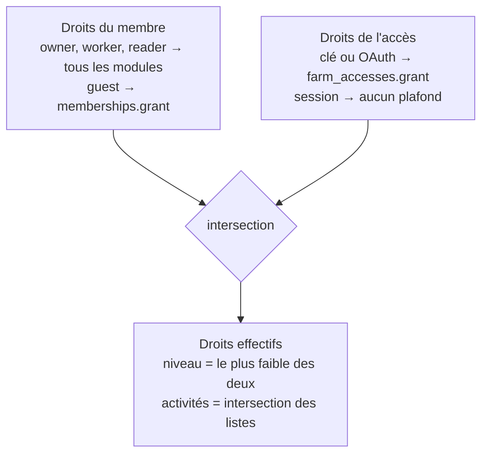
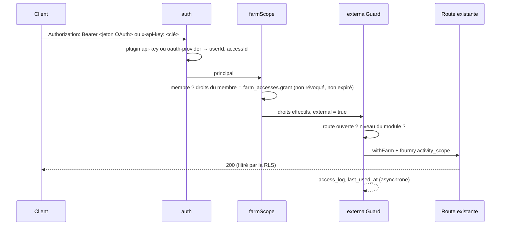
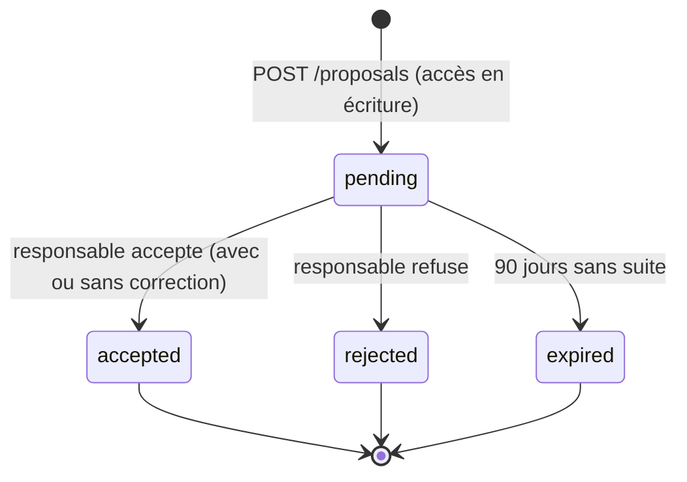

# API ouverte et serveur MCP — conception

*Conception du 27/11/2026, d'après `claudedocs/besoins_api_mcp.md` (B1 à B10, API-1 à API-28). Étape suivante : `/sc:workflow` (plan par lots). Corrigée le 27/11 après l'essai AM0 ([`essai_api_mcp.md`](essai_api_mcp.md) §3).*

## 1. Ce qui existe et ce qui contraint la conception

| Constat | Conséquence |
|---|---|
| **Authentification** : better-auth 1.7.12, avec la session par cookie du web et le plugin `bearer` signé du mobile (`apps/api/src/auth.ts`). | Les clés d'API et OAuth s'ajoutent comme des plugins better-auth. Les versions 1.7.12 de `@better-auth/api-key`, `@better-auth/oauth-provider` et `@better-auth/mcp` existent : **pas de montée de version** de better-auth. |
| **Droits** : `farmScope` lit `memberships.role` (`owner`, `worker`, `reader`). `reader` est refusé sur toute méthode autre que GET, sauf pour son propre profil. `requireOwner` protège certaines routes. | Le nouveau modèle doit garder ces trois rôles intacts (B8 : ils deviendront plus tard des profils prédéfinis). |
| **Cloisonnement** : la RLS de PostgreSQL. `withFarm` passe en `SET LOCAL ROLE fourmy_app` et pose `fourmy.farm_id`. On compte 99 tables avec RLS et des policies `farm_id = current_farm_id()`. | La RLS est le bon endroit pour le **scope d'activités** : une seule règle par table couvre les listes, les fiches, les totaux et les registres (API-10, API-11, NF-5). |
| **Routes** : toutes les routes métier sont montées sur `/` sous `/api/v1/farms/:farmId` (`routes/farm.ts`, environ 310 routes). | Un middleware par module risquerait de déborder sur les routes des autres modules. Il faut donc **une liste explicite** des routes ouvertes, avec leur module. |
| **Interventions** : leurs cibles (`intervention_parameters`, `role = 'target'`) sont des **parcelles** (`ref_type = 'land_parcel'`), des matériels ou des lieux, jamais des productions. Les statuts sont `planned`, `done` et `cancelled`. | Pour connaître l'activité d'une intervention, on passe de la parcelle ciblée à la production de cette parcelle sur la campagne qui couvre la date de l'intervention. |
| **Assolement** : `crop_plan_versions` garde des instantanés de l'assolement. | La RLS ne peut pas filtrer l'intérieur d'un instantané. L'assolement vu sous scope se recalcule à partir des productions (§5.4). |
| **OpenAPI** : le commentaire de `packages/contracts/src/api.ts` cite `@hono/zod-openapi`, mais ce paquet n'est pas installé et aucune route n'est décrite. | La documentation OpenAPI (issue #35) part de zéro. On la génère à partir de la liste des routes ouvertes (§6.3). |
| **Propositions** : le précédent est la boîte de réception agrirouter (`state = 'proposed'`), propre à ce fournisseur. | Les propositions des accès externes ont leur propre table, plus générale (§8). |

## 2. Vue d'ensemble

```mermaid
flowchart LR
  subgraph Clients
    W[Web / mobile Fourmy<br/>session]
    S[Script, intégrateur<br/>clé d'API]
    A[Assistant IA, Aiffel<br/>OAuth]
    C[Conseiller invité<br/>session ou OAuth]
  end
  subgraph API["apps/api (Hono)"]
    AU[auth<br/>session · clé · jeton OAuth]
    P[principal + droits effectifs]
    G[garde des routes ouvertes<br/>module × niveau]
    R[routes /api/v1 existantes]
    M[/mcp<br/>outils métier]
    PR[propositions<br/>lot 2]
    J[journal des appels]
  end
  DB[(PostgreSQL<br/>RLS ferme + scope d'activités)]
  W --> AU
  S --> AU
  A --> AU
  C --> AU
  A --> M
  AU --> P --> G --> R --> DB
  M -->|appel interne, même principal| G
  G --> J
  PR --> DB
```

**Les principes** :

1. **Un principal, des droits effectifs.** Chaque requête porte un principal : session, clé d'API ou jeton OAuth. On en tire les **droits effectifs** pour la ferme visée, qui sont l'intersection des droits du membre et de ceux de l'accès.
2. **Une liste de routes, refus par défaut.** Un principal externe n'atteint que les routes de la liste des routes ouvertes (§6.1). Toute autre route lui répond 404.
3. **La RLS porte le scope d'activités.** Le middleware pose `fourmy.activity_scope` dans la transaction, et des policies **restrictives** s'ajoutent à celles de la ferme.
4. **Le MCP est un client de l'API.** Un outil MCP appelle les routes de `/api/v1` en interne (`app.request`), avec le même principal. Il n'y a pas de seconde logique de droits.
5. **Aucune écriture externe directe.** En écriture, un principal externe ne fait que déposer des propositions (B6, B10). Les routes d'écriture existantes ne lui sont jamais ouvertes.

## 3. Le modèle de droits

### 3.1 Types (dans `packages/contracts`)

```ts
export const accessModules = [
  "farm", "parcels", "activities", "interventions", "phyto", "fertilization",
  "stocks", "equipments", "people", "economics", "certifications",
] as const;                                   // les 11 modules de besoins §1 (Q7)
export type AccessModule = (typeof accessModules)[number];
export type AccessLevel = "none" | "read" | "write";   // write = lecture + propositions

export type Grant = {
  modules: Partial<Record<AccessModule, AccessLevel>>; // absent = none
  activities: "all" | string[];                         // uuid des activités de la ferme
};
```

### 3.2 Calcul des droits effectifs



- **Membres existants.** `owner`, `worker` et `reader` gardent leur comportement actuel (`farmScope`, `requireOwner`) **sans changement**. Pour l'intersection, ils valent « tous les modules » : en écriture pour `owner` et `worker`, en lecture pour `reader`, et toutes les activités.
- **Nouveau rôle `guest`** (membre restreint, B7) : ses droits sont dans `memberships.grant`. Le passage de `owner`, `worker` et `reader` à des profils du même modèle (B8) est préparé par ce calcul, mais il est **hors de ce chantier** (issue #36).
- **Plafond (API-4).** Un accès créé par un utilisateur ne dépasse jamais les droits de ce membre. On les recalcule à **chaque requête** : un membre retiré coupe tous ses accès aussitôt (API-5b).
- **Q4.** Un `reader` ne peut créer ou consentir qu'un accès en lecture. C'est appliqué à la création, puis par l'intersection.
- **Un `guest` sur l'écran.** Ses droits s'appliquent au web comme à l'API. Dans ce chantier, il **lit seulement**. S'il a « écriture » sur un module, il peut seulement déposer des propositions, comme un accès externe : cela découle de B6 et B10, et lui ouvrir l'écriture directe se décidera avec #36.

### 3.3 Contexte de requête

`Env.Variables` (`apps/api/src/context.ts`) s'enrichit, sans rien changer pour les routes actuelles :

```ts
principal: { kind: "session" | "api_key" | "oauth"; userId: string; accessId: string | null; clientId: string | null };
grant: EffectiveGrant;          // calculé par farmScope
external: boolean;              // kind !== "session" || role === "guest"
```

## 4. Données

```sql
-- Membre restreint (B7) et son invitation.
ALTER TABLE memberships        ADD COLUMN grant jsonb;   -- non NULL si role = 'guest'
ALTER TABLE person_invitations ADD COLUMN grant jsonb;   -- recopié dans memberships à l'acceptation

-- Un accès externe à une ferme : clé d'API ou consentement OAuth (API-1, API-26).
CREATE TABLE farm_accesses (
  id            uuid PRIMARY KEY,
  farm_id       uuid NOT NULL REFERENCES farms(id) ON DELETE CASCADE,
  kind          text NOT NULL CHECK (kind IN ('api_key', 'oauth')),
  name          text NOT NULL,                 -- « Export compta », ou nom de l'application OAuth
  user_id       uuid NOT NULL REFERENCES users(id) ON DELETE CASCADE, -- auteur ou consentant
  api_key_id    text,                          -- table du plugin api-key
  oauth_client_id text,                        -- client du plugin oauth-provider
  grant         jsonb NOT NULL,
  expires_at    timestamptz,
  revoked_at    timestamptz,
  last_used_at  timestamptz,
  created_at    timestamptz NOT NULL DEFAULT now(),
  UNIQUE (farm_id, oauth_client_id, user_id)   -- un consentement par client, utilisateur et ferme
);

-- Journal des appels externes (API-27), purgé à 90 jours par le worker (Q6).
CREATE TABLE access_log (
  id          bigserial PRIMARY KEY,
  farm_id     uuid NOT NULL,
  access_id   uuid,                 -- NULL pour un guest en session
  user_id     uuid NOT NULL,
  at          timestamptz NOT NULL DEFAULT now(),
  channel     text NOT NULL,        -- 'rest' | 'mcp'
  operation   text NOT NULL,        -- 'GET /interventions' ou 'mcp:interventions_periode'
  status      int NOT NULL,
  duration_ms int,
  written     jsonb                 -- propositions créées (lot 2)
);
CREATE INDEX ON access_log (farm_id, at DESC);

-- Propositions des accès externes (lot 2, §8).
CREATE TABLE external_proposals ( ... );
```

- **RLS.** Ces tables sont soumises à la RLS par ferme, comme les autres. `farm_accesses` et `access_log` sont lisibles par un `owner` seulement. Dans ce chantier, ils sont gérés par des routes sous `requireOwner` (et lisibles par le créateur pour ses propres accès, Q4).
- **Tables du plugin api-key.** La clé hachée, son préfixe et son expiration vivent dans la table du plugin, en snake_case comme les tables `auth_*`. `farm_accesses` porte la ferme et les droits. Le même principe vaut pour les clients et jetons OAuth.

## 5. Le scope d'activités dans la RLS

### 5.1 Mécanisme

- `withFarm` pose en plus `fourmy.activity_scope` : la liste des uuid des activités autorisées, ou une chaîne vide pour « toutes ». La valeur vient des droits effectifs, posés par `farmScope`, et passe par un `AsyncLocalStorage` pour ne pas modifier les quelque 300 appels à `withFarm`.
- Fonction `current_activity_scope() RETURNS uuid[]` : elle vaut `NULL` quand il n'y a pas de scope. C'est le cas du web habituel, où chaque policy se réduit alors à `NULL IS NULL`.
- Les policies **restrictives** (`AS RESTRICTIVE`) s'ajoutent aux policies par ferme. Elles ne peuvent que retirer des lignes.
- **En lecture seulement** (`FOR SELECT`, réalisé en AM2). Les écritures d'un accès restreint sont refusées par la garde ; les caches écrits pendant une lecture (trajets OSRM, indices) restent possibles.
- **Calcul par ensemble** (réalisé en AM2). Les policies appellent `fourmy_scope_parcels()` et `fourmy_scope_targets()`, des fonctions `SECURITY DEFINER` qui renvoient les parcelles et les couples (intervention, parcelle) visibles. Elles le font en sous-requête non corrélée (`id IN (SELECT …)`), que PostgreSQL ne calcule qu'une fois par requête. Une fonction appelée à chaque ligne faisait passer le registre phyto de 45 ms à 900 ms sur la ferme de l'exploitant testeur.

```sql
CREATE POLICY activity_scope ON productions AS RESTRICTIVE FOR SELECT
  USING (current_activity_scope() IS NULL OR activity_id = ANY (current_activity_scope()));
```

### 5.2 Règles par table

| Tables | Visible sous scope si… |
|---|---|
| `activities`, `technical_itineraries`, `prices` (avec `activity_id`) | l'activité est dans le scope ; les prix sans activité restent visibles (API-9) |
| `productions` | `activity_id` est dans le scope |
| `land_parcels`, `land_parcel_versions` | la parcelle porte une production du scope, **toutes campagnes confondues** (voir l'écart ci-dessous) |
| Tables avec `land_parcel_id` : `cover_crops`, `fertilization_plans`, `parcel_certifications`, `parcel_nitrate_zones`, `parcel_references`, `parcel_rows`, `parcel_soils`, `prescriptions`, `remote_sensing_dismissals`, `soil_analyses` | la parcelle est visible ; pour `fertilization_plans`, la production aussi |
| `interventions` | au moins une cible `land_parcel` porte, **sur la campagne qui couvre la date de l'intervention**, une production du scope ; une intervention sans cible parcelle est invisible (Q2) |
| `intervention_parameters` | l'intervention est visible, et pour une cible `land_parcel`, la parcelle est dans le scope à cette date ; les intrants, matériels et intervenants d'une intervention visible restent visibles |
| `intervention_periods`, `intervention_crews` et les autres tables avec `intervention_id` | l'intervention est visible |
| `crop_plans`, `crop_plan_versions` | invisibles sous scope restreint ; la vue d'assolement est recalculée à partir des productions (§5.4) |

- **Écart avec API-7, validé le 27/11.** La RLS ne sait pas quelle campagne l'écran consulte. Une parcelle est donc visible dès qu'elle a porté une activité du scope, **quelle que soit la campagne**. Les productions des autres activités restent cachées, mais leur forme et leurs références sont visibles. Exemple : une ancienne vigne arrachée et passée en céréales reste visible pour un accès « Vigne », sans rien de ses céréales.
- **Refus par défaut.** Un test d'intégration parcourt `information_schema`. Toute table qui a une colonne `land_parcel_id`, `production_id`, `activity_id` ou `intervention_id` sans policy `activity_scope` le fait échouer. Une table ajoutée plus tard ne peut donc pas laisser fuir des données.
- **Performance (NF-3).** Les policies d'interventions passent par la fonction `STABLE` `fourmy_intervention_in_scope(id)`, appuyée sur les index `intervention_parameters (intervention_id, role)`, `productions (land_parcel_id, campaign_id)` et `campaigns (farm_id, starts_on, stops_on)`. Sans scope, la condition `current_activity_scope() IS NULL` court-circuite tout. Mesure attendue : la liste des interventions de la ferme de Pierre sous scope, en moins de 300 ms.

### 5.3 Intervention mixte (B5)

- La RLS cache les cibles hors scope. Les **intrants** et les **totaux** de l'intervention restent pourtant ceux de l'intervention entière. La route `GET /interventions/:id`, et la liste, appliquent donc un **prorata** quand un scope est posé.
- La fonction `SECURITY DEFINER` `fourmy_intervention_scope_share(intervention_id)` renvoie la part visible : surface travaillée des cibles visibles divisée par la surface travaillée totale. Elle **ne renvoie que ce nombre**, rien des cibles cachées.
- Le repo multiplie les quantités d'intrants par cette part et ajoute `shared: true` à la réponse, affiché « intervention partagée avec d'autres cultures ».
- L'IFT reste celui de l'intervention : c'est une dose par hectare, que le prorata ne change pas.
- Les contrôles d'une intervention partagée sont réduits (réalisé en AM2) :
  - les indicateurs phyto qui peuvent citer une parcelle (ZNT, délai avant récolte, rentrée) gardent leur niveau, mais leur message est remplacé par « Détail non disponible : intervention partagée avec d'autres cultures » ;
  - les contrôles nitrates et HVE/AB, calculés parcelle par parcelle, sont retirés.
- La fonction `fourmy_input_applicators`, appelée à chaque ligne du registre phyto, devient `SECURITY DEFINER`, bornée à la ferme courante.

### 5.4 Ce qui reste du ressort des repos

- **L'assolement sous scope** (`GET /crop-plans/:year`) : sans instantané, il se reconstruit à partir des productions visibles, et ses totaux se recalculent sur ce périmètre.
- **Stocks, matériels, personnes, prix** : aucun scope (API-9). Un mouvement de stock lié à une intervention cachée reste visible dans le module Stocks. C'est conforme à API-9, mais il faut le savoir.

## 6. API REST

### 6.1 Liste des routes ouvertes

Le fichier `apps/api/src/external/routes.ts` est **la** liste des routes accessibles à un principal externe :

```ts
type OpenRoute = {
  method: "GET";                     // lot 1 : lecture seulement
  path: string;                      // motif Hono relatif à /api/v1/farms/:farmId
  module: AccessModule;
  summary: string;                   // pour OpenAPI et le journal
  query?: ZodType; response: ZodType; // schémas de packages/contracts
};
```

- **La garde `externalGuard`** (après `farmScope`) s'applique dès que `external` est vrai :
  - si la route n'est pas dans la liste, elle répond **404** (API-6, API-11) ;
  - si le niveau du module est `none`, elle répond **403**, avec un message qui nomme le module.
- **Le lot 1 ouvre en lecture** les routes de consultation des 11 modules, soit une cinquantaine de routes à recenser au lot 1 :
  - parcellaire et fiche de parcelle ;
  - activités et assolement ;
  - interventions et interventions prévues ;
  - registre phyto et contrôles ;
  - fertilisation ;
  - stocks et semences ;
  - matériels ;
  - personnes ;
  - prix et marges ;
  - certifications et contrôles.
- **Jamais ouvertes** : les routes de membres, invitations, intégrations, agrirouter, imports, synchronisation, `me`, ainsi que les images et exports lourds (3D, tuiles), qui ne sont pas utiles à un client externe.
- **Ajouts d'AM3, pour le web d'un invité restreint** :
  - `/snapshot` est ouvert avec le module Parcellaire, mais les matériels, cuves et lieux en sont retirés si leur module est fermé ;
  - `/ign/tiles/…` est ouvert, puisque ce sont des fonds de carte publics relayés par la ferme. Sans eux, la carte reste vide.
- **Test de couverture.** Chaque entrée de la liste correspond à une route réelle de l'application (`app.routes`). Chaque route GET de l'application est soit dans la liste, soit explicitement marquée « fermée ». Une nouvelle route oblige donc à choisir.

### 6.2 Authentification d'un appel externe



- **Clé d'API.** Elle arrive par l'en-tête `x-api-key` (ou par `Authorization: Bearer fmy_…`, que l'on reconnaît à son préfixe). Elle est **liée à une ferme** par `farm_accesses`. Un appel vers une autre ferme répond 403.
- **Jeton OAuth.** Il est vérifié par le plugin oauth-provider. Il donne l'utilisateur et le client ; `farm_accesses (farm_id, oauth_client_id, user_id)` donne les droits. Sans ligne pour la ferme demandée, la réponse est 403.
- **Ce qu'a fixé AM4** :
  - **Rôle vu des routes.** Un accès externe est vu des routes comme un invité restreint (`role = "guest"`). Il n'a jamais les privilèges du responsable, même si c'est le responsable qui l'a créé : pas de données privées des personnes, pas de route réservée.
  - **Périmètre d'une clé.** Une clé n'ouvre que les routes `/api/v1/farms/:farmId/…`. « Mes fermes » et le compte lui répondent 403.
  - **Ordre des middlewares.** Le journal et le débit passent **avant** la garde, pour que les refus soient aussi comptés et notés.
  - **Début de la clé.** `farm_accesses.key_start` garde les premiers caractères de la clé pour l'affichage, car le rôle applicatif ne lit pas la table des clés.
- **Débit (NF-2).** Un compteur en mémoire par accès, 120 requêtes par minute et 10 000 par jour, avec 429 et `Retry-After`. L'API tourne en une seule instance sur Dokploy. Avec plusieurs instances, il faudra un compteur dans PostgreSQL.

### 6.3 Documentation OpenAPI (API-13)

- `GET /api/v1/openapi.json` est généré à partir de la liste des routes ouvertes (`z.toJSONSchema` de zod 4) : chemins, paramètres, schémas de réponse, module et niveau requis (`x-fourmy-module`), et sécurité (`apiKey`, `oauth2`).
- Une page de référence est servie par le web (`/developpeurs`).
- Les schémas de réponse qui manquent dans `packages/contracts` sont à écrire pour les routes ouvertes. C'est le gros du travail de documentation, et il fait aussi avancer l'issue #35.

## 7. OAuth et serveur MCP

### 7.1 Serveur d'autorisation (API-19 à API-21)

- Le plugin `@better-auth/oauth-provider` 1.7.12 sur la même instance better-auth. Il gère :
  - l'autorisation par code, avec PKCE obligatoire ;
  - les jetons de rafraîchissement ;
  - l'enregistrement dynamique des clients, et les Client ID Metadata Documents (`@better-auth/cimd`, profil MCP 2026-07-28), avec un fetch sortant encadré : HTTPS seulement, taille et délai limités, pas d'adresse privée ;
  - les métadonnées `/.well-known/oauth-authorization-server`.
- **Scopes OAuth grossiers** : `fourmy:read` et `fourmy:write`. Le détail (ferme, modules, activités) **ne passe pas par les scopes** : il se choisit sur l'écran de consentement et se range dans `farm_accesses`.
- **Choix de la ferme** (web, `/oauth/ferme`). C'est l'étape `postLogin` du plugin : la ferme choisie est rangée dans `auth_sessions.active_farm_id`, devient la référence du consentement (`consentReferenceId`) et revient dans le jeton sous la revendication `fourmy_farm` (essai AM0).
- **Écran de consentement** (web, `/oauth/consentement`). L'utilisateur y voit l'application, puis choisit :
  - la ferme ;
  - les modules et leurs niveaux, préremplis à partir du scope et plafonnés par son propre rôle ;
  - les activités.

  À la validation, l'API écrit `farm_accesses` puis accepte le consentement auprès du plugin. **Un consentement donne accès à une seule ferme.** Pour une autre ferme, il faut consentir à nouveau ; le jeton sert alors pour toutes les fermes consenties.
- **Aiffel et les services maison** (API-21) sont des clients déclarés d'avance par configuration. Ils passent par le même écran de consentement.
- **Conseiller invité** (B7) : il consent avec son propre compte. Ses droits de `guest` plafonnent ce consentement.

### 7.2 Serveur MCP (API-15 à API-17)

- Route `POST /mcp` en **Streamable HTTP sans état**, avec `@modelcontextprotocol/sdk` (version 1.32.2, compatible avec zod 4). Elle est montée dans Hono et protégée par le même `auth`.
- `@better-auth/mcp` est retenu. Il lie les jetons à l'audience `/mcp` et sert `/.well-known/oauth-protected-resource/mcp` à la racine du site, où `/.well-known/*` est routé vers better-auth.
- `requireMcpAuth` est écarté, car il va chercher les clés de signature par HTTP sur sa propre URL. On vérifie le jeton localement avec `jose` (`jwtVerify` sur les clés lues par `auth.api.getJwks()`), et on produit nous-mêmes le `WWW-Authenticate`.
- **Un outil = une fonction qui appelle `/api/v1` en interne.** Chaque appel passe par `app.request` avec le principal courant. Les droits, la RLS, le prorata et le journal s'appliquent donc sans rien écrire de plus. Chaque outil déclare son module, et `tools/list` ne renvoie que les outils permis (API-16).
- **Ferme.** L'outil `fermes` liste les fermes accessibles. Les autres outils prennent `ferme` en option, par défaut la seule ferme consentie, et sinon renvoient une erreur claire.

**Outils du lot 1 (lecture)** :

| Outil | Module | Appuyé sur |
|---|---|---|
| `fermes` | — | `farm_accesses` du principal |
| `parcelles` (recherche par nom, îlot, culture) | parcels | `GET /land-parcels` |
| `fiche_parcelle` | parcels | `GET /land-parcels/:id/sheet` |
| `interventions_periode` (dates, parcelle, activité, type) | interventions | `GET /interventions` |
| `detail_intervention` | interventions | `GET /interventions/:id` |
| `interventions_prevues` | interventions | `GET /planned-interventions` |
| `registre_phyto` (campagne) | phyto | `GET /registers/…` |
| `assolement` (campagne) | activities | `GET /crop-plans/:year` |
| `activites` | activities | `GET /activities` |
| `stock` (article ou famille) | stocks | `GET /inventory…` |
| `materiels` | equipments | `GET /equipments` |
| `marges` (campagne) | economics | `GET /crop-plans/:year` (onglet économique) |
| `controles_certification` | certifications | `GET /control…` |

- **Format (API-17).** Le texte est en français et chaque valeur porte son unité. Les listes font au plus 50 éléments, avec un curseur. Un résumé en tête aide l'assistant (« 12 interventions du 20 au 27/11 sur 8 parcelles »), suivi des données en JSON structuré (`structuredContent`).
- **Lot 2** : `proposer_intervention` et `etat_propositions` (§8).

## 8. Propositions (lot 2, B6, B9)



```sql
CREATE TABLE external_proposals (
  id           uuid PRIMARY KEY,
  farm_id      uuid NOT NULL REFERENCES farms(id) ON DELETE CASCADE,
  access_id    uuid REFERENCES farm_accesses(id) ON DELETE SET NULL,
  user_id      uuid NOT NULL,
  kind         text NOT NULL CHECK (kind IN ('intervention')),   -- puis 'stock_entry'…
  payload      jsonb NOT NULL,   -- même contrat que POST /interventions
  message      text,             -- ce que le client explique (« dicté le 27/11 à 8 h »)
  checks       jsonb,            -- contrôles au dépôt : phyto, ZNT, feux, IFT
  status       text NOT NULL DEFAULT 'pending',
  decided_by   uuid, decided_at timestamptz, decision_note text,
  result_id    uuid,             -- intervention créée
  created_at   timestamptz NOT NULL DEFAULT now()
);
```

- **Dépôt** (`POST /proposals`, outil `proposer_intervention`) :
  - le corps est validé par le contrat de `POST /interventions` ;
  - les cibles doivent être dans le scope (API-24) ;
  - les contrôles sont faits **à blanc**, sans rien écrire, et leur résultat est renvoyé tout de suite (API-22). Ils existent déjà : `checkComplianceFor` (phyto et ZNT), la vérification nitrates et le contrôle HVE et AB, derrière `/phyto/check`, `/fertilization/check` et `/control/check`.
  - L'IFT, calculé par le worker après la réalisation, est calculé à l'acceptation.
- **Validation (web).** Une liste « À valider » apparaît, avec un compteur dans la navigation.
  - Le formulaire d'intervention s'ouvre prérempli avec la proposition. Le responsable corrige et enregistre : l'intervention est créée par le chemin habituel, avec `origin = 'api'` ou `'mcp'`, les contrôles refaits, le registre et les stocks.
  - La proposition passe en `accepted` avec `result_id`.
  - Seul un `owner` peut accepter (B9).
- **Suivi** par `GET /proposals?mine=1` et l'outil `etat_propositions` (API-23b).
- **Purge** à 90 jours par le worker (API-23c).

## 9. Écrans du web

| Écran | Contenu |
|---|---|
| **Ferme → Accès externes** (owner) | Les clés et les applications OAuth, avec leurs droits, leur auteur, leur dernière utilisation et leur expiration. On peut créer une clé (affichée une seule fois), modifier ses droits ou la révoquer. On y consulte aussi le journal, filtrable par accès et par date. |
| **Mon compte → Mes accès** (tout membre) | Les accès que j'ai créés ou consentis, toutes fermes confondues. Un `reader` peut y créer une clé en lecture (Q4). |
| **Inviter** (owner) | Le rôle « Invité restreint » ouvre l'éditeur de droits (modules et activités). |
| **Éditeur de droits** (composant partagé) | Un tableau des 11 modules avec trois choix (aucun, lecture, écriture), puis « toutes les activités » ou des cases à cocher. Il sert à la clé, au consentement et à l'invitation. |
| **Consentement OAuth** | Voir §7.1. |
| **Navigation d'un guest** | Les menus des modules sans droit sont masqués. `GET /me/farms` renvoie les droits effectifs, et non plus seulement le rôle. |
| **À valider** (lot 2) | Voir §8. |
| **Développeurs** | La référence OpenAPI, la page « Connecter un assistant » (URL `https://<instance>/mcp`) et des exemples de clé. |

## 10. Sécurité

- Les clés sont hachées par le plugin et préfixées `fmy_` pour être repérées par les scanners de secrets. Une clé n'est montrée qu'une fois.
- Les jetons d'accès OAuth valent une heure et se renouvellent par rafraîchissement. La révocation dans `farm_accesses` prend effet **à la requête suivante**, car les droits sont relus à chaque appel.
- Sous scope, un objet caché répond 404, jamais 403 (API-11) : la RLS renvoie zéro ligne, et la route répond déjà `NotFound`.
- **CSRF.** Les principaux externes n'utilisent pas de cookie. Le contrôle d'origine de better-auth reste actif pour les sessions.
- Les e-mails à l'exploitant (API-28) partent à la création d'une clé en écriture et au premier consentement d'une application.
- **Auto-hébergement (NF-4).** Tout est dans l'API : better-auth, ses plugins et le SDK MCP. Il n'y a aucun service externe.

## 11. Tests

- **Matrice de droits.** Pour chaque route ouverte : sans droit → 403, module `none` → 403, lecture → 200. Toute route non ouverte → 404 pour un principal externe.
- **Scope (NF-5).** La ferme de test a deux activités, Vigne et Blé, et une intervention mixte. Un accès « Vigne » ne voit :
  - aucune parcelle, production ou intervention de blé ;
  - ni en liste, ni par identifiant (404), ni dans le registre, l'assolement ou les marges.

  L'intervention mixte apparaît au prorata, avec `shared: true`.
- **Couverture RLS.** Le test `information_schema` du §5.2.
- **Couverture des routes.** Le test du §6.1.
- **OAuth.** Le parcours complet avec un client de test : enregistrement dynamique, PKCE, consentement, jeton, appel, révocation, puis 401 ou 403.
- **MCP.** Le client du SDK en mémoire : `tools/list` filtré selon les droits, et chaque outil appelé sur la ferme de test.
- **Non-régression.** La suite actuelle (442 tests) doit passer sans modification, puisque rien ne change pour une session sans scope.

## 12. Découpage proposé (pour `/sc:workflow`)

| Lot | Contenu | Dépend de |
|---|---|---|
| **AM0** | Essai technique : les plugins api-key, oauth-provider et mcp en 1.7.12 avec nos tables en snake_case et Hono ; le SDK MCP en Streamable HTTP ; un connecteur MCP réel sur dev.fourmy.org ; le contrôle phyto à blanc. | — |
| **AM1** | Modèle de droits : types, droits effectifs, liste des routes ouvertes, `externalGuard`, tests de couverture et matrice. | AM0 |
| **AM2** | Scope d'activités : `fourmy.activity_scope`, policies restrictives, prorata, assolement recalculé, tests du scope. | AM1 |
| **AM3** | Membre restreint : `guest`, invitation avec droits, éditeur de droits, navigation filtrée. | AM1, AM2 |
| **AM4** | Clés d'API : `farm_accesses`, écran « Accès externes », journal, limitation de débit, purge. | AM1 |
| **AM5** | OAuth : serveur d'autorisation, écran de consentement, clients déclarés d'avance. | AM4 |
| **AM6** | Serveur MCP : `/mcp`, outils du lot 1, page « Connecter un assistant ». | AM5 |
| **AM7** | OpenAPI : schémas manquants, `openapi.json`, page « Développeurs ». | AM1 |
| **AM8** | Lot 2 : propositions, contrôles à blanc, « À valider », outils MCP d'écriture. | AM6 |

## 13. Points validés le 27/11/2026

1. **Visibilité d'une parcelle sous scope, toutes campagnes confondues** (§5.2). C'est un écart avec API-7, qui parle de la campagne consultée. La solution exacte demanderait de passer la campagne à chaque requête de parcellaire.
2. **Un `guest` en « écriture » ne fait que déposer des propositions** (§3.2), jusqu'à la décision sur #36.
3. **Un consentement OAuth donne accès à une seule ferme** (§7.1). Pour plusieurs fermes, on consent plusieurs fois.
4. **Mouvements de stock visibles même si leur intervention est cachée** (§5.4, conforme à API-9).
