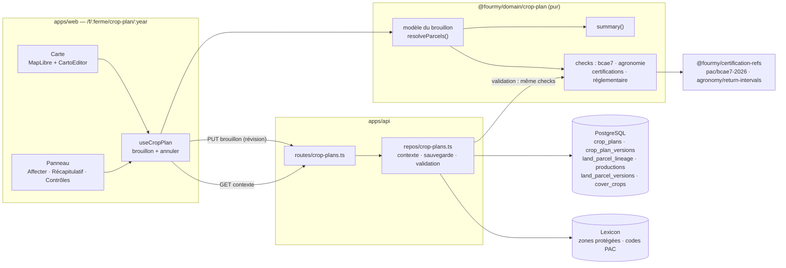

# Assolement prévisionnel — conception (temps 1)

*Conception du 20/11/2026, à partir de [`besoins_assolement.md`](besoins_assolement.md) (FR-AS-1 à 13, décisions A1 à A12). Les temps 2 (itinéraires) et 3 (économique) ne sont pas conçus ici ; le §9 dit seulement ce que le temps 1 leur réserve. Étape suivante : `/sc:workflow` (plan en lots).*

## 1. Principes

| # | Principe | Pourquoi |
|---|---|---|
| C1 | **Le brouillon est un document**, pas des lignes en base : `crop_plans.draft` (jsonb), sauvegardé au fil de l'eau, comme le brouillon du plan de fumure (`fertilization_plans.draft`). Rien d'autre ne bouge avant la validation. | NFR-AS-3 : les productions, parcelles et contrôles des autres modules restent intacts. |
| C2 | **La validation applique le brouillon en une transaction** : parcelles découpées ou fusionnées, productions, couverts ; puis une **version figée** (`crop_plan_versions`) garde l'état validé et la liste des changements. | FR-AS-10 à 12 ; même modèle que les versions établies du plan de fumure. |
| C3 | **Contrôles calculés dans le navigateur** par des fonctions pures de `@fourmy/domain`, sur le brouillon et un **contexte** chargé une fois (historique, zones, référentiels) ; le serveur refait le même calcul à la validation. | NFR-AS-2 (moins d'une seconde après un geste, sans aller-retour) ; un seul code pour le web et l'API, comme le contrôle phyto. |
| C4 | **Constats au format existant** (`ControlFinding` : niveau, message, parcelles, règle, source), donc mêmes feux et mêmes composants que les contrôles HVE et AB ; « données manquantes » n'est jamais vert. | Cohérence ; NFR-AS-6. |
| C5 | **Parcelles datées** (A2) : une découpe ferme la version de la parcelle d'origine à une **date d'effet** et crée de nouvelles parcelles valides à partir de cette date ; une **filiation** relie enfants et parents pour l'historique. | Campagnes passées intactes (NFR-AS-4) ; rotation et conversion AB suivent la surface. |
| C6 | **Référentiels versionnés** dans `@fourmy/certification-refs` (BCAE 7 2026, repères agronomiques) avec leur source ; jamais de valeur sans source. | NFR-AS-6. |

## 2. Vue d'ensemble



## 3. Données

### 3.1 Nouvelles tables (migration 0071)

```sql
-- Un assolement par ferme et par campagne (année de récolte, A5).
CREATE TABLE crop_plans (
  id              uuid PRIMARY KEY,
  farm_id         uuid NOT NULL REFERENCES farms(id),
  campaign_id     uuid NOT NULL REFERENCES campaigns(id),
  status          text NOT NULL CHECK (status IN ('draft', 'validated')),
  draft           jsonb,               -- CropPlanDraft (§3.3) ; null quand validé et non rouvert
  revision        integer NOT NULL DEFAULT 0,  -- concurrence optimiste de la sauvegarde
  current_version integer,             -- dernière version validée
  created_at, updated_at, updated_by uuid,
  UNIQUE (farm_id, campaign_id)
);

-- Versions validées, figées.
CREATE TABLE crop_plan_versions (
  plan_id      uuid REFERENCES crop_plans(id) ON DELETE CASCADE,
  version      integer,
  farm_id      uuid NOT NULL,
  validated_at timestamptz NOT NULL,
  validated_by uuid NOT NULL,
  reason       text,                   -- motif d'une révision (« colza gelé »)
  snapshot     jsonb NOT NULL,         -- brouillon validé, ids réels (§3.3)
  changes      jsonb NOT NULL,         -- CropPlanChange[] appliqués (§5.2)
  findings     jsonb NOT NULL,         -- constats au moment de la validation
  refs_version text NOT NULL,          -- REFS_VERSION de certification-refs
  PRIMARY KEY (plan_id, version)
);

-- Filiation des parcelles découpées ou fusionnées (C5).
CREATE TABLE land_parcel_lineage (
  child_id     uuid REFERENCES land_parcels(id),
  parent_id    uuid REFERENCES land_parcels(id),
  farm_id      uuid NOT NULL,
  kind         text NOT NULL CHECK (kind IN ('split', 'merge')),
  effective_at timestamptz NOT NULL,   -- début de validité de l'enfant = fin de la version du parent
  share        numeric NOT NULL,       -- part de la surface de l'enfant venue de ce parent (0 à 1)
  plan_id      uuid REFERENCES crop_plans(id),
  PRIMARY KEY (child_id, parent_id)
);
```

RLS par `farm_id` comme les autres tables (`withFarm`).

### 3.2 Tables existantes touchées à la validation

| Table | Effet |
|---|---|
| `campaigns` | créée si absente (dates du 1er janvier au 31 décembre de l'année de récolte, comme aujourd'hui). |
| `land_parcels`, `land_parcel_versions` | découpe ou fusion : `upper(valid)` du parent fixé à la date d'effet ; enfants créés avec `valid = [date d'effet, ∞)`. |
| `productions` | créées, modifiées (activité, dates, rôle) ou supprimées pour la campagne ; `attrs.cropPlan = { version, role }`. |
| `cover_crops` | couverts d'interculture saisis dans l'assolement (A7), même convention de campagne que le cahier de fertilisation. |
| `parcel_certifications` | copiées du parent vers les enfants (même période) ; fusion de parcelles de statuts différents : bloquant (§6). |
| `parcel_nitrate_zones`, eau, références | recalculées pour les enfants par les mécanismes existants (création de parcelle). |

### 3.3 Le brouillon (`packages/domain/src/crop-plan/model.ts`)

```ts
/** Clé d'une parcelle dans le brouillon : existante ou nouvelle (morceau). */
type ParcelKey = `p:${string}` /* land_parcel_id */ | `n:${string}` /* id provisoire */;

interface CropPlanDraft {
  schema: 1;
  year: number;                         // année de récolte
  /** Découpes et fusions, dans l'ordre ; rejouées pour obtenir le parcellaire. */
  operations: ParcelOperation[];
  /** Cultures prévues par parcelle du parcellaire résolu. */
  assignments: Assignment[];
  /** Parcelles volontairement sans culture (jachère, gel, SNE). */
  fallow: { key: ParcelKey; capCode?: string }[];
}

type ParcelOperation =
  | { kind: "split"; source: ParcelKey; pieces: { key: `n:${string}`; name: string; shape: Polygon }[]; effectiveOn: string }
  | { kind: "merge"; sources: ParcelKey[]; result: { key: `n:${string}`; name: string; shape: Polygon }; effectiveOn: string };

interface Assignment {
  id: string;                           // stable dans le brouillon
  key: ParcelKey;
  role: "main" | "secondary";           // culture principale, dérobée
  activityId: string;
  startedOn: string | null;             // dates théoriques (semis → récolte)
  stoppedOn: string | null;
  productionId?: string;                // production existante reprise (révision, import)
  // Réservé aux temps 2 et 3 (§9), absent au temps 1 :
  itineraryId?: string;
  forecasts?: { product: string; yield: number; unit: string; price?: number; currency?: "EUR" }[];
}

/** Couverts d'interculture saisis dans l'assolement (A7). */
interface CoverAssignment { id: string; key: ParcelKey; species: string[]; sownOn: string | null; destroyedOn: string | null; kind: "sown" | "regrowth"; }
```

`resolveParcels(base, draft)` rejoue les opérations sur le parcellaire de base et rend la liste des parcelles du brouillon (clé, nom, surface, parcelles d'origine et parts). Toutes les vues (carte, récapitulatif, contrôles) partent de là. Chaque morceau porte sa surface géodésique, calculée au dessin par `@fourmy/carto` et recalculée par PostGIS à la validation : le domaine reste sans géométrie (écart AS1a).

Point de départ (FR-AS-2) : parcellaire valide au **début de la campagne** (veille de la date d'effet par défaut) ; affectations reprises des productions déjà saisies pour l'année (imports, saisie), avec leur `productionId`.

### 3.4 Date d'effet d'une découpe ou d'une fusion

Une culture d'hiver de la campagne 2027 se sème en 2026 (A5) : la nouvelle parcelle doit exister dès le semis.

- **Par défaut** : le lendemain de la dernière fin de production (`stopped_on`) de la parcelle d'origine sur la campagne précédente ; à défaut, le 1er août de l'année précédente pour une culture d'hiver affectée, sinon le 1er janvier de l'année de récolte.
- **Modifiable** dans le panneau de découpe.
- **Contraintes** vérifiées dans le navigateur puis à la validation : pas avant la fin d'une production de la campagne précédente sur la parcelle d'origine ; aucune intervention réalisée sur la parcelle d'origine après la date d'effet (bloquant) ; interventions **prévues** après la date d'effet listées pour être reportées sur un morceau.

## 4. Contrôles (`packages/domain/src/crop-plan/checks/`)

Entrée commune : `CropPlanCheckInput = { parcels: ResolvedParcel[]; assignments; covers; context: CropPlanContext; settings }`. Sortie : `ControlFinding[]` avec `parcelKeys` pour la carte.

### 4.1 Contexte (`GET …/context`, chargé une fois)

| Élément | Source |
|---|---|
| Historique de chaque parcelle de base sur 5 campagnes (Y-5 à Y-1) : cultures principales et secondaires, code PAC, espèce, famille | `productions` (code PAC de `attrs.capCode` des imports TelePAC, sinon d'après l'activité : `lexicon_cap_codes` par production de référence), `parcel_references` TelePAC, filiation (§4.6) |
| Activités : famille, espèce, cycle (hiver, printemps, pérenne), code PAC, catégorie BCAE 7 | `activities`, Lexicon, `certification-refs/pac` |
| Certifications des parcelles et statut AB prévu à la récolte | `parcel_certifications`, `abParcelStatuses` |
| Zones : part de chaque parcelle de base en aire de captage et en Natura 2000 ; distance aux points d'eau (ZNT) | jeux Lexicon `protected_water_zones` et `protected_natural_zones` (à ajouter à la synchronisation), `water_items` |
| Réglages et exemptions | réglages assolement de la ferme (§4.7), SAU, part de terres arables, statut AB de la ferme |

Les morceaux issus d'une découpe n'ont pas de zones précalculées : `POST …/geometry` (§5) les calcule pour les nouvelles formes, au fil de l'eau.

### 4.2 PAC — BCAE 7 (`checks/bcae7.ts`, A6)

Référentiel `certification-refs/src/pac/bcae7-2026.ts` extrait de la fiche de conditionnalité 2026 : catégories de culture (annexes 3 et 4, par code PAC), cultures exclues (annexe 1), herbe et légumineuses (annexe 2), barème de diversification (annexe 5), seuils.

- **Exemptions** : ferme AB (toutes ses terres arables certifiées), terres arables ≤ 10 ha, plus de 75 % d'herbe, légumineuses ou jachère, plus de 75 % de prairies ; SAU < 30 ha : pas de contrôle en 2026 (constat d'information).
- **Rotation, critère annuel** : part des terres arables cultivées où la catégorie de la culture principale Y diffère de celle de Y-1, ou qui porte une culture secondaire différente des deux principales ; seuil 35 %.
- **Rotation, critère pluriannuel** : par parcelle, au moins deux catégories différentes sur Y-3 à Y, ou une culture secondaire chaque année ; années non déclarées ou SNE réputées respectées (règle de la fiche).
- **Diversification** : points d'après le nombre de cultures et leurs parts (annexe 5).
- **Verdict** : « BCAE 7 respectée par la rotation », « par la diversification », ou les deux en échec (rouge) ; les parcelles en cause sont données pour le critère pluriannuel.

### 4.3 Agronomie (`checks/agronomy.ts`, A8)

Référentiel `certification-refs/src/agronomy/return-intervals.ts` : délai de retour minimal par espèce ou famille, successions déconseillées (précédent → culture), chaque valeur avec sa page Triple Performance. Constitué à la main (les pages sont du texte libre, besoins §9) et relu ; valeurs par défaut que la ferme peut changer dans ses réglages.

Constats (orange) : retour trop rapide (« Colza : retour en 2 ans, 4 conseillés »), succession déconseillée, deux cultures d'hiver de la même famille à la suite ; information sur l'alternance hiver et printemps de l'assolement.

### 4.4 Certifications (`checks/certification.ts`)

Adaptateurs vers les fonctions existantes, appelés sur l'assolement prévu :
- AB : `rotationFindings` (R11) avec l'année Y prévue ; `mixityFindings` (même espèce en AB et hors AB) ; statut de conversion prévu des récoltes (`harvestStatus`), en information ; parcelle AB affectée à une activité en culture hors sol (R10).
- HVE : `mainCropFindings` (4.3) et `speciesFindings` (4.4) sur les surfaces prévues, présentés comme une **projection** des points ; 4.2 (taille des parcelles) recalculé après les découpes.

### 4.5 Phyto et réglementaire (`checks/regulatory.ts`, A9)

Constats d'information ou orange, jamais bloquants :
- **ZNT** : parcelle bordée par un point d'eau (distance < 5 m sur une partie du contour) affectée à une culture qui sera traitée : rappel de la ZNT et surface concernée.
- **Aires de captage** : part de la parcelle en aire d'alimentation de captage ; culture à risque (maïs, cultures traitées en herbicides de prélevée) signalée.
- **Natura 2000** : part de la parcelle en site Natura 2000 ; retournement d'une prairie en culture signalé.

### 4.6 Historique des parcelles découpées ou fusionnées

`historyOf(key)` remonte la filiation : un morceau hérite de l'historique de sa parcelle d'origine ; une parcelle fusionnée a plusieurs historiques, pondérés par `share`. Pour la BCAE 7 et la rotation AB, chaque parent est vérifié séparément (le plus défavorable l'emporte) ; pour la conversion AB, une fusion de statuts différents est bloquante.

### 4.7 Réglages

`farm_settings.cropPlan` : critère BCAE 7 préféré à l'affichage (les deux sont toujours calculés), repères agronomiques modifiés (délai par espèce), exemptions déclarées (prairies, AB de toute la ferme), seuils propres à la ferme. Écran : onglet « Réglages » de l'assolement (responsable).

## 5. API (`apps/api/src/routes/crop-plans.ts`)

Toutes sous `/farms/:farmId`. Lecture : membres ; écriture : responsable (NFR-AS-5).

| Méthode et chemin | Rôle |
|---|---|
| `GET /crop-plans` | Liste des assolements (année, statut, version, date de validation). |
| `GET /crop-plans/:year` | Assolement de l'année : statut, `revision`, brouillon ou dernier instantané, versions. 404 si aucun. |
| `POST /crop-plans/:year` | Crée l'assolement (et la campagne au besoin) avec le brouillon de départ (§3.3). 409 s'il existe. |
| `PUT /crop-plans/:year/draft` | Sauvegarde `{ revision, draft }` ; 409 avec le brouillon du serveur si la révision a changé (deux onglets, deux responsables). Validation du schéma (zod) et des formes. |
| `GET /crop-plans/:year/context` | Contexte des contrôles (§4.1). |
| `POST /crop-plans/:year/geometry` | Pour des formes nouvelles : surface géodésique (PostGIS), validité, chevauchement avec les autres parcelles, zones et distance à l'eau. |
| `POST /crop-plans/:year/validate?dryRun=1` | Aperçu : changements (§5.2), bloquants, constats. |
| `POST /crop-plans/:year/validate` | `{ revision, reason?, plannedInterventionMoves? }` : applique (§6), crée la version. |
| `POST /crop-plans/:year/reopen` | Rouvre un assolement validé : brouillon = dernier instantané. |
| `DELETE /crop-plans/:year/draft` | Abandonne les modifications d'un assolement rouvert (revient à la dernière version) ou supprime un assolement jamais validé. |
| `GET /crop-plans/:year/versions/:version` | Instantané, changements et constats d'une version (FR-AS-12). |

### 5.2 Changements

```ts
type CropPlanChange =
  | { kind: "campaign.create"; year: number }
  | { kind: "parcel.split"; parentId: string; children: { id: string; name: string; areaM2: number }[]; effectiveOn: string }
  | { kind: "parcel.merge"; parentIds: string[]; child: { id: string; name: string; areaM2: number }; effectiveOn: string }
  | { kind: "production.create" | "production.update" | "production.delete"; productionId: string; parcelId: string; activityId: string; before?: Partial<ProdFields>; after?: Partial<ProdFields> }
  | { kind: "cover.create" | "cover.update" | "cover.delete"; coverId: string; parcelId: string }
  | { kind: "intervention.retarget"; interventionId: string; fromParcelId: string; toParcelId: string };
```

Calculés par `diffPlan(current, draft)` dans le domaine (testable sans base), appliqués par le dépôt.

## 6. Validation (transaction)

```mermaid
sequenceDiagram
  participant W as Web
  participant A as API
  participant D as Domain
  participant P as PostgreSQL
  W->>A: POST validate?dryRun=1 {revision}
  A->>P: verrou crop_plans, contexte frais
  A->>D: resolveParcels + checks + diffPlan
  A-->>W: changements, bloquants, constats
  W->>A: POST validate {revision, reason, déplacements}
  A->>P: BEGIN ; SELECT … FOR UPDATE (révision)
  A->>P: campagne, découpes/fusions, filiation, certifications
  A->>P: productions, couverts, interventions reportées
  A->>D: checks sur l'état appliqué
  A->>P: crop_plan_versions, status = validated, événement
  A->>P: COMMIT
  A-->>W: version N
```

**Bloquants** (incohérences de données ; les constats agronomiques ou réglementaires ne bloquent jamais) :
- parcelle du parcellaire sans affectation ni « sans culture » ;
- forme invalide, chevauchement avec une autre parcelle, morceaux qui ne recouvrent pas la parcelle d'origine (tolérance 1 m²) ;
- date d'effet avant la fin d'une production de la campagne précédente, ou intervention réalisée sur la parcelle d'origine après cette date ;
- suppression d'une production qui porte des interventions réalisées (FR-AS-11) : à remplacer par une fin anticipée (`stopped_on`) ;
- fusion de parcelles de statuts de certification différents ;
- révision périmée (409).

Après le COMMIT : recalcul des zones nitrates et de l'eau des parcelles créées (mécanismes existants) ; les contrôles HVE et AB se recalculent d'eux-mêmes (leur `dataHash` couvre productions et parcelles).

**Révision** (FR-AS-11) : `reopen`, modifications, nouvelle validation avec motif. Annuler une découpe déjà validée n'est possible que si ses morceaux ne portent aucune intervention réalisée : la version d'origine est rouverte (`upper(valid)` remis à vide), morceaux et filiation supprimés ; sinon, on fusionne les morceaux (nouvelle parcelle).

## 7. Interface (`apps/web/src/features/crop-plan/`)

**Accès** (FR-AS-1) : bouton « Assolement » en tête de la page Activités pour la campagne de la frise : « Préparer l'assolement 2027 » (crée), « Reprendre le brouillon », « Modifier » (rouvre), « Voir » (membres). Route `/f/:ferme/crop-plan/:year`.

```
┌ Assolement 2027 · brouillon · enregistré il y a 3 s ─────── [Réglages] [Valider…] ┐
│ ┌──────────────────────────────────────┐ ┌ Affecter │ Récapitulatif │ Contrôles 4 ┐ │
│ │                                      │ │ 3 parcelles · 18,40 ha                 │ │
│ │   carte : couleur de l'activité      │ │ Précédent : Blé tendre (2), Orge (1)   │ │
│ │   prévue, hachures + précédent       │ │ Activité  [Colza d'hiver        ▾]     │ │
│ │   sinon ; étiquette                  │ │ Semis 25/08/2026 → Récolte 05/07/2027  │ │
│ │   « Le Champ · 7,2 ha · Blé → Colza »│ │ + Culture dérobée   + Couvert          │ │
│ │                                      │ │ [Affecter]  [Sans culture]  [Retirer]  │ │
│ │ [Sélection][Lasso][Découper][Fusionner]│ │ ⚠ Colza : retour en 2 ans (4 conseillés)│ │
│ └──────────────────────────────────────┘ └────────────────────────────────────────┘ │
│ Blé tendre 42 ha · Colza 18 ha · Orge 25 ha · non affecté 6 parcelles (12 ha)      │
└────────────────────────────────────────────────────────────────────────────────────┘
```

- **Carte** : `CartoEditor` existant ; nouveaux outils « Sélection » (clic, Maj+clic) et « Lasso » ; « Sélectionner les parcelles d'un précédent » depuis la légende. Découper et Fusionner réutilisent les outils de `docs/carto.md`, avec la date d'effet dans le panneau.
- **Affecter** : activité (actives de la ferme, création rapide depuis une production de référence comme la page Activités), dates proposées d'après la même activité l'an passé ou le cycle de la culture, culture dérobée, couvert ; les constats des parcelles sélectionnées s'affichent sous le formulaire.
- **Récapitulatif** (FR-AS-8) : par famille et activité, surface (ha, % SAU) et écart avec Y-1 ; parcelles non affectées ; découpes et fusions en attente.
- **Contrôles** (FR-AS-9) : constats groupés (PAC, Agronomie, Certifications, Réglementaire) ; un clic sélectionne les parcelles concernées sur la carte.
- **Barre du bas** : bandeau des surfaces, toujours visible.
- **Sauvegarde** : à chaque geste, `PUT …/draft` avec anti-rebond de 800 ms ; annuler et rétablir locaux (pile de brouillons) ; 409 → choix « recharger » ou « écraser ».
- **Valider** : fenêtre avec l'aperçu (`dryRun`) : changements lisibles, bloquants à corriger (lien vers la parcelle), constats restants, interventions prévues à reporter, motif (révision).
- **Historique** : liste des versions et de leurs changements (onglet de l'écran).
- **Mobile** (NFR-AS-7) : l'assolement validé est déjà dans les productions synchronisées ; aucun écran mobile de préparation.

## 8. Synchronisation Lexicon

- Ajouter `protected_water_zones` et `protected_natural_zones` aux jeux chargés (`packages/lexicon/src/load.ts`), tables `lexicon_protected_water_zones`, `lexicon_protected_natural_zones` (géométries, index GiST).
- Codes PAC : `lexicon_cap_codes` déjà chargé ; ajouter la catégorie BCAE 7 côté `certification-refs` (pas dans Lexicon : texte réglementaire daté).

## 9. Ce que le temps 1 réserve aux temps 2 et 3

| Temps | Réservé maintenant | Conçu plus tard |
|---|---|---|
| 2 | `Assignment.itineraryId` ; la validation sait déjà créer d'autres objets dans la transaction (changements typés) | catalogue d'ITK (Lexicon `technical_workflows`, ITK de la ferme), interventions **proposées puis confirmées** (A10), temps de travaux (débits, OSRM), besoins en intrants |
| 3 | `Assignment.forecasts` (rendement, prix) ; récapitulatif en colonnes extensibles | module Économique (prix en masse, sources : clé d'adhérent Lexicon A11 pour les intrants ; prix de vente par l'API agrifood de la Commission, A12), indicateurs du modèle `ekylibre-economic` |

### 9.1 Prix de vente (temps 3, décision A12)

- **Source** : `GET https://api.tech.ec.europa.eu/agrifood/api/cereal/prices?memberStateCodes=FR&productCodes=…&beginDate=dd/mm/yyyy` (prix hebdomadaires, €/t, par marché et stade de commercialisation) ; listes de référence `/api/cereal/products`, `/stages`, `/markets` ; documentation `https://api.tech.ec.europa.eu/agrifood/v3/api-docs`.
- **Correspondance** code produit → espèce, reprise de Lexicon (`lib/datasources/eu_market_prices.rb`) dans `certification-refs` (ou un futur `economic-refs`) : `AVO`, `AVOMILL` → avoine ; `BLTFOUR`, `BLTPAN` → blé tendre (fourrager, panifiable) ; `DUR` → blé dur ; `MAI` → maïs ; `ORGBRAS`, `ORGFOUR` → orge (brassicole, fourragère) ; `SEGPAN`, `SEGFOUR` → seigle ; `TRI` → triticale. Le choix fourrager ou panifiable, brassicole ou fourrager se fait par activité (débouché).
- **Appel côté serveur**, jamais depuis le navigateur ; prix mis en cache par semaine et par code (table de prix datés, source et date gardées) ; l'API répond parfois en erreur 500 ou en plus d'une minute (constaté le 20/11/2026) : délai court, nouvel essai plus tard, repli sur le dernier prix en cache puis sur le jeu Lexicon `eu_market_prices`.
- Hors céréales (oléagineux, protéagineux, vin) : autres points de l'API à examiner au temps 3.

## 10. Tests

| Niveau | Contenu |
|---|---|
| Domaine (vitest) | `resolveParcels` (découpes successives, fusion de morceaux) ; `diffPlan` ; BCAE 7 sur les exemples de la fiche 2026 (ferme de 125 ha, rotation pluriannuelle 2023-2026) ; exemptions ; agronomie ; historique hérité par filiation |
| Référentiels | catégories BCAE 7 : chaque code PAC de l'annexe 4 a une catégorie ; repères agronomiques : chaque valeur a une source |
| API (vitest, base) | création, sauvegarde et 409, contexte, validation (découpe avec date d'effet, culture d'hiver semée l'année précédente, production avec interventions réalisées, fusion AB / non AB refusée), révision, annulation d'une découpe, droits |
| e2e (Playwright) | « Préparer l'assolement 2027 » depuis Activités, affecter trois parcelles, découper une parcelle, valider, voir les productions dans Activités et dans la frise ; rouvrir et réviser |

## 11. Risques

| Risque | Parade |
|---|---|
| Fermes avec beaucoup de parcelles (300) : carte et contrôles lents | contrôles purs et incrémentaux par parcelle touchée ; formes simplifiées pour l'affichage ; mesure dès le premier lot |
| Repères agronomiques sans source structurée | table constituée à la main, chaque valeur sourcée et relue ; constats seulement orange |
| BCAE 7 lue dans un PDF | extraction outillée et testée comme les autres référentiels ; date de la fiche dans chaque constat |
| Codes PAC manquants dans l'historique (saisies sans import) | code d'après l'activité ; sinon « données manquantes » pour la parcelle |
| Interventions rattachées à une parcelle d'origine après la date d'effet | bloquant pour les réalisées, report proposé pour les prévues |
| Mobile hors ligne sur une parcelle découpée entre-temps | la synchronisation existante renvoie le parcellaire daté ; à vérifier dans le lot de découpe |

## 12. Découpage proposé (à détailler par `/sc:workflow`)

| Lot | Contenu |
|---|---|
| AS1 | Référentiels (BCAE 7 2026, repères agronomiques sourcés) ; domaine : modèle, `resolveParcels`, `summary`, `diffPlan`, contrôles BCAE 7, agronomie, certification |
| AS2 | Migration, API (création, brouillon, contexte, versions), page et bouton Activités ; affectation sans découpe, récapitulatif, contrôles ; validation et révision des productions |
| AS3 | Découpe et fusion : opérations du brouillon, date d'effet, `geometry`, filiation, application, report des interventions prévues, annulation |
| AS4 | Réglementaire : zones Lexicon (captages, Natura 2000), ZNT ; cultures secondaires et couverts dans la validation ; réglages ; documentation et e2e |
