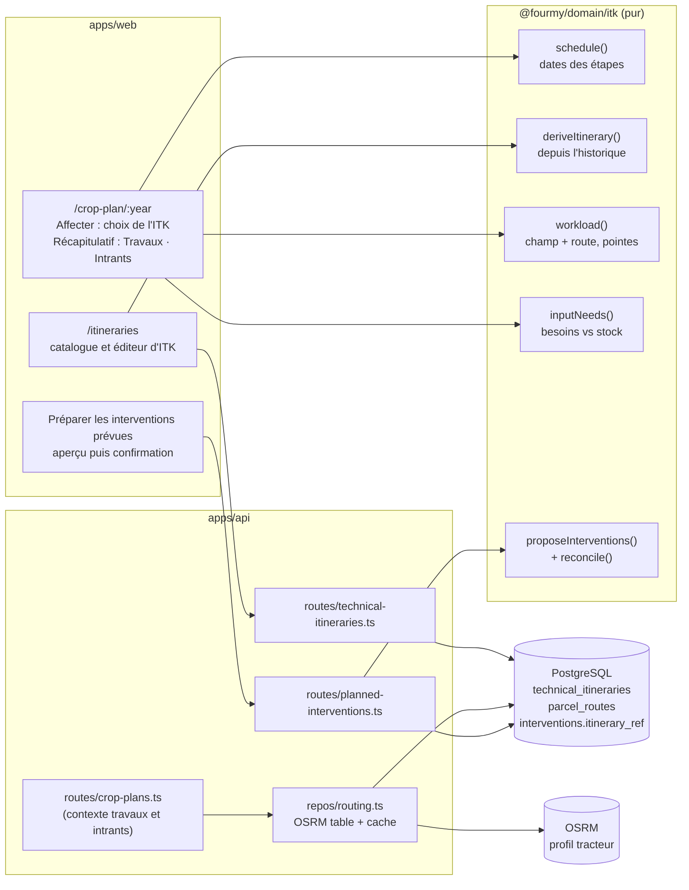

# Assolement prévisionnel — conception du temps 2 (itinéraires techniques)

*Conception du 21/11/2026, à partir de [`besoins_assolement.md`](besoins_assolement.md) §5 (FR-AS-20 à 25), de [`conception_assolement.md`](conception_assolement.md) §9 (ce que le temps 1 réserve) et des décisions A13 à A15 ci-dessous. Issue #114 ; reprend #116 (report des interventions prévues après une découpe). Étape suivante : `/sc:workflow` (plan en lots).*

## 0. Décisions (21/11/2026)

| # | Décision | Conséquence |
|---|---|---|
| A13 | **Catalogue Lexicon repris dans l'esprit seulement.** Les 62 itinéraires de `technical_workflows` (Ekylibre, 2021, CC-BY-SA) servent de modèle de structure : production, système (conventionnel, bio), cycle (annuel, pluriannuel), date de début, étapes avec procédure et articles. Leur contenu n'est pas importé : il est à refaire. Les premiers ITK viennent des **interventions passées des deux fermes de test** (exploitant testeur et GAEC). | Pas de synchronisation Lexicon pour les ITK. La création d'un ITK « depuis l'historique » (§5) devient centrale. Dans le dépôt, les exemples sont anonymisés (« Le Champ »). |
| A14 | **Interventions prévues créées campagne par campagne, sur demande**, et non à la validation de l'assolement. L'utilisateur demande « Préparer les interventions prévues 2027 », voit les propositions, puis confirme (A10). | La validation du temps 1 ne change pas. Les temps de travaux et les besoins en intrants se calculent **sur le brouillon**, sans intervention en base. FR-AS-22 est réécrit dans ce sens (§7). |
| A15 | **Débit de chantier** : calculé à partir du matériel (largeur × vitesse × rendement de chantier) **et saisissable dans l'ITK**. | Le débit a trois sources, par ordre de priorité : saisi, observé sur la ferme, calculé (§8.1). Chaque chiffre affiché dit d'où il vient. |

## 1. Principes

| # | Principe | Pourquoi |
|---|---|---|
| I1 | **Un ITK est un document** (`technical_itineraries.content`, jsonb validé par zod, avec une révision), comme le brouillon d'assolement (C1). On l'édite d'un bloc, on le duplique, on le versionne. | Les étapes ne sont jamais interrogées une à une en SQL ; une copie ou une révision reste atomique. |
| I2 | **Calculs purs dans `@fourmy/domain/itk`** : dates des étapes, temps de travaux, besoins en intrants, proposition d'ITK depuis l'historique, interventions proposées. Le web les calcule en direct sur le brouillon et l'API refait le même calcul. | Même règle que les contrôles de l'assolement (C3) : réactivité (NFR-AS-2) et un seul code. |
| I3 | **Les interventions prévues sont un résultat, pas la source.** Le temps de travaux et les intrants du récapitulatif viennent de l'ITK × brouillon. Les interventions prévues servent à l'exécution (calendrier, mobile, réalisation). | Décision A14. Le récapitulatif marche avant toute validation. |
| I4 | **Jamais de chiffre muet** : un débit, une durée ou une dose inconnus s'affichent comme « inconnu » et sont comptés à part, jamais comme zéro. | Même règle que « données manquantes n'est jamais vert » (C4). |
| I5 | **Rien n'est écrasé chez l'utilisateur** : une intervention prévue qu'il a modifiée, réalisée ou annulée n'est jamais régénérée en silence. | FR-AS-11, NFR-AS-4. |

## 2. Existant réutilisé

| Élément | Où | Usage au temps 2 |
|---|---|---|
| `Assignment.itineraryId` (réservé) | `packages/contracts/src/crop-plan.ts` | Rattache un ITK à une affectation du brouillon. |
| Dates théoriques semis → récolte de l'affectation, dates Lexicon des productions | `crop-plan.ts`, migration 0074 | Ancres des dates relatives. |
| Procédures (64, avec forme et natures d'intrants) | `packages/contracts/src/procedures.ts` | Mêmes codes que les procédures Ekylibre, donc que `technical_workflow_procedures` de Lexicon : pas de table de correspondance à maintenir, seulement la liste des codes inconnus (§4.3). |
| Frise TIKA, statut `planned` | `packages/domain/src/itinerary.ts`, `features/itinerary/` | Aperçu d'un ITK et des interventions prévues sur la frise de la parcelle ou de l'activité. |
| Interventions `planned` → `done` (réalisation, mouvements de stock à la réalisation seulement) | `apps/api/src/repos/interventions.ts` | Les interventions prévues ne touchent pas aux stocks. Les réaliser reprend le parcours existant. |
| Attelages types | `crew_templates`, migration 0025 | Matériels et personnes d'une étape. |
| Largeur de travail résolue (saisie > fiche > nom > gabarit) | `apps/api/src/repos/avatar.ts` | Débit calculé (§8.1). |
| Temps de travaux réalisés (union des plages) | `packages/domain/src/work-time.ts`, `repos/people-work.ts` | Débits observés et comparaison prévu / réalisé. |
| Siège et sites de la ferme, géolocalisés | `farm_sites` (0048) | Départ des trajets. |
| OSRM auto-hébergé, profil tracteur | `apps/api/src/osrm.ts`, `docs/routage-osrm.md` | Distance et durée siège → parcelle (service `table`, pas encore exposé). |
| Doses de semis, PMG, mélanges, conversions | `packages/domain/src/seeds/` | Besoins en semences dans l'unité du stock. |
| Stock par lot et par article | `packages/domain/src/stock.ts`, `repos/stock.ts` | Comparaison besoins / stock. |
| Plan de fumure (apports prévus) | `fertilization_plans` | Prioritaire sur les doses d'engrais de l'ITK (§9.2). |

## 3. Vue d'ensemble



## 4. Données

### 4.1 Nouvelles tables (migration 0077)

```sql
-- ITK de la ferme (A13).
CREATE TABLE technical_itineraries (
  id            uuid PRIMARY KEY,
  farm_id       uuid NOT NULL REFERENCES farms(id) ON DELETE CASCADE,
  name          text NOT NULL CHECK (length(btrim(name)) BETWEEN 1 AND 120),
  activity_id   uuid REFERENCES activities(id) ON DELETE SET NULL,  -- activité proposée par défaut
  production    text,              -- production de référence Lexicon (`winter_common_wheat`), comme Lexicon
  system        text NOT NULL DEFAULT 'conventional' CHECK (system IN ('conventional', 'organic')),
  cycle         text NOT NULL DEFAULT 'annual' CHECK (cycle IN ('annual', 'perennial')),
  origin        text NOT NULL CHECK (origin IN ('manual', 'history', 'copy')),
  source        jsonb,             -- { activityId, campaigns: [2025, 2026], parcels: n } pour « history » ; { itineraryId } pour « copy »
  content       jsonb NOT NULL,    -- TechnicalItineraryContent (§4.2)
  revision      integer NOT NULL DEFAULT 0,
  active        boolean NOT NULL DEFAULT true,
  created_at, updated_at, updated_by uuid,
  UNIQUE (farm_id, name)
);
-- RLS farm_isolation comme les autres tables.

-- Trajets siège ou site → parcelle (OSRM), en cache (§8.2).
CREATE TABLE parcel_routes (
  farm_id      uuid NOT NULL REFERENCES farms(id) ON DELETE CASCADE,
  site_id      uuid NOT NULL REFERENCES farm_sites(id) ON DELETE CASCADE,
  parcel_key   text NOT NULL,      -- land_parcel_id, ou empreinte de la forme pour un morceau du brouillon
  shape_hash   text NOT NULL,      -- empreinte de la forme et de la position du site : invalide le cache
  distance_m   integer NOT NULL,
  duration_s   integer NOT NULL,
  method       text NOT NULL CHECK (method IN ('osrm', 'estimate')),
  computed_at  timestamptz NOT NULL DEFAULT now(),
  PRIMARY KEY (farm_id, site_id, parcel_key)
);

-- Lien d'une intervention prévue avec son ITK (§7).
ALTER TABLE interventions ADD COLUMN itinerary_ref jsonb;
--   { itineraryId, revision, stepId, occurrence, productionId, campaign, hash }
--   hash : empreinte de ce que la génération a écrit ; différente ⇒ modifiée par l'utilisateur.
CREATE UNIQUE INDEX interventions_itinerary_ux ON interventions
  (farm_id, (itinerary_ref->>'productionId'), (itinerary_ref->>'stepId'), ((itinerary_ref->>'occurrence')::int))
  WHERE itinerary_ref IS NOT NULL AND status <> 'cancelled';
ALTER TABLE interventions DROP CONSTRAINT interventions_origin_check;
ALTER TABLE interventions ADD CONSTRAINT interventions_origin_check
  CHECK (origin IN ('web', 'mobile', 'migration', 'plugin', 'import', 'itinerary'));

-- Réglages : farm_settings.crop_plan s'enrichit (contrat, pas de colonne) :
--   workdayHours (8), weeklyHoursPerPerson (45), defaultSiteId, workRateEfficiency (0,7).
```

### 4.2 Le contenu d'un ITK (`packages/contracts/src/technical-itinerary.ts`)

Champs repris de Lexicon dans l'esprit (A13) : production, système, cycle, début, étapes avec procédure, articles et quantités, répétition. Ajouts propres à Fourmy : ancres de dates, part de la surface, débit, attelage.

```ts
type StepAnchor =
  | { kind: "sowing"; offsetDays: number }           // J-10 = 10 jours avant le semis
  | { kind: "harvest"; offsetDays: number }          // J+3 après la récolte
  | { kind: "date"; monthDay: `${number}-${number}`; yearOffset: -1 | 0 }; // 15/03 de l'année de récolte, 20/09 de l'année d'avant

interface ItineraryStep {
  id: string;                    // stable (uuid), sert à l'idempotence de la génération
  rank: number;
  procedure: string;             // code de PROCEDURES
  label?: string;                // « Désherbage d'automne »
  anchor: StepAnchor;
  windowDays?: number;           // plage de réalisation ± n jours (affichage et pointes)
  repeat?: { count: number; everyDays: number };     // 3 passages tous les 10 jours
  share: number;                 // part de la surface concernée (0 à 1) ; 1 par défaut
  optional: boolean;             // « si besoin » : proposée décochée, comptée à part
  purposes?: TreatmentPurpose[];
  inputs: ItineraryInput[];
  staffing: {
    crewTemplateId?: string;     // attelage type
    equipmentIds: string[];      // sinon matériels seuls
    personIds: string[];
    people?: number;             // nombre de personnes si aucune n'est nommée
  };
  workRateHaH?: number;          // débit saisi (A15) ; sinon observé ou calculé
  notes?: string;
}

interface ItineraryInput {
  articleId?: string;            // article de la ferme
  kind: ArticleKind;             // seed · fertilizer · phyto · other
  label: string;                 // affiché, et seul repère d'un intrant générique (« Azote 40 u »)
  dose: number;                  // par hectare traité
  unit: string;                  // unités de `units.ts` (kg/ha, l/ha, grains/m², doses/ha…)
}

interface TechnicalItineraryContent {
  schema: 1;
  /** Début du cycle, pour un ITK sans date de semis (pérennes, comme `Début (jour/mois)` de Lexicon). */
  startMonthDay?: string;
  /** Années d'un ITK pluriannuel (vigne : plantation, P+1, pleine production), chacune ses étapes. */
  years?: { label: string; steps: ItineraryStep[] }[];
  steps: ItineraryStep[];
}
```

Un ITK pluriannuel (vigne, luzerne) garde l'idée des « P-1, P, P+, PP » de Lexicon, mais ne sera conçu en détail que si une ferme de test en a besoin. Le premier lot ne traite que les cultures annuelles, et `years` reste absent.

### 4.3 Validation du contenu

- Procédure inconnue de `PROCEDURES` : refusée. Unité incompatible avec la nature de l'article : refusée.
- Article supprimé ou inactif, matériel ou personne disparus : **gardés** dans le document, signalés « à remplacer » dans l'éditeur et dans les calculs (I4).
- Intrant phyto avec article : la dose est contrôlée par le contrôle phyto existant **à la génération des interventions** (dose maximale, usage autorisé sur la culture). L'éditeur affiche seulement un avertissement, comme la saisie d'une intervention prévue.

## 5. ITK de la ferme depuis l'historique (FR-AS-21, A13)

`deriveItinerary(input)` dans `@fourmy/domain/itk/derive.ts` :

- **Entrée** : les interventions réalisées des productions d'une activité sur une ou plusieurs campagnes choisies (« comme en 2026 », « comme 2025 et 2026 »), avec leurs cibles et surfaces travaillées, leurs intrants et quantités, leurs matériels, intervenants et périodes, plus les dates de semis et de récolte de chaque production.
- **Ancrage** : chaque intervention est placée par rapport au semis de sa production (première intervention de forme `sowing`, sinon `started_on`). Les interventions de forme `harvest`, et celles qui suivent la récolte, sont placées par rapport à la récolte.
- **Regroupement** : par procédure, les interventions sont regroupées par écart (même règle que `groupMarks` : 7 jours, 15 pour la récolte). Un groupe donne une étape, avec :
  - le **décalage médian** et la **plage** (écart interquartile) ;
  - la **part** = surface concernée / surface de l'activité ;
  - l'étape est **facultative** si moins de la moitié de la surface a été concernée ;
  - la **dose médiane par intrant**, ramenée à l'hectare de la surface travaillée et convertie avec les unités des semences ;
  - le **matériel et les personnes les plus fréquents** ;
  - le **débit observé** médian (surface / durée des périodes), gardé comme valeur observée et non saisie.
- **Sortie** : un contenu proposé, chaque étape avec ses preuves (« 9 parcelles sur 11, 2026, du 12/10 au 20/10 »), à relire puis à enregistrer. Rien n'est enregistré sans action de l'utilisateur.

**Premiers ITK** : le lot IT2 les crée **sur les deux fermes de test**, à partir de l'écran (activité → « Créer l'ITK depuis 2026 »), puis l'exploitant les relit. Les fixtures du dépôt reprennent un cas anonymisé (blé tendre de « Le Champ »), sans nom de ferme ni de personne.

## 6. ITK dans l'assolement (FR-AS-20)

- **Panneau Affecter** : après l'activité, un sélecteur « Itinéraire technique » propose les ITK actifs de l'activité (puis ceux de la même production de référence). Par défaut, il prend celui que l'activité avait au dernier assolement validé. On peut aussi choisir « Aucun » ou « Créer depuis 2026… ». Le choix s'enregistre dans `Assignment.itineraryId`, que la validation du temps 1 copie dans `productions.attrs.itineraryId` (champ de `ProdFields`, sans nouvelle colonne).
- **Dates** : `schedule(itk, assignment, campaign)` calcule la date de chaque étape et de chaque passage à partir des dates théoriques de l'affectation. Une affectation sans dates prend les dates Lexicon de la production (0074). Si une ancre manque, l'étape est datée « à préciser » et n'entre pas dans les pointes de travail (I4).
- **Affichage** : sous le formulaire, un résumé de l'ITK pour la sélection (étapes, heures, intrants par hectare) et un lien vers la frise des étapes prévues.
- **Modification d'un ITK déjà affecté** : le brouillon référence l'ITK, pas une copie. Le récapitulatif suit donc la dernière révision. Les interventions déjà générées gardent la révision qui les a créées (`itinerary_ref.revision`) et sont signalées « ITK modifié depuis » dans l'aperçu de la génération suivante.

## 7. Interventions prévues sur demande (FR-AS-22 réécrit, A10, A14)

**FR-AS-22 (réécrit le 21/11)** : sur un assolement validé, « Préparer les interventions prévues » propose, campagne par campagne, les interventions des ITK des productions. L'utilisateur les coche, ajuste les dates, puis confirme. Les interventions confirmées sont créées avec le statut « prévue ». La même action, relancée après une révision ou une modification d'un ITK, met à jour ce qui peut l'être.

```mermaid
sequenceDiagram
  participant W as Web
  participant A as API
  participant D as Domain
  participant P as PostgreSQL
  W->>A: POST /planned-interventions/:year/preview {productionIds?}
  A->>P: productions de la campagne avec ITK, interventions existantes (itinerary_ref)
  A->>D: proposeInterventions() puis reconcile()
  A-->>W: à créer · à mettre à jour · à retirer · conservées (modifiées, réalisées)
  W->>A: POST /planned-interventions/:year {accepted, dateEdits, previewHash}
  A->>P: BEGIN ; recalcul, 409 si l'aperçu a changé
  A->>P: créer / mettre à jour / annuler (status = cancelled)
  A->>P: COMMIT
  A-->>W: n créées, n mises à jour, n retirées
```

- **Une intervention par production, par étape et par passage**, ciblant la parcelle de la production sur la surface `share × surface`. On ne fait pas de regroupement de parcelles au premier lot. Cette forme est la plus simple pour reporter, annuler ou réaliser une parcelle à la fois, et c'est déjà la pratique de la saisie mobile. Le regroupement par jour et par chantier reste une question ouverte (§13).
- **Contenu** : procédure, dates (`started_at` = date de l'étape à 8 h, durée = durée prévue au champ), cibles, intrants et doses (quantité = dose × surface), matériels, personnes ou attelage type (copié comme le fait le lot Q), motifs, `origin = 'itinerary'`, `itinerary_ref`, `period_precision = 'day'`.
- **Rapprochement** (`reconcile`) par clé (production, étape, passage) :

| Existante | Proposition | Effet |
|---|---|---|
| aucune | présente | à créer (cochée, sauf étape facultative) |
| prévue, `hash` inchangé | différente | à mettre à jour |
| prévue, `hash` inchangé | absente (étape retirée, production supprimée) | à retirer (statut `cancelled`, jamais supprimée) |
| prévue, modifiée par l'utilisateur | quelconque | conservée, signalée « modifiée à la main » |
| réalisée ou annulée | quelconque | conservée, jamais touchée (I5) |

- **Contrôles** : les contrôles phyto (dose, usage) et nitrates de la saisie s'appliquent aux interventions générées. Ils sont affichés dans l'aperçu et ne bloquent rien, comme pour une intervention prévue saisie à la main.
- **Mobile** : les interventions prévues se synchronisent déjà (`sync.ts`, statut `planned`). Aucun changement côté mobile.
- **Points d'entrée** : bouton sur l'assolement validé (onglet Récapitulatif) et sur la page d'une activité (ses productions seulement).

### 7.1 Découpe et interventions prévues (#116)

La validation d'une découpe (temps 1, §3.4) liste aujourd'hui les interventions prévues sur la parcelle d'origine après la date d'effet. Au temps 2 :

- **Interventions générées par un ITK** (`itinerary_ref` présent) : la production d'origine est remplacée par les productions des morceaux. Ses interventions générées non modifiées sont retirées (`cancelled`). La validation propose de lancer « Préparer les interventions prévues » sur les nouvelles productions.
- **Interventions prévues saisies à la main** : dans la fenêtre de validation, pour chacune, l'utilisateur choisit un morceau (changement `intervention.retarget`, déjà typé) ou « sur chaque morceau » (copie au prorata des surfaces, nouveau changement `intervention.split`).
- **Annulation d'une découpe validée** : la règle du temps 1 s'applique (§6 de la conception du temps 1). Les interventions prévues des morceaux reviennent sur la parcelle rouverte, et les interventions générées sont retirées puis proposées à nouveau.

## 8. Temps de travaux (FR-AS-23)

### 8.1 Débit de chantier (A15)

`resolveWorkRate(step, context)` rend `{ haH, source }`, avec par ordre de priorité :

1. **Saisi** dans l'étape (`workRateHaH`).
2. **Observé** sur la ferme : médiane de surface / durée des interventions réalisées de **même procédure et même matériel principal** sur les 3 dernières campagnes, s'il y en a au moins 3. On écarte les durées aberrantes (moins de 0,1 ou plus de 50 ha/h).
3. **Calculé** : largeur de travail (résolue comme l'avatar) × vitesse de travail × rendement de chantier / 10. La vitesse vient d'un référentiel par procédure (`@fourmy/certification-refs/src/work/work-speeds.ts`, chaque valeur sourcée, par exemple le guide BCMA des coûts des matériels agricoles, à constituer en IT4). Le rendement de chantier vient des réglages de la ferme (0,7 par défaut).
4. Sinon **inconnu** : l'étape est comptée « durée inconnue » (I4).

Le récapitulatif affiche la source (« 3,2 ha/h · observé sur 6 chantiers »), et un débit saisi peut se reprendre depuis la valeur observée.

### 8.2 Trajets (OSRM)

- **Départ** : le site choisi dans les réglages, sinon le siège (`farm_sites.is_headquarters`). Sans site localisé, les trajets sont signalés « siège non localisé » et seul le temps au champ est compté.
- **Arrivée** : un point de la parcelle (point intérieur, `ST_PointOnSurface`). Pour un morceau du brouillon, on prend son point intérieur, calculé par `POST …/geometry` du temps 1, qui rend aussi l'empreinte.
- **Calcul** : service `table` d'OSRM, un appel par ferme pour toutes les parcelles sans cache valide, puis cache dans `parcel_routes` (clé : parcelle et empreinte de la forme et du site).
- **Repli** : si OSRM est absent, si la région n'est pas chargée ou si aucune route n'est trouvée, on prend la distance à vol d'oiseau × 1,3 à 25 km/h, `method = 'estimate'`, signalé comme estimé.
- **Allers-retours** : une étape d'une parcelle demande `ceil(durée au champ / workdayHours)` journées, avec un aller-retour par journée. Le regroupement de plusieurs parcelles dans un même déplacement n'est pas modélisé au temps 2. C'est volontairement prudent et c'est dit dans l'aide.

### 8.3 Cumuls et pointes

`workload(input)` rend, pour l'assolement et par activité :

- **heures au champ, heures de route, kilomètres**, par personne, par matériel, par procédure ;
- **pointes** : heures par semaine ISO et par personne ou matériel, comparées à la capacité (personnes nommées × `weeklyHoursPerPerson` ; `people` sans nom compte en « main-d'œuvre à trouver »). Les semaines au-dessus de la capacité sont signalées (orange) ;
- l'étalement d'une étape sur sa plage (`windowDays`) : les heures sont réparties uniformément, ce qui évite une pointe artificielle le jour exact de l'étape ;
- les **inconnus** (débits, ancres, personnes) sont comptés et listés.

Les personnes reprennent les heures du matériel quand elles sont dans l'attelage (une personne par automoteur ou tracteur), sauf si l'étape fixe `people`.

## 9. Besoins en intrants (FR-AS-24)

### 9.1 Calcul

`inputNeeds(input)` : pour chaque intrant d'étape, quantité = dose × surface de l'affectation × `share` × nombre de passages. Les étapes facultatives sont comptées à part, en « si besoin ».

- **Conversion vers l'unité du stock** : semences par `seeds/units` (grains/m² → kg avec le PMG, doses), engrais et phyto par `quantities.ts`. Ce qui ne se convertit pas est compté en « non convertible », comme pour l'utilisation des semences (SE7).
- **Regroupement** par article. Un intrant générique sans article (« Azote 40 u ») se regroupe par libellé et unité, sans comparaison au stock.
- **Comparaison au stock** : stock disponible à la date de calcul (`computeStock`), moins ce que réservent déjà les interventions prévues non issues de l'assolement de la campagne. Le résultat donne pour chaque article la quantité **à acheter**, ou « couvert ».

### 9.2 Plan de fumure

Quand une production a un plan de fumure établi, ses apports prévus **remplacent** les étapes de fertilisation minérale de l'ITK dans le calcul des besoins (source affichée : « plan de fumure »). Le plan de fumure est le document réglementaire, et l'ITK n'en est qu'un point de départ. Les étapes de fertilisation organique restent celles de l'ITK.

## 10. API

Toutes les routes sont sous `/farms/:farmId`. Les membres peuvent lire ; seul le responsable écrit (NFR-AS-5).

| Méthode et chemin | Rôle |
|---|---|
| `GET /technical-itineraries?activityId=&active=` | Liste avec un résumé (étapes, heures/ha, intrants/ha, activités qui l'utilisent). |
| `POST /technical-itineraries` | Création (manuelle ou à partir d'une proposition). |
| `GET /technical-itineraries/:id` | Contenu, révision, éléments à remplacer, débits résolus. |
| `PUT /technical-itineraries/:id` | `{ revision, … }` ; 409 si la révision a changé. |
| `POST /technical-itineraries/:id/copy` | Duplique (`origin = 'copy'`). |
| `DELETE /technical-itineraries/:id` | Désactive si l'ITK est référencé (brouillon, production, intervention), sinon supprime. |
| `POST /technical-itineraries/derive` | `{ activityId, campaigns[] }` → contenu proposé avec ses preuves (§5). N'enregistre rien. |
| `GET /crop-plans/:year/itk-context` | Contexte du temps 2, chargé une fois : ITK référencés, débits observés, largeurs, trajets (`parcel_routes`, calculés au besoin), stocks, plans de fumure établis, réglages. |
| `POST /crop-plans/:year/routes` | Trajets pour des formes nouvelles du brouillon (morceaux), appelé avec `…/geometry`. |
| `POST /planned-interventions/:year/preview` | `{ productionIds? }` → aperçu rapproché (§7) et `previewHash`. |
| `POST /planned-interventions/:year` | `{ previewHash, accepted[], dateEdits }` → applique ; 409 si l'aperçu a changé. |

## 11. Interface

- **Catalogue** `/f/:ferme/itineraries`, accessible depuis Activités (onglet « Itinéraires ») et depuis la page d'une activité. Il liste les ITK par activité et propose « Créer », « Créer depuis l'historique », « Dupliquer ».
- **Éditeur d'ITK** :

```
┌ Blé tendre — conventionnel · révision 4 ─────────────────── [Dupliquer] [Enregistrer] ┐
│ Frise TIKA (aperçu sur un semis au 15/10, récolte au 10/07)                            │
│ ───●────●──────◆──────────●──●──────●──────────────────────────■──▶                   │
│ ┌ Étape ─────────────┬ Quand ─────────┬ Part ┬ Intrants ─────────┬ Matériel ──┬ Débit ┐│
│ │ Déchaumage         │ semis J-30 ±7   │ 100% │                   │ Déchaumeur │ 4,1 obs││
│ │ Semis              │ semis J0 ±5     │ 100% │ Blé 180 kg/ha     │ Combiné    │ 2,5 ✎ ││
│ │ Désherbage automne │ semis J+25 ±10  │  80% │ Herbicide 2 l/ha  │ Pulvé 24 m │ calc. ││
│ │ Azote ×3           │ 15/02, tous 30 j│ 100% │ Ammonitrate 150 kg│ Distrib.   │ 12 obs││
│ │ Récolte            │ récolte J0      │ 100% │                   │ Moiss. ETA │ ?     ││
│ └────────────────────┴─────────────────┴──────┴───────────────────┴────────────┴───────┘│
│ Par hectare : 2,4 h de tracteur · 1,1 h de main-d'œuvre · 3 intrants · 1 débit inconnu │
└────────────────────────────────────────────────────────────────────────────────────────┘
```

- **Créer depuis l'historique** : choix de l'activité et des campagnes, puis la proposition s'affiche dans l'éditeur, avec les preuves de chaque étape dans une info-bulle. On relit, puis on enregistre.
- **Assolement, Affecter** : sélecteur d'ITK et résumé (§6).
- **Assolement, Récapitulatif** : deux nouvelles sections.
  - **Travaux** : heures champ et route, km, par personne et par matériel, et un graphique des pointes par semaine (Recharts, comme les graphiques existants), avec la capacité en ligne.
  - **Intrants** : besoins, stock et quantité à acheter par article, et les intrants génériques à part.
  - Chaque section liste ses inconnus. Le bouton « Préparer les interventions prévues » apparaît quand l'assolement est validé.
- **Aperçu de la génération** : tableau groupé par production, cases à cocher, dates modifiables, états (à créer, à mettre à jour, à retirer, conservée), constats phyto et nitrates.

## 12. Tests

| Niveau | Contenu |
|---|---|
| Domaine | `schedule` (ancres semis, récolte, date avec année précédente, passages répétés, ancre manquante) ; `deriveItinerary` (regroupement, facultatif sous 50 %, doses médianes par ha, débit observé) sur un jeu anonymisé ; `resolveWorkRate` (ordre des sources) ; `workload` (allers-retours, étalement sur la plage, capacité, inconnus) ; `inputNeeds` (conversions semences, non convertibles, plan de fumure prioritaire) ; `reconcile` (les 5 cas du §7) |
| Référentiel | chaque vitesse de travail a une source ; chaque procédure de forme `work`, `sowing`, `treatment`, `fertilization` ou `harvest` a une vitesse ou est explicitement sans |
| API | CRUD et 409 ; `derive` sans écriture ; contexte (cache des trajets, repli sans OSRM) ; génération idempotente (relancée deux fois = rien de nouveau) ; intervention modifiée conservée ; découpe (#116 : retrait des générées, report des manuelles) ; droits |
| e2e | créer un ITK depuis 2026, l'affecter dans l'assolement 2027, voir les heures et les intrants, valider, préparer les interventions prévues, les voir dans la frise et le calendrier |

## 13. Questions ouvertes, tranchées le 21/11/2026 (recommandations validées par l'équipe)

1. **Regroupement des interventions générées** : une intervention par production, par étape et par passage. Les imports de la GAEC ciblent déjà 1,2 parcelle par intervention en moyenne. **Option prévue (lot IT7)** : regrouper en une intervention les parcelles d'une même étape à la même date (chantier multi-parcelles), au choix dans l'aperçu. Pour la préparer, la clé d'idempotence reste (production, étape, passage) : au lot IT7, `itinerary_ref` portera la liste des productions couvertes, et l'unicité passera par une table de liens (`intervention_itinerary_links`) au lieu de l'index partiel.
2. **OSRM** (validé, Pays de la Loire à charger) : la ferme de l'exploitant testeur (64) est couverte par l'extrait `aquitaine`, mais pas la GAEC (44). On fusionne les extraits `aquitaine` et `pays-de-la-loire` avec `osmium merge` dans un seul graphe, ce qui garde un seul service (`docker/osrm/prepare.sh` accepte plusieurs régions). C'est fait en IT4 et le serveur est mis à jour au déploiement, sur accord.
3. **Débits de référence : barème BCMA 2024** (guides CEGARA « Coût d'entraide » et « Coût des façons culturales », fournis par l'équipe). Pour 846 matériels, le barème donne la **performance en unités par heure** (ha/h pour les outils), le prix d'achat moyen, l'utilisation annuelle et les coûts fixes et variables. Il remplace la vitesse par procédure envisagée au §8.1 (§15.3). Ses coûts serviront aussi au temps 3. **Licence** : accord du CEGARA et du BCMA obtenu le 21/11/2026. Le tableau extrait est versionné dans le dépôt, avec sa source citée à chaque affichage.
4. **ITK pluriannuels** : pas de `years` au temps 2. Prairies temporaires et luzerne (GAEC) se décrivent par un ITK annuel par année d'exploitation, ancré sur des dates fixes (fauches, apports). La vigne reste hors du temps 2.
5. **Partage d'ITK entre fermes** : hors temps 2.

## 14. Découpage proposé (pour `/sc:workflow`)

| Lot | Contenu | Dépend de |
|---|---|---|
| **IT1** | Migration 0077, contrats, `technical_itineraries` (CRUD, 409), validation du contenu, `schedule()`, catalogue et éditeur d'ITK avec aperçu TIKA | — |
| **IT2** | `deriveItinerary()`, `POST …/derive`, « Créer depuis l'historique » ; création et relecture des premiers ITK sur les deux fermes de test (donnée, hors dépôt) | IT1 |
| **IT3** | Choix de l'ITK dans l'assolement (`itineraryId` → `productions.attrs`) ; `proposeInterventions()` et `reconcile()`, aperçu et confirmation ; #116 (découpe, annulation) | IT1 |
| **IT4** | Débits (3 sources, référentiel des vitesses), `parcel_routes` et OSRM `table` avec repli, `workload()`, section Travaux et pointes | IT1 (IT2 pour les débits observés en recette) |
| **IT5** | `inputNeeds()`, stocks, priorité du plan de fumure, section Intrants | IT1 |
| **IT6** | Récapitulatif par activité et pour l'assolement, mode d'emploi (`docs/assolement.md`, nouveau `docs/itineraires-techniques.md`), e2e, recette avec l'exploitant testeur | IT3, IT4, IT5 |

Une fois IT1 fait, IT3, IT4 et IT5 peuvent avancer en parallèle.

## 15. Écarts après examen des données des deux fermes (21/11/2026)

Examen de la base de développement : interventions réalisées des campagnes 2024 à 2026, rattachées aux productions par la parcelle et les dates.

### 15.1 Ce que montrent les données

| | Exploitant testeur (64) | GAEC (44) |
|---|---|---|
| Activités avec historique | surtout Maïs (20 à 40 interventions par campagne, 5 à 9 procédures) ; avoine, triticale ponctuels | 15 activités (blé, orges, maïs fourrage, colza, féverole, lin, carotte, épinard, prairies, luzerne…), 3 à 5 procédures chacune |
| Origine | reprise Ekylibre (`migration`), quelques saisies | import Geofolia (`import`) |
| Matériels et intervenants | présents sur 3 interventions sur 4 ; 18 matériels | **aucun** dans les interventions ; **aucun matériel** dans la ferme |
| Périodes | heures réelles | **au jour près** (`period_precision = 'day'`), 24 h par intervention |
| Surface travaillée | absente des cibles (sauf 7) | présente |
| Dates de semis des productions | **vides** (`started_on`) | renseignées en 2026 |
| Attelages types | aucun | aucun |
| Siège localisé | oui | oui |

### 15.2 Conséquences sur `deriveItinerary` (§5)

- **Ancre du semis** : à défaut de `started_on`, on prend la date de la première intervention de forme `sowing` de la production (c'est le cas de l'exploitant testeur). Sans semis ni date, la production est écartée de la proposition et comptée.
- **Surface travaillée** : à défaut de `workedAreaM2`, on prend la surface de la parcelle ciblée à la date de l'intervention.
- **Débit observé** : on écarte les interventions au jour près, celles d'origine `import` et celles sans matériel. Chez la GAEC, aucun débit ne sera donc observé : leurs ITK passent par le barème ou la saisie.
- **Personnel** : une étape sans matériel ni intervenant dans l'historique reçoit `people: 1`, signalé « à compléter ». L'aperçu propose de choisir un attelage type ou un type de matériel du barème (§15.3).
- Les ITK proposés à la GAEC n'auront que les étapes saisies dans Geofolia (traitements, fertilisation, semis, récolte, irrigation) : pas de travail du sol. L'éditeur doit rendre l'ajout d'étapes rapide (dupliquer une étape, insérer depuis la liste des procédures).

### 15.3 Débit de référence BCMA (remplace la vitesse par procédure du §8.1)

- **Référentiel** : table `ref_machinery_rates` (migration du lot IT4). Chaque ligne a :
  - `id`, `family` (famille du barème), `label`, `width_m` lu dans le libellé quand il y en a un, `unit` (hectares, heures, voyages, tonnes…) ;
  - `performance_per_h`, `purchase_price`, `annual_use`, `fixed_cost`, `variable_cost` ;
  - `edition` (2024) et `source` (« BCMA, guide CEGARA Coût des façons culturales 2024 »).
- **Chargement** : un script lit le texte extrait du PDF (`pdftotext -layout`). Environ 825 lignes sur 846 se lisent directement ; les libellés sur deux lignes sont recollés. Accord obtenu le 21/11/2026 : le CSV extrait (`packages/certification-refs/data/bcma-2024.csv`) est versionné ; le PDF ne l'est pas.
- **Rattachement d'un matériel** : colonne `equipments.machinery_rate_id` (la table n'a pas d'`attrs`). Il est proposé automatiquement d'après la nature du matériel et sa largeur de travail (ligne la plus proche de la même famille), puis confirmé sur la fiche du matériel.
- **Étape sans matériel de la ferme** (GAEC, prestations) : `staffing.machineryRateId` désigne directement un type du barème (« Semoir à disques sans labour 4 m »).
- **Ordre des sources du débit** : saisi > observé > barème (ligne rattachée, performance × largeur réelle / largeur de la ligne si les deux sont connues) > largeur × vitesse déduite du barème pour la famille × rendement > inconnu.
- **Temps 3** : `purchase_price`, `fixed_cost` et `variable_cost` donnent le coût du matériel à l'hectare ou à l'heure (FR-AS-30), sans nouvelle collecte.

### 15.4 Contrat de l'étape

`ItineraryStep.staffing` gagne `machineryRateId?: string` (type du barème quand aucun matériel de la ferme n'est désigné), et `ItineraryStep` gagne `evidence?` (preuves d'une étape proposée depuis l'historique, gardées pour l'affichage).
