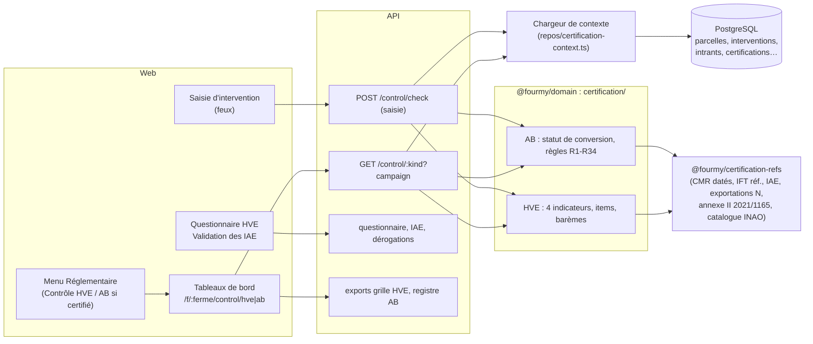

# Contrôles HVE et Agriculture biologique — conception

Conception du 19/11/2026, à partir de `claudedocs/besoins_controle_hve_ab.md`
(décisions D1 à D12, exigences FR-CTL, FR-HVE, FR-AB) et des rapports
`docs/hve/rapport_hve.md` et `docs/ab/rapport_ab.md` (sources à la page ou à
la cellule près). Aucun code n'est écrit ici.

## 1. Principes

1. **Règles pures, données fournies.** Comme le contrôle phyto
   (`packages/domain/src/phyto-rules.ts`), chaque règle est une fonction pure
   du domaine : le serveur rassemble les données, la règle rend un verdict.
   Testables sans base, rejouables sur une campagne passée.
2. **Référentiels sourcés et versionnés**, dans un paquet dédié sur le modèle
   de `@fourmy/fertilization-refs` : recopiés des textes table par table,
   chaque table citant sa source et sa date ; jamais modifiés par le code
   (NFR-2). Le classement CMR, l'IFT de référence, les coefficients IAE
   comptent « à la date ».
3. **Une seule évaluation, deux usages.** Le même moteur sert au tableau de
   bord d'une campagne (FR-CTL-2) et au feu de la saisie (FR-CTL-4) : à la
   saisie, il n'évalue que les règles qui concernent l'intervention.
4. **Pas de faux vert** (NFR-3) : une règle sans ses données rend
   `missing`, affiché en orange avec ce qui manque et où le saisir.
5. **Le feu suit la gravité officielle.** HVE : un indicateur sous 10 points
   ou le CMR1 → rouge. AB : la classe du manquement du catalogue INAO
   (FR-AB-10) → rouge si majeur ou critique, orange si mineur.
6. **Résultats gardés.** Le calcul d'une campagne est enregistré avec la
   version des référentiels ; un export est lié au calcul exporté (FR-CTL-6).

## 2. Vue d'ensemble



## 3. Référentiels : `packages/certification-refs`

Paquet de données sans dépendance (comme `fertilization-refs`), TypeScript
et JSON générés, chaque fichier en tête : source, date, page ou cellule.

| Module | Contenu | Source | Production |
|---|---|---|---|
| `hve/grid-v1.15.ts` | Items, barèmes et maxima des 4 indicateurs, seuils de validation, règles de prorata par famille de cultures, 4 bornes « grille » (D6) | grille v1.15, plan V4.4 | recopie manuelle, testée item par item contre la grille |
| `hve/iae.ts` | 17 types d'IAE : unité, coefficient, famille, socle/poids, conditions | plan V4.4 annexe 2 | recopie |
| `hve/ift-references.ts` | Planchers et plafonds IFT : grandes cultures par ancienne région (échelles « en cours » et « ancienne »), vigne par bassin, arboriculture | grille onglets Scoring_* | extraction du xlsx par script |
| `hve/cmr/2024-10-29.json`, `2025-10-21.json`, `2026-09-04.json` | Liste CMR : n° d'autorisation, AMM, nom, type, classe CMR1/2, fonctions, statut, dates | classeur ministériel, 3 onglets | script d'extraction (`scripts/extract-cmr.mjs`) ; la version applicable à une date est la plus récente antérieure |
| `hve/nitrogen-exports-2026.ts` | Exportations d'azote : culture, organe, destination, % MS de référence, teneur, unité | table ministérielle du 23/06/2026 | saisie semi-manuelle (PDF mal structuré), relue ligne à ligne |
| `hve/otex-herbivore.ts`, `hve/regions.ts` | OTEX herbivores (bilan apparent), départements → anciennes régions, communes → bassins viticoles | plan V4.4 | recopie |
| `ab/annex-ii-2021-1165.ts` | Catégories de matières fertilisantes autorisées, conditions, mention « élevages industriels interdite » | règlement 2021/1165 annexe II | recopie |
| `ab/conversion.ts` | Durées (C1 12 mois, AB 24/36 mois), classes de culture | règlement 2018/848 annexe II 1.7.1, GDL l. 96-98 | recopie |
| `ab/copper.ts` | 28 kg/ha/7 ans depuis le 1/1/2022, cas 4 kg/an | 2021/1165 annexe I p. 12, GDL l. 420 | recopie |
| `ab/inao-catalogue.ts` | Règle → n° de manquement, classe, mesures | INAO-DEC-CONT-AB-4 v10 | recopie |
| `ab/cleaning-products.ts` | Produits de nettoyage admis (annexe I du CCF élevage) | arrêté du 28/12/2021 | recopie |

Mise à jour d'un référentiel : nouveau fichier daté (jamais d'écrasement),
version du paquet incrémentée, changelog ; les calculs gardent la version
utilisée.

## 4. Modèle de données (migration 0067)

### 4.1 Ajouts aux tables existantes

| Table | Colonnes | Pour |
|---|---|---|
| `productions` | `cycle text CHECK (cycle IN ('annual','semi_perennial','perennial'))` (défaut tiré de `lexicon_productions.life_years`, corrigeable), `planted_on date`, `cultivation_mode text CHECK (… 'open_field','shelter','heated_shelter','soilless','pot','container')` défaut `open_field` | statut AB (FR-AB-1), hors-sol (R10), serres chauffées (R13), familles HVE |
| `articles` | `organic_status text CHECK (organic_status IN ('organic','conversion','conventional'))`, `seed_treated boolean` | semences et plants (FR-AB-5) |
| `article_fertilizers` | `ab_categories text[]` (codes de l'annexe II), `effluent_origin text CHECK (… 'organic','conventional','industrial','unknown')` | fertilisants AB (FR-AB-4), 170 N |
| `interventions` | `certification_check jsonb` (comme `compliance`, `nitrate_check`), `justification text` (nécessité d'un traitement, AB 1.10.2) | feux de saisie (FR-CTL-4) |
| `interventions.irrigation` (jsonb existant) | `mode`, `equipmentMobile`, `waterOrigin` (`network`, `reservoir`, `natural`), `trigger` | cahier HVE 7.1, étiage 7.6 |
| `interventions.ift` (jsonb existant) | `signature` (renvoyée par l'API du ministère), catégorie par ligne (`herbicide`, `other`, `biocontrol`, `seed`) | IFT HVE 5.3 |
| `farm_landscape_features` | `hve_type text`, `hve_validated_at timestamptz`, `hve_shared boolean` (mitoyen) | IAE (FR-HVE-3) |
| `farm_settings` | `certification jsonb` : `{ hveCampaignStartMd, hveMethod: 'campaign'|'average', rotationYears: 5, rotationSameSpeciesMax: 2, ab: { notifiedOn, committedOn } }` | D12, FR-HVE-1, R3 |

`cover_crops.destruction_mode` existe déjà (6.7 : destruction chimique).

### 4.2 Nouvelles tables (RLS `farm_isolation`, comme les autres)

```sql
-- Questionnaire HVE annuel (D10) : réponses par item, pièces jointes.
CREATE TABLE hve_questionnaires (
  farm_id    uuid NOT NULL REFERENCES farms(id) ON DELETE CASCADE,
  campaign   int  NOT NULL,
  answers    jsonb NOT NULL DEFAULT '{}',   -- { "4.6": { hives: 4, sedentary: true }, "5.5": {...}, ... }
  updated_by uuid, updated_at timestamptz NOT NULL DEFAULT now(),
  PRIMARY KEY (farm_id, campaign)
);
-- Pièces : table regulatory_documents existante (owner_type 'hve_questionnaire').

-- Dérogations semences AB (FR-AB-5), accordées par l'organisme certificateur.
CREATE TABLE seed_derogations (
  id uuid PRIMARY KEY, farm_id uuid NOT NULL REFERENCES farms(id) ON DELETE CASCADE,
  species text NOT NULL, variety text, article_id uuid REFERENCES articles(id) ON DELETE SET NULL,
  granted_on date NOT NULL, season int NOT NULL, quantity numeric, unit text,
  reference text, certifier text, created_at timestamptz NOT NULL DEFAULT now()
);

-- Calculs de contrôle d'une campagne (FR-CTL-6) : résultat, référentiels, export.
CREATE TABLE certification_runs (
  id uuid PRIMARY KEY, farm_id uuid NOT NULL REFERENCES farms(id) ON DELETE CASCADE,
  kind text NOT NULL CHECK (kind IN ('hve','ab')), campaign int NOT NULL,
  computed_at timestamptz NOT NULL DEFAULT now(), refs_version text NOT NULL,
  data_hash text NOT NULL,      -- empreinte des données lues (écart signalé si elles changent)
  result jsonb NOT NULL,
  exported_at timestamptz, exported_by uuid, export_sha256 text
);
CREATE INDEX certification_runs_farm ON certification_runs (farm_id, kind, campaign, computed_at DESC);
```

Le **statut de conversion AB n'est pas stocké** (D8) : il se calcule à la
demande (§5.2). Le nettoyage du matériel est une **intervention** de la
procédure `equipment_cleaning` (nouvelle, cible : matériel ; intrant :
produit de nettoyage), pas une table.

## 5. Domaine : `packages/domain/src/certification/`

### 5.1 Contrat commun

```ts
type ControlLevel = "ok" | "warning" | "danger" | "missing" | "na";

interface ControlFinding {
  ruleId: string;                 // "hve.5.1", "ab.R21"
  level: ControlLevel;
  message: string;
  value?: number; threshold?: number; unit?: string;
  points?: { got: number; max: number };            // HVE
  breach?: { inao: string; class: "minor" | "major" | "critical"; measure: string }; // AB
  refs: { parcelIds?: string[]; interventionIds?: string[]; articleIds?: string[] };
  missing?: { what: string; where: "parcel" | "intervention" | "article" | "questionnaire" | "farm"; id?: string }[];
  source: string;                 // « plan V4.4 §5.1 p.40 ; grille Phyto!P22 »
  gridDivergence?: string;        // D6 : écart plan/grille signalé
}

interface ControlReport {
  kind: "hve" | "ab"; campaign: number; period: { from: string; to: string };
  verdict: ControlLevel;          // HVE : 4 indicateurs ≥ 10 et pas de CMR1 ; AB : pire constat
  sections: { id: string; label: string; level: ControlLevel; points?: { got: number; max: number; min: number }; findings: ControlFinding[] }[];
  refsVersion: string;
}
```

`CertificationContext` (données d'une campagne, assemblées par l'API) :
parcelles et versions (surface réelle, géométrie, codes PAC, zone
vulnérable), certifications, productions (espèce, famille, cycle, mode,
dates), historique déclaré, couverts, interventions réalisées avec intrants
(article, dose, surface, produit E-Phy, composition), récoltes, irrigation,
matériels par intervention, éléments du paysage, questionnaire, dérogations,
réglages.

### 5.2 AB

- `conversionStatus(cert, production, harvestDate)` → `C1 | C2 | AB | null` :
  - début = `started_on` de la certification AB de la parcelle ;
  - récolte < début + 12 mois → C1 ; sinon C2 ;
  - AB si annuelle semée ≥ début + 24 mois, ou pérenne récoltée ≥ début +
    36 mois (semi-pérenne : 24) ;
  - **remise à zéro** au dernier traitement non autorisé (R5) : nouveau
    début = date du traitement, récolte suivante déclassée (`downgraded`).
  - Incohérence avec le `level` saisi (« certified » alors que C1) → constat
    orange.
- Une fonction par règle, `abRules: Rule[]` dans l'ordre D11 :
  `R5` (phyto non autorisé, reprend le constat `organic` du contrôle phyto),
  `R1/R2` (statut des récoltes), `R21` (cuivre), `R14/R15/R17` (fertilisants),
  `R16` (170 N par parcelle, D7), `R24/R25` (semences), `R7` (mixité),
  `R27` (matériel), `R11` (rotation, D12), `R10/R13` (hors-sol, serres).
- **Cuivre** : teneur en cuivre métal lue dans les substances E-Phy
  (`active_compounds` : « Cuivre de l'hydroxyde de cuivre 300 g/kg »,
  « Oxyquinoléate de cuivre 50 % » → facteur de conversion par composé dans
  `ab/copper.ts`), × dose × surface ; cumul par parcelle sur 7 ans glissants
  depuis le 1/1/2022 ; + cuivre des engrais foliaires (`article_fertilizers.foliar`)
  si l'utilisateur les marque comme usage fongicide.
- **170 N** : N **total** des intrants dont `ab_categories` relève des
  effluents d'élevage (fumier, lisier, fientes, composts d'excréments), par
  parcelle AB et par année civile (à confirmer, §11), contre 170 kg/ha.

### 5.3 HVE

- Un module par indicateur (`biodiversity.ts`, `phyto.ts`,
  `fertilization.ts`, `irrigation.ts`), un calcul par item renvoyant ses
  points, appliquant les barèmes de `grid-v1.15.ts` **à la lettre** (D6) et
  le prorata par famille de cultures.
- **CMR** (5.1) : jointure sur le **n° d'autorisation** (PCP compris), avec
  la version de la liste en vigueur à la date du traitement ; porte aussi sur
  les semences traitées et engrais déclarés contenir un produit classé (FAQ
  Q129). Discordance avec les mentions de danger E-Phy (H340/350/360,
  H341/351/361) → constat `warning` « à vérifier » (D9).
- **IFT** (5.3) : réutilise le calcul existant (`repos/ift.ts`, API du
  ministère), agrégé par catégorie hors biocontrôle et semences, comparé aux
  références de la région ou du bassin ; moyenne pluriannuelle selon les
  réglages ; signature conservée (sans signature : constat `warning`,
  l'auditeur recalculera).
- **Bilan azoté** (6.1) : balance globale en **N total réalisé** — entrées :
  apports des interventions (N total déjà calculé par le cahier,
  `fertilization-record.ts`) ; sorties : récoltes × teneurs de la table
  2026 ; cultures absentes de la table = mineures ; élevage : questionnaire
  (effectifs × normes), sinon constat `missing`.
- **IAE** (4.1) : éléments du paysage validés (`hve_type`), convertis en
  surface équivalente ; **adjacence** calculée en PostGIS (élément porté par
  une terre arable ou touchant une parcelle « par sa longueur » : longueur
  de l'intersection d'un tampon de 1 m ≥ 50 % de la longueur de l'élément),
  socle sur les terres arables, poids sur la surface totale, diversité.
- Items déclaratifs : lus dans le questionnaire ; non répondu → `missing`.

### 5.4 Contrôle à la saisie

`checkInterventionCertification(input, context)` évalue seulement les règles
qui portent sur une intervention :

| Règle | Déclenchée par |
|---|---|
| HVE 5.1 CMR1 (rouge) / CMR2 (orange) | traitement, semis avec semence traitée |
| AB R5 phyto non autorisé | déjà dans le contrôle phyto (`organic`) : rappel de la conséquence (récolte déclassée) |
| AB R15/R14/R17 fertilisant | apport sur parcelle AB |
| AB R16 170 N | apport d'effluent sur parcelle AB (cumul de l'année + cet apport) |
| AB R21 cuivre | traitement cuprique sur parcelle AB (cumul 7 ans + ce traitement) |
| AB R24/R25 semences | semis ou plantation sur parcelle AB |
| AB R27 matériel | intervention sur parcelle AB avec un matériel venu d'une parcelle non AB sans nettoyage |
| AB R20 justification | traitement sur parcelle AB sans justification (orange) |

Branchement : `recordCompliance` (`repos/interventions.ts`) appelle, après le
contrôle phyto et le contrôle nitrates, `recordCertificationCheck`, qui
enregistre `certification_check` ; **même règle de motif** : une réalisation
saisie sur le web avec un feu rouge est refusée sans motif (motif commun
`compliance.reason`). Feu calculé seulement si la ferme a une certification
HVE ou AB active à la date (sinon `NULL`, coût nul). Le formulaire l'affiche
en direct via `POST /control/check` (comme `POST /phyto/check`).

## 6. API (routes de ferme, lecture : membres ; écriture : responsable)

| Route | Effet |
|---|---|
| `GET /control/availability?campaign=` | `{ hve: bool, ab: bool }` : certification de parcelle active pendant la campagne (menu, D2) |
| `GET /control/:kind?campaign=` (`hve`, `ab`) | `ControlReport` : dernier calcul si les données n'ont pas changé (`data_hash`), sinon recalcul et enregistrement dans `certification_runs` |
| `POST /control/check` | constats de saisie pour un brouillon d'intervention (sans écriture) |
| `GET /control/ab/parcels?campaign=` | statut C1/C2/AB de chaque parcelle et date de passage au suivant (US-4) |
| `GET|PUT /control/hve/questionnaire?campaign=` | questionnaire (D10) ; pièces via `regulatory_documents` |
| `GET /control/hve/iae` ; `PUT /landscape-features/:id/hve` | IAE proposées (type PAC → type HVE) et validation, mitoyenneté |
| `GET|POST|PUT|DELETE /control/ab/seed-derogations` | dérogations semences |
| `PUT /settings/certification` | réglages (période HVE, méthode, rotation N/K, dates de notification et d'engagement) |
| `GET /control/hve/export?campaign=` | grille v1.15 pré-remplie (xlsx) + liasse (zip : bilan IFT, cahiers, plan parcellaire IAE) ; enregistre l'export sur le calcul |
| `GET /control/ab/export?campaign=` | registre AB (zip : CSV par registre + synthèse imprimable) |

Contrats Zod dans `packages/contracts/src/certification.ts`.

## 7. Web

- **Menu** (`components/Layout.tsx`) : `NavItem` gagne `when?: (ctx) => boolean` ;
  sous Réglementaire, « Contrôle HVE » et « Contrôle AB » affichés si
  `GET /control/availability` (campagne de la frise) le dit.
- **Pages** `features/certification/` :
  - `ControlPage` (commune, `kind` en paramètre) : verdict, une carte par
    indicateur ou règle (feu, points ou valeur, seuil, gravité INAO), détail
    dépliable avec les liens vers interventions, parcelles, articles, et la
    liste « à compléter » ; bouton « Exporter le dossier » (responsable) ;
    écart avec le dernier export signalé.
  - HVE : onglets Indicateurs · IAE (carte des éléments, validation du type
    HVE, mitoyenneté) · Questionnaire · Réglages.
  - AB : onglets Règles · Parcelles (statut de conversion, frise de rotation
    avec repères D12, cumul cuivre, 170 N) · Semences et dérogations ·
    Réglages.
- **Saisie d'intervention** : section « Certification » sous les feux phyto
  et nitrates (`InterventionForm`, `InterventionPage`), champ
  « Justification du traitement » sur parcelle AB.
- **Fiches** : article (statut bio, semence traitée ; catégories annexe II et
  origine de l'effluent pour un fertilisant), production (cycle, date de
  plantation, mode de culture), intervention d'irrigation (mode, origine,
  déclencheur).
- Feux : composant `StatusLight` de la page Intégrations, étendu à orange.

## 8. Exports

- **Grille HVE v1.15** : le classeur ministériel (non modifiable, importé
  dans Certibase) est embarqué dans `certification-refs` ; l'export ouvre
  l'archive (`@fourmy/isoxml` : `unzip`/`zip`), écrit **seulement les
  cellules de saisie** listées dans une table de correspondance
  (`hve/grid-v1.15-cells.ts` : onglet, cellule, donnée), sans toucher aux
  formules, et marque le classeur à recalculer à l'ouverture
  (`fullCalcOnLoad`). Test : les points recalculés par Excel/LibreOffice
  (conversion headless en CI) égalent ceux du tableau de bord (US-3).
- **Liasse HVE** : bilan IFT (signé si disponible), cahiers phyto,
  fertilisation et irrigation de la période (exports CSV existants), plan
  parcellaire avec IAE (page imprimable, comme les éditions de la
  fertilisation).
- **Registre AB** : parcelles et statuts, cultures, intrants (phyto avec
  justification, fertilisants avec catégorie, semences avec statut et
  dérogation), récoltes avec statut, nettoyages ; CSV + page imprimable.

## 9. Performance et volumétrie

Ferme type : 200 ha, 1 000 interventions par campagne. Le contexte d'une
campagne est chargé en 6 à 8 requêtes ; les règles tournent en mémoire. IAE
et adjacence : une requête PostGIS par campagne (tampon et intersections),
résultat mis en cache dans `certification_runs`. Contrôle de saisie : règles
d'une intervention, avec les cumuls (cuivre 7 ans, 170 N année) lus par deux
requêtes agrégées indexées (`intervention_parameters`), < 500 ms (NFR-4).

## 10. Découpage en lots (ordre D11)

| Lot | Contenu | Dépend de |
|---|---|---|
| **CT1 Socle** | migration 0067, `certification-refs` (squelette, catalogue INAO, conversion), contrats, `certification_runs`, menu conditionnel, `ControlPage`, `certification_check` et `POST /control/check` | — |
| **CT2 AB essentiel** | statut de conversion calculé, conséquence d'un phyto interdit, cuivre, fertilisants (annexe II, N minéral, élevages industriels), 170 N par parcelle ; fiches article et production | CT1 |
| **CT3 HVE phyto, fertilisation, irrigation** | liste CMR datée, IFT par catégorie et signature, références IFT, surfaces non traitées, bilan azoté (table 2026), N organique, SAU non fertilisée, légumineuses, couverture des sols, OAD, irrigation (champs, complétude, étiage) | CT1 |
| **CT4 HVE biodiversité et questionnaire** | IAE (types, validation, adjacence PostGIS), taille des parcelles, culture principale, espèces, questionnaire et pièces | CT3 |
| **CT5 AB compléments** | semences et dérogations, mixité, nettoyage du matériel (procédure), rotation (D12), hors-sol et serres, justification des traitements | CT2 |
| **CT6 Exports** | grille v1.15 pré-remplie et liasse, registre AB, écarts avec le dernier export | CT3, CT4, CT5 |

Chaque lot : tests du domaine sur cas tirés des sources (barèmes aux bornes,
exemples du plan de contrôle), intégration API, web, e2e du parcours.

## 11. Risques et points à confirmer

| Sujet | Risque | Parade |
|---|---|---|
| Grille v1.15 modifiée par le ministère | export invalide | version de grille dans le référentiel, test de structure à chaque mise à jour |
| Signature IFT | l'API actuelle ne la renvoie peut-être pas | vérifier en CT3 ; sans signature, l'auditeur recalcule (constat orange) |
| Bilan azoté sans élevage saisi | BGA incomplète pour les éleveurs | questionnaire (effectifs) ; constat `missing` |
| Teneur en cuivre métal | libellés E-Phy hétérogènes | table de conversion par composé, test sur tous les produits cupriques du référentiel |
| Adjacence IAE | géométries PAC imprécises | proposition validée par l'exploitant (FR-HVE-3) |
| 170 N | année civile ou campagne ; notes INAO absentes | année civile par défaut (texte : « par an »), réglage si l'organisme dit autrement |
| Cuivre côté INAO | rattachement au manquement n° 328 non confirmé | gravité « à confirmer » affichée |
| Versions consolidées du 2021/1165 | catégories modifiées depuis 2021 | vérifier la version consolidée avant CT2 |

Points ouverts reportés des besoins : abattement de 20 % du bilan fourrager,
parties pérennes des vergers, notes de lecture INAO (170 N, semences).
