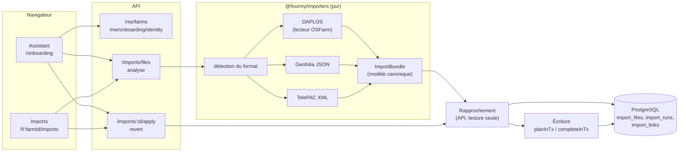
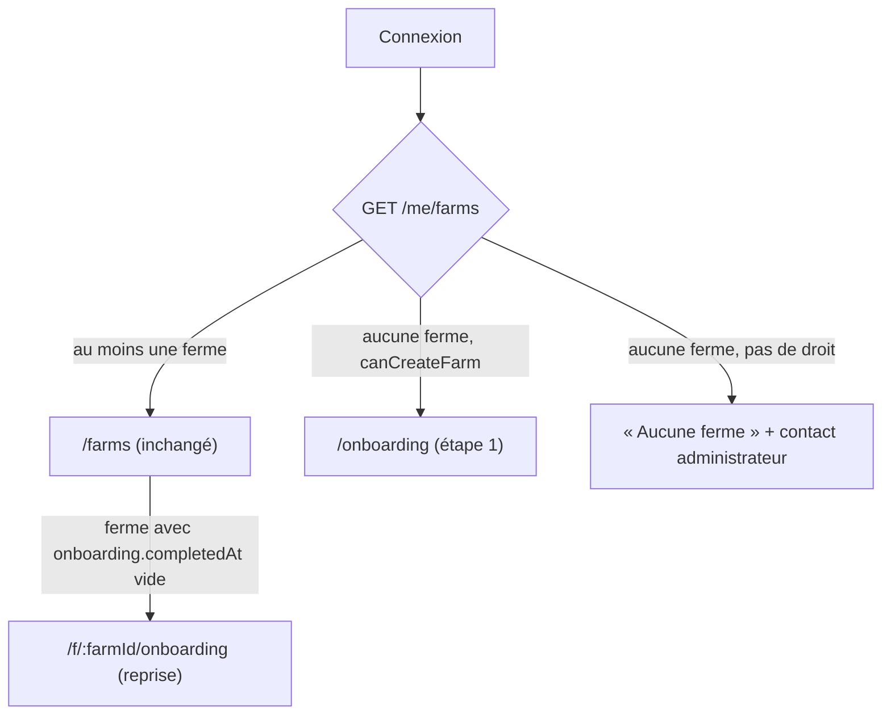

# Imports DAPLOS, Geofolia, TelePAC et assistant de premier démarrage — conception

Conception du 2026-11-19, à partir de `claudedocs/besoins_import_onboarding.md`
(décisions D1 à D5, exigences FR-IMP, FR-DAP, FR-GEO, FR-PAC, FR-EVO, FR-ONB,
NFR). Ce document fixe le modèle canonique, les règles de rapprochement, la
migration, les routes, l'assistant et le découpage en lots. Le code vient
ensuite (`/sc:implement`, lot par lot).

## 1. Existant réutilisé

| Besoin | Existant | Fichier |
|---|---|---|
| Suivi d'un import | `import_runs` (source, statut, rapport), `POST /imports/ekylibre` en tâche de fond (202 + suivi), un seul import en cours par ferme | migration 0000, `repos/imports.ts` |
| Écran d'imports | page Imports (Ekylibre, base matériel) | `features/imports/ImportsPage.tsx` |
| Écriture d'une intervention avec ses règles | `planInTx`, `completeInTx` : validation de forme, contrôle phyto, IFT, nitrates, mouvements de stock ; `ctx.origin` décide si un feu rouge exige un motif (web seulement) | `repos/interventions.ts:626`, `:747` |
| Cibles, intrants, sorties | `workedAreaM2` par parcelle ; intrant `per: total | hectare` ; sortie `to` (lieu ou cuve) | `contracts/entities/interventions.ts` |
| Irrigation | bloc `irrigation.depthMm` (≤ 100 mm), procédures `watering`… | idem, `procedures.ts:188` |
| Parcelles datées | `land_parcels` + `land_parcel_versions` (forme, `pac_islet`, `valid`) | migration 0000 |
| Références PAC et cadastre | `parcel_references` (`kind = cap`, code culture, surface, recouvrement, `attrs`) ; `lexicon_cap_codes` (code PAC → production) | migration 0016 |
| Activités | `activities` (famille, référence Lexicon, variété), `productions.activity_id` | migration 0011, `docs/activites.md` |
| Articles | `articles` (`kind`, `amm`, `lexicon_ref`), `article_fertilizers` (composition) | migrations 0000, 0039 |
| Personnes | `people.external_ids` | migration 0045 |
| Identifiants rejouables | UUID v5 dérivés de la source | `migrator-ekylibre/src/ids.ts` |
| Siège depuis une adresse | `placeHeadquartersFromAddress` | `repos/farm-profile.ts` |
| Comptes | inscription fermée, `create-user` en ligne de commande, invitations | `cli/create-user.ts`, `repos/invitations.ts` |
| Liste des fermes | `GET /me/farms` ; page « Vous n'êtes membre d'aucune ferme » | `routes/me.ts`, `features/farms/FarmsPage.tsx` |
| Zip | écriture seulement (`zip()`), sans dépendance | `packages/isoxml/src/zip.ts` |
| Référentiel Lexicon | paquet `productions` (table `master_productions`, qui porte `agroedi_crop_code`, non chargée aujourd'hui) | `packages/lexicon/src/load.ts` |

## 2. Ce que les fichiers imposent (constats vérifiés)

Ces constats complètent le §1.1 des besoins et en corrigent un point.

1. **Le GUID commun est celui du couple intervention × parcelle**, pas celui
   de l'intervention : `intervention_guid` DAPLOS = `CropZoneIds[].RecognitionId`
   Geofolia. 421 des 511 couples Geofolia sont dans le DAPLOS ; les 90 absents
   sont les apports « Plan de fumure ». Geofolia regroupe les couples sous un
   `ActionId` (311 actions sur 1 parcelle, 73 sur 2 à 7) ; **DAPLOS n'a pas
   d'identifiant d'intervention** regroupant plusieurs parcelles.
2. **Parcelles principales et secondaires** (constaté au lot IM2) : les
   63 cultures Geofolia sont 41 parcelles principales et 22 « parcelles
   secondaires » (interculture, dérobée) rattachées à une principale par
   `MainPlotId`. Couverts d'interculture (20 « Mélange CINE ») →
   `cover_crops` ; dérobées (2) → productions datées de la même parcelle,
   la culture contrôlée à une date venant de `fourmy_production_at`
   (migration 0063). Surface réelle : 164,9 ha.
2bis. **Les parcelles n'ont pas d'identifiant commun** : Geofolia change de `Id`
   chaque campagne (chaîne `NMinus1PlotId`…), DAPLOS n'en a pas. Le seul lien
   stable est le **numéro de travail** (`Code` = `land_parcel_work_number`,
   ex. « 143 »), plus la géométrie.
3. **Les doses sont par parcelle** (quantité totale et dose/ha par couple),
   alors que Fourmy porte les intrants au niveau de l'intervention.
4. **Aucune heure** : `StartTime` vide, durée 0, dates seules.
5. **L'eau d'irrigation est un intrant** (« Eau », en litres) :
   2 178 290 L sur 7,26 ha = 30 mm.
6. **Récoltes par parcelle** (quantité, rendement), sans destination.
7. **TelePAC** : XML en ISO-8859-1, géométries GML 2 (`gml:coordinates`) en
   Lambert 93 sans `srsName`, SNA en polygones (197) ou points (143). Le
   demandeur n'a **pas d'adresse** (raison sociale, SIRET, courriel) ;
   l'adresse vient du DAPLOS (segment `DATF` : lieu-dit, code postal, commune).
8. **Lecteur DAPLOS d'OSFarm** (1.0.12, dépendances `proj4`, `js-yaml`,
   `uuid`) : lit le fichier du GAEC pilote (63 cultures, 421 interventions),
   coordonnées en WGS 84, n° AMM et codes GNIS présents. Défauts constatés :
   valeurs numériques laissées en texte (« 02.612158 »), code INSEE tronqué
   (« 441 »), **libellés parfois faux** (code `ZFB` libellé « Orge d'hiver 2
   rangs », unité de rendement libellée « Limon argilo-sableux »). **Cause**
   (vérifiée sur le dictionnaire AgroEDI de Lexicon, §5.8) : les codes AEE
   ne sont uniques **que dans leur table** (`ZKE` = « Semis de précision »
   en table 14, « Amendements calco-magnésiens » en table 5 ; `ZHK` = unité
   de rendement ici, type de sol en tables 2 et 43), alors que le paquet
   (`dict/aee_codes.js`, 11 catégories) range la plupart des codes dans un
   seul fourre-tout `other_codes`. **Corrigé dans le fork
   [`ekylibre/agroedei-edifact-daplos-reader`](https://github.com/ekylibre/agroedei-edifact-daplos-reader)**,
   branche `fix/lecture-par-table`, version 2.0.0 (19/11/2026, CI verte) :
   - libellés lus dans la table de chaque champ (`FIELD_TABLES`, tables
     confirmées par les commentaires du gabarit d'Ekylibre
     `lib/svf/norms/edi/daplos_2.yml`) ; un code absent de sa table reste
     sans libellé ;
   - **segment `DP` recalé** : le code INSEE occupe 6 colonnes, pas 3 (même
     erreur dans le gabarit d'Ekylibre). Avec 3, la fin du segment était
     décalée : les « codes de résidus » `8`, `16`, `41` étaient des numéros
     de parcelle précédente, et le sol était lu dans le mauvais champ.
     Vérifié sur quatre exports (Geofolia, MesParcelles, Smag) ;
   - quantités, surfaces, rendements en nombres ; température signée ; durée
     `JJHHMM` aussi en minutes ; `ZHK` = t/ha ;
   - option `dictionary` : Fourmy passe les libellés du jeu `agroedi` de
     Lexicon (§5.8) ;
   - plus de `console.log`, code mort et dépendance `uuid` retirés, types
     alignés sur la sortie, 14 tests.
   Le gabarit d'Ekylibre a en plus un segment `PV` trop court de 12 colonnes
   (surface travaillée mal lue) : à corriger dans Ekylibre. Fourmy dépend du
   fork par Git (`github:ekylibre/agroedei-edifact-daplos-reader#<commit>`)
   jusqu'à la reprise des corrections par OSFarm (PR à ouvrir).

## 3. Vue d'ensemble



Trois étages, comme pour la reprise Ekylibre mais séparés :

1. **Lecture** (`packages/importers`, fonctions pures, sans base) : un fichier
   → un `ImportBundle` normalisé, identique quel que soit le format.
2. **Rapprochement** (API, lecture seule en base) : bundle + état de la ferme
   + référentiels → **plan d'import** (quoi créer, compléter, ignorer) et
   **propositions** (activités, articles, personnes) que l'utilisateur corrige.
3. **Écriture** (API, une transaction par fichier) : le plan, avec les
   décisions de l'utilisateur, passe par les mêmes fonctions que la saisie.

Le rapprochement est **recalculé à l'écriture** : un fichier analysé avant un
autre (Geofolia avant que TelePAC soit écrit) est donc juste au moment de
l'écriture. Les décisions de l'utilisateur sont indexées par **clés source**,
pas par identifiants Fourmy : elles survivent au recalcul.

## 4. Modèle canonique (`@fourmy/importers`)

Nouveau paquet `packages/importers`, sans accès à la base, testé sur des jeux
anonymisés. Géométries en **GeoJSON WGS 84** (reprojection Lambert 93 → WGS 84
dans le paquet, avec `proj4`, déjà tiré par le lecteur DAPLOS).

```ts
export type ImportFormat = "daplos" | "geofolia" | "telepac";

export interface ImportBundle {
  format: ImportFormat;
  producedBy: string | null;            // « Geofolia 26.2.48.0 », émetteur DAPLOS
  exportedAt: string | null;
  farm: BundleFarm;
  campaigns: number[];                  // récoltes couvertes
  parcels: BundleParcel[];              // parcelles culturales (Geofolia, DAPLOS) ou PAC (TelePAC seul)
  history: BundleHistoryCrop[];         // cultures N-1…N-5
  capRefs: BundleCapRef[];              // îlots et parcelles PAC (TelePAC)
  landscape: BundleLandscapeFeature[];  // SNA, ZDH (TelePAC)
  articles: BundleArticle[];
  people: BundlePerson[];
  workUnits: BundleWorkUnit[];          // un couple intervention × parcelle
  notImported: { kind: string; label: string; count: number }[];  // volailles, aides…
  warnings: BundleWarning[];
}

export interface BundleFarm {
  siret: string | null; pacage: string | null; name: string | null;
  email: string | null;
  address: { line1?: string; line2?: string; postalCode?: string; city?: string; country?: string } | null;
}

export interface BundleParcel {
  key: string;                    // numéro de travail (« 143 »), ou « ilot/parcelle » PAC
  campaign: number;
  name: string;
  shape: GeoJSON.MultiPolygon | null;
  areaM2: number | null;
  islet: string | null;           // n° d'îlot déclaré
  inseeCode: string | null;
  crop: {
    aeeCode: string | null;       // « ZAM », « ZDUZLT »
    capCode: string | null;       // « PTR » (TelePAC)
    label: string;                // « Avoine noire d'hiver »
    variety: { name: string; gnis: string | null } | null;
    sownOn: string | null; harvestedOn: string | null;
    destination: string | null;   // pâturée et fauchée, grain…
  };
  soil: { code: string | null; label: string | null } | null;
  yield: { objective: number | null; realized: number | null; unit: string | null } | null;
  advice: Record<string, number> | null;   // P, K, Mg… (kg/ha)
  spreadable: Record<string, number> | null; // SNE, surfaces épandables
  sourceIds: Record<string, string>;        // { "geofolia.field": "6eeac503-…" }
}

export interface BundleHistoryCrop {
  parcelKey: string; campaign: number;      // campagne passée
  aeeCode: string | null; label: string;
}

export interface BundleCapRef {
  kind: "islet" | "parcel";
  ref: string;                    // n° d'îlot de référence, ou « îlot/parcelle »
  campaign: number;
  isletNumber: string; parcelNumber: string | null;
  capCode: string | null; admissibleAreaM2: number | null;
  shape: GeoJSON.MultiPolygon | null;
  attrs: Record<string, unknown>;
}

export interface BundleLandscapeFeature {
  source: "telepac.sna" | "telepac.zdh";
  ref: string;                    // numeroSna, numeroZdh
  category: string | null;        // categorieSna (« EA »…)
  capType: string;                // typeSna (« V4 »…), « ZDH »
  widthM: number | null;
  areaM2: number | null;
  geometry: GeoJSON.Polygon | GeoJSON.MultiPolygon | GeoJSON.Point;
  attrs: Record<string, unknown>; // densité de végétation, îlots et parcelles touchés
}

export type ArticleNature = "phyto" | "adjuvant" | "seed" | "fertilizer" | "amendment" | "water" | "harvest" | "other";

export interface BundleArticle {
  key: string;                    // SupplyId Geofolia, sinon nom normalisé
  name: string;
  nature: ArticleNature;
  amm: string | null; gnis: string | null;
  unit: string;                   // unité canonique Fourmy (kg, L, t, q, unité)
  composition: Partial<Record<"n" | "p2o5" | "k2o" | "mgo" | "so3" | "cao" | "b" | "cu" | "zn" | "mn" | "fe" | "mo" | "ms" | "cn", number>> | null;
  species: string | null;         // récolte, semence
  sourceIds: Record<string, string>;
}

export interface BundlePerson { key: string; firstName: string | null; lastName: string; startedOn: string | null; sourceIds: Record<string, string> }

/** Un couple intervention × parcelle : l'unité commune aux deux formats. */
export interface BundleWorkUnit {
  guid: string;                   // RecognitionId / intervention_guid, majuscules sans tirets
  groupKey: string | null;        // ActionId Geofolia ; null en DAPLOS
  parcelKey: string; campaign: number;
  operation: { aeeCode: string | null; label: string; category: string | null };
  status: "done" | "planned";
  on: string;                     // date (AAAA-MM-JJ) ; fin si différente
  until: string | null;
  workedAreaM2: number | null;
  inputs: { articleKey: string; total: number | null; perHa: number | null; unit: string }[];
  outputs: { articleKey: string; total: number | null; perHa: number | null; unit: string }[];
  waterL: number | null;          // irrigation
  weather: { temperatureC?: number; windKmh?: number; humidity?: number } | null;
  purpose: string | null; notes: string | null;
  doerKeys: string[];
  modifiedBy: string | null;
}
```

**Détection du format** (`detectFormat(name, bytes)`) : zip contenant
`Field.Json` et `Action.Json` → Geofolia ; XML de racine `producteurs`
(espace `urn:x-telepac:…`) → TelePAC ; texte dont la première ligne commence
par `EI` → DAPLOS. Sinon : refus explicite (« format non reconnu »).

### 4.1 Lecteurs

| Lecteur | Points de conception |
|---|---|
| `readDaplos(bytes)` | `parseDaplosFile` du paquet OSFarm, figé à une version exacte. Conversion des textes numériques (`"02.612158"` → 2.612158), codes seuls (libellés du paquet ignorés, libellés Fourmy issus de nos tables). Une culture (`crops[]`) = une `BundleParcel` ; `crop_histories` → `history` ; `interventions[]` → `workUnits` (sans `groupKey`) ; `entities` (`TF`) → `farm` (SIRET, adresse, PACAGE en `entity_informations_2`). |
| `readGeofolia(bytes)` | `unzip` maison (§10, limites de taille), JSON UTF-8 avec BOM. `Fields` → parcelles (WKT Lambert 93 → GeoJSON), `NMinus1Crop`…`NMinus5Crop` → `history` ; `Products` → articles (nature par `CategoryEnum`/`ProductTypeEnum`, table §6.5) ; `Employees` → personnes ; `Activities[].CropZoneIds` → `workUnits` (`groupKey = ActionId`), intrants et récoltes rattachés par `RecognitionId`. |
| `readTelepac(bytes)` | Décodage selon l'en-tête XML (ISO-8859-1), parseur XML sans entités externes (`fast-xml-parser`, `processEntities: false`). `demandeur` → `farm` ; `ilot` → `capRefs` (îlot) et `parcelle` → `capRefs` (parcelle, code culture, surface admissible) ; `sna-declaree`, `zdh-declaree` → `landscape` ; `effectifs-animaux`, demandes d'aides → `notImported`. Sans Geofolia/DAPLOS, les parcelles PAC deviennent aussi des `BundleParcel` (FR-PAC-3) : c'est le rapprochement qui choisit. |

## 5. Rapprochement (API, `repos/farm-imports/reconcile.ts`)

Entrée : bundle, ferme (parcelles, articles, activités, personnes, liens
d'import), référentiels, décisions. Sortie : un **plan** et un **aperçu**.

```ts
interface ImportPlan {
  parcels:        PlanItem<{ parcelKey: string; landParcelId: string; version: "create" | "reuse" | "new_version" }>[];
  productions:    PlanItem<{ parcelKey: string; campaign: number; activityKey: string; declared: boolean }>[];
  activities:     PlanItem<{ key: string; name: string; family: string; reference: string | null; cultivation: string | null }>[];
  articles:       PlanItem<{ key: string; articleId: string | null; lexiconRef: string | null }>[];
  people:         PlanItem<{ key: string; personId: string | null }>[];
  interventions:  PlanItem<{ guids: string[]; procedure: string; status: "planned" | "done" }>[];
  capRefs:        PlanItem<{ ref: string; landParcelId: string | null; overlapM2: number | null }>[];
  landscape:      PlanItem<{ ref: string }>[];
  farmIdentity:   { field: string; current: string | null; proposed: string }[];
}
interface PlanItem<T> { action: "create" | "link" | "complete" | "skip"; reason?: string; value: T }
```

### 5.1 Parcelles (D2, constat 2)

Dans l'ordre, pour chaque `BundleParcel` :

1. **Lien connu** : `import_links` (`plot.work_number`, clé = numéro de
   travail) → la parcelle. Forme comparée à la version en vigueur au début de
   la campagne : IoU ≥ 0,95 → même version ; sinon **nouvelle version** datée
   du début de la campagne.
2. **Géométrie** : parcelle de la ferme d'IoU ≥ 0,80 à la même date (créée à la
   main, depuis la carte, ou par TelePAC) → lien.
3. Sinon **création** (parcelle + version valide du début de la campagne à
   l'infini).

Avec TelePAC seul (FR-PAC-3), la clé de parcelle est `îlot/parcelle` PAC
(namespace `telepac.parcel`) ; un Geofolia importé ensuite s'y raccroche par
l'étape 2.

### 5.2 Activités et productions

- **Référence Lexicon d'une culture**, dans l'ordre : code AEE →
  `lexicon_productions.agroedi_crop_code` (code complet, puis 3 premiers
  caractères = espèce) ; code culture PAC de la parcelle PAC qui la recouvre
  le plus → `lexicon_cap_codes` ; libellé (recherche approchée sur les
  libellés français). Sans résultat : activité sans référence, signalée.
- **Une activité par libellé de culture** (Geofolia `CropName` ; DAPLOS :
  espèce + usage final, ex. « Avoine — grain »), famille `plant_farming`.
  Activité de même nom existante → lien. L'utilisateur peut renommer ou
  fusionner à l'étape Rapprochements.
- `productions.nature` : `grassland` pour les prairies et bandes enherbées
  (référence de famille prairie), sinon `field_crop`.
- **Historique N-1…N-5** (FR-EVO-3) : production `declared = true` sur la
  parcelle de la campagne importée, campagnes créées au besoin. Aucune
  intervention, aucune version de parcelle antidatée : la production
  déclarée ne s'affiche pas sur la carte d'une date passée ; elle sert au
  précédent cultural (fertilisation) et à la frise des rotations.

### 5.3 Interventions (constats 1, 3, 4, 6)

**Regroupement des couples en interventions** :

- Geofolia : un `ActionId` = une intervention…
- DAPLOS : couples de même date de début et de fin, même code d'opération,
  même statut → une intervention…
- … puis, dans les deux cas, **scission par signature de doses** : la liste
  triée `(article, dose/ha arrondie à 3 chiffres significatifs, unité)` ;
  une signature = une intervention. Les doses Fourmy étant par intervention,
  c'est la seule façon de ne pas inventer de dose.
- **Récoltes : une intervention par parcelle** (le rendement de chaque
  parcelle est la donnée utile).
- **Irrigations** : dose `waterL / workedAreaM2` en mm, scission par dose
  arrondie au mm.

**Dédoublonnage (D1)** : chaque couple porte son GUID (namespace
`agri.crop_zone`). Un couple déjà lié est ignoré ; si **tous** les couples
d'une intervention prévue sont déjà liés, l'intervention est ignorée
(« déjà importée ») ; s'il en reste, ils forment une nouvelle intervention
(cas rare : un couple ajouté à la source entre deux exports).

**Correspondance des opérations** (table versionnée
`importers/src/operations.ts`, test : tout code rencontré dans les jeux d'essai
a une cible) :

Codes vérifiés le 19/11/2026 sur la table 14 (« nature d'intervention ») du
dictionnaire AgroEDI de Lexicon (`lexicon/data/agroedi`) ; nombre de couples
au GAEC pilote entre parenthèses. Geofolia donne le même code dans
`ReferentialOperationCode`.

| Code AEE (table 14) | Libellé AEE | Procédure Fourmy | Bloc, précision |
|---|---|---|---|
| `SEM` (116) | Fertilisation | `mineral_fertilizing` ; `organic_fertilizing` si un intrant est de nature `ZJB` (effluents d'élevage) | — |
| `SEK` (21) | Épandage organique | `organic_fertilizing` | type d'effluent (table 6 : `SCA` fumier de bovins, `SCB` lisier de bovins, `SCU` fumier de poulets de chair) |
| `SEX` (75) | Traitement phytosanitaire | `spraying` | `purposes` d'après la nature d'intrant (table 5 : `ZIU` herbicide, `ZIV` fongicide, `ZIW` insecticide, `ZIX` molluscicide, `ZIZ` régulateur) |
| `SEU` (53) | Semis direct | `sowing` | `sowing.technique = direct` |
| `ZKE` (6) | Semis de précision | `sowing` | `sowing.technique = precision` |
| `SET` | Semis classique | `sowing` | `sowing.technique = conventional` |
| `SEW` | Plantation | `sowing` | `sowing.technique = planting` |
| `SER` (71), `SEQ` | Récolte, Moisson | `harvesting` ; `grains_harvest` si usage final grain (`ZLD`) ou moisson | sorties |
| `SEO` (77) | Irrigation | `plant_watering` | `irrigation.depthMm` (intrant `ZJE` / code eau `EAU`) |
| `SFK` (2) | Broyage des résidus | `crop_residues_grinding` | — |
| `SEP`, `SEE`, `SEF`, `SEV` | Labour, Déchaumage, Décompactage, Sous-solage | `plowing`, `superficial_plowing` (×2), `subsoiling` si présent au catalogue, sinon `superficial_plowing` | — |
| `SEB`, `SED`, `SEI`, `SEN`, `SES`, `SEL` | Binage, Buttage, Enfouissement, Hersage, Roulage, Fauchage | `hoeing` (×3), `raking`, `rolling`, `plant_mowing` | — |
| autre (dont `ZTC` « Autre type de travail ») | — | `generic_tillage` si catégorie `ZF8` (travail du sol), sinon `technical_task` « Tâche technique générale » (procédures d'Ekylibre hors catalogue, lisibles par `getProcedure`), libellé AEE en note | — |

Les 8 codes du GAEC pilote ont tous une cible. La colonne `ekylibre_value` du
dictionnaire sert de point de départ mais **n'est pas reprise telle
quelle** : elle donne des procédures Ekylibre absentes du catalogue Fourmy
(`harvesting_with_plant_or_land_parcel`, `sowing_without_plant_output`) et
quelques erreurs (`SEV` Sous-solage → `rolling`, `ZTC` Autre → semis).

Autres codes d'intervention vérifiés : catégorie (table 26) `ZG7` intrant,
`ZF7` récolte, `ZF9` autres travaux ; état (table 11) `ZK2` « événement
réalisé » (seul présent : le DAPLOS ne porte aucun prévisionnel) ; motif
(tables 9 et 25) `ZNC` autres mesures/OAD, `ZNB` conditions météo, `ZNE`
autre observation, `ZMV` préconisation.

**Dates** : période du jour entier, heure de Paris, marquée
`period_precision = 'day'` (§6.3). **Météo** saisie dans Geofolia → bloc
`weather` avec `source: "import"`.

**Statut** : « Réalisée » → `planInTx` puis `completeInTx` ; « Plan de
fumure » (`ZK…` non réalisé) → `planInTx` seul (FR-GEO-5).

**Règles relâchées pour `origin = import`** (FR-IMP-6) : destination de
récolte facultative (FR-EVO-5) ; feu rouge réglementaire enregistré sans
motif (comme mobile et migration aujourd'hui) ; aucune dose plafonnée
supprimée : une dose hors AMM reste un feu rouge, visible au registre et au
rapport.

**Stocks** : les interventions importées **ne bougent pas les stocks**
(`affects_stock = false`) : sinon 62 traitements et 113 fertilisations
d'historique rendraient les stocks négatifs. Les stocks se reprennent par un
inventaire initial (hors de ce lot).

### 5.4 Articles (FR-IMP-4)

| Nature | Rapprochement | Création |
|---|---|---|
| phyto, adjuvant | n° AMM → `registered_phytosanitary_products.france_maaid` ; article de la ferme de même AMM → lien | article `phyto` avec `amm` et `lexicon_ref` |
| semence | article de même nom + variété ; code GNIS gardé en `custom.gnis` | article `seed`, variété (taxonomie) si l'espèce est connue |
| engrais, amendement | article de même nom (normalisé) | article `fertilizer` + `article_fertilizers` (composition, `origin = import`) |
| eau | — | pas d'article : dose d'irrigation |
| récolte | article `harvest` de même espèce et nom | article `harvest` (unité q ou t) |

Les unités sources (`LTR`, `KGM`, `TNE`, `L`, `kg`, `q`, `D` dose…) passent
par une table de conversion vers les unités Fourmy ; une unité inconnue
bloque l'article à l'étape Rapprochements (choix obligatoire).

### 5.5 Personnes, PAC, paysage

- `Employees` → personne (`external_ids.geofolia`), active depuis
  `StartDate`. `LastModificationUser` est proposé comme personne à créer,
  sans être intervenant (on ne sait pas qui a travaillé).
- **Références PAC** : îlot → `parcel_references` `kind = cap_islet` ;
  parcelle PAC → `kind = cap` rattachée à **chaque** parcelle Fourmy qu'elle
  recouvre (surface commune en `overlap_m2`), `ref = îlot/parcelle`,
  `code` = code culture, `attrs` : surface admissible, n° d'îlot de
  référence. Écart > 5 % entre surface PAC et surface culturale → rapport.
- **SNA et ZDH** → `farm_landscape_features` (§6.2).

### 5.6 Identité de la ferme

SIRET, PACAGE, raison sociale, courriel, adresse : proposés seulement quand
le champ est vide dans Fourmy ; sinon écart affiché, valeur de Fourmy gardée.
**SIRET du fichier ≠ SIRET de la ferme** : analyse refusée, sauf confirmation
explicite (« ce fichier concerne bien ma ferme ») enregistrée dans les
décisions (FR-DAP-2).

### 5.8 Nomenclatures AEE (vérifiées sur `lexicon/data/agroedi`)

**Synchronisation.** Le jeu `agroedi` de Lexicon (`registered_agroedi_codes`
: 1 372 codes en tables numérotées, avec `ekylibre_value` ;
`registered_agroedi_crops` : codes simples et combinés → production) est
réservé aux adhérents (`scope :members`) : absent du dépôt public, servi par
un **bundle** à une clé portant `bundle:<flavor>`. Ekylibre édite Lexicon et
Fourmy peut tout synchroniser :

- **Lexicon** : un bundle suivi `fourmy` (`resources/flavors/fourmy.yml`,
  `tracked: true`) nommant ce que Fourmy charge, dépendances comprises :

  ```yaml
  name: fourmy
  tracked: true
  only:
    - agricultural_pictures
    - agroedi
    - phytosanitary
    - productions
    - taxonomy
    - units
  ```

  publié par `./lexicon publish --bundle fourmy`, et une clé
  `--scope bundle:fourmy` par instance de Fourmy (dev, production).
- **Fourmy** (`packages/lexicon`) : `FOURMY_LEXICON_API_KEY` ; avec une clé,
  la base devient `https://lexicon.osfarm.org/bundles/fourmy` et chaque
  requête porte `Authorization: Bearer lex_…` (même arborescence `index.json`
  / `<jeu>/<version>/…` que le dépôt public, sommes `sha256` vérifiées comme
  le fait `Lexicon::Packaging::Fetcher`). Sans clé : dépôt public, sans
  `agroedi` ; l'import marche quand même (libellés du paquet DAPLOS, cultures
  par `agroedi_crop_code`), en signalant la référence moins précise.
- Nouveau paquet dans `PACKAGES` : `agroedi` → tables
  `lexicon_agroedi_codes (table_id, code, label, ekylibre_value)` et
  `lexicon_agroedi_crops (code, label, production)` ; ignoré s'il est absent
  de l'index.

Usage dans l'import :

- les **libellés** affichés viennent de `lexicon_agroedi_codes`, passés au
  lecteur DAPLOS par l'option `dictionary` ;
- la **culture** se résout d'abord par `lexicon_agroedi_crops` sur le code
  combiné (`ZCSZLF` → `silage_corn`, `ZDHZMVZFB`), puis par l'algorithme
  ci-dessous ;
- la **table de correspondance propre** (`importers/src/aee.ts`) ne garde que
  la traduction en concepts Fourmy (procédures, unités, natures d'intrant,
  états, motifs, types d'effluent, sols) ; `ekylibre_value` sert de point de
  départ, pas de vérité (§5.3).

**Table par champ DAPLOS.** Chaque champ codé se lit dans sa table, jamais
dans une table voisine (cause des libellés faux du paquet OSFarm, §2.8) :

| Champ DAPLOS (paquet OSFarm) | Table AEE | Codes au GAEC pilote |
|---|---|---|
| `crop_specie_edicode`, `output_specie_edicode` | 18 espèce | ZDU, ZCS, ZDA, ZAR, ZDH, ZBE, ZBT, H69, ZAM, ZAV, ZCQ, ZCA, ZCD, ZBN, ZCL |
| `crop_specie_number` (complément) | 37 | ZLT permanente, ZLU temporaire, ZMU 6 rangs, ZMV 2 rangs, ZLM noire… |
| `crop_sowing_period_edicode` | 30 période | ZFB hiver, ZFA printemps |
| `crop_final_usage_edicode` | 17 / 28 usage | ZEQ pâturée et fauchée, ZLD grain, ZLF fourrage, ZPB biomasse, ZES oléagineux, ZNS industrie, ZEP fauchée, H72 autre |
| `other_soil_nature` | 43 sol | ZQE limon battant, ZFG argileux, ZFN limon sableux |
| `residue_management` | 29 résidus | ZLJ exportés, ZHI enfouis broyés, ZSD enfouis non broyés (les valeurs `8`, `16`, `41` lues avant correction venaient du décalage du segment `DP`, §2.8 ; `residue_input` est une quantité en t/ha) |
| `area_nature_edicode` | 41 surface | A17 parcelle culturale ; A28, A38, A18 surfaces épandables fumier, lisier, fientes |
| `intervention_*` | 14, 26, 11, 9/25 | voir §5.3 |
| `input_nature_edicode` | 5 | ZJC minéral, ZIU herbicide, ZJE irrigation, ZJF semence, ZQG adjuvant, ZJB effluents, ZIV fongicide, ZIX molluscicide, ZIW insecticide, ZJD fertirrigation, ZIZ régulateur |
| `input_organic_code` | 6 | SCB lisier de bovins, SCA fumier de bovins, SCU fumier de poulets de chair |
| `indicator_nature_edicode` (composition) | 20 | NT, NL, PT, KT, MT, ST, CA, BT, ZT, LT (Mo), UT (Cu), GT (Mn), FT (Fe) → `article_fertilizers` |
| unités (`*_unity_edicode`) | 36 | LTR litre, KGM kg, TNE tonne, ZKK L/ha, ZKL kg/ha ; **`ZHK` (unité de rendement) absent de la table 36** : t/ha d'après les valeurs (5,54 t sur 1,4568 ha = 3,80) |
| `output_nature_edicode` | 15 | ZJH produit principal |
| `seed_information_1` | 6 | ZQA semences certifiées |

**Culture → production de référence**, dans l'ordre :

1. candidats du paquet `productions` de même `agroedi_crop_code` (espèce,
   3 caractères) ;
2. filtrés par **saison** (période de semis `ZFB` → `winter`, `ZFA` →
   `spring`) et par **usage** (`ZLD` → `grain`, `ZLF`/`ZEQ`/`ZEP` →
   `fodder`/`meadow`) ;
3. un seul candidat → retenu ; plusieurs → le premier par usage, signalé ;
   aucun → code culture PAC de la parcelle (`lexicon_cap_codes`), puis
   libellé, puis choix de l'utilisateur.

Résultat simulé sur les 63 cultures 2026 du GAEC pilote (16 combinaisons
espèce × complément × période × usage) :

| Issue | Parcelles | Combinaisons |
|---|---|---|
| Une seule production | 39 | `ZDU` → `meadow` (23) ; `ZCS`+`ZLF` → `silage_corn` (7) ; `ZDH`+`ZFB` → `winter_barley`, `ZDH`+`ZFA` → `spring_barley` (2+2) ; `ZAR`+`ZFB` → `winter_common_wheat` (2) ; `ZBT`+`ZFB` → `winter_field_bean` (2) ; `ZAM`+`ZFB` → `winter_oat` (1) |
| Plusieurs candidats | 4 | carotte `ZAV` (5 productions), épinard `ZBN` (pas de période), lin `ZCL` (usage `ZES` sans période ; Geofolia dit « d'hiver »), luzerne `ZCQ` (`alfalfa` / `dehydrated_alfalfa`) |
| Aucun candidat | 20 | `ZDA` moutarde blanche : le paquet n'a que `mustard` en `ZDC` |

Les ambiguïtés se lèvent par le libellé Geofolia (« Lin oléagineux
d'hiver », « Carotte Amsterdam »), puis par le code PAC, puis à l'étape
Rapprochements. Prairies permanente (`ZLT`) et temporaire (`ZLU`) tombent
toutes deux sur `meadow` : la distinction vient du complément AEE et du
code PAC (`PPH`, `PTR`), gardés dans `productions.attrs`.

Dans l'historique (N-1…N-5) apparaissent aussi `H69` mélange
(`fodder_species_mix` n'a pas de code), `ZCD` jachère autre semée (`fallow`
est en `ZCF`), `ZBE` colza et `ZCA` haricot (résolus). À proposer à Lexicon,
dans le paquet ouvert `productions` : `ZDA`, `H69` et `ZCD`.

**Le dictionnaire réservé a aussi ses défauts**, à signaler à Lexicon :
`crops.csv` contient deux lignes fausses (`ZFA`, `ZFB`, codes de période
pris pour des cultures) ; la table 18 envoie toute l'orge sur
`spring_barley` et toute l'avoine sur `winter_oat`, quelle que soit la
saison ; les codes `ZKM ` et `ZKN ` de la table 36 ont une espace finale.

**« Mélange CINE » élucidé** : ses 20 parcelles Geofolia sont les 20
cultures DAPLOS `ZDA` (moutarde blanche). C'est un **couvert
d'interculture** : activité proposée sur `wintry_cover` (et non une
prairie), ce qui compte pour le contrôle nitrates (question ouverte 2 des
besoins).

### 5.7 Idempotence et non-destruction (FR-IMP-2, FR-IMP-3)

- Tout ce qu'un import crée **ou relie** laisse une ligne `import_links`
  `(namespace, clé source) → (entité, id)`, avec le run et `created`.
- Une entité déjà liée n'est **jamais réécrite**. Seuls des champs **vides**
  dans Fourmy sont complétés (`complete`) : sol, rendement objectif,
  références PAC, AMM d'un article, composition d'un engrais.
- Une différence entre la source et une entité liée est **rapportée**
  (« modifiée à la source, non reprise »), jamais appliquée en v1.

## 6. Données (migration 0061)

### 6.1 Imports

```sql
-- Fichiers déposés : en base (même choix que les photos), purgés à expiration.
CREATE TABLE import_files (
  id           uuid PRIMARY KEY,
  farm_id      uuid NOT NULL REFERENCES farms(id) ON DELETE CASCADE,
  format       text NOT NULL CHECK (format IN ('daplos', 'geofolia', 'telepac')),
  name         text NOT NULL,
  size         int  NOT NULL CHECK (size > 0 AND size <= 52428800),
  sha256       text NOT NULL,
  bytes        bytea NOT NULL,
  uploaded_by  uuid NOT NULL,
  uploaded_at  timestamptz NOT NULL DEFAULT now(),
  expires_at   timestamptz NOT NULL DEFAULT now() + interval '30 days',
  UNIQUE (farm_id, sha256)
);

-- import_runs s'étend à toutes les sources : analyse, décisions, écriture, annulation.
ALTER TABLE import_runs DROP CONSTRAINT import_runs_status_check;
ALTER TABLE import_runs
  ADD CONSTRAINT import_runs_status_check
    CHECK (status IN ('analyzed', 'running', 'completed', 'failed', 'discarded', 'reverting', 'reverted')),
  ADD COLUMN file_id    uuid REFERENCES import_files(id) ON DELETE SET NULL,
  ADD COLUMN format     text,
  ADD COLUMN preview    jsonb,          -- aperçu (§7.2), recalculé à la demande
  ADD COLUMN decisions  jsonb NOT NULL DEFAULT '{}',  -- par clé source (§5)
  ADD COLUMN created_by uuid;

-- Provenance : clé source → entité Fourmy.
CREATE TABLE import_links (
  farm_id      uuid NOT NULL REFERENCES farms(id) ON DELETE CASCADE,
  namespace    text NOT NULL,   -- plot.work_number, agri.crop_zone, geofolia.action, geofolia.field,
                                -- geofolia.supply, article.amm, telepac.islet, telepac.parcel,
                                -- telepac.sna, telepac.zdh, geofolia.employee
  key          text NOT NULL,
  entity       text NOT NULL,   -- land_parcel, production, intervention, article, person,
                                -- activity, parcel_reference, landscape_feature
  entity_id    uuid NOT NULL,
  run_id       uuid NOT NULL REFERENCES import_runs(id) ON DELETE CASCADE,
  created      boolean NOT NULL,      -- créé par ce run (annulable), ou seulement relié
  linked_at    timestamptz NOT NULL DEFAULT now(),
  PRIMARY KEY (farm_id, namespace, key, entity)
);
CREATE INDEX import_links_entity ON import_links (entity, entity_id);
```

RLS `farm_isolation` sur les trois tables, droits `fourmy_app`, comme
partout. `import_files.bytes` n'est jamais renvoyé par l'API.

### 6.2 Modèle (FR-EVO)

```sql
-- FR-EVO-2, FR-IMP-6 : origine « import », interventions sans effet de stock.
ALTER TABLE interventions DROP CONSTRAINT interventions_origin_check;
ALTER TABLE interventions ADD CONSTRAINT interventions_origin_check
  CHECK (origin IN ('web', 'mobile', 'migration', 'plugin', 'import'));
ALTER TABLE interventions
  ADD COLUMN affects_stock     boolean NOT NULL DEFAULT true,
  ADD COLUMN period_precision  text NOT NULL DEFAULT 'time' CHECK (period_precision IN ('time', 'day')),
  ADD COLUMN sowing            jsonb;   -- { technique: direct | precision | conventional | planting | broadcast }

-- FR-EVO-3, FR-EVO-8 : productions déclarées et attributs de la source.
ALTER TABLE productions
  ADD COLUMN declared  boolean NOT NULL DEFAULT false,
  ADD COLUMN attrs     jsonb;   -- { yield: {objective, realized, unit}, destination, residues, advice, spreadable }

-- Type de sol déclaré : porté par productions.attrs (réalisation IM2), par
-- campagne comme dans la source ; parcel_soils reste au modèle de croissance.

-- Îlots PAC.
ALTER TABLE parcel_references DROP CONSTRAINT parcel_references_kind_check;
ALTER TABLE parcel_references ADD CONSTRAINT parcel_references_kind_check
  CHECK (kind IN ('cadastre', 'cap', 'cap_islet'));

-- FR-EVO-4 : éléments du paysage déclarés par la ferme.
CREATE TABLE farm_landscape_features (
  id          uuid PRIMARY KEY,
  farm_id     uuid NOT NULL REFERENCES farms(id) ON DELETE CASCADE,
  source      text NOT NULL CHECK (source IN ('telepac', 'manual')),
  campaign    int,
  ref         text,             -- numeroSna, numeroZdh
  kind        text NOT NULL CHECK (kind IN ('hedge', 'tree_row', 'tree', 'grove', 'pond', 'ditch', 'stone_wall', 'hedge_densification', 'other')),
  cap_type    text,             -- code TelePAC d'origine (V1, V4, B3…)
  width_m     double precision,
  area_m2     double precision,
  geom        geometry(Geometry, 4326) NOT NULL,
  attrs       jsonb,
  created_at  timestamptz NOT NULL DEFAULT now(),
  UNIQUE (farm_id, source, campaign, ref)
);
CREATE INDEX farm_landscape_features_geom ON farm_landscape_features USING gist (geom);

-- Référentiel : code AgroEDI des productions Lexicon (déjà dans le paquet).
ALTER TABLE lexicon_productions ADD COLUMN agroedi_crop_code text;

-- Assistant (§9) : droit de créer une ferme, état de l'assistant.
ALTER TABLE users ADD COLUMN farm_creation_quota int NOT NULL DEFAULT 0 CHECK (farm_creation_quota >= 0);
ALTER TABLE farm_settings ADD COLUMN onboarding jsonb;  -- { step, files: [runId], completedAt }
```

Correspondance `typeSna` → `kind` : table dans `importers/src/telepac-sna.ts`
établie d'après la notice TelePAC 2026 au lot 3 (hypothèse à vérifier :
`V1` arbres isolés — 143 points au GAEC pilote ; `V4` haies — 136 avec largeur
calculée ; `A*` mares ; `B*` bosquets). Code inconnu → `other`, code gardé.

### 6.3 Impacts sur l'existant

| Changement | Code touché |
|---|---|
| `origin = import` | contrat `interventionOrigin` (web, synchro mobile : zero-mobile doit accepter la valeur ou la recevoir comme `migration`) |
| `affects_stock = false` | écriture des mouvements de stock dans `completeInTx` |
| `period_precision = 'day'` | `crewDurations`, temps de travaux, météo de l'intervention (journalière), rapprochement Traccar/parcours GPS (exclu), affichage (« le 01/04/2026 » sans heures) |
| `sowing.technique` | contrat d'intervention, fiche, formulaire (champ facultatif) |
| destination facultative en import | `validateIntervention` (option d'origine) |
| `productions.declared` | rotations, précédent cultural (`docs/fertilisation.md`), listes des productions (filtre), carte (exclues) |
| `farm_landscape_features` | carte (couche « Éléments déclarés PAC »), plan 3D (haies comme la couche paysage IGN), ZNT (lot ultérieur) |
| `lexicon_productions.agroedi_crop_code` | `packages/lexicon/src/load.ts` |

## 7. API

### 7.1 Routes de ferme (responsable, `requireOwner`)

| Route | Effet |
|---|---|
| `POST /imports/files` (multipart `file`) | Détecte, stocke (`import_files`, dédoublonné par sha256), lit, rapproche ; crée un run `analyzed` ; **201** `{ run, preview }`. Lecture > 30 s ou fichier refusé → 422 avec la raison |
| `GET /imports` | Runs de la ferme (toutes sources), du plus récent au plus ancien |
| `GET /imports/:id` | Run, aperçu, rapport (existant, étendu) |
| `PUT /imports/:id/decisions` | Décisions (activités, articles, personnes, identité, confirmation de SIRET) ; renvoie l'aperçu recalculé |
| `POST /imports/:id/apply` | **202** ; une transaction : rapprochement recalculé + écriture ; `completed` + rapport, ou `failed` sans rien écrire |
| `POST /imports/:id/discard` | Abandonne un run `analyzed` ; supprime son fichier s'il n'est plus utilisé |
| `POST /imports/:id/revert` | **202** ; supprime ce que le run a créé (`created = true`) et qui n'a pas été modifié depuis (`updated_at ≤ linked_at`), dans l'ordre inverse des dépendances ; le reste est listé au rapport |
| `POST /imports/ekylibre` | inchangé |

Un seul run `running` ou `reverting` à la fois par ferme (règle existante).

### 7.2 Aperçu (`preview`)

```ts
interface ImportPreview {
  format: ImportFormat; producedBy: string | null; campaigns: number[];
  farm: { siretMatches: boolean | null; identity: { field: string; current: string | null; proposed: string }[] };
  parcels: { create: number; link: number; newVersion: number; areaHa: number; geojson: GeoJSON.FeatureCollection };
  activities: { key: string; name: string; reference: string | null; parcels: number; areaHa: number; action: "create" | "link" }[];
  interventions: { byProcedure: { procedure: string; done: number; planned: number }[]; alreadyImported: number };
  articles: { key: string; name: string; nature: string; match: { articleId?: string; lexiconRef?: string; label: string } | null; needsDecision: boolean }[];
  people: { key: string; name: string; match: string | null }[];
  capRefs: { islets: number; parcels: number; areaGapParcels: { name: string; gapPct: number }[] };
  landscape: { byKind: { kind: string; count: number }[] };
  history: { campaigns: number[]; productions: number };
  notImported: { kind: string; label: string; count: number }[];
  warnings: { level: "info" | "warning" | "blocking"; message: string; ref?: string }[];
}
```

Un avertissement `blocking` (unité inconnue, SIRET différent non confirmé)
interdit `apply` (409).

### 7.3 Routes de l'utilisateur (assistant)

| Route | Effet |
|---|---|
| `GET /me/farms` | ajoute `canCreateFarm` (`farm_creation_quota > 0`) |
| `POST /me/farms` `{ name, siret?, pacage?, address? }` | Si quota > 0 : crée la ferme (`farms`, `memberships` owner, `farm_settings` avec `onboarding: { step: "files" }`, campagne de l'année, personne liée au compte, siège géocodé si adresse) ; décrémente le quota ; **201** `{ id }`. Sinon 403 |
| `POST /me/onboarding/identity` (multipart) | Lit **l'identité seule** d'un fichier (SIRET, PACAGE, nom, adresse), sans rien stocker ; pré-remplit l'étape 1 |

La création de ferme passe par une fonction `createFarm(tx, …)` du nouveau
`repos/farms.ts`, que la reprise Ekylibre pourra réutiliser.

**Compte « à embarquer »** : `create-user --onboarding` (ou une option de
l'invitation administrateur) met `farm_creation_quota = 1`.

## 8. Écriture (`repos/farm-imports/apply.ts`)

Dans une transaction `withFarm`, dans cet ordre (chaque étape enregistre ses
`import_links`) :

1. identité de la ferme (champs vides seulement) ;
2. campagnes manquantes ;
3. parcelles et versions ;
4. activités, puis productions (dont déclarées) ;
5. articles (+ compositions), personnes ;
6. références PAC, éléments du paysage ;
7. interventions : `planInTx(tx, farmId, ctx, body)` puis, si réalisée,
   `completeInTx` — `ctx.origin = "import"`, identifiant
   `uuidv5(farmId:agri.crop_zone:<GUID min des couples>)` pour qu'un rejeu
   interrompu retombe sur la même intervention ;
8. rapport : comptes par entité et action, avertissements, contrôles
   réglementaires en défaut (lus dans `compliance`, `nitrate_check`).

Un échec annule tout le fichier (NFR-2) ; le run passe `failed` avec l'erreur.
Les tâches longues (calcul IFT, météo des interventions) restent celles du
worker, déclenchées comme pour une saisie.

## 9. Assistant de premier démarrage (web)

### 9.1 Entrée



### 9.2 Étapes et état

`/onboarding` (étape 1, avant la ferme), puis `/f/:farmId/onboarding/:step`.
L'état vit dans `farm_settings.onboarding` (étape courante, runs de
l'assistant) : fermer le navigateur reprend à la même étape (FR-ONB-3).

| Étape | Écran | Appels | Écrit en base |
|---|---|---|---|
| 1 `farm` | Raison sociale, SIRET, PACAGE, adresse ; « Pré-remplir depuis un fichier » | `POST /me/onboarding/identity`, `POST /me/farms` | ferme (seule exception à FR-ONB-4) |
| 2 `files` | Zone de dépôt multiple, format reconnu par fichier, ordre affiché TelePAC → Geofolia → DAPLOS, aide « où trouver cet export » (FR-ONB-5) | `POST /imports/files` par fichier | fichiers, runs `analyzed` |
| 3 `preview` | Carte (parcelles, îlots, éléments du paysage), chiffres par fichier, interventions par procédure, « déjà importé » | `GET /imports/:id` | — |
| 4 `matching` | Tables éditables : cultures → activités (renommer, fusionner, référence), articles non rapprochés (choix ou création, unité), personnes | `PUT /imports/:id/decisions` | décisions |
| 5 `settings` | Campagne courante, couleurs d'activités, préférences d'affichage, invitations d'équipe, intégrations facultatives (liens vers les écrans existants) | routes existantes de « Ma ferme » | réglages |
| 6 `import` | Progression fichier par fichier, dans l'ordre ; rapport | `POST /imports/:id/apply`, `GET /imports/:id` | données |
| 7 `done` | Résumé et liens (tableau de bord, registre phyto, cahier de fertilisation, carte) | `PUT /farm/onboarding` (completedAt) | fin |

Composants : `features/onboarding/` (`OnboardingLayout` avec la frise des
étapes, un composant par étape) ; la carte de l'aperçu réutilise
`ParcelMap` ; le dépôt de fichiers et l'aperçu sont **partagés** avec la page
Imports (`features/imports/FileImport.tsx`, `ImportPreview.tsx`), qui gagne
« Importer un fichier » pour FR-IMP-7.

## 10. Sécurité et données personnelles (NFR-3, NFR-4)

- Taille : 50 Mo par fichier (limite du corps de requête Hono), refus au-delà.
- Zip : `unzip` maison dans `packages/isoxml/src/zip.ts` (inflate de
  `node:zlib`) : entrées attendues seulement (`Field.Json`, `Action.Json`,
  `IdentificationCodes.json`), taille décompressée ≤ 200 Mo et ratio ≤ 100,
  noms sans `..` ni chemin absolu, rien n'est écrit sur disque.
- XML : `fast-xml-parser` sans entités (`processEntities: false`), pas de
  DTD. DAPLOS : texte seul.
- Aucun contenu de fichier n'est exécuté ni interprété hors des lecteurs.
- Fichiers : responsable seul, RLS, purgés par le worker à `expires_at`
  (30 jours ; question ouverte 9 des besoins).
- Rapport et journaux : comptes et clés, jamais le contenu brut.

## 11. Tests

| Niveau | Contenu |
|---|---|
| `@fourmy/importers` | Jeux **anonymisés** dérivés des fichiers du GAEC pilote (`importers/test/fixtures/` : noms, SIRET, PACAGE, géométries décalées), par lecteur ; détection du format ; regroupement et scission des doses ; table des opérations ; unités ; zip malveillant, XML avec entité externe |
| Domaine | `validateIntervention` avec origine import (destination facultative) ; durées ignorées en `period_precision = day` |
| API (intégration) | Analyse → décisions → écriture de chaque format ; **Geofolia puis DAPLOS et l'inverse : mêmes comptes** (US-IMP-2) ; rejeu à l'identique (US-IMP-4) ; annulation ; SIRET différent refusé ; création de ferme avec et sans quota |
| Web (e2e) | Assistant de bout en bout avec les trois jeux anonymisés ; reprise à l'étape 4 |
| Recette | Fichiers réels du GAEC pilote sur dev.fourmy.org, critères chiffrés du §11 des besoins |

Les fichiers réels restent hors du dépôt (`ressources_fourmy/`).

## 12. Lots

| Lot | Contenu | Dépend de |
|---|---|---|
| **IM1** Socle | Migration 0061 (§6.1, §6.2), `@fourmy/importers` (modèle, détection, `unzip`, table AEE `aee.ts` du §5.8), `agroedi_crop_code` chargé, synchronisation du bundle Lexicon `fourmy` avec clé (jeu `agroedi`), `import_links`, routes `files` / `decisions` / `discard` sans écriture | — |
| **IM2** Geofolia | Lecteur, rapprochement parcelles / activités / articles / personnes / interventions, écriture (`apply`), origine import, `affects_stock`, `period_precision`, `sowing`, destination facultative | IM1 |
| **IM3** TelePAC | Lecteur, identité, îlots et parcelles PAC, création de parcelles sans Geofolia, éléments du paysage (table + couche carte) | IM1 |
| **IM4** DAPLOS | Lecteur (fork `ekylibre/agroedei-edifact-daplos-reader` 2.0.0, libellés Lexicon par l'option `dictionary`), regroupement par signature, dédoublonnage avec Geofolia | IM2 |
| **IM5** Historique et plan de fumure | Productions déclarées N-1…N-5, précédent cultural, interventions planifiées, `revert` | IM2 |
| **IM6** Assistant | Quota de création, `POST /me/farms`, `createFarm`, identité depuis un fichier, écrans 1 à 7, page Imports partagée | IM2, IM3 |
| **IM7** Recette du GAEC pilote | Compte, assistant sur dev.fourmy.org avec ses trois fichiers, écarts corrigés, documentation (`docs/imports.md`, README) | IM1 à IM6 |

IM3 peut avancer en parallèle d'IM2 ; IM4 a besoin de la mécanique de
dédoublonnage d'IM2.

## 13. Décisions de conception à valider

1. **Doses par parcelle → scission** des interventions par signature de
   doses (§5.3), plutôt qu'une dose moyenne ou des doses par cible.
2. **Récoltes : une intervention par parcelle.**
3. **Historique sans effet de stock** (`affects_stock = false`) ; stocks
   repris par un inventaire initial, hors de ce lot.
4. **Dates sans heure** : période du jour entier marquée
   `period_precision = 'day'`, exclue des temps de travaux.
5. **v1 n'applique jamais une différence** sur une entité déjà importée :
   elle est rapportée.
6. **Fichiers en base** 30 jours, puis purgés.
7. **Plan de fumure Geofolia** : interventions planifiées seulement ; le PPF
   de Fourmy n'est pas modifié (réponse proposée à la question ouverte 5 des
   besoins).

## 14. Questions restantes

Les questions ouvertes 1 à 4, 6, 8 et 9 des besoins restent posées. S'y
ajoutent :

- ~~Confirmer les codes d'opération AEE~~ : vérifiés le 19/11/2026 sur
  `lexicon/data/agroedi` (§5.3, §5.8). Les codes `8`, `16`, `41` venaient
  d'un décalage du lecteur, corrigé (§2.8). Reste l'unité `ZHK`, absente du
  dictionnaire (t/ha d'après les valeurs : à ajouter à la table 36 de
  Lexicon), et les types SNA TelePAC (lot IM3).
- Remontées :
  - **OSFarm** : PR du fork `ekylibre/agroedei-edifact-daplos-reader`
    (`fix/lecture-par-table`) vers `osfarm/…`, à ouvrir ;
  - **Ekylibre** : gabarit `lib/svf/norms/edi/daplos_2.yml` (code INSEE sur
    6 colonnes, segment `PV` trop court de 12 colonnes, commentaires de
    table faux pour `PH.crop_specie_number`, `output_use_edicode`,
    `LC.indicator_nature_edicode`) ;
  - **Lexicon** : bundle `fourmy` ; codes `ZDA`, `H69`, `ZCD` dans
    `productions` ; `ZHK` en table 36 ; lignes `ZFA`/`ZFB` de `crops.csv` ;
    orge et avoine sans saison en table 18 ; espaces finales de `ZKM`,
    `ZKN`.
- zero-mobile : accepter `origin = import` ou le recevoir comme `migration`.
- Rendre la création de ferme disponible aussi à l'administrateur
  (`create-farm` en ligne de commande) pour les fermes sans fichiers.
