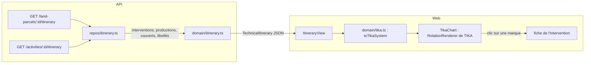

# Itinéraires techniques : conception

Réponse à `claudedocs/besoins_itineraires_techniques.md` (exigences E1 à
E15, N1 à N8, récits R1 à R4). Version du 2026-11-13, décisions validées le même jour (§13).

## 1. Existant réutilisé

| Besoin | Déjà dans Fourmy |
|---|---|
| Interventions complètes d'une parcelle | `readInterventions(tx, where)` (`apps/api/src/repos/interventions.ts`), cibles dans `intervention_parameters` (`role = 'target'`, `ref_type = 'land_parcel'`) |
| Bornes d'une campagne | `campaignWindow(db, farmId, year)` : table `campaigns`, sinon l'année civile |
| Culture d'une parcelle par campagne | `productions` (parcelle × campagne) → `activities` (nom, couleur, variété, famille) |
| Couverts d'interculture | `cover_crops` : espèce, `sown_on`, `destroyed_on`, campagne de la culture qui suit |
| Forme et catégorie d'une procédure | `getProcedure(code)` : `work`, `sowing`, `harvest`, `fertilization`, `treatment`, `maintenance` ; catégories `crops`, `vine`, `equipment`, `general` |
| Irrigation | `isIrrigation(code)` et `interventions.irrigation` |
| Libellés | `PROCEDURE_LABELS`, `TREATMENT_PURPOSE_LABELS` (contrats) |
| Activités végétales | familles `plant_farming`, `vine_farming`, `plant_nursery` |
| Lecture hors ligne | service worker de « Ma ferme » F5 : toute lecture JSON d'une ferme gardée hors ligne est conservée |
| Chargement différé | `lazy()` du routeur (carte, labo carto) |

**Pas de nouvelle table.** Tout ce que montre l'itinéraire se déduit des
tables existantes ; les dates d'une culture sont calculées à la lecture (E6).
Une seule migration, un index (§10).

## 2. Vue d'ensemble



- **Le serveur calcule le modèle de Fourmy** (`TechnicalItinerary`) :
  étapes, dates, couloirs, regroupements, libellés résolus. Les règles sont
  des fonctions pures du paquet `domain`, testées sans base.
- **Le web convertit vers le format de TIKA** (`toTikaSystem`, fonction pure
  du même paquet), puis TIKA dessine. Le format de TIKA reste ainsi en
  bordure : il ne fuit ni dans l'API, ni dans le cache hors ligne. Le jour
  où l'on exporte vers Triple Performance (N8), l'API pourra appeler la même
  fonction.

## 3. Règles du domaine (`packages/domain/src/itinerary.ts`)

Fonctions pures, sans base ni réseau.

### 3.1 Couloir d'une intervention (décision 4, questions 2)

```ts
type Lane = "works" | "inputs";

/** null : hors itinéraire (entretien du matériel, procédures générales, E15). */
function laneOf(procedure: string, irrigation: boolean): Lane | null;
```

| Cas | Couloir |
|---|---|
| forme `maintenance`, ou catégorie `equipment` ou `general` | aucun (exclu) |
| irrigation (`isIrrigation` ou `irrigation` renseignée) | `inputs` |
| forme `fertilization` ou `treatment` | `inputs` |
| forme `work`, `sowing`, `harvest` (cultures et vigne) | `works` |
| procédure inconnue du catalogue | `works` |

Sur TIKA : `works` → `intervention_top`, `inputs` → `intervention_bottom`.

### 3.2 Dates d'une culture (E6, question 3)

```ts
function cropSpan(
  interventions: { procedure: string; at: string; status: InterventionStatus }[],
  campaign: { from: string; to: string },
): { from: string; to: string; source: "interventions" | "campaign" };
```

- **Début** : le premier semis ou la première plantation (forme `sowing`,
  hors `plant_cover_sowing`) dans la campagne.
- **Fin** : le dernier chantier de forme `harvest` dans la campagne.
- Il manque l'un ou l'autre (vigne, prairie, culture en cours) : la borne de
  la campagne, et `source = "campaign"`. La frise l'indique (E6).
- On ne compte que les interventions **réalisées**. Une récolte prévue ne
  fixe pas la fin.

### 3.3 Rattachement d'une intervention à une étape

- Une intervention appartient à la **campagne** dont la fenêtre contient sa
  date (début, sinon fin, sinon date de création, comme
  `listInterventions`).
- Dans sa campagne, elle va à l'**étape principale**, avec un décalage en
  jours depuis le début de la culture. Ce décalage est **négatif** pour un
  labour avant le semis : TIKA le gère (« day »: "-5" dans ses exemples).
- **Exception** : semis et destruction d'un couvert (`plant_cover_sowing`,
  ou date dans la période du couvert et forme `work` de destruction) vont à
  l'étape du couvert.
- Annulées : jamais (E14). Prévues : oui, avec leur statut.

### 3.4 Regroupement de la vue fusionnée (E8, question 1)

```ts
function groupMarks(marks: Mark[], opts = { gapDays: 7, harvestGapDays: 15 }): MarkGroup[];
```

- Les marques sont regroupées par **procédure** et par **statut**, puis
  triées par date. Un nouveau groupe commence dès que l'écart avec la marque
  précédente dépasse 7 jours, ou 15 jours pour une récolte. Les écarts
  s'enchaînent : trois semis à 5 jours d'intervalle font un seul groupe de
  10 jours.
- Un groupe porte :
  - sa date médiane, où se place la marque ;
  - ses bornes ;
  - le nombre de parcelles **distinctes** ;
  - les identifiants des interventions ;
  - le produit principal, s'il est le même partout.
- Une intervention faite sur trois parcelles compte une fois, avec trois
  parcelles.

## 4. Contrats (`packages/contracts/src/itinerary.ts`)

```ts
export type ItineraryLane = "works" | "inputs";

export interface ItineraryMark {
  /** Une intervention (vue parcelle) ou un groupe (vue fusionnée). */
  interventionIds: string[];
  procedure: string;
  /** « Pulvérisation · Karaté K » (E11). */
  label: string;
  lane: ItineraryLane;
  status: "done" | "planned";
  /** Date affichée (début, ou médiane du groupe), et bornes pour un groupe. */
  at: string;
  from: string;
  to: string;
  /** Décalage en jours depuis le début de l'étape (négatif avant le semis). */
  day: number;
  /** Lignes « libellé : valeur », en texte brut (E12). */
  details: { label: string; value: string }[];
  /** Vue fusionnée : parcelles touchées. */
  parcels: { id: string; name: string }[];
}

export interface ItineraryStep {
  /** Production, ou couvert d'interculture. */
  kind: "crop" | "cover";
  campaign: number;
  name: string;            // activité (et variété), ou espèce du couvert
  color: string | null;    // couleur de l'activité
  from: string;
  to: string;
  datesFrom: "interventions" | "campaign" | "cover";
  attributes: { label: string; value: string }[];   // variété, surface, culture contrôlée…
  marks: ItineraryMark[];
}

export interface TechnicalItinerary {
  title: string;
  steps: ItineraryStep[];   // dans l'ordre du temps
  /** Bornes demandées, pour la frise de l'application. */
  campaigns: number[];
}

export interface ActivityItinerary extends TechnicalItinerary {
  /** Parcelles de l'activité pour la campagne, pour descendre sur l'une d'elles (E9, E10). */
  parcels: { id: string; name: string; areaM2: number; interventions: number }[];
}
```

Pas de schéma zod : ces types ne sont que des réponses, comme `FarmProfile`.

## 5. API

Lecture seule, sous `/farms/:farmId`, ouverte à tout membre (E3). Le
contexte est posé par `withFarm`, donc la RLS s'applique.

| Méthode et chemin | Paramètres | Réponse |
|---|---|---|
| `GET /land-parcels/:id/itinerary` | `year` (campagne, défaut : celle du jour), `years` (1 à 20, défaut 1) | `TechnicalItinerary` |
| `GET /activities/:id/itinerary` | `year` | `ActivityItinerary` ; 404 si l'activité n'est pas végétale |

### 5.1 `repos/itinerary.ts`

**Vue parcelle**, campagnes `year − years + 1` à `year` :

1. Fenêtres des campagnes (`campaignWindow`), et fenêtre totale.
2. Productions de la parcelle sur ces campagnes, avec leur activité (nom,
   couleur, variété). On ne garde que les familles végétales.
3. Couverts de la parcelle (`cover_crops.campaign` dans l'intervalle).
4. Interventions : un seul `readInterventions` filtré sur la cible et la
   fenêtre totale, statut différent de `cancelled` :

   ```sql
   EXISTS (SELECT 1 FROM intervention_parameters t
           WHERE t.intervention_id = i.id AND t.role = 'target'
             AND t.ref_type = 'land_parcel' AND t.ref_id = $parcel)
   AND coalesce(i.started_at, i.stopped_at, i.created_at) >= $from
   AND coalesce(i.started_at, i.stopped_at, i.created_at) <  $to
   AND i.status <> 'cancelled'
   ```

5. Libellés : une requête par type pour **tous** les identifiants
   rencontrés (articles, matériels, personnes, parcelles), pas une par
   intervention.
6. `cropSpan`, `laneOf`, rattachement (§3), puis construction des étapes.

**Vue activité**, une campagne :

1. Parcelles de l'activité pour la campagne (`productions.activity_id`).
2. Interventions qui ciblent au moins une de ces parcelles dans la fenêtre :
   même requête, avec `t.ref_id = ANY($parcels)`.
3. Étape unique : l'activité. Début au plus tôt des `cropSpan` des
   parcelles, fin au plus tard.
4. Marques par intervention, puis `groupMarks`.
5. `parcels` : nom, surface et nombre d'interventions de chaque parcelle ;
   celles à 0 donnent l'avertissement de E10.

### 5.2 Détails d'une marque (E12)

Calculés côté serveur, en texte brut, dans cet ordre, en sautant les
vides :

1. **Date** : jour, ou « du … au … », et durée de travail (`workDurationS`).
2. **Parcelles** : nom et surface travaillée (`workedAreaM2`, sinon la
   surface de la parcelle).
3. **Intrants** : article, dose et unité (« 1,5 L/ha »).
4. **Matériels** et **équipe**.
5. **Traitement** : stade BBCH, cibles (`purposes`), IFT.
6. **Météo** : température et vent.
7. **Notes**.

## 6. Web

### 6.1 Où

- **Fiche parcelle** : onglet « Itinéraire technique » (E1), à côté de
  « Interventions ».
  - Campagne de la frise de l'application par défaut.
  - Bouton « Rotation » : 3 ans par défaut, liste 3, 5, 10 ou « tout » (E5).
  - Bascule frise ou cercle (vue `donut` de TIKA).
- **Activités** :
  - lien « Itinéraire » sur chaque activité végétale (E2), vers
    `/f/:farmId/activities/:id/itinerary?at=…` ;
  - la page montre la frise fusionnée et, à côté, la liste des parcelles avec
    leur nombre d'interventions ;
  - un clic sur une parcelle (ou sur une parcelle d'une marque regroupée)
    remplace la frise par celle de la parcelle, avec un retour à la vue
    fusionnée (E9).
- Les deux écrans sont chargés à la demande (`lazy`) : ECharts et TIKA ne
  pèsent pas sur le reste (N4).

### 6.2 Composants

```
apps/web/src/features/itinerary/
  ItineraryView.tsx          barre (rotation, années, frise ou cercle), états vide et erreur
  TikaChart.tsx              enveloppe React de RotationRenderer
  ParcelItineraryTab.tsx     onglet de la fiche parcelle
  ActivityItineraryPage.tsx  page de l'activité (vue fusionnée, liste des parcelles)
packages/domain/src/tika.ts  toTikaSystem(itinerary, { view, laneTitles }) → JSON au format TIKA
```

**`TikaChart`** :
- monte `RotationRenderer` sur un élément, dans un `useEffect`, et appelle
  `dispose()` au démontage (le double montage de StrictMode doit fonctionner) ;
- re-rend quand le JSON change ;
- relaie le clic sur une intervention : `navigate` vers la fiche (E13) ;
- pour un groupe, ouvre la liste de ses interventions.

**`toTikaSystem`** :

| Fourmy | TIKA |
|---|---|
| `title` | `title` |
| étape `crop` / `cover` | `steps[]`, `secondary_crop` vrai pour un couvert |
| `from`, `to` | `startDate`, `endDate` |
| `color` | `color`, `useDefaultColor` faux ; couleur par défaut de TIKA si null |
| `attributes` | `attributes[]` (`name`, `value`) |
| `datesFrom = "campaign"` | ligne « Dates : bornes de la campagne » dans `description` |
| marque | `interventions[]` : `day`, `name` = `label`, `type` selon le couloir, `description` = lignes `libellé : valeur`, `status`, `ref` = identifiants (contribution C5, C6) |
| options | `view`, `show_transcript` vrai (N6), titres des couloirs « Travaux » et « Intrants », `show_climate_diagram` faux |

L'adresse et le climat de TIKA restent vides : rien n'est envoyé à
`itk-info` (N1).

### 6.3 Styles

La feuille `styles-rendering.css` de TIKA (après C3) est importée par
`TikaChart`, sous la classe racine de TIKA. Les couleurs des couloirs et des
statuts sont passées en variables CSS, prises dans le thème Mantine (clair
et sombre).

## 7. Contributions à TIKA : fork Ekylibre, puis reversement

**Fork `ekylibre/itineraire-technique`** de `osfarm/itineraire-technique`
(décision du 2026-11-13). Toutes les modifications se font dans le fork, pour
ne pas attendre les publications d'OSFarm. Elles sont ensuite **reversées à
OSFarm**, par demandes de fusion, une par contribution. Relecture côté OSFarm :
David et Bertrand.

- **Dépendance de Fourmy** : le fork par une étiquette Git, sans publication
  npm :

  ```json
  "@osfarm/itineraire-technique": "github:ekylibre/itineraire-technique#v1.3.0-ekylibre.1"
  ```

  Le paquet est du JavaScript et du CSS déjà compilés : rien à construire à
  l'installation. On garde le nom du paquet : les `import` de Fourmy ne
  changent pas le jour où l'on revient au paquet npm d'OSFarm.
- **Une branche par contribution** dans le fork, partant de `main` d'OSFarm,
  fusionnée dans la branche `ekylibre` qui porte les étiquettes. Chaque
  branche devient telle quelle une demande de fusion chez OSFarm.
- **Compatibilité** : Triple Performance et Itinera continuent de
  fonctionner. La variable globale `window.RotationRenderer` reste, le format
  JSON ne change pas, et les champs ajoutés sont facultatifs. Sans cela, le
  reversement serait refusé.
- **Retour au paquet d'OSFarm** quand tout est publié : on remplace
  l'étiquette Git par la version npm, et le fork peut être archivé.

| # | Contribution | Pourquoi |
|---|---|---|
| **C1** | **Module ES** : `export class RotationRenderer`, `"exports"` et `"module"` dans `package.json`, ECharts importé (`import * as echarts`) et déclaré en `peerDependencies` | empaqueter sans CDN (N1), charger à la demande (N4) |
| **C2** | **Sans jQuery ni Underscore** : DOM natif, `debounce` interne | ne pas ajouter jQuery à Fourmy ; plus léger pour tous |
| **C3** | **Sans Bootstrap ni Font Awesome** : grille propre à TIKA sous une classe racine (`.tika`), icônes en SVG intégré | ne pas importer Bootstrap dans une application Mantine (N3) |
| **C4** | **Textes échappés** : noms et descriptions échappés avant la mise en forme « libellé : valeur » en gras et les retours à la ligne ; drapeau `options.allow_html` pour garder l'ancien comportement si le wiki en a besoin | aucun texte saisi ne devient du HTML (N2) |
| **C5** | **Rappels** : options `onInterventionClick(intervention)` et `onStepClick(step)`, champ libre `ref` porté tel quel par chaque intervention | ouvrir la fiche de l'intervention (E13) |
| **C6** | **Statut** : `status: "done" \| "planned"` sur une intervention ; une prévue est dessinée en creux, avec une légende | réalisé et prévu (E14) |
| **C7** | **Élément plutôt qu'identifiant** : le constructeur accepte un `HTMLElement` ; `dispose()` retire tous les écouteurs (fenêtre comprise) | montage et démontage par React, plusieurs frises par page |
| **C8** | **Types** : `index.d.ts` du format JSON et de la classe | contrôle de `toTikaSystem` par TypeScript |
| **C9** | **ECharts modulaire** : `echarts/core` et les seuls composants utilisés (série personnalisée, lignes, barres, secteurs, infobulles, zoom) | réduire le poids (N4) |

Ordre : C7 et C2 (le cœur du DOM), puis C3, C4, C1, C5, C6, C8 et C9. Chaque
étape est vérifiée à la main avec les fichiers `test/*.json` de TIKA dans
`visualisateur.html` et `editor.html`, comme aujourd'hui, avant d'être
étiquetée.

## 8. Hors ligne (N7)

- Les deux routes renvoient du JSON sous `/api/v1/farms/:id/` : le service
  worker les garde déjà pour une ferme copiée (F5). Rien à ajouter côté
  service worker.
- Les fichiers de TIKA et d'ECharts sont des fichiers `/assets/` hachés.
  Gardés au premier affichage en ligne, ils servent ensuite hors ligne.
- Comme pour les cartes : un itinéraire jamais ouvert en ligne n'est pas
  disponible hors ligne.

## 9. Sécurité

- Lecture seule, tout membre de la ferme, RLS par `withFarm` (E3).
- Les détails partent de l'API en texte brut. Le web ne fabrique aucun HTML.
  L'échappement (C4) fait partie de la première étiquette du fork utilisée
  par Fourmy.
- Aucun appel externe : ni CDN, ni `itk-info` (N1).

## 10. Performance (N5)

- Une requête d'interventions par écran, plus une requête de libellés par
  type d'objet.
- Sur la ferme pilote, 1 482 interventions en tout : une parcelle sur dix ans
  reste sous quelques centaines.
- **Index à ajouter** (vérifié le 2026-11-13 : il n'existe aucun index sur
  les cibles, seulement `(intervention_id, role)`). La fiche parcelle fait
  déjà cette recherche sans index ; elle en profitera aussi :

  ```sql
  CREATE INDEX intervention_parameters_target_ix
    ON intervention_parameters (ref_id) WHERE role = 'target';
  ```

  La date des interventions n'est pas indexée non plus. Ce n'est pas
  nécessaire ici : on part des cibles, pas des dates.
- ECharts dans son propre morceau de code chargé à la demande. Taille à
  mesurer avant C9.

## 11. Tests

| Niveau | Quoi |
|---|---|
| Domaine (unitaires) | `laneOf` sur tout le catalogue (aucune procédure de culture sans couloir), `cropSpan` (semis et récolte, vigne sans semis, récolte seulement prévue), rattachement (labour avant semis → jour négatif, couvert), `groupMarks` (écart de 7 et de 15 jours, chaîne, parcelles distinctes, statuts séparés), `toTikaSystem` (forme du JSON, couloirs, couvert en culture secondaire) |
| API (intégration, ferme pilote) | parcelle sur une campagne et sur trois ans ; activité fusionnée avec ses parcelles ; annulées exclues ; activité d'élevage → 404 ; lecteur autorisé ; RLS (autre ferme → 404) |
| Web | onglet et page avec TIKA simulé (jsdom n'a pas de canvas) : JSON transmis, bascules rotation et cercle, descente sur une parcelle, avertissement des parcelles sans intervention |
| E2E | fiche parcelle de la ferme pilote : frise dessinée (canvas) et liste textuelle présente ; après C5, un clic mène à la fiche de l'intervention |

## 12. Découpage en lots

| Lot | Contenu | Dépend de |
|---|---|---|
| **T0. Fork TIKA** | fork `ekylibre/itineraire-technique`, C1 à C9 dans le fork, étiquettes ; demandes de fusion vers OSFarm au fil de l'eau | — |
| **T1. Modèle et API** | `domain/itinerary.ts`, contrats, `repos/itinerary.ts`, deux routes, index des cibles, tests | — (en parallèle de T0) |
| **T2. Fiche parcelle** | `toTikaSystem`, `TikaChart`, onglet, campagne et rotation, frise et cercle, clic vers la fiche | T1, première étiquette du fork (C1 à C5, C7) |
| **T3. Activité** | lien depuis Activités, page fusionnée, liste des parcelles, descente | T2 |
| **T4. Reversement** | demandes de fusion restantes chez OSFarm ; retour au paquet npm d'OSFarm une fois tout publié | T0 |

## 13. Décisions de conception

1. **Modèle de Fourmy côté API, format TIKA côté web** (§2), plutôt qu'une
   API qui renverrait directement le JSON de TIKA.
2. **Pas de nouvelle table** : dates des cultures calculées à la lecture
   (§3.2) ; une migration pour l'index des cibles (§10).
3. **Couverts en cultures secondaires** de TIKA, sur la même frise (§3.3).
4. **Fork `ekylibre/itineraire-technique`** : Fourmy dépend du fork (étiquette
   Git) et n'attend pas OSFarm ; chaque contribution est reversée ensuite
   (§7). Validé le 2026-11-13.
5. **Toutes les modifications dans le fork**, y compris le clic vers la
   fiche (C5) et le statut (C6) : pas de solution d'attente dans Fourmy.
   Validé le 2026-11-13.
6. **ECharts dans Fourmy, à côté de Recharts**, chargé seulement sur les
   écrans d'itinéraire, en version modulaire (C9). Validé le 2026-11-13.
1 à 3 validés le 2026-11-13.
