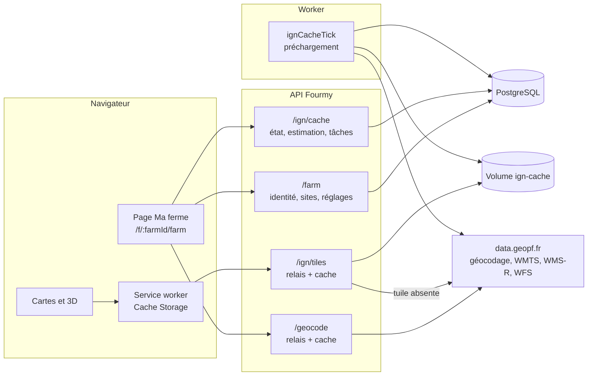
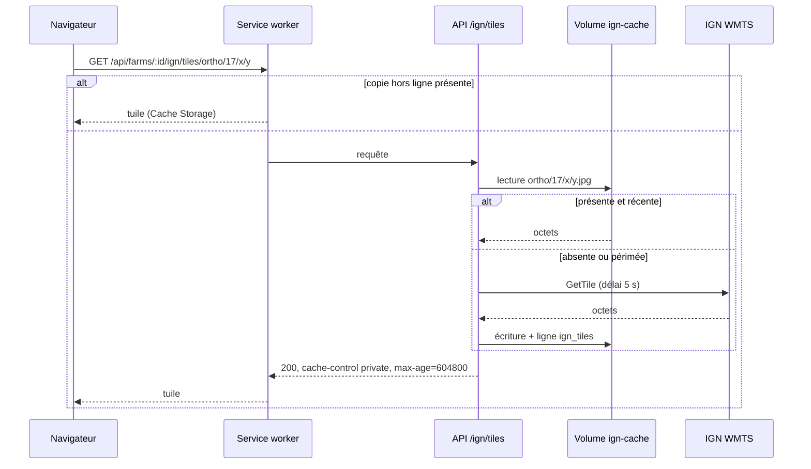

# « Ma ferme » : conception

Conception du 2026-11-13, à partir de `claudedocs/besoins_ma_ferme.md`
(décisions 1 à 13, exigences E1 à E22, N1 à N7, récits R1 à R10). Ce document
fixe le modèle, les contrats, les routes, le cache IGN et le découpage en
lots. Le code vient ensuite (`/sc:implement`, lot par lot).

## 1. Existant réutilisé

| Besoin | Existant | Fichier |
|---|---|---|
| Identité | `farms.siret`, `farms.pacage` (CHECK en base) | migration 0027 |
| Lecture/écriture de l'identité | `GET/PUT /settings/identity` (responsable) | `routes/registers.ts` |
| Réglages | `farm_settings` (une ligne par ferme, colonnes jsonb `maintenance`, `tracks`) | migrations 0018, 0023 |
| Isolation | RLS `farm_isolation` sur `farm_id` ; sur `farms`, `id = current_farm_id()` | toutes les migrations |
| Journal | `audit_log` (helper `audit()` local à chaque repo) | `repos/maintenance.ts` |
| Fichiers | images en `bytea` avec type, taille et sha256 (`person_photos`) | migration 0045 |
| Tâches de fond | `worker.ts` : une boucle de « ticks » (Lexicon, intégrations, météo…) | `apps/api/src/worker.ts` |
| Données IGN côté API | `@fourmy/geo-ign` (relief WMS-R, BD TOPO WFS, hydro), cache `Lru` en mémoire | `terrain.ts`, `repos/plan3d.ts` |
| Tuiles raster | Plan IGN et orthophotos demandés **directement** à `data.geopf.fr/wmts` par le navigateur | `ParcelMap.tsx:17`, `3d/FarmScene.ts:154` |
| Point météo | centre des parcelles (`weatherPoint`) | `repos/weather.ts:46` |
| Surfaces | `formatArea(m2)` (carto) et environ 28 affichages écrits à la main | `carto/format.ts` |
| Navigation | tableau `NAV` (chemin, libellé, icône, `ownerOnly`) | `components/Layout.tsx:33` |
| Impression | composant `Header` du plan de fumure | `features/fertilization/PrintPage.tsx:57` |
| Ekylibre | `entities` : `of_company`, `full_name`, `siret_number`, `vat_number`, `activity_code`, `legal_position_code`, image | base source `ekylibre_src_*` |

Deux constats orientent la conception :

- **Les tuiles raster ne passent pas par l'API.** Pour les mettre en cache sur
  le serveur, l'API devient un relais de tuiles (§5.1), et les cartes du web
  pointent vers ce relais.
- **Le serveur n'a pas de dossier de données.** Les fichiers sont en base, et
  le déploiement ne monte aucun volume pour l'API ni le worker. Le cache IGN
  pèse jusqu'à environ 1 Go par site : il n'ira **pas en base** (sauvegardes
  et `VACUUM` alourdis). Il va sur un volume monté (§4.4).

## 2. Vue d'ensemble



Le navigateur ne parle plus jamais directement à l'IGN. Le serveur est la
seule sortie (N1), et la copie hors ligne est prise sur le serveur (E14, E15).

## 3. Modèle de données (migration `0048_ma_ferme.sql`)

### 3.1 Identité : colonnes ajoutées à `farms`

La fiche est en relation un-à-un avec la ferme, et SIRET et PACAGE y sont
déjà. On enrichit donc `farms` au lieu de créer une table à part : la RLS
est déjà en place, et `/settings/identity` continue de lire les mêmes
colonnes.

```sql
ALTER TABLE farms
  ADD COLUMN legal_name      text CHECK (length(legal_name) <= 200),
  ADD COLUMN legal_form      text CHECK (legal_form IN ('ei','earl','gaec','scea','sarl','sas','other')),
  ADD COLUMN vat_number      text CHECK (vat_number ~ '^FR[0-9A-HJ-NP-Z]{2}[0-9]{9}$'),
  ADD COLUMN naf_code        text CHECK (naf_code ~ '^[0-9]{2}\.[0-9]{2}[A-Z]$'),
  ADD COLUMN cvi             text CHECK (cvi ~ '^[0-9A-Z]{10}$'),
  ADD COLUMN ede             text CHECK (ede ~ '^[0-9]{8}$'),
  ADD COLUMN phone           text CHECK (length(phone) <= 30),
  ADD COLUMN email           text CHECK (length(email) <= 200),
  ADD COLUMN legal_rep_person_id uuid REFERENCES people(id) ON DELETE SET NULL,
  ADD COLUMN legal_rep_name  text CHECK (length(legal_rep_name) <= 120),
  ADD COLUMN logo_id         uuid;  -- FK ajoutée après farm_logos
```

- **Le SIRET** garde son CHECK de format en base. La clé de Luhn est
  contrôlée dans le contrat (§4.1), pas en base : un SIRET importé d'Ekylibre
  avec une clé fausse reste lisible, et on le signale.
- **Le responsable légal** est soit une personne de l'équipe
  (`legal_rep_person_id`), soit un nom libre. Si les deux sont remplis, la
  personne l'emporte.
- **L'adresse n'est pas sur `farms`.** C'est celle du site siège (§3.3) :
  une seule source, pas de copie à tenir à jour.

### 3.2 Certifications : `farm_certifications`

Plusieurs lignes par ferme, avec une échéance. Une table plutôt que des
colonnes, parce que les échéances alimentent les alertes (E8).

```sql
CREATE TABLE farm_certifications (
  id          uuid PRIMARY KEY,
  farm_id     uuid NOT NULL REFERENCES farms(id) ON DELETE CASCADE,
  kind        text NOT NULL CHECK (kind IN ('phyto_approval','organic','hve')),
  body        text CHECK (length(body) <= 120),      -- organisme certificateur
  number      text CHECK (length(number) <= 60),
  level       text CHECK (level IN ('1','2','3')),   -- HVE uniquement
  expires_on  date,
  created_at  timestamptz NOT NULL DEFAULT now(),
  updated_at  timestamptz NOT NULL DEFAULT now(),
  CHECK (kind = 'hve' OR level IS NULL)
);
CREATE INDEX farm_certifications_farm ON farm_certifications (farm_id, expires_on);
```

### 3.3 Sites : `farm_sites`

```sql
CREATE TABLE farm_sites (
  id              uuid PRIMARY KEY,
  farm_id         uuid NOT NULL REFERENCES farms(id) ON DELETE CASCADE,
  name            text NOT NULL CHECK (length(name) BETWEEN 1 AND 120),
  is_headquarters boolean NOT NULL DEFAULT false,
  address_line1   text CHECK (length(address_line1) <= 200),
  address_line2   text CHECK (length(address_line2) <= 200),
  postal_code     text CHECK (postal_code ~ '^[0-9]{5}$'),
  city            text CHECK (length(city) <= 120),
  insee_code      text CHECK (insee_code ~ '^[0-9][0-9AB][0-9]{3}$'),
  location        geometry(Point, 4326),
  location_source text CHECK (location_source IN ('geocoded','manual')),
  geocode_score   real CHECK (geocode_score BETWEEN 0 AND 1),
  geocode_type    text,      -- housenumber, street, locality, municipality
  radius_m        integer NOT NULL DEFAULT 10000 CHECK (radius_m BETWEEN 1000 AND 30000),
  position        integer NOT NULL DEFAULT 0,
  created_at      timestamptz NOT NULL DEFAULT now(),
  updated_at      timestamptz NOT NULL DEFAULT now(),
  CHECK ((location IS NULL) = (location_source IS NULL))
);
CREATE UNIQUE INDEX farm_sites_one_hq ON farm_sites (farm_id) WHERE is_headquarters;
CREATE INDEX farm_sites_location ON farm_sites USING gist (location);
```

- **Un seul siège par ferme** (index unique partiel).
- **Le siège ne se supprime pas (E20)** : un trigger `BEFORE DELETE` refuse
  la suppression d'un site `is_headquarters`, sauf si la ferme elle-même
  est supprimée (`ON DELETE CASCADE` passe par un contexte où la ferme
  n'existe plus : le trigger teste `EXISTS (SELECT 1 FROM farms WHERE id =
  OLD.farm_id)`).
- **Création du siège** : la migration crée un siège vide (`name =
  'Siège'`, sans point) pour chaque ferme existante. `createFarm` le crée
  aussi pour une nouvelle ferme. Toute ferme a donc toujours son siège.

### 3.4 Logo : `farm_logos`

Même modèle que `person_photos`, avec le SVG en plus.

```sql
CREATE TABLE farm_logos (
  id         uuid PRIMARY KEY,
  farm_id    uuid NOT NULL REFERENCES farms(id) ON DELETE CASCADE,
  media_type text NOT NULL CHECK (media_type IN ('image/png','image/jpeg','image/svg+xml')),
  bytes      bytea NOT NULL,
  size       integer NOT NULL CHECK (size > 0 AND size <= 1048576),
  sha256     text NOT NULL,
  created_at timestamptz NOT NULL DEFAULT now()
);
ALTER TABLE farms ADD CONSTRAINT farms_logo_fk FOREIGN KEY (logo_id) REFERENCES farm_logos(id) ON DELETE SET NULL;
```

### 3.5 Réglages : deux colonnes ajoutées à `farm_settings`

```sql
ALTER TABLE farm_settings
  ADD COLUMN display jsonb NOT NULL DEFAULT '{"basemap":"plan","areaUnit":"ha"}',
  ADD COLUMN ign     jsonb NOT NULL DEFAULT
    '{"layers":["ortho","plan","elevation","buildings","hydro"],"detailMarginM":200,"autoRefresh":false}';
```

- `display.basemap` : `plan` | `ortho` (E9).
- `display.areaUnit` : `ha` | `a` (E21 bis).
- `ign.layers` : les couches à précharger (E12).
- `ign.detailMarginM` : la marge autour des parcelles où l'on descend au
  zoom 18 (décision 11). 200 m par défaut, de 0 à 1 000 m.
- `ign.autoRefresh` : relancer le préchargement quand un site ou un rayon
  change (E12).

Les réglages `maintenance` et `tracks` restent dans leurs colonnes. Seuls
leurs écrans changent de place (E21).

### 3.6 Préchargement IGN : `ign_cache_jobs` et `ign_tiles`

```sql
CREATE TABLE ign_cache_jobs (
  id            uuid PRIMARY KEY,
  farm_id       uuid NOT NULL REFERENCES farms(id) ON DELETE CASCADE,
  status        text NOT NULL CHECK (status IN ('pending','running','done','partial','failed','cancelled')),
  layers        text[] NOT NULL,
  requested_by  uuid REFERENCES users(id) ON DELETE SET NULL,
  tile_count    integer NOT NULL,
  estimate_bytes bigint NOT NULL,
  progress      jsonb NOT NULL DEFAULT '{}',  -- { ortho: { done, total, failed }, … }
  error         text,
  created_at    timestamptz NOT NULL DEFAULT now(),
  started_at    timestamptz,
  finished_at   timestamptz,
  locked_until  timestamptz            -- verrou du worker, comme les intégrations
);
CREATE UNIQUE INDEX ign_cache_jobs_one_active ON ign_cache_jobs (farm_id) WHERE status IN ('pending','running');

-- Index du cache disque : commun à toutes les fermes (données publiques de l'IGN).
CREATE TABLE ign_tiles (
  layer       text NOT NULL,
  z           smallint NOT NULL,
  x           integer NOT NULL,
  y           integer NOT NULL,
  bytes       integer NOT NULL,
  sha1        text NOT NULL,            -- notre ETag
  ign_etag    text,                     -- ETag renvoyé par l'IGN, pour If-None-Match
  fetched_at  timestamptz NOT NULL DEFAULT now(),
  last_read_at timestamptz NOT NULL DEFAULT now(),  -- quota LRU (§5.4)
  PRIMARY KEY (layer, z, x, y)
);
CREATE INDEX ign_tiles_lru ON ign_tiles (last_read_at);
```

- **`ign_cache_jobs` a la RLS `farm_isolation`**, comme les autres tables.
- **`ign_tiles` n'a pas de `farm_id` et pas de RLS** : c'est l'index des
  fichiers du volume, et les données IGN sont publiques. Deux fermes
  voisines partagent les mêmes tuiles. Seuls le relais (§5.1) et le worker
  lisent et écrivent cette table, par le rôle applicatif.
- La table sert à estimer le volume déjà présent, à purger les tuiles
  anciennes et à éviter de tester le disque à chaque demande.

## 4. Contrats et règles

### 4.1 Contrats zod (`packages/contracts/src/farm.ts`)

```ts
export const legalForm = z.enum(["ei", "earl", "gaec", "scea", "sarl", "sas", "other"]);
export const siret = z.string().regex(/^\d{14}$/).refine(luhn, "SIRET invalide (clé de contrôle).");
export const vatNumber = z.string().regex(/^FR[0-9A-HJ-NP-Z]{2}\d{9}$/);

export const farmIdentity = z.object({
  name: z.string().trim().min(1).max(120),
  legalName: z.string().trim().max(200).nullable(),
  legalForm: legalForm.nullable(),
  siret: siret.nullable(),
  vatNumber: vatNumber.nullable(),
  nafCode: z.string().regex(/^\d{2}\.\d{2}[A-Z]$/).nullable(),
  pacage: z.string().regex(/^\d{9}$/).nullable(),
  cvi: z.string().regex(/^[0-9A-Z]{10}$/).nullable(),
  ede: z.string().regex(/^\d{8}$/).nullable(),
  phone: z.string().trim().max(30).nullable(),
  email: z.email().max(200).nullable(),
  legalRep: z.union([z.object({ personId: uuid }), z.object({ name: z.string().trim().min(1).max(120) })]).nullable(),
});

export const farmCertification = z.object({
  id: uuid,
  kind: z.enum(["phyto_approval", "organic", "hve"]),
  body: z.string().trim().max(120).nullable(),
  number: z.string().trim().max(60).nullable(),
  level: z.enum(["1", "2", "3"]).nullable(),
  expiresOn: isoDate.nullable(),
});

export const point = z.object({ lat: z.number().min(-90).max(90), lon: z.number().min(-180).max(180) });

export const farmSite = z.object({
  id: uuid,
  name: z.string().trim().min(1).max(120),
  isHeadquarters: z.boolean(),
  address: z.object({
    line1: z.string().trim().max(200).nullable(),
    line2: z.string().trim().max(200).nullable(),
    postalCode: z.string().regex(/^\d{5}$/).nullable(),
    city: z.string().trim().max(120).nullable(),
    inseeCode: z.string().nullable(),
  }),
  location: point.nullable(),
  locationSource: z.enum(["geocoded", "manual"]).nullable(),
  geocode: z.object({ score: z.number(), type: z.string() }).nullable(),
  radiusM: z.number().int().min(1000).max(30000),
  /** Calculé : parcelles en vigueur hors de toutes les zones (E19). */
  parcelsOutside: z.number().int(),
});

export const farmDisplay = z.object({ basemap: z.enum(["plan", "ortho"]), areaUnit: z.enum(["ha", "a"]) });
export const ignLayer = z.enum(["ortho", "plan", "elevation", "buildings", "hydro"]);
export const farmIgnSettings = z.object({
  layers: z.array(ignLayer).min(1),
  detailMarginM: z.number().int().min(0).max(1000),
  autoRefresh: z.boolean(),
});

/** Réponse de GET /farm : tout ce qu'affiche la page, en une requête. */
export const farmProfile = z.object({
  identity: farmIdentity,
  certifications: z.array(farmCertification),
  sites: z.array(farmSite),
  display: farmDisplay,
  ign: farmIgnSettings,
  logo: z.object({ url: z.string(), mediaType: z.string() }).nullable(),
  canEdit: z.boolean(),
});

export const geocodeResult = z.object({
  label: z.string(),
  line1: z.string().nullable(),
  postalCode: z.string(),
  city: z.string(),
  inseeCode: z.string(),
  location: point,
  score: z.number(),
  type: z.enum(["housenumber", "street", "locality", "municipality"]),
});
```

### 4.2 Règles du domaine (`packages/domain/src/farm.ts`)

- `luhn(siret)` : clé de contrôle du SIRET. Exception connue : les SIRET de
  La Poste (SIREN 356000000) suivent une autre règle ; on les accepte.
- `vatFromSiren(siren)` : `FR` + clé `(12 + 3 × (siren mod 97)) mod 97` sur
  deux chiffres + SIREN. Sert à **proposer** la TVA (E4.1), sans l'imposer.
- `geocodeQuality(score, type)` : `"precise"` si `type` vaut `housenumber`
  ou `street` et `score ≥ 0,7`, sinon `"approximate"` (E7).
- `farmPoint(sites, parcelsCentroid)` : le point du siège s'il existe,
  sinon le centre des parcelles, sinon `null`. Utilisé par la météo (E11)
  et le centrage des cartes (E10).
- `certificationAlerts(certs, today)` : échéances à moins de 60 jours (E8).
- `formatArea(m2, unit)` : `ha` avec 2 décimales, `a` sans décimale.

### 4.3 Calcul des tuiles (`packages/geo-ign/src/coverage.ts`)

Fonctions pures, testées sans réseau.

```ts
type TileKey = { z: number; x: number; y: number };

/** Tuiles du zoom z qui touchent le cercle (centre, rayon). */
tilesInCircle(center: Point, radiusM: number, z: number): TileKey[];
/** Tuiles du zoom z qui touchent les polygones élargis de `marginM`. */
tilesNearPolygons(polygons: Polygon[], marginM: number, z: number): TileKey[];
/** Plan de préchargement : union sans doublon sur tous les sites. */
coveragePlan(input: {
  sites: { location: Point; radiusM: number }[];
  parcels: Polygon[];
  layers: IgnLayer[];
  detailMarginM: number;
}): Map<IgnLayer, TileKey[]>;
estimateBytes(plan: Map<IgnLayer, TileKey[]>): number;
```

Niveaux de zoom par couche (décision 11) :

| Couche | Zone des sites | Autour des parcelles | Taille moyenne retenue |
|---|---|---|---|
| `ortho` (ORTHOPHOTOS, JPEG) | 8 à 16 | 17 et 18 | 25 Ko |
| `plan` (PLANIGNV2, PNG) | 8 à 16 | 17 | 15 Ko |
| `elevation` (grilles de relief de `terrain.ts`) | niveaux 10 à 14 | 15 | 4 Ko |
| `buildings`, `hydro` (WFS, GeoJSON par tuile) | zoom 14 | zoom 14 | 10 Ko |

Ordre de grandeur pour un site de 10 km de rayon avec 40 ha de parcelles :
environ 2 400 tuiles d'ortho dans la zone (zooms 8 à 16), plus environ 400
autour des parcelles (17 et 18), soit environ 70 Mo pour l'ortho. Avec les
autres couches, on reste sous 150 Mo par site, au lieu d'environ 1 Go si
toute la zone était au zoom 18.

Seuils de confirmation (N3) : au-delà de **2 Go** pour le serveur, et de
**500 Mo** pour la copie dans le navigateur. Les deux valeurs sont des
constantes du domaine, faciles à changer.

## 5. API

Toutes les routes sont sous `/farms/:farmId` (middleware actuel :
authentification, appartenance, `withFarm`). Écriture réservée au
responsable (`requireOwner`), lecture ouverte aux membres (E3).

### 5.1 Routes

| Méthode et chemin | Rôle | Réponse |
|---|---|---|
| `GET /farm` | fiche complète (§4.1 `farmProfile`) | 200 |
| `PUT /farm/identity` | identité, contacts, responsable légal | 200 `farmIdentity` |
| `POST /farm/certifications` | ajouter | 201 |
| `PUT /farm/certifications/:id` | modifier | 200 |
| `DELETE /farm/certifications/:id` | supprimer | 204 |
| `POST /farm/sites` | ajouter un site | 201 `farmSite` |
| `PUT /farm/sites/:id` | modifier un site (adresse, point, rayon) | 200 `farmSite` |
| `DELETE /farm/sites/:id` | supprimer (refusé pour le siège : 409) | 204 |
| `PUT /farm/logo` | déposer le logo (corps binaire, 1 Mo maximum) | 200 |
| `DELETE /farm/logo` | retirer le logo | 204 |
| `GET /farm/logo` | servir le logo de la ferme, ou celui de Fourmy | 200 image |
| `PUT /settings/display` | fond de carte, unité de surface | 200 |
| `PUT /settings/ign` | couches, marge, mise à jour automatique | 200 |
| `GET /geocode?q=&limit=5` | suggestions d'adresse (relais IGN) | 200 `geocodeResult[]` |
| `GET /geocode/reverse?lat=&lon=` | adresse la plus proche d'un point placé à la main | 200 `geocodeResult` ou 204 |
| `GET /ign/tiles/:layer/:z/:x/:y` | tuile raster, depuis le cache ou l'IGN | 200 image |
| `GET /ign/cache` | état : dernière tâche, plan, estimation, déjà en cache | 200 |
| `POST /ign/cache/jobs` | lancer le préchargement (`{ confirm?: boolean }`) | 202, ou 409 avec l'estimation si confirmation requise |
| `DELETE /ign/cache/jobs/:id` | annuler une tâche en cours | 204 |
| `GET /ign/cache/manifest` | liste des URL de tuiles pour la copie navigateur | 200 `{ urls, bytes }` |

`GET/PUT /settings/identity` reste en place pour le registre phyto et le
mobile (N6). Il lit et écrit les mêmes colonnes. Il sera retiré quand plus
aucun client ne l'appellera.

### 5.2 Géocodage (`apps/api/src/geocode.ts`)

- Appelle `https://data.geopf.fr/geocodage/search?q=…&limit=…&index=address`
  et `…/reverse?lon=…&lat=…`. Seule l'adresse est envoyée (N1).
- **Cache** `Lru` de 2 000 entrées, 24 h, clé = requête normalisée
  (minuscules, espaces réduits). Les suggestions tapées lettre par lettre
  reviennent souvent.
- **Limite de débit** : 10 requêtes par seconde pour toute l'instance, et
  5 par seconde par utilisateur. Au-delà : 429 avec `retry-after`. La
  Géoplateforme accepte 50 requêtes par seconde par adresse IP (fiche
  data.gouv.fr de l'API de géocodage, vérifiée le 2026-11-13).
- **Délai** : 3 s. Si l'IGN ne répond pas : 503 « Géocodage indisponible,
  placez le point sur la carte », sans bloquer l'enregistrement (E5).
- **Injection pour les tests** : `geocodeDeps.fetch`, comme `terrainDeps`.

### 5.3 Relais de tuiles (`apps/api/src/ign/tiles.ts`)



- **Couches autorisées** : `ortho` → `ORTHOIMAGERY.ORTHOPHOTOS` (jpeg),
  `plan` → `GEOGRAPHICALGRIDSYSTEMS.PLANIGNV2` (png). Toute autre valeur :
  404. Zoom de 0 à 19, `x` et `y` dans les bornes du zoom.
- **Fraîcheur** : une tuile de plus de 180 jours est redemandée à l'IGN avec
  `If-None-Match` (`ign_etag`) ; un 304 rafraîchit seulement `fetched_at`.
- **IGN indisponible** : on sert la tuile périmée si elle existe
  (`x-ign-cache: stale`), sinon 502.
- **Relief, bâtiments, hydrographie** : `terrain.ts` et `repos/plan3d.ts`
  gardent leur `Lru` en mémoire, mais lisent et écrivent d'abord le volume,
  par le même module de stockage (`IgnStore`). La 3D profite donc du
  préchargement sans changer d'API.
- **Requêtes simultanées** : deux demandes de la même tuile manquante
  n'appellent l'IGN qu'une fois (carte des promesses en cours). Entre
  l'API et le worker, qui sont deux processus, l'écriture atomique suffit :
  au pire, la tuile est téléchargée deux fois.
- **Arborescence** : `{FOURMY_IGN_CACHE_DIR}/{layer}/{z}/{x}/{y}.{ext}`, en
  schéma XYZ (y compté depuis le nord, comme le WMTS de l'IGN en grille PM).
  Dans une zone de 10 km, un dossier `x` contient au plus quelques centaines
  de fichiers : la répartition en sous-dossiers de GeoWebCache
  (`z/xc_yc/x_y`) n'est pas nécessaire.
- **Écriture atomique** : fichier temporaire dans le même dossier, puis
  `rename`. Un lecteur ne voit jamais une tuile à moitié écrite.
- **On ne met jamais en cache une erreur** : une réponse IGN autre que 200
  (ou 304) n'est pas écrite. Une image blanche de l'IGN (hors couverture) est
  un 200 normal et se met en cache.
- **En-têtes HTTP** (repris de GeoWebCache) :
  - `ETag` = empreinte SHA-1 du contenu, stockée dans `ign_tiles` ;
  - `Last-Modified` = `fetched_at` ;
  - `If-None-Match` ou `If-Modified-Since` → 304 sans corps ;
  - `cache-control: private, max-age=604800` (7 jours) ;
  - `x-ign-cache: HIT | MISS | STALE`, pour le diagnostic, comme
    `geowebcache-cache-result`.
- **Pas de métatuilage** : le métatuilage et la marge (`gutter`) de
  GeoWebCache servent à limiter les appels à un WMS non tuilé. Notre source
  est déjà un WMTS en tuiles de 256 px : on relaie tuile à tuile.

### 5.4 Préchargement (worker)

- `POST /ign/cache/jobs` calcule le plan (§4.3) et l'estimation. Si le
  volume dépasse le seuil et que `confirm` est absent : 409 avec
  l'estimation, et le web affiche la demande de confirmation (N3). Sinon la
  tâche est créée en `pending`.
- `worker.ts` gagne un `ignCacheTick` : il prend une tâche `pending`
  (`locked_until`, comme les intégrations), télécharge par lots de 8
  requêtes parallèles au plus, en sautant les tuiles déjà présentes et
  récentes, et écrit `progress` toutes les 200 tuiles.
- **Échec partiel** : 3 essais par tuile, puis la tuile est comptée en
  `failed`. Fin en `partial` si des tuiles manquent, et un nouveau
  lancement ne reprend que celles-là (E13).
- **Mise à jour automatique** : si `ign.autoRefresh`, la modification d'un
  point ou d'un rayon crée une tâche (au plus une active par ferme, grâce à
  l'index unique).
- **Quota disque** (repris des « disk quotas » de GeoWebCache, politique
  LRU) : `FOURMY_IGN_CACHE_MAX_GB`, 20 Go par défaut. `ign_tiles` gagne une
  colonne `last_read_at`. Pour ne pas écrire en base à chaque lecture, elle
  n'est mise à jour qu'une fois par jour au plus par tuile, et par lots
  (tampon en mémoire vidé toutes les minutes).
- **Purge** : une fois par jour, le worker calcule le total depuis
  `ign_tiles`. Au-delà du quota, il supprime en priorité les tuiles hors du
  plan de toutes les fermes, les moins récemment lues d'abord. Les tuiles
  du plan d'une ferme ne sont supprimées qu'en dernier recours, et la page
  « Données IGN » de la ferme concernée l'indique alors.
- **Troncature par zone** : quand un site est supprimé ou son rayon réduit,
  aucune suppression immédiate. Ses tuiles sortent simplement du plan et
  deviennent purgeables. Le calcul passe par la table, jamais par un
  parcours du disque.

### 5.5 Logo

- Types acceptés : PNG, JPEG, SVG ; 1 Mo maximum ; type vérifié sur les
  octets (signature), pas sur l'en-tête.
- **SVG** : servi avec `content-security-policy: default-src 'none';
  style-src 'unsafe-inline'; sandbox` et `x-content-type-options: nosniff`.
  Le web ne l'affiche que dans un ``, où les scripts ne s'exécutent
  pas. On ne l'intègre jamais en ligne dans le HTML.
- `GET /farm/logo` sans logo renvoie le logo Fourmy (`apps/web/public/favicon.svg`
  ou un fichier dédié), pour que l'impression n'ait qu'une URL (R10).

## 6. Web

### 6.1 Accès

- **Bouton « Ma ferme »** (icône `Building`) à droite du titre du tableau de
  bord (`DashboardPage.tsx:54`), dans un `Group justify="space-between"`.
- **Menu** : nouvelle entrée dans `NAV` (`Layout.tsx:33`),
  `{ path: "/farm", label: "Ma ferme", icon: Building }`, visible par tous
  les membres (pas `ownerOnly`).
- **Route** : `{ path: "farm", element: <FarmProfilePage /> }` sous
  `/f/:farmId`, avec `?tab=` pour ouvrir un onglet précis (E22).

### 6.2 Page `features/farm/`

```
FarmProfilePage.tsx    onglets, chargement de GET /farm
IdentityTab.tsx        identité, contacts, certifications, logo
SitesTab.tsx           carte des sites, liste, formulaire de site
AddressField.tsx       saisie assistée (GET /geocode, délai 250 ms, ≥ 3 caractères)
SitePicker.tsx         petite carte MapLibre, épingle déplaçable, cercles des zones
IgnTab.tsx             couches, marge, état du cache, lancement, copie navigateur
MaintenanceTab.tsx     formulaire déplacé depuis l'entretien
TracksTab.tsx          formulaire déplacé depuis les parcours
BrandsTab.tsx          marques
```

- **Lecture seule** : chaque formulaire reçoit `canEdit` (renvoyé par
  l'API), et un salarié voit des champs désactivés sans bouton
  d'enregistrement.
- **Adresse et point (E4 à E7)** :
  - choisir une suggestion remplit les champs, place l'épingle et met
    l'origine à « géocodé » ;
  - déplacer l'épingle met l'origine à « placé à la main », appelle
    `/geocode/reverse` pour afficher l'adresse la plus proche à titre
    indicatif, sans modifier les champs ;
  - quand l'origine est « placé à la main », changer l'adresse ne touche plus
    au point ; le bouton « Recalculer depuis l'adresse » est alors affiché ;
  - un résultat `approximate` affiche l'avertissement de E7.
- **TVA proposée** : si le SIRET est valide et la TVA vide, un lien
  « Utiliser FR… » la remplit (`vatFromSiren`).

### 6.3 Préférences appliquées partout

- **`useFarmPrefs()`** (`app/queries.ts`) : lit `display` dans `GET /farm`
  (mis en cache par TanStack Query, une requête par ferme).
- **Fond de carte (E9)** : `ParcelMap`, `ParcelCreatePage`,
  `PrescriptionNewPage`, `PrescriptionPage` et la 3D prennent
  `prefs.basemap` comme valeur initiale. Le choix sur un écran reste local à
  cet écran.
- **URL des tuiles** : `WMTS()` (`ParcelMap.tsx:17`) et l'imagerie de
  `FarmScene.ts:154` pointent vers `/api/farms/:farmId/ign/tiles/{layer}/{z}/{x}/{y}`.
- **CesiumJS** : `WebMapTileServiceImageryProvider` (`FarmScene.ts:153`)
  est remplacé par `UrlTemplateImageryProvider` sur le relais :
  `url: "/api/farms/<id>/ign/tiles/ortho/{z}/{x}/{y}"`, schéma de tuilage
  Web Mercator (celui par défaut), `maximumLevel: 19`, crédit « © IGN ».
  Le viewer est déjà configuré pour ne rien demander à l'extérieur
  (`baseLayer: false`, `geocoder: false`, `baseLayerPicker: false`,
  terrain maison), comme le recommande le guide hors ligne de Cesium. On
  ajoute un test e2e qui échoue si une requête part vers `api.cesium.com`
  ou `virtualearth.net`.
- **Relief** : on garde nos grilles Float32 par tuile (`/terrain/heightmap`),
  mises en cache sur disque par `IgnStore` et dans le navigateur par le
  service worker comme les autres réponses. Les formats standard de Cesium
  (`heightmap-1.0`, `quantized-mesh`) n'apportent rien tant que le relief
  passe par notre API (§12).
- **Unité de surface** : `formatArea(m2, prefs.areaUnit)` remplace les
  environ 28 affichages écrits à la main. Les documents réglementaires
  (registre phyto, plan de fumure) gardent l'hectare, quelle que soit la
  préférence.
- **Centre des cartes (E10)** : sans parcelle, `ParcelMap` centre sur le
  siège (zoom 14), sinon garde l'emprise des parcelles.

### 6.4 Copie hors ligne dans le navigateur (E14, R7)

- **Service worker** écrit à la main (`apps/web/src/sw.ts`, compilé par
  Vite), sans dépendance. Il ne fait que trois choses :
  1. tuiles `/api/farms/*/ign/tiles/*` : d'abord le Cache Storage, puis le
     réseau ;
  2. coquille de l'application (`index.html`, JS, CSS, polices) : réseau
     d'abord, cache en secours, pour que l'application s'ouvre sans réseau ;
  3. réponses `GET` utiles à la carte et à la 3D (`/snapshot`, parcelles,
     `/terrain/heightmap`, bâtiments) : réseau d'abord, dernière réponse en
     secours.
- **« Garder pour le hors ligne »** (onglet Données IGN) :
  `navigator.storage.persist()`, puis `navigator.storage.estimate()` pour
  vérifier la place. Ensuite `GET /ign/cache/manifest`, et téléchargement
  dans le cache `fourmy-ign-<farmId>` avec une barre de progression. Le
  manifeste ne contient que des tuiles déjà sur le serveur : le navigateur
  ne déclenche jamais d'appel à l'IGN.
- **Place insuffisante** : on s'arrête avant de commencer, avec le message
  « Il faut X Mo, il en reste Y » (N3 bis). On ne laisse pas une copie à
  moitié faite : si le téléchargement échoue en route, le cache de la ferme
  est vidé.
- **« Libérer l'espace »** supprime `fourmy-ign-<farmId>`.
- **Mise à jour de la copie** : le manifeste porte l'`ETag` de chaque tuile.
  Une nouvelle copie ne télécharge que les tuiles absentes ou modifiées, et
  supprime celles qui ne sont plus dans le manifeste.
- **Contrôle au démarrage** : à l'ouverture de la page, on compare le
  nombre de tuiles en cache au manifeste mémorisé. Si le navigateur a purgé
  la copie, on l'affiche (« Copie hors ligne effacée par le navigateur »).
  Safari efface le stockage d'un site resté plusieurs jours sans visite,
  même avec `persist()`.
- **Requêtes de MapLibre** : un service worker intercepte les `fetch` de la
  page et ceux des workers dédiés qu'elle crée. MapLibre charge ses tuiles
  raster par `fetch`, donc la copie est servie sans changer MapLibre. Ce
  point est à **vérifier en début de F5** par un test e2e réseau coupé. S'il
  échoue, on passe par un protocole MapLibre (`maplibregl.addProtocol`) qui
  lit directement le Cache Storage.
- **Pourquoi pas IndexedDB** (comme `leaflet-cached-tile-layer`) : il
  faudrait un adaptateur pour MapLibre (`addProtocol`) et un fournisseur
  d'imagerie maison pour Cesium. Le Cache Storage garde des réponses HTTP
  complètes, que le service worker rend telles quelles aux deux
  bibliothèques, sans les modifier.
- **Limite assumée** : hors ligne, on **consulte** (carte, 3D, dernières
  données vues). La saisie sans réseau reste le rôle du mobile, qui est
  traité dans un lot suivant (décision 12).

## 7. Import Ekylibre (`packages/migrator-ekylibre`)

- **Extraction** : l'entité `of_company = true` (une seule par base
  Ekylibre) et son adresse postale par défaut (`entity_addresses`, canal
  `mail`, `by_default`), lignes `mail_line_1` à `mail_line_6`.
- **Correspondances** :

| Ekylibre | Fourmy |
|---|---|
| `full_name` | `legal_name` |
| `siret_number` | `siret` (si 14 chiffres) |
| `vat_number` | `vat_number` (si format FR valide) |
| `activity_code` | `naf_code` (normalisé en `01.11Z`) |
| `legal_position_code` | `legal_form` (`GAEC`, `EARL`, `SCEA`…, sinon `other`) |
| adresse par défaut | adresse du siège (lignes 4 à 6 : voie, lieu-dit, code postal et ville) |

- **Sans écraser** : un champ déjà rempli dans Fourmy n'est pas modifié. Si
  la valeur d'Ekylibre diffère, on l'ajoute au compte rendu de l'import
  (`import_runs`), rubrique « Identité : écarts non appliqués ».
- **Géocodage** : après l'import, si le siège a une adresse mais pas de
  point, on le géocode (meilleur résultat, origine « géocodé »). En cas
  d'échec, l'import n'échoue pas : le point reste vide et la page l'indique.
- **Valeurs invalides** (SIRET mal formé, TVA étrangère) : non appliquées,
  signalées dans le compte rendu.

## 8. Effets sur l'existant

| Où | Changement |
|---|---|
| `repos/weather.ts` `weatherPoint` | sans parcelle, utilise le siège (`farmPoint`, E11) |
| `features/register/OfficialRegister.tsx` | le formulaire SIRET/PACAGE devient un lien « Compléter dans Ma ferme » (onglet Identité) |
| `features/maintenance`, parcours | les réglages deviennent des liens vers l'onglet correspondant (E22) |
| `PrintPage.tsx` `Header` | ajoute `` et la raison sociale si elle existe (R10) |
| Alertes du tableau de bord | ajout des certifications qui expirent dans moins de 60 jours (E8) |
| `createFarm` | crée la ligne `farm_settings` et le siège vide |
| `docker/compose.deploy.yml` | volume `fourmy_ign` monté sur `/var/cache/fourmy/ign` dans `api` **et** `worker` ; variable `FOURMY_IGN_CACHE_DIR` |
| `.env.example` | `FOURMY_IGN_CACHE_DIR=/var/cache/fourmy/ign` (en dev : `./.cache/ign`, ignoré par Git) |

## 9. Sécurité

- **RLS** sur `farm_certifications`, `farm_sites`, `farm_logos`,
  `ign_cache_jobs` (`farm_isolation`). `ign_tiles` n'en a pas : elle ne
  contient que des coordonnées de tuiles publiques.
- **Relais de tuiles** : réservé aux membres de la ferme (pas de relais
  ouvert sur Internet). Liste blanche de couches, bornes de zoom et de
  coordonnées : on ne peut pas faire appeler une URL arbitraire au serveur.
- **Chemins disque** : construits uniquement à partir de `layer` (liste
  blanche) et d'entiers. Aucun texte venu de la requête n'entre dans un
  chemin.
- **Géocodage** : seule l'adresse part vers l'IGN ; limites de débit
  (§5.2).
- **Logo SVG** : §5.5.
- **Audit** : `PUT /farm/identity`, sites, certifications, logo et réglages
  écrivent dans `audit_log` (N5), avec le diff avant/après.

## 10. Tests

| Niveau | Contenu |
|---|---|
| Domaine | `luhn` (dont La Poste), `vatFromSiren`, `geocodeQuality`, `farmPoint`, `certificationAlerts`, `formatArea` |
| geo-ign | `tilesInCircle`, `tilesNearPolygons`, `coveragePlan` (union sans doublon entre deux sites qui se recouvrent), `estimateBytes` |
| Base | siège unique, suppression du siège refusée mais cascade de la ferme acceptée, bornes du rayon, RLS des nouvelles tables |
| API (intégration) | GET/PUT de la fiche, droits salarié/responsable, `/settings/identity` toujours compatible, géocodage avec `fetch` simulé (succès, approximatif, panne), relais de tuiles (cache, périmé, IGN en panne, couche refusée), tâche de préchargement (estimation, confirmation 409, reprise des échecs) |
| Import | entité société d'Ekylibre : remplissage, non-écrasement, écarts dans le compte rendu (fixture `ekylibre_src_phaurigot`) |
| Web | bouton du tableau de bord, formulaire en lecture seule pour un salarié, saisie assistée (MSW), épingle manuelle puis changement d'adresse sans déplacement du point |
| e2e | parcours R1 à R5 ; R7 avec le réseau coupé dans Playwright (`context.setOffline(true)`) |

## 11. Découpage en lots

| Lot | Contenu | Exigences | Dépend de |
|---|---|---|---|
| **F1. Fiche et sites** | migration (identité, sites, certifications), `GET /farm`, identité, sites, géocodage, bouton, page (onglets Identité et Sites), siège créé pour chaque ferme | E1 à E8, E16 à E20, R1 à R4, R8 | — |
| **F2. Réglages regroupés** | `display`, fond de carte par défaut, unité de surface (`formatArea` partout), onglets Entretien, Parcours, Marques, renvois depuis les anciens écrans, météo et centrage sur le siège | E9 à E11, E21, E22, R5 | F1 |
| **F3. Logo et Ekylibre** | `farm_logos`, en-tête d'impression, import de l'identité depuis Ekylibre, alertes d'échéance | E8, E8 bis, E8 ter, R9, R10 | F1 |
| **F4. Cache IGN serveur** | volume, `ign_tiles`, relais de tuiles (web basculé sur le relais), `IgnStore` pour relief, bâtiments et hydro, plan de couverture, tâches du worker, onglet Données IGN | E12, E13, E15, N2, N3, N3 ter, R6 | F1 |
| **F5. Copie navigateur** | prototype A (une entrée de cache par tuile) contre B (archive PMTiles dans OPFS, lue par le service worker), puis service worker, « Garder pour le hors ligne », « Libérer l'espace » | E14, N3 bis, R7 | F4 |

F2, F3 et F4 peuvent avancer en parallèle une fois F1 mergé. F4 est le plus
gros lot, et le seul qui touche au déploiement (volume).

## 12. Protocoles et bibliothèques étudiés (2026-11-13)

| Référence | Ce que c'est | Retenu pour Fourmy |
|---|---|---|
| [WMS Tiling Client Recommendation](https://wiki.osgeo.org/wiki/WMS_Tiling_Client_Recommendation) (WMS-C) | Recommandation communautaire de 2006 (pas une norme OGC) : grille fixe, résolutions en puissances de deux, bbox alignées, `tiled=true` | **Le principe seulement** : une grille fixe rend les tuiles cachables. Notre source est déjà un WMTS (grille PM) : WMS-C n'a pas à être implémenté. |
| [GeoWebCache](https://www.osgeo.org/projects/geowebcache/) | Serveur de tuiles et proxy de cache en Java (LGPL). Sert WMTS, TMS, XYZ, WMS-C, KML ; stockage fichier en standard ; préchargement multi-thread ; quotas LRU/LFU ; `Last-Modified` et 304 | **Les idées, pas le logiciel** : en-têtes HTTP et 304, en-tête de diagnostic HIT/MISS, quota LRU, troncature par zone (§5.3, §5.4). |
| [GeoServer](https://geoserver.org/) | Serveur OGC complet (WMS, WFS, WCS, WMTS), avec GeoWebCache intégré | **Non** : il sert à publier ses propres données. Pour relayer des tuiles déjà produites par l'IGN, c'est une JVM de plus à exploiter, avec un second système de droits. |
| [leaflet-cached-tile-layer](https://github.com/yagajs/leaflet-cached-tile-layer) | Couche Leaflet qui garde les tuiles dans IndexedDB, avec préchargement d'une emprise (`seedBBox`) et durée de vie (`maxAge`, 7 jours) | **Le principe** du préchargement par emprise et par zoom. Pas la bibliothèque : elle est pour Leaflet, peu active, et ne gère pas le quota du navigateur. |
| [UrlTemplateImageryProvider](https://cesium.com/learn/cesiumjs/ref-doc/UrlTemplateImageryProvider.html) | Imagerie Cesium à partir d'un modèle d'URL `{z}/{x}/{y}` | **Oui** : il remplace le fournisseur WMTS de la 3D et pointe vers le relais (§6.3). |
| [Guide hors ligne de Cesium](https://github.com/CesiumGS/cesium/tree/main/Documentation/OfflineGuide) | Comment empêcher Cesium d'appeler Ion, Bing et le géocodeur | **Déjà appliqué** dans `FarmScene.ts`. Ajout d'un test qui le garantit (§6.3). |
| [cesium-terrain-server](https://github.com/geo-data/cesium-terrain-server) | Serveur Go de fichiers `.terrain` prégénérés (`{z}/{x}/{y}.terrain` + `layer.json`) | **Non pour l'instant** : notre relief passe par l'API, qui le met en cache. Si un jour le relief doit être servi en statique (CDN, Nginx), on générera des fichiers `heightmap-1.0` (grille 65 × 65, entiers 16 bits au pas de 0,2 m) depuis nos grilles. C'est une conversion directe, sans outil de maillage, alors que `quantized-mesh` en demande un. |

### MapLibre Native (mobile, lot suivant)

Lu dans les en-têtes du dépôt `maplibre/maplibre-native` (`MLNMapView.h`,
`MLNOfflineStorage.h`, `MLNShapeOfflineRegion.h`,
`MLNNetworkConfiguration.h`). La documentation en ligne est générée dans le
navigateur et n'a pas pu être lue.

- **`tileCacheEnabled`** (vrai par défaut) : la carte garde **en mémoire**
  les tuiles des niveaux de zoom voisins, pour que le zoom soit plus fluide.
  Ce n'est ni un cache disque ni un outil hors ligne. On le laisse activé.
- **Cache ambiant** : base SQLite du SDK, 50 Mo par défaut
  (`setMaximumAmbientCacheSize`, à appeler avant de charger la carte). Il se
  remplit pendant l'usage normal. `invalidateAmbientCache` revalide les
  tuiles auprès du serveur au lieu de tout retélécharger : notre relais doit
  donc bien répondre 304 aux requêtes conditionnelles (§5.3).
- **Packs hors ligne** : `MLNShapeOfflineRegion` prend **n'importe quelle
  forme** (polygone, multipolygone) avec une plage de zooms. Notre plan
  (décision 11) se traduit donc par deux packs par ferme, sans code de
  tuilage côté mobile :
  - les cercles des sites, du zoom 8 au zoom 16 ;
  - les parcelles élargies de la marge, aux zooms 17 et 18.
  Les packs ne comptent pas dans les 50 Mo du cache ambiant.
  `invalidatePack` met un pack à jour en ne retéléchargeant que ce qui a
  changé.
- **Gestion des packs** (exemples « Download Offline Pack » et « Manage
  Offline Regions » de MapLibre, lus dans `platform/ios/MapLibre.docc` et
  `app-swift/Sources`) :
  - `addPack(for:withContext:)` crée le pack, puis `resume()` lance le
    téléchargement ; `suspend()` le met en pause, par exemple quand on
    quitte l'écran ou qu'on n'a plus de Wi-Fi ;
  - le **contexte** est un bloc d'octets libre attaché au pack. On y met un
    JSON `{ farmId, kind: "zone" | "detail", planVersion }`. `planVersion`
    est une empreinte du plan de couverture renvoyée par
    `GET /ign/cache/regions` : si elle a changé (site ajouté, rayon
    modifié), le pack est périmé, on le supprime et on le recrée ;
  - la **progression** arrive par notifications
    (`MLNOfflinePackProgressChanged`) : ressources faites et attendues,
    octets téléchargés, état `complete`. C'est ce qu'affiche la barre de
    progression ;
  - `MLNOfflineStorage.shared.packs` liste les packs présents. L'écran
    « Données hors ligne » du mobile s'en sert pour afficher la taille par
    ferme et supprimer un pack (`removePack`) ;
  - **à ne pas utiliser** : `resetDatabase`, qui efface aussi le cache
    ambiant. La notification de plafond de tuiles
    (`MaximumMapboxTilesReached`) est, d'après la doc, un reste de Mapbox
    sans objet pour un serveur de tuiles comme le nôtre.
- **Un pack télécharge aussi le style** et tout ce qu'il référence
  (sources, sprites, polices). Notre style IGN doit donc rester minimal :
  deux sources raster, sans polices ni sprites, pour que le pack ne
  contienne que des tuiles.
- **Authentification** : `MLNNetworkConfiguration.sessionConfiguration`
  (en-têtes ajoutés à toutes les requêtes du SDK, à régler avant la
  première carte). Le délégué `willSendRequest` existe aussi, mais il est
  marqué expérimental.
- **Ce que le serveur doit fournir** pour ce lot : un style MapLibre
  `GET /farms/:farmId/ign/style.json` dont les sources raster pointent vers
  le relais (`ortho`, `plan`), et une route qui renvoie les deux formes des
  packs (`GET /ign/cache/regions` : cercles des sites, parcelles élargies,
  en GeoJSON). Le relais, ses en-têtes et son cache serveur sont les mêmes
  que pour le web : rien à refaire.
- **Non vérifié** : l'équivalent Android (même cœur C++, mais une API Java
  et Kotlin différente), le comportement exact du cache ambiant face à
  `Cache-Control` et `Expires`, et la valeur par défaut du plafond de tuiles.

Alternatives écartées :

- **`proxy_cache` de Nginx devant l'IGN** : simple, mais il ne sait ni
  vérifier l'appartenance à la ferme, ni tenir l'index nécessaire au
  préchargement, à l'estimation et à la purge par plan de ferme.
- **Archives MBTiles** : une base SQLite par ferme, illisible directement
  par le navigateur.

### PMTiles : à prototyper pour la copie navigateur

Lu : [PMTiles, bibliothèque JS](https://github.com/protomaps/PMTiles/tree/main/js),
la spécification v3, la doc Protomaps et les CHANGELOG de MapLibre Native.

- **Le format** : une archive en un seul fichier (en-tête de 127 octets,
  répertoires compressés, puis les tuiles). Un seul type de tuile par
  archive (JPEG, PNG, WebP, MVT, MLT…), donc **une archive par couche**.
  Les tuiles absentes n'ont simplement pas d'entrée, ce qui convient à
  notre zoom 18 limité aux parcelles. Les tuiles identiques sont stockées
  une seule fois.
- **En lecture seule** : toute mise à jour réécrit le fichier entier. La
  génération passe par le binaire Go `pmtiles` (`convert` depuis un
  MBTiles, `verify`). Aucune bibliothèque d'écriture Node n'a été trouvée.
- **Lecture** : par requêtes HTTP `Range`, ou depuis un fichier local
  (`FileSource`, qui prend un `File` : OPFS ou IndexedDB). Pour MapLibre GL
  JS, un protocole (`addProtocol("pmtiles", …)`). Pour Cesium, il n'existe
  pas de fournisseur d'imagerie PMTiles : il faudrait l'écrire.
- **Piège** : une réponse `206` (requête `Range`) ne se met pas bien en
  cache dans le Cache Storage. Un service worker ne peut donc pas
  simplement mettre en cache les lectures d'une archive distante. Ce point
  n'est pas vérifié dans les sources lues.
- **MapLibre Native** lit `pmtiles://` depuis iOS 6.10.0 et Android 11.8.0.
  Mais plusieurs anomalies sont ouvertes en octobre 2026 : en-tête
  périmé après remplacement d'une archive au même chemin (#4786, #4891),
  répertoires compressés en gzip qui ne chargent aucune tuile (#4462). Le
  raster en PMTiles sur mobile n'est confirmé par aucun test trouvé.

**Ce que ça change à la conception :**

| Usage | Décision |
|---|---|
| Cache serveur | **Inchangé** : une tuile par fichier et l'index PostgreSQL. C'est ce qui permet l'ajout au fil de l'eau, la reprise des échecs et la purge. PMTiles, en lecture seule, ne s'y prête pas. |
| Copie navigateur (F5) | **Deux options à départager par un prototype en début de F5.** **A** : le service worker garde une entrée par tuile (§6.4). **B** : le serveur produit, par ferme et par couche, une archive PMTiles versionnée et immuable (`ortho-<version>.pmtiles`). Le navigateur la télécharge en une fois dans OPFS, et le **service worker répond aux requêtes `/ign/tiles/{z}/{x}/{y}` en lisant cette archive** (bibliothèque `pmtiles`, `FileSource`). MapLibre et Cesium ne voient rien de différent, et Cesium n'a pas besoin d'un fournisseur PMTiles. B évite des dizaines de milliers d'entrées de cache et rend la mise à jour atomique (on remplace un fichier). Il reste à vérifier que l'OPFS est accessible depuis le service worker dans Chrome, Firefox et Safari, et que le binaire Go peut être embarqué dans l'image du worker. |
| Mobile (lot suivant) | **Packs hors ligne natifs d'abord** (`MLNShapeOfflineRegion`), parce que le support PMTiles de MapLibre Native est récent et instable sur les fichiers locaux. Si l'option B est retenue pour le navigateur, on testera la même archive sur mobile, avec des noms de fichiers versionnés pour ne jamais écraser une archive au même chemin. Les packs restent le plan de repli. |

### MapLibre Tile (MLT) : pas maintenant

Lu : [spécification MLT](https://maplibre.org/maplibre-tile-spec/)
(présentation, modèle, état d'implémentation, mesures, spécifications v1
et v2).

- **C'est un format de tuiles vectorielles**, successeur de MVT : stockage
  en colonnes, 10 à 18 % plus petit que MVT compressé et 2,3 à 3,7 fois plus
  rapide à décoder d'après les mesures publiées. Il ne concerne **pas** nos
  fonds raster (orthophotos, Plan IGN).
- **Maturité** : v1 stable, v2 expérimentale (« ne pas stocker de tuiles v2
  dans un cache qu'on ne peut pas invalider »). Lu par MapLibre GL JS depuis
  5.12.0 (nous sommes en 6.16.0) et par MapLibre Native depuis iOS 6.2.0 et
  Android 12.1.0. L'encodeur TypeScript est expérimental, et Cesium ne lit
  ni MLT ni MVT pour l'imagerie.
- **Pour nous** : nos couches vectorielles (parcelles, bâtiments BD TOPO,
  hydrographie) sont petites, en 2D, avec des propriétés simples, et la 3D
  Cesium doit de toute façon les lire. On garde le GeoJSON. À reconsidérer
  si un jour on sert des couches vectorielles volumineuses en tuiles (par
  exemple la BD TOPO complète sur toute une zone) : on choisirait alors MLT
  v1, généré avec le CLI Rust `mlt` ou servi par Martin.

**À vérifier avant F4 :** les conditions d'utilisation de la Géoplateforme
pour le **stockage durable** et le **préchargement en masse** des tuiles.
Les données Plan IGN et orthophotos sont ouvertes, mais le service d'accès
peut encadrer le moissonnage. Selon la réponse, on ajustera le débit du
worker et la durée de conservation.

**Vérifié le 2026-11-13** (CGU cartes.gouv.fr du 15 octobre 2024, page
« Limites d'usage » du 7 août 2026) : le WMTS n'est **soumis à aucune limite
de débit** ; les données suivent la licence de chaque jeu, **Licence Ouverte
Etalab 2.0 par défaut**. Les textes **ne parlent ni de cache serveur ni de
préchargement** ; ils interdisent seulement de « nuire, entraver ou fausser
le bon fonctionnement des API » et prévoient un blocage en cas d'usage
abusif. D'où, d'abord, un worker prudent (4 requêtes en parallèle).

**Confirmation de l'IGN obtenue le 2026-11-13 pour le cache des tuiles sur
le serveur et pour le préchargement.** Le worker passe donc à 8 requêtes en
parallèle, comme prévu au départ. Reste à vérifier la mention d'attribution
exacte sur les fiches catalogue des couches (l'application affiche
« © IGN — Géoplateforme »). Constat : l'IGN ne renvoie pas d'`ETag` sur les
tuiles WMTS ; une tuile de plus de 180 jours est donc retéléchargée en
entier.

## 12 bis. Écarts du lot F1 (2026-11-13)

- **Siège créé par un trigger** `AFTER INSERT ON farms`, pas par
  `createFarm` : cette fonction n'existe pas, les fermes sont créées par
  l'import Ekylibre, les tests et les scripts. Le trigger couvre tous ces
  chemins.
- **`parcelsOutside` au niveau de la fiche**, pas de chaque site : c'est un
  compte pour la ferme. Il vaut `null` tant qu'aucun site n'a de point. Une
  parcelle est « hors zone » si elle ne tient pas entièrement dans l'union
  des cercles.
- **Géocodage réservé au responsable** : lui seul saisit une adresse, et cela
  limite les appels sortants.
- **Pas encore dans la fiche** : `display`, `ign` et le logo, qui arrivent
  avec F2, F3 et F4.
- **Contrats** : `farmProfileIdentity` (et non `farmIdentity`), car
  `FarmIdentity` existe déjà pour `/settings/identity`. La clé de Luhn et la
  TVA proposée sont dans les contrats, pour servir à la validation zod.

## 12 ter. Écarts du lot F2 (2026-11-13)

- **Fond par défaut : orthophotos**, pas le Plan IGN : c'est le fond
  qu'ouvraient déjà presque toutes les cartes. Rien ne change pour une ferme
  qui ne touche pas au réglage.
- **`formatArea` dans les contrats**, à côté de `farmDisplay`, et un hook
  `useArea()` côté web. Les surfaces écrites par `formatHa` sur les écrans
  de travail suivent l'unité ; l'IFT, le registre phyto et le plan de fumure
  restent en hectares. Les doses par hectare (« /ha ») ne changent pas.
- **La 3D garde son fond** : la préférence s'applique aux cartes MapLibre.
  La 3D sera revue avec le relais de tuiles (F4).
- **Onglets Entretien et Parcours réservés au responsable**, comme leurs
  formulaires aujourd'hui. L'onglet Marques reprend le panneau de la fiche
  matériel (couleur, logo), modifiable par le responsable.
- **Centrage sur le siège (E10)** : `ParcelMap` centre sur le siège tant
  qu'il n'y a rien à cadrer (Plan 2D, création de parcelle). Non couvert
  par un test automatique : MapLibre ne tourne pas dans jsdom.

## 12 quater. Écarts du lot F3 (2026-11-13)

- **Pas de table `farm_logos`** : le logo est rangé dans `equipment_assets`
  avec ceux des matériels et des marques (`farms.logo_asset_id`), qui
  vérifient déjà le type sur les octets et servent le SVG sous CSP
  `sandbox`. Pas de `GET /farm/logo` : le web prend `/assets/:id`, ou le
  logo de Fourmy (`/favicon.svg`) s'il n'y en a pas.
- **Impression** : seul le plan de fumure (et son cahier d'enregistrement)
  a un en-tête imprimé aujourd'hui ; il porte le logo, la raison sociale et
  le SIRET. Le registre phyto officiel n'a pas d'en-tête imprimé.
- **Pas d'e-mail d'échéance** : E8 demande l'affichage sur le tableau de
  bord, fait en F1.
- **Adresse du siège reprise d'Ekylibre seulement si le siège n'en a
  aucune** : on ne mélange pas deux adresses champ par champ. Ligne
  principale : la voie (ligne 4), sinon le lieu-dit (ligne 5).
- **Géocodage du siège après l'import, par l'API** (le migrateur n'appelle
  pas le réseau). Un résultat approximatif ou introuvable est noté dans le
  compte rendu de l'import.

## 12 quinquies. Écarts du lot F4 (2026-11-13)

- **Raster seulement : orthophotos et Plan IGN.** Le relief et les
  bâtiments ont suivi en F4 bis (§12 sexies). Le contrat
  `ignLayer` ne liste donc que `ortho` et `plan` ; une couche inconnue lue
  dans `farm_settings.ign` est ignorée.
- **Worker : 8 requêtes en parallèle**, réglable par
  `FOURMY_IGN_PRELOAD_CONCURRENCY` (4 au départ, relevé après la
  confirmation de l'IGN du 2026-11-13). **50 s de travail par tour** : la tâche rend la main pour
  que Traccar et les autres tâches passent, puis reprend au tour suivant.
- **Hors couverture** (400 ou 404 de l'IGN) : ni erreur ni cache ; le relais
  répond 404, le préchargement passe à la tuile suivante sans la compter en
  échec.
- **Relance automatique** : à chaque écriture d'un site (création,
  modification, suppression), pas seulement quand le point ou le rayon
  change. Sans effet si une tâche est déjà active ; les tuiles présentes ne
  sont pas retéléchargées, une relance de trop coûte seulement la lecture de
  l'index. Pas de relance automatique au-delà du seuil de confirmation.
- **Purge des tuiles d'un plan** en dernier recours : journalisée par le
  worker ; la page le montre par le compte « déjà en cache » qui baisse,
  sans message dédié.
- **Pas de `GET /ign/cache/manifest`** : il sert la copie navigateur (F5).
- **Cartes** : `ParcelMap`, `SitesMap`, `ParcelPicker` et le labo carto
  lisent le relais (`ignTiles(farmId, layer)`). La 3D Cesium lit encore
  l'IGN directement.
- **Déploiement** : le dossier `/var/cache/fourmy/ign` est créé dans l'image
  (propriétaire `node`) pour que le volume nommé en hérite.

## 12 sexies. Lot F4 bis : relief et bâtiments (2026-11-13)

- **Relief** : `terrain.ts` garde son cache mémoire, sa limite de 4 appels
  et ses reprises, mais lit et écrit d'abord le disque (`elevation`, grilles
  65 × 65 en float32 brut, schéma géographique de Cesium). Préchargement :
  niveaux 10 à 14 sur la zone, 15 et 16 autour des parcelles (la 3D ne
  demande rien de plus fin à l'IGN). Environ 7 Mo pour 10 km.
- **Bâtiments** : une requête WFS par tuile Web Mercator de zoom 14, gardée
  en GeoJSON sur le disque (`buildings`). `ignBuildingsAround` assemble les
  tuiles de l'emprise et dédoublonne par `cleabs`, au lieu d'une seule
  requête plafonnée à 500 bâtiments. Requêtes paginées (500 par page,
  20 pages au plus : 10 000 bâtiments par tuile, assez hors centre-ville).
  Mesuré le 2026-11-13 : 324 bâtiments en 0,8 s pour une tuile rurale ;
  premier appel parfois au-delà de 30 s (serveur froid), rattrapé par les
  reprises du worker.
- **Hydrographie : rien à faire.** Elle est déjà gardée en base
  (`water_syncs`) et rafraîchie tous les 30 jours par le worker. Elle n'est
  pas une couche du préchargement.
- **3D : orthophotos par le relais** (`UrlTemplateImageryProvider`), comme
  les cartes. `ignTiles` et `ignSource` sont dans `app/ign.ts`, pour ne pas
  charger MapLibre avec la 3D.
- Le relais `/ign/tiles` ne sert que les fonds (`ortho`, `plan`) ; relief et
  bâtiments passent par les routes de la 3D.
- Couches par défaut : les quatre, y compris pour les fermes qui avaient
  gardé le réglage par défaut du lot F4 (migration 0052).
- `ensureTile` vérifie aussi la présence du fichier : un volume perdu ou
  remplacé est reconstitué au préchargement suivant, sans vider `ign_tiles`.
- Tests : chaque lancement de l'API a son propre dossier de cache
  (`vitest.config.ts`), supprimé à la fin.

## 12 septies. Lot F5 : copie dans le navigateur (2026-11-13)

- **Option A retenue** (une entrée du Cache Storage par tuile), sans
  prototyper B. Mesuré dans Chromium : 6 000 tuiles de 20 Ko (120 Mo)
  écrites en 0,6 s, lecture en 0,09 ms, quota de 11 Go ; c'est le
  téléchargement qui coûte, pas le stockage. B (archive PMTiles dans OPFS)
  demandait le binaire Go dans l'image, la réécriture de l'archive à chaque
  ajout au cache serveur, et l'accès à l'OPFS depuis le service worker n'est
  pas établi sur Safari. À reconsidérer seulement si des fermes dépassent
  largement 50 000 tuiles.
- **MapLibre et le service worker : vérifié** par un parcours e2e
  (`e2e/offline.spec.ts`) : réseau coupé, page rechargée, les tuiles
  demandées par le worker de MapLibre sont servies par la copie. Pas besoin
  d'`addProtocol`.
- **Manifeste** : fonds de carte par le relais, relief par
  `/terrain/heightmap` (même URL que la 3D) ; les bâtiments viennent avec
  la réponse de `/plan3d`, gardée comme les autres lectures. Une seule
  entrée d'index (`/__fourmy/offline-index`) dans le cache de la ferme
  garde l'`ETag` de chaque tuile : une mise à jour ne télécharge que ce qui
  a changé et supprime ce qui est sorti du plan.
- **Lectures de l'API gardées** (`fourmy-api-v1`, réseau d'abord) : seulement
  pour une ferme qui a une copie, plus la session et la liste des fermes.
  Sans copie, rien de l'API n'est gardé sur le poste.
- **Déconnexion** : le service worker (sur `POST /api/auth/sign-out`) et la
  page effacent les copies, les lectures gardées et les marques. Poste
  partagé : rien ne reste.
- **Coquille** : fichiers de `/assets/` (noms hachés) en cache d'abord ;
  page, Cesium, kit et icône en réseau d'abord. Il faut un passage en ligne
  après la mise en place du service worker pour qu'ils soient gardés.
- **Service worker en production seulement** (`vite preview` et l'image) :
  en dev, Vite sert les sources. Publié en `/sw.js`, servi `no-cache` par
  nginx. Code dans `apps/web/sw/` (lib `WebWorker`, tsconfig à part).
- **Confirmation au-delà de 500 Mo**, place vérifiée avant de commencer
  (`navigator.storage.estimate`), stockage persistant demandé. Copie
  ouverte à tout membre (lecture), pas seulement au responsable.
- **Effacement par le navigateur** : une marque dans `localStorage` permet
  d'afficher « Copie hors ligne effacée par le navigateur ».

## 13. Décisions de conception à valider

1. **Identité sur `farms`** plutôt que dans une table `farm_profile` (§3.1).
2. **Adresse portée par le site siège**, pas par la ferme (§3.3).
3. **Cache IGN sur un volume disque**, indexé en base, partagé entre les
   fermes (§3.6). Cela demande un volume dans `compose.deploy.yml`.
4. **Toutes les tuiles passent par l'API**, y compris hors préchargement
   (§5.3). L'API sert davantage de trafic, mais c'est la seule façon de
   mettre en cache sur le serveur et de construire la copie navigateur.
5. **Service worker écrit à la main**, sans `vite-plugin-pwa` (§6.4).
6. **Hors ligne navigateur = consultation seulement** (§6.4).
7. **Zoom 18 seulement autour des parcelles**, avec une marge de 200 m, et
   un seuil de confirmation à 2 Go pour le serveur et 500 Mo pour le
   navigateur (§4.3).
