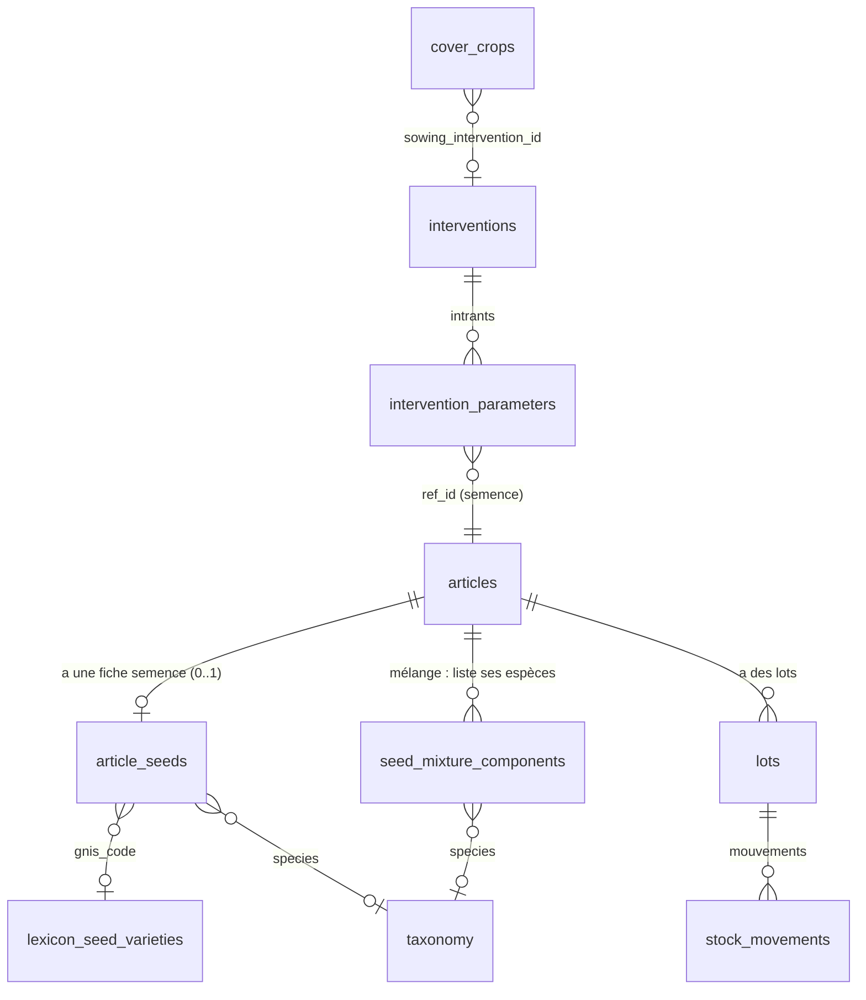

# Semences — conception

*Conception du 20/11/2026, d'après [`besoins_semences.md`](besoins_semences.md) (FR-SE-1 à 29, décisions S1 à S8). Étape suivante : `/sc:workflow`.*

## 1. Principes

1. **Une extension 1-1 de l'article**, comme les fertilisants (`article_fertilizers`) : une table `article_seeds`. Les semences restent des `articles` (`kind = 'seed'`), donc les stocks, les lots, les interventions, le registre et la synchronisation mobile n'ont rien à migrer.
2. **Le PMG se lit dans cet ordre** : le lot (S5), puis l'article, puis le repère de l'espèce (S6, « estimé »). Rien d'autre : pas de 50 g par défaut (S2).
3. **Une conversion faite est figée.** L'intervention garde le PMG et le nombre de grains par dose qui ont servi. Une correction ultérieure du PMG ne change pas en silence les stocks passés (NF-SE-5).
4. **Les unités existantes sont reconnues à la lecture** (FR-SE-23) par un analyseur unique du domaine. Aucun article n'est réécrit (question ouverte 2).
5. **Les référentiels sont dans la base, avec leur source** : catalogue GNIS (Lexicon `seed_varieties`), taxonomie (déjà chargée), repères de PMG (module versionné de `certification-refs`).

## 2. Modèle de données



### 2.1 `article_seeds` (migration 0075)

| Colonne | Type | Rôle |
|---|---|---|
| `article_id` | uuid PK, FK `articles` ON DELETE CASCADE | la semence |
| `farm_id` | uuid NOT NULL | RLS, comme `article_fertilizers` |
| `species` | text NULL | taxon Lexicon (`triticum_aestivum`) ; NULL pour un mélange ou une espèce inconnue |
| `variety_name` | text NULL | « Thermidor » |
| `gnis_code` | text NULL | « 512E492 » ; n'est pas une FK, car un code absent du catalogue est gardé (FR-SE-28) |
| `category` | text NULL CHECK (`certified`, `farm`) | FR-SE-5 |
| `is_mixture` | boolean NOT NULL DEFAULT false | FR-SE-13 |
| `grains_per_dose` | integer NULL CHECK (> 0) | S3, FR-SE-6 |
| `bag_kg` | numeric NULL CHECK (> 0) | poids d'un sac vendu au poids (FR-SE-6), information seulement |
| `tgw_g` | numeric NULL CHECK (> 0 AND < 2000) | PMG par défaut de l'article (S5) |
| `tgw_origin` | text NULL CHECK (`label`, `measured`, `reference`, `imported`) | FR-SE-7 |
| `tgw_on` | date NULL | date de l'étiquette ou de la mesure |
| `updated_by`, `updated_at` | | comme les fertilisants |

L'unité de stock reste `articles.unit` : c'est elle que lisent les stocks, les lots, le registre et le mobile. La fiche la remplace par une unité canonique (§3.1) quand on la modifie : « Sac de 50 000 grains » devient `dose`, avec `grains_per_dose = 50000`.

### 2.2 `seed_mixture_components` (migration 0075)

| Colonne | Type | Rôle |
|---|---|---|
| `id` | uuid PK | |
| `farm_id` | uuid NOT NULL | RLS |
| `article_id` | uuid FK `articles` ON DELETE CASCADE | le mélange |
| `species` | text NULL | taxon ; NULL si non rattaché (« Radis » saisi librement) |
| `label` | text NOT NULL | libellé affiché |
| `variety_name`, `gnis_code` | text NULL | si connus |
| `position` | smallint NOT NULL | ordre |

Pas de proportion (S7). Contrainte UNIQUE (`article_id`, `label`).

### 2.3 PMG d'un lot (S5)

Il est rangé dans `lots.attrs.seed = { tgwG, origin, on }`, validé par le contrat. Il n'y a pas de colonne, parce que les lots servent à tous les articles et qu'une seule valeur est concernée. Il se lit avec `(attrs->'seed'->>'tgwG')::numeric`.

### 2.4 Doses d'un mélange et conversion figée (S7, principe 3)

Dans `intervention_parameters.attrs` d'un intrant semence :

```jsonc
{
  "lotId": "…",
  // présent quand une conversion grains ↔ masse ou dose a servi
  "seedConversion": { "tgwG": 300, "tgwOrigin": "label", "grainsPerDose": 50000, "estimated": false },
  // présent pour un mélange : quantity = somme des kgHa, unit = kilogram_per_hectare
  "mixture": [ { "componentId": "…", "label": "Avoine", "species": "avena_sativa", "kgHa": 8 } ]
}
```

`quantity` et `unit` gardent **ce qui a été saisi** (par exemple 9 `grain_per_square_meter`). Le mouvement de stock est dans l'unité de l'article.

### 2.5 Couverts (FR-SE-16)

La migration 0075 ajoute à `cover_crops` :
- `sowing_intervention_id` (uuid NULL, FK `interventions` ON DELETE SET NULL) ;
- `components` (jsonb NULL, `[{ label, species, kgHa }]`).

`species` (texte) reste pour l'affichage et la compatibilité ; il est rempli par la liste des libellés.

### 2.6 Référentiels

| Table | Source | Chargement |
|---|---|---|
| `lexicon_seed_varieties` (`gnis_code` PK, `species`, `species_label`, `variety_name`, `registered_on`) | Lexicon `seed_varieties` (SEMAE, ouvert) | nouveau paquet de `packages/lexicon/src/load.ts`, `ifPublished` ; index sur `lower(variety_name)` et sur `species` |
| `taxonomy` | Lexicon `taxonomy` | déjà chargée ; sert aux légumineuses (ancêtre `fabaceae`) et aux libellés |
| Repères de PMG | Arvalis, Terres Inovia (S6) | `packages/certification-refs/src/agronomy/thousand-grain-weight.ts` : `{ species, typicalG, minG, maxG, source, url }` ; chaque valeur avec sa source (licence acceptée le 20/11/2026) ; `REFS_VERSION` relevée |

Pas de recherche floue (`pg_trgm` n'est pas installé). La recherche se fait par `ILIKE` sur la variété et l'espèce, en ignorant les accents (normalisation dans le code), et rend 20 résultats ; 21 592 lignes, c'est rapide.

## 3. Domaine (`packages/domain/src/seeds/`)

### 3.1 Unités (`units.ts`)

```ts
type SeedUnit =
  | { dim: "mass"; kg: number }                    // g, kg, q, t, « Kilogramme », « Kg »
  | { dim: "grain"; grains: number }               // grain = 1, thousand = 1 000, million = 1 000 000, « Mille grains »
  | { dim: "dose"; grains: number | null };        // dose (N de la fiche), « Sac de 50 000 grains » (N lu dans le libellé)

parseSeedUnit(unit: string, grainsPerDose?: number | null): SeedUnit | null
```

- Libellés libres : la casse, les espaces multiples, les pluriels et « graine/grain » sont normalisés. `/^(sac|dose)\s+de\s+([\d\s.]+)\s+grain/` donne N.
- Codes canoniques enregistrés : `kilogram`, `gram`, `grain`, `thousand`, `million`, `dose`, avec `_per_hectare`, plus `grain_per_square_meter`.
- `convertSeedQuantity(q, from, to, { tgwG, grainsPerDose })` : même dimension → facteur ; grains ↔ masse → PMG obligatoire (`kg = grains × tgwG / 1e6`) ; dose → grains par N. Rend `null` quand c'est impossible, comme `convertQuantity`.
- `seedUnitChoices(article, seed, tgw)` remplace `[a.unit]` pour les semences dans le formulaire : l'unité de l'article d'abord, puis grains/m², milliers/ha, kg/ha et doses/ha selon ce qui est convertible (FR-SE-20).
- `seedEquivalents(q, unit, ctx, areaHa)` donne la ligne « 9 grains/m² ≈ 90 000 grains/ha ≈ 1,8 dose/ha ≈ 27 kg/ha » (FR-SE-20, 22).

### 3.2 PMG retenu (`tgw.ts`)

```ts
resolveTgw({ lot, article, speciesRef }): { tgwG: number; origin; estimated: boolean } | null
```

Ordre : lot, puis article, puis repère de l'espèce (`estimated: true`). `tgwWarning(tgwG, ref)` signale un écart de plus de 30 % avec le repère (FR-SE-7 ; seuil dans une constante).

### 3.3 Intégration au stock (`quantities.ts`)

`toStockQuantity` reçoit en plus `seed?: { tgwG, grainsPerDose }` :
- `_per_hectare` × surface ; `grain_per_square_meter` × 10 000 × surface ;
- `convertSeedQuantity` quand l'article est une semence, `convertQuantity` sinon.

Le message d'erreur nomme ce qui manque : « PMG inconnu : compléter la fiche de la semence » (FR-SE-19).

### 3.4 Repères (`flags.ts`)

`seedFlags(article, seed, components)` rend `tgw_missing`, `unit_unknown`, `mixture_empty`, `species_unknown` (FR-SE-4). `looksLikeMixture(name, customSpecies)` repère « + » dans le nom ou l'espèce importée « Mélange » ; la liste le propose.

## 4. API

Fichiers : `apps/api/src/routes/seeds.ts`, `apps/api/src/repos/seeds.ts` ; contrat : `packages/contracts/src/seeds.ts`.

| Méthode et chemin | Droits | Rôle | FR |
|---|---|---|---|
| `GET /seeds?at=&campaign=` | membre | liste : article, fiche, PMG retenu, repères, stock à la date, nombre d'interventions de la campagne | 2-4 |
| `GET /articles/:id/seed` | membre | fiche : identité, conditionnement, PMG, lots et leur PMG, composants, repère de l'espèce, utilisation par campagne | 5-8 |
| `PUT /articles/:id/seed` | responsable | enregistre la fiche ; peut réécrire `articles.unit` en unité canonique | 5-7, 12 |
| `PUT /articles/:id/seed/components` | responsable | remplace la liste des espèces d'un mélange | 13 |
| `PUT /lots/:id/seed` | responsable | PMG d'un lot | 7 (S5) |
| `POST /seeds` | responsable | crée l'article et sa fiche (depuis le catalogue GNIS ou libre) | 10-11 |
| `GET /seeds/catalog?q=&species=` | membre | recherche GNIS (20 résultats) avec l'espèce, le repère de PMG et l'unité proposée | 10 |
| `GET /seeds/:id/suggestions` | membre | rattachement proposé (code GNIS, nom, `lexicon_ref`, `custom.species`) | 12 |
| `GET /seeds/usage?campaign=&by=article\|species&format=csv` | membre | utilisation par campagne, réalisé et prévu distingués | 24-27 |

Toutes les routes passent par `withFarm` (RLS) ; les écritures exigent `requireOwner`, comme `fertilizers.ts`.

**Utilisation (FR-SE-24).** Pour chaque intrant semence d'une intervention de la campagne (`fourmy_production_at` pour la campagne de la parcelle), le service calcule :
- la quantité dans l'unité de stock (mouvement s'il existe, sinon conversion) ;
- les kg et les grains (conversion figée si présente, sinon PMG retenu, marquée « estimée ») ;
- la surface traitée ;
- la densité.

Moyenne pondérée par la surface ; écart minimum-maximum.

## 5. Interventions

### 5.1 Validation (`repos/interventions.ts`, autour de la ligne 58)

Aujourd'hui, un intrant non fertilisant doit être saisi dans l'unité de son article. Nouvelle règle pour une semence : l'unité saisie doit être convertible vers celle de l'article d'après `parseSeedUnit` et le PMG retenu. Sinon, erreur 422 avec le motif.

Pour un mélange, l'unité doit être `kilogram_per_hectare` ou `kilogram` et `attrs.mixture` est présent ; la quantité est égale à la somme des doses, à 0,01 près.

### 5.2 Stock (`completeIntervention`, ligne 890 environ)

Le lot est choisi **avant** la conversion (aujourd'hui, la conversion vient d'abord). Puis `resolveTgw` sur le lot, puis `toStockQuantity` avec `seed`. On écrit enfin `attrs.seedConversion` sur le paramètre. Une intervention importée (`affects_stock = false`) garde ses quantités ; la conversion n'est calculée qu'à l'affichage.

### 5.3 Couvert (FR-SE-16)

À la validation d'un semis réalisé, sur une parcelle et dans une période d'interculture où un couvert existe déjà pour la campagne suivante, le couvert est rattaché (`sowing_intervention_id`) et ses `components` sont remplis depuis `attrs.mixture`, ou depuis l'espèce de la semence pour une espèce seule.

Sans couvert existant, rien n'est créé automatiquement. La page des couverts propose « Reprendre le semis du 12/08 » ; c'est la règle des propositions confirmées.

### 5.4 Fiche d'intervention

`SeedLine` (sur le modèle de `NitrogenLine`) affiche sous chaque semence :
- la densité en grains/m² et la dose en kg/ha ;
- « estimée » si le PMG vient du repère ;
- pour un mélange, la dose de chaque espèce.

## 6. Interface web (`apps/web/src/features/seeds/`)

| Composant | Rôle | FR |
|---|---|---|
| Menu `Layout.tsx` | « Semences » (icône `Wheat`) entre « État des stocks » et « Produits phyto » ; route `seeds` dans `router.tsx` | 1 |
| `SeedsPage.tsx` | liste à colonnes choisies (`useColumns("seeds", …)`), filtres (espèce, campagne, sans PMG, mélanges, non bio), badges des repères avec « Compléter » ; onglets **Semences** et **Utilisation** | 2-4, 24-26 |
| `SeedSheet.tsx` | tiroir latéral : identité, conditionnement, PMG (repère et écart affichés), lots et leur PMG, composants, interventions par campagne ; lecture seule hors responsable | 5-9 |
| `AddSeedModal.tsx` | recherche GNIS (`Autocomplete`, 600 ms comme Sirene), proposition d'unité et de PMG repère ; onglet « Saisie libre » | 10-11 |
| `MixtureEditor.tsx` | espèces du mélange (taxonomie, ou libellé libre), légumineuses repérées | 13-14 |
| `UsagePanel.tsx` | tableau par semence ou par espèce, réalisé et prévu, export CSV | 24-27 |
| `InterventionForm.tsx` | unités de `seedUnitChoices`, ligne d'équivalence sous la quantité, saisie des doses par espèce pour un mélange (doses précédentes proposées) | 20, S7 |
| `SeedLine.tsx` | fiche d'intervention | 22 |

**Mobile.** La synchronisation (`repos/sync.ts`) ajoute à chaque article semence `seed: { grainsPerDose, tgwG, tgwOrigin, isMixture, components }`. L'application mobile s'en sert dans son propre dépôt ; l'API accepte dès maintenant les unités de semence venues du mobile (NF-SE-6).

## 7. Imports et reprises (FR-SE-28, 29)

- `import-apply.ts` crée `article_seeds` pour chaque semence importée :
  - `gnis_code` (Geofolia `ReferentialVarietyCode`, DAPLOS `input_gnis_code`), puis l'espèce et la variété lues dans `lexicon_seed_varieties` ;
  - à défaut, l'espèce d'après `custom.species` et les libellés de `taxonomy` ;
  - « Mélange » donne `is_mixture` ;
  - `tgw_origin = 'imported'` seulement si le fichier donne un PMG.
- Les fermes existantes n'ont pas de reprise en masse : la liste propose les rattachements (`/seeds/:id/suggestions`) et le responsable confirme (FR-SE-12). Une commande `seeds:attach --farm <id> --dry-run` applique les propositions sûres (code GNIS trouvé au catalogue), pour les fermes pilotes.

## 8. Correspondance des besoins

| Besoins | Où |
|---|---|
| FR-SE-1 à 4 | `SeedsPage`, `GET /seeds`, `seedFlags` |
| FR-SE-5 à 9 | `article_seeds`, `SeedSheet`, `GET/PUT /articles/:id/seed`, `PUT /lots/:id/seed` |
| FR-SE-10 à 12 | `lexicon_seed_varieties`, `AddSeedModal`, `/seeds/catalog`, `/seeds/:id/suggestions` |
| FR-SE-13 à 16, S7 | `seed_mixture_components`, `attrs.mixture`, `cover_crops.components` |
| FR-SE-17 à 23 | `seeds/units.ts`, `tgw.ts`, `toStockQuantity`, validation et stock des interventions, `SeedLine` |
| FR-SE-24 à 27 | `/seeds/usage`, `UsagePanel` |
| FR-SE-28, 29 | `import-apply.ts`, `seeds:attach` |
| NF-SE-1 | sources dans `thousand-grain-weight.ts` et attribution SEMAE sur la recherche |
| NF-SE-2, 5 | `estimated`, conversion figée `attrs.seedConversion` |
| NF-SE-3, 4 | paquet `ifPublished`, RLS sur les deux nouvelles tables |

## 9. Tests

- **Domaine** :
  - `parseSeedUnit` sur les 10 libellés observés ;
  - conversions (maïs 9 grains/m² → 1,8 dose/ha → 27 kg/ha) ;
  - refus sans PMG ;
  - ordre lot → article → repère ;
  - seuil d'écart ;
  - repères.
- **API (intégration)** :
  - création depuis le catalogue ;
  - fiche et PMG de lot ;
  - semis en grains/m² qui fait baisser le stock en doses ;
  - conversion figée inchangée après une correction du PMG ;
  - mélange (somme et 422) ;
  - couvert rattaché ;
  - utilisation et CSV ;
  - RLS entre deux fermes.
- **Lexicon** : chargement de `seed_varieties` avec un jeu réduit (fixtures de `packages/lexicon/test`).
- **Web** : liste et filtres, tiroir, saisie avec la ligne d'équivalence, mélange.
- **e2e** : ajouter « Thermidor » depuis le catalogue, saisir son PMG, semer en grains/m², lire la densité sur la fiche.

## 10. Risques et points d'attention

- **Repères de PMG** : une espèce sans repère ni PMG saisi garde ses conversions refusées, avec un message qui dit quoi compléter.
- **Lot choisi avant la conversion** (§5.2) : un changement d'ordre dans un code sensible ; à couvrir par les tests existants des stocks.
- **Mobile** : tant que l'application n'utilise pas `seed`, elle saisit dans l'unité de l'article, ce qui reste valide.
- **Interventions importées** : elles n'ont pas de mouvement de stock. L'utilisation les compte d'après la dose saisie ; une conversion impossible y apparaît « non convertible », sans bloquer.
- **Unité canonique écrite par la fiche** : changer `articles.unit` d'une semence qui a déjà des mouvements changerait l'unité des stocks passés. La fiche ne le permet que si le facteur est 1 (même dimension, même facteur, par exemple « Sac de 50 000 grains » → `dose` avec N = 50 000). Sinon, elle refuse avec un message.
