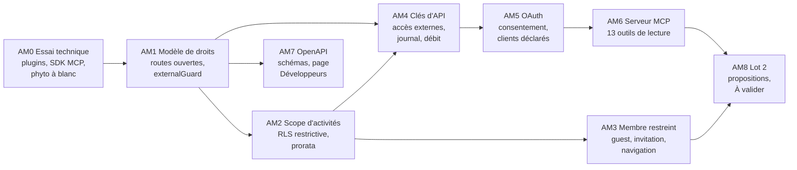

# API ouverte et serveur MCP — plan de réalisation

*Plan du 27/11/2026, d'après [`besoins_api_mcp.md`](besoins_api_mcp.md) (B1 à B10, API-1 à API-28) et [`conception_api_mcp.md`](conception_api_mcp.md) (§12, points 1 à 4 validés). FR-API-1, FR-API-2, US-7, point ouvert 60, issue #35. Exécution lot par lot avec `/sc:implement`.*

## 1. Règles communes

- **Une branche et une PR par lot**, partie de `main` et nommée `feat/api-mcp-am<n>-…`. On pousse et on ouvre la PR sur accord. Dokploy redéploie dev.fourmy.org à chaque fusion sur `main`.
- **Avant chaque push** : `turbo run typecheck lint test`, avec `NODE_OPTIONS=--no-experimental-webstorage` et la base sur le port 5434. Les lots qui touchent l'interface passent aussi les tests e2e.
- **Aucun test existant ne doit changer.** La suite API (442 tests) et la suite web passent sans modification. C'est la preuve que rien ne change pour une session sans scope.
- **Migrations** numérotées à la suite à partir de 0084 : 0084 (AM1), 0085 (AM2), 0086 (AM3), 0087 (AM4), 0088 (AM5), 0089 (AM8).
- **Dépendances** : versions exactes, sans `^`. `@better-auth/api-key`, `@better-auth/oauth-provider` et `@better-auth/mcp` en 1.7.12, alignés sur better-auth ; `@modelcontextprotocol/sdk` 1.32.2.
- **Pas de données de testeur dans le dépôt.** Les tests créent leurs fermes (Vigne et Blé), et les essais se font sur la base de développement.
- **Suivi** : chaque lot remplit la section « Réalisé » (§5) et fait avancer la documentation : `docs/api.md` pour les développeurs, `docs/acces-externes.md` pour l'exploitant.

## 2. Enchaînement

Chemin critique : AM0 → AM1 → AM2 → AM4 → AM5 → AM6. AM3 et AM7 peuvent avancer en parallèle dès que AM2, pour AM3, et AM1, pour AM7, sont fusionnés.

**Pourquoi AM4 dépend aussi d'AM2.** Une clé d'API ne doit jamais fonctionner sans le scope d'activités. On s'interdit donc de mettre en service un accès externe avant que la RLS restrictive ne soit en place.

## 3. Lots

### AM0 — Essai technique (taille S, sans fusion du code d'essai)
- **But** : lever les incertitudes de la conception avant d'écrire du code durable. Le résultat est une note dans `claudedocs/essai_api_mcp.md`. Le code d'essai n'est pas fusionné ; il reste sur une branche ou un worktree.
- **Plugins better-auth en 1.7.12, avec nos tables en snake_case** (`auth_*`) :
  - `api-key` : préfixe `fmy_`, hachage, expiration, en-tête `x-api-key` ;
  - `oauth-provider` : PKCE, enregistrement dynamique des clients, page de consentement personnalisée, rafraîchissement, métadonnées `.well-known` ;
  - `mcp` : est-il utile en plus d'`oauth-provider`, ou fait-il double emploi ?
- **Tables des plugins** : générer leur schéma (`npx @better-auth/cli generate`) et le traduire en migration SQL à notre façon.
- **SDK MCP** : `StreamableHTTPServerTransport` sans état, monté dans une route Hono (requête et réponse Web), un outil `ping`, puis un client du SDK en mémoire.
- **Un vrai connecteur** : reporté en AM6 (décision du 27/11). L'essai se fera directement sur dev.fourmy.org une fois AM6 fusionné : découverte, enregistrement, consentement, jeton, appel d'outil.
- **Contrôle phyto à blanc** : vérifier que le contrôle réglementaire (feux, ZNT) et l'IFT se calculent sans écrire, pour la conception §8. Sinon, noter l'extraction à prévoir en AM8.
- **Appels internes** : mesurer le coût d'un `app.request` interne (latence, transaction), pour la conception §7.2.
- **Sortie** : la note d'essai, avec une décision par point. On met à jour la conception (§7) si un choix change.

### AM1 — Modèle de droits et routes ouvertes (taille L)
- **Contrats** (`packages/contracts/src/access.ts`) : `accessModules`, `AccessLevel`, `Grant`, `EffectiveGrant`, `grantSchema` (zod), et les libellés des modules en français.
- **Domaine** (`packages/domain/src/access/`) : fonctions pures et testées à part.
  - `memberGrant(role, grant?)` ;
  - `intersectGrants(a, b)` ;
  - `levelAllows(level, method)` ;
  - `capGrant(creatorGrant, requested)`, pour les plafonds de API-4 et Q4.
- **Migration 0084** : `memberships.grant jsonb` et `person_invitations.grant jsonb`, encore vides. Le rôle `guest` est autorisé par la contrainte, mais pas encore proposé.
- **Contexte** (`context.ts`) : `principal`, `grant` et `external` dans `Env`. `farmScope` calcule les droits effectifs. Pour une session `owner`, `worker` ou `reader`, `external = false`, et le comportement reste **identique** (`reader` et `requireOwner` ne bougent pas).
- **Liste des routes ouvertes** (`apps/api/src/external/routes.ts`) :
  - recenser les routes GET de consultation des 11 modules (une cinquantaine), chacune avec son module, son résumé et le schéma de réponse quand il existe ;
  - lister aussi les routes **fermées**, explicitement.
- **Garde `externalGuard`** (`apps/api/src/external/guard.ts`) : route absente de la liste → 404, module `none` → 403, méthode autre que GET → 404.
- **Tests** :
  - le domaine : intersection et plafonds ;
  - la **couverture des routes** : `app.routes` comparé à la liste des routes ouvertes et à celle des routes fermées ;
  - la **matrice** : un principal externe de test, injecté par un en-tête réservé aux tests, sur chaque route ouverte, avec les niveaux none, read et write ;
  - la non-régression complète.
- Il n'y a pas encore de principal externe réel. La garde est testée par l'injection de test.

### AM2 — Scope d'activités dans la RLS (taille L)
- **Migration 0085** :
  - la fonction `current_activity_scope()` ;
  - les fonctions `fourmy_parcel_in_scope(parcel_id)`, `fourmy_intervention_in_scope(intervention_id)` et `fourmy_intervention_scope_share(intervention_id)`, cette dernière en `SECURITY DEFINER` et ne renvoyant que la part visible ;
  - les policies `activity_scope AS RESTRICTIVE` sur toutes les tables de la conception §5.2 ;
  - les index qui manquent : `intervention_parameters (intervention_id, role)`, `productions (land_parcel_id, campaign_id)` et `campaigns (farm_id, starts_on, stops_on)`.
- **`withFarm`** (`packages/db/src/client.ts`) : il pose `fourmy.activity_scope` à partir d'un `AsyncLocalStorage` rempli par `farmScope`. Sans scope, rien n'est posé, et la requête est identique à aujourd'hui.
- **Prorata** (`repos/interventions.ts`) : quand un scope est actif, les quantités d'intrants sont multipliées par la part visible, et la réponse porte `shared: true`. `compliance` est renvoyé sans les parcelles cachées. Le contrat de l'intervention gagne `shared?: boolean`.
- **Assolement sous scope** (`repos/crop-plans.ts`) : il est recalculé à partir des productions visibles, sans instantané.
- **Tests** :
  - la **couverture RLS** : `information_schema` comparé aux tables qui ont une policy `activity_scope` ;
  - la ferme Vigne et Blé, avec une intervention mixte, une intervention sans cible et une ancienne vigne arrachée ;
  - un accès « Vigne », vérifié sur les listes, les fiches (404), le registre, l'assolement, les marges et l'intervention mixte (prorata) ;
  - la **performance** : la liste des interventions sous scope en moins de 300 ms sur la copie de la ferme de Pierre (essai local, mesure notée).

### AM3 — Membre restreint (taille M)
- **Migration 0086**, si besoin : la contrainte sur `role` (`guest`) et une vérification « `grant` non NULL si `guest` ».
- **API** :
  - l'invitation porte un rôle `guest` et ses droits, qui sont recopiés à l'acceptation ;
  - un responsable modifie les droits d'un membre `guest` (`PATCH /members/:id`) ;
  - `GET /me/farms` renvoie les droits effectifs.
- **Garde** : un `guest` en session est traité comme externe (`external = true`). Il n'atteint que les routes ouvertes, en lecture.
- **Web** :
  - l'**éditeur de droits** (`features/team/AccessGrantEditor.tsx`) : les 11 modules avec trois choix chacun, puis « toutes les activités » ou des cases ;
  - le rôle « Invité restreint » dans l'invitation et la fiche du membre ;
  - la navigation : les menus et les boutons d'écriture sont masqués selon les droits.
- **Tests** :
  - API : invitation `guest`, puis acceptation, puis lecture limitée ; un retrait du membre coupe l'accès ;
  - web : éditeur, et navigation masquée ;
  - e2e : invitation d'un conseiller « Vigne ».

### AM4 — Clés d'API, accès externes, journal (taille L)
- **Migration 0087** : `farm_accesses`, `access_log` (avec sa RLS), et les tables du plugin api-key (d'après AM0).
- **Auth** (`auth.ts`) : le plugin `api-key` (`fmy_`). Le middleware `auth` reconnaît `x-api-key` et `Bearer fmy_…`, et en tire le principal `api_key`, avec `accessId`.
- **`farmScope`** :
  - l'accès est-il lié à cette ferme, non révoqué et non expiré ? Sinon, 403 ;
  - les droits effectifs = droits du membre ∩ droits de l'accès ;
  - `last_used_at` est mis à jour au plus une fois par minute.
- **API de gestion** :
  - `owner` : `GET/POST/PATCH/DELETE /accesses` et `GET /accesses/:id/log` ;
  - tout membre : `GET/POST/DELETE /me/accesses`, avec les plafonds de Q4 et API-4.
  - La clé n'est renvoyée qu'à la création.
- **Journal** : un middleware après la garde, pour tout principal externe, avec écriture asynchrone dans `access_log`.
- **Débit** : un compteur en mémoire par accès, 120 requêtes par minute et 10 000 par jour, avec 429 et `Retry-After`.
- **Worker** : purge de `access_log` à 90 jours, comme `purgeExpiredImportFiles`.
- **E-mail** à l'exploitant quand une clé en écriture est créée (API-28).
- **Web** :
  - Ferme → **Accès externes** : la liste, la création avec l'éditeur de droits, la clé affichée une seule fois avec un bouton « Copier », la révocation et le journal ;
  - Mon compte → **Mes accès**.
- **Tests** :
  - le cycle de vie d'une clé : création, appel, scope, expiration, révocation (401 ou 403 à l'appel suivant) ;
  - le plafond d'un `reader` ;
  - une clé d'une autre ferme → 403 ;
  - le journal, le débit (429) et la purge ;
  - web : l'écran Accès externes.

### AM5 — OAuth et consentement (taille L)
- **Migration 0088** : les tables du plugin oauth-provider (d'après AM0).
- **Auth** :
  - le plugin `oauth-provider` : PKCE obligatoire, enregistrement dynamique, scopes `fourmy:read` et `fourmy:write`, jeton d'accès d'une heure, rafraîchissement ;
  - le jeton OAuth est reconnu par le middleware `auth` (principal `oauth`, `clientId`) ;
  - `farmScope` trouve `farm_accesses (farm_id, oauth_client_id, user_id)`.
- **Consentement** :
  - `GET /oauth/consent-info` : le client, les scopes demandés et les fermes de l'utilisateur avec ses droits ;
  - `POST /oauth/consent` : il écrit `farm_accesses` et accepte le consentement auprès du plugin ;
  - un e-mail part au premier consentement d'une application (API-28).
- **Clients déclarés d'avance** : configuration `FOURMY_OAUTH_CLIENTS`, pour Aiffel et les services de l'offre commune.
- **Web** : la page `/oauth/consentement`, avec l'application, la ferme, l'éditeur de droits prérempli et plafonné, puis « Autoriser » ou « Refuser ». Les applications OAuth apparaissent dans Accès externes et Mes accès, et peuvent y être révoquées.
- **Tests** :
  - le parcours complet avec un client de test : enregistrement, PKCE, consentement, code, jeton, appel, rafraîchissement, révocation ;
  - un consentement réduit par l'utilisateur ;
  - un `guest` qui consent, plafonné par ses droits ;
  - une ferme non consentie → 403.

### AM6 — Serveur MCP (taille M)
- **Route `POST /mcp`** (Streamable HTTP sans état) et `/.well-known/oauth-protected-resource`, d'après le choix fait en AM0 sur `@better-auth/mcp`.
- **Outils** (`apps/api/src/mcp/tools/*.ts`) : les 13 outils de lecture de la conception §7.2.
  - Chacun déclare son module, appelle `/api/v1` en interne avec le principal courant, et met en forme sa réponse : un résumé en français, des unités, au plus 50 éléments avec un curseur, et `structuredContent`.
  - `tools/list` est filtré selon les droits.
- **Ferme par défaut** : la seule ferme consentie. S'il y en a plusieurs, l'outil renvoie une erreur qui invite à utiliser `fermes`.
- **Journal** : `channel = 'mcp'`, avec le nom de l'outil.
- **Documentation** : la page web « Connecter un assistant », avec l'URL `/mcp` et les étapes pour les principaux assistants, et `docs/acces-externes.md`.
- **Tests** : un client du SDK en mémoire, avec `tools/list` filtré selon trois profils de droits et chaque outil appelé sur la ferme Vigne et Blé (scope, prorata).
- **Recette** : US-7, avec le premier branchement d'un assistant réel, directement sur dev.fourmy.org après la fusion. L'assistant répond à « qu'est-ce qui a été traité sur la parcelle X cette semaine ? ». Le parcours OAuth complet (découverte, enregistrement ou CIMD, choix de la ferme, consentement) y est vérifié de bout en bout.

### AM7 — OpenAPI et page Développeurs (taille M)
- **Schémas de réponse** qui manquent dans `packages/contracts` pour les routes ouvertes. Les routes doivent renvoyer ces formes : c'est vérifié par un test de conformité, qui fait passer chaque réponse de la matrice AM1 par son schéma.
- **`GET /api/v1/openapi.json`**, généré à partir de la liste des routes ouvertes (`z.toJSONSchema`) : chemins, paramètres, réponses, `x-fourmy-module`, et sécurité (`apiKey`, `oauth2`).
- **Web** : la page `/developpeurs`, avec la référence générée, l'authentification et des exemples (`curl` avec une clé).
- **Tests** : le document est valide (OpenAPI 3.1) ; chaque route ouverte y figure ; les réponses sont conformes.
- Ce lot fait avancer l'issue #35, à fermer quand AM7 est fusionné.

### AM8 — Propositions (lot 2, taille L)
- **Migration 0089** : `external_proposals`.
- **Domaine** : contrôle d'une intervention à blanc (phyto, ZNT, feux, IFT), extrait si AM0 l'a montré nécessaire.
- **API** :
  - `POST /proposals` (accès avec `write` sur interventions, cibles dans le scope), qui renvoie les contrôles ;
  - `GET /proposals` : l'`owner` les voit toutes, un accès ne voit que les siennes ;
  - `POST /proposals/:id/accept`, qui crée l'intervention par le chemin habituel, avec `origin` égal à `api` ou `mcp` ;
  - `POST /proposals/:id/reject`.
  - Ces routes sont dans la liste des routes ouvertes, en POST, pour `proposals` seulement.
- **Worker** : expiration et purge à 90 jours.
- **MCP** : `proposer_intervention` et `etat_propositions`.
- **Web** :
  - la liste **« À valider »**, avec un compteur dans la navigation ;
  - le formulaire d'intervention prérempli à partir de la proposition ;
  - l'origine affichée sur l'intervention créée ;
  - seul un `owner` peut accepter (B9).
- **Tests** :
  - dépôt avec un feu rouge (renvoyé, rien d'écrit) ;
  - acceptation avec correction, qui écrit l'intervention, le registre et le stock ;
  - refus ;
  - un `worker` ne peut pas accepter ;
  - cibles hors scope → 422 ;
  - MCP : dépôt dicté puis acceptation.
- **Recette** : R5 dans un assistant réel.

## 4. Points de contrôle

| Après | Vérification |
|---|---|
| AM0 | note d'essai : les trois plugins tranchés, un connecteur MCP réel parcouru de bout en bout, contrôle phyto à blanc possible ou extraction chiffrée |
| AM1 | couverture des routes verte ; matrice verte ; suite existante inchangée |
| AM2 | couverture RLS verte ; accès « Vigne » sans fuite (listes, 404, registre, marges) ; intervention mixte au prorata ; moins de 300 ms |
| AM3 | conseiller invité « Vigne » : navigation réduite, lecture seule, retrait effectif |
| AM4 | une clé `curl` lit les interventions d'une ferme, limitées au scope ; révocation immédiate ; journal consultable |
| AM5 | un client OAuth de test obtient un jeton par consentement réduit ; révocation depuis Accès externes |
| AM6 | US-7 dans un assistant réel sur dev.fourmy.org |
| AM7 | `openapi.json` valide et complet ; page Développeurs en ligne ; #35 fermée |
| AM8 | R5 : un traitement dicté arrive dans « À valider », accepté avec correction, présent dans le registre |

## 5. Réalisé

*(à remplir lot par lot)*
