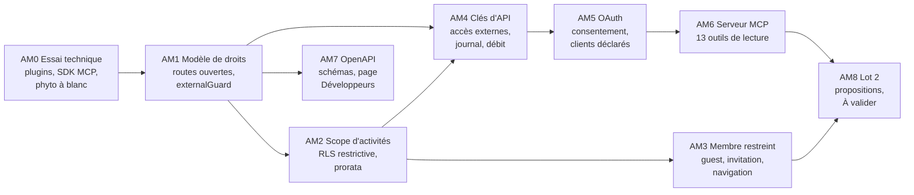

# API ouverte et serveur MCP — plan de réalisation

*Plan du 27/11/2026, d'après [`besoins_api_mcp.md`](besoins_api_mcp.md) (B1 à B10, API-1 à API-28) et [`conception_api_mcp.md`](conception_api_mcp.md) (§12, points 1 à 4 validés). FR-API-1, FR-API-2, US-7, point ouvert 60, issue #35. Exécution lot par lot avec `/sc:implement`.*

## 1. Règles communes

- **Une branche et une PR par lot**, partie de `main` et nommée `feat/api-mcp-am<n>-…`. On pousse et on ouvre la PR sur accord. Dokploy redéploie dev.fourmy.org à chaque fusion sur `main`.
- **Avant chaque push** : `turbo run typecheck lint test`, avec `NODE_OPTIONS=--no-experimental-webstorage` et la base sur le port 5434. Les lots qui touchent l'interface passent aussi les tests e2e.
- **Aucun test existant ne doit changer.** La suite API (442 tests) et la suite web passent sans modification. C'est la preuve que rien ne change pour une session sans scope.
- **Migrations** numérotées à la suite à partir de 0084 : 0084 (AM1), 0085 (AM2), 0086 (AM3), 0087 (AM4), 0088 (AM5), 0089 (AM8).
- **Dépendances** : versions exactes, sans `^`. `@better-auth/api-key`, `@better-auth/oauth-provider` et `@better-auth/mcp` en 1.7.12, alignés sur better-auth ; `@modelcontextprotocol/sdk` 1.32.2.
- **Pas de données de testeur dans le dépôt.** Les tests créent leurs fermes (Vigne et Blé), et les essais se font sur la base de développement.
- **Suivi** : chaque lot remplit la section « Réalisé » (§5) et fait avancer la documentation : `docs/api.md` pour les développeurs, `docs/acces-externes.md` pour l'exploitant.

## 2. Enchaînement

Chemin critique : AM0 → AM1 → AM2 → AM4 → AM5 → AM6. AM3 et AM7 peuvent avancer en parallèle dès que AM2, pour AM3, et AM1, pour AM7, sont fusionnés.

**Pourquoi AM4 dépend aussi d'AM2.** Une clé d'API ne doit jamais fonctionner sans le scope d'activités. On s'interdit donc de mettre en service un accès externe avant que la RLS restrictive ne soit en place.

## 3. Lots

### AM0 — Essai technique (taille S, sans fusion du code d'essai)
- **But** : lever les incertitudes de la conception avant d'écrire du code durable. Le résultat est une note dans `claudedocs/essai_api_mcp.md`. Le code d'essai n'est pas fusionné ; il reste sur une branche ou un worktree.
- **Plugins better-auth en 1.7.12, avec nos tables en snake_case** (`auth_*`) :
  - `api-key` : préfixe `fmy_`, hachage, expiration, en-tête `x-api-key` ;
  - `oauth-provider` : PKCE, enregistrement dynamique des clients, page de consentement personnalisée, rafraîchissement, métadonnées `.well-known` ;
  - `mcp` : est-il utile en plus d'`oauth-provider`, ou fait-il double emploi ?
- **Tables des plugins** : générer leur schéma (`npx @better-auth/cli generate`) et le traduire en migration SQL à notre façon.
- **SDK MCP** : `StreamableHTTPServerTransport` sans état, monté dans une route Hono (requête et réponse Web), un outil `ping`, puis un client du SDK en mémoire.
- **Un vrai connecteur** : reporté en AM6 (décision du 27/11). L'essai se fera directement sur dev.fourmy.org une fois AM6 fusionné : découverte, enregistrement, consentement, jeton, appel d'outil.
- **Contrôle phyto à blanc** : vérifier que le contrôle réglementaire (feux, ZNT) et l'IFT se calculent sans écrire, pour la conception §8. Sinon, noter l'extraction à prévoir en AM8.
- **Appels internes** : mesurer le coût d'un `app.request` interne (latence, transaction), pour la conception §7.2.
- **Sortie** : la note d'essai, avec une décision par point. On met à jour la conception (§7) si un choix change.

### AM1 — Modèle de droits et routes ouvertes (taille L)
- **Contrats** (`packages/contracts/src/access.ts`) : `accessModules`, `AccessLevel`, `Grant`, `EffectiveGrant`, `grantSchema` (zod), et les libellés des modules en français.
- **Domaine** (`packages/domain/src/access/`) : fonctions pures et testées à part.
  - `memberGrant(role, grant?)` ;
  - `intersectGrants(a, b)` ;
  - `levelAllows(level, method)` ;
  - `capGrant(creatorGrant, requested)`, pour les plafonds de API-4 et Q4.
- **Migration 0084** : `memberships.grant jsonb` et `person_invitations.grant jsonb`, encore vides. Le rôle `guest` est autorisé par la contrainte, mais pas encore proposé.
- **Contexte** (`context.ts`) : `principal`, `grant` et `external` dans `Env`. `farmScope` calcule les droits effectifs. Pour une session `owner`, `worker` ou `reader`, `external = false`, et le comportement reste **identique** (`reader` et `requireOwner` ne bougent pas).
- **Liste des routes ouvertes** (`apps/api/src/external/routes.ts`) :
  - recenser les routes GET de consultation des 11 modules (une cinquantaine), chacune avec son module, son résumé et le schéma de réponse quand il existe ;
  - lister aussi les routes **fermées**, explicitement.
- **Garde `externalGuard`** (`apps/api/src/external/guard.ts`) : route absente de la liste → 404, module `none` → 403, méthode autre que GET → 404.
- **Tests** :
  - le domaine : intersection et plafonds ;
  - la **couverture des routes** : `app.routes` comparé à la liste des routes ouvertes et à celle des routes fermées ;
  - la **matrice** : un principal externe de test, injecté par un en-tête réservé aux tests, sur chaque route ouverte, avec les niveaux none, read et write ;
  - la non-régression complète.
- Il n'y a pas encore de principal externe réel. La garde est testée par l'injection de test.

### AM2 — Scope d'activités dans la RLS (taille L)
- **Migration 0085** :
  - la fonction `current_activity_scope()` ;
  - les fonctions `fourmy_parcel_in_scope(parcel_id)`, `fourmy_intervention_in_scope(intervention_id)` et `fourmy_intervention_scope_share(intervention_id)`, cette dernière en `SECURITY DEFINER` et ne renvoyant que la part visible ;
  - les policies `activity_scope AS RESTRICTIVE` sur toutes les tables de la conception §5.2 ;
  - les index qui manquent : `intervention_parameters (intervention_id, role)`, `productions (land_parcel_id, campaign_id)` et `campaigns (farm_id, starts_on, stops_on)`.
- **`withFarm`** (`packages/db/src/client.ts`) : il pose `fourmy.activity_scope` à partir d'un `AsyncLocalStorage` rempli par `farmScope`. Sans scope, rien n'est posé, et la requête est identique à aujourd'hui.
- **Prorata** (`repos/interventions.ts`) : quand un scope est actif, les quantités d'intrants sont multipliées par la part visible, et la réponse porte `shared: true`. `compliance` est renvoyé sans les parcelles cachées. Le contrat de l'intervention gagne `shared?: boolean`.
- **Assolement sous scope** (`repos/crop-plans.ts`) : il est recalculé à partir des productions visibles, sans instantané.
- **Tests** :
  - la **couverture RLS** : `information_schema` comparé aux tables qui ont une policy `activity_scope` ;
  - la ferme Vigne et Blé, avec une intervention mixte, une intervention sans cible et une ancienne vigne arrachée ;
  - un accès « Vigne », vérifié sur les listes, les fiches (404), le registre, l'assolement, les marges et l'intervention mixte (prorata) ;
  - la **performance** : la liste des interventions sous scope en moins de 300 ms sur la copie de la ferme de Pierre (essai local, mesure notée).

### AM3 — Membre restreint (taille M)
- **Migration 0086**, si besoin : la contrainte sur `role` (`guest`) et une vérification « `grant` non NULL si `guest` ».
- **API** :
  - l'invitation porte un rôle `guest` et ses droits, qui sont recopiés à l'acceptation ;
  - un responsable modifie les droits d'un membre `guest` (`PATCH /members/:id`) ;
  - `GET /me/farms` renvoie les droits effectifs.
- **Garde** : un `guest` en session est traité comme externe (`external = true`). Il n'atteint que les routes ouvertes, en lecture.
- **Web** :
  - l'**éditeur de droits** (`features/team/AccessGrantEditor.tsx`) : les 11 modules avec trois choix chacun, puis « toutes les activités » ou des cases ;
  - le rôle « Invité restreint » dans l'invitation et la fiche du membre ;
  - la navigation : les menus et les boutons d'écriture sont masqués selon les droits.
- **Tests** :
  - API : invitation `guest`, puis acceptation, puis lecture limitée ; un retrait du membre coupe l'accès ;
  - web : éditeur, et navigation masquée ;
  - e2e : invitation d'un conseiller « Vigne ».

### AM4 — Clés d'API, accès externes, journal (taille L)
- **Migration 0087** : `farm_accesses`, `access_log` (avec sa RLS), et les tables du plugin api-key (d'après AM0).
- **Auth** (`auth.ts`) : le plugin `api-key` (`fmy_`). Le middleware `auth` reconnaît `x-api-key` et `Bearer fmy_…`, et en tire le principal `api_key`, avec `accessId`.
- **`farmScope`** :
  - l'accès est-il lié à cette ferme, non révoqué et non expiré ? Sinon, 403 ;
  - les droits effectifs = droits du membre ∩ droits de l'accès ;
  - `last_used_at` est mis à jour au plus une fois par minute.
- **API de gestion** :
  - `owner` : `GET/POST/PATCH/DELETE /accesses` et `GET /accesses/:id/log` ;
  - tout membre : `GET/POST/DELETE /me/accesses`, avec les plafonds de Q4 et API-4.
  - La clé n'est renvoyée qu'à la création.
- **Journal** : un middleware après la garde, pour tout principal externe, avec écriture asynchrone dans `access_log`.
- **Débit** : un compteur en mémoire par accès, 120 requêtes par minute et 10 000 par jour, avec 429 et `Retry-After`.
- **Worker** : purge de `access_log` à 90 jours, comme `purgeExpiredImportFiles`.
- **E-mail** à l'exploitant quand une clé en écriture est créée (API-28).
- **Web** :
  - Ferme → **Accès externes** : la liste, la création avec l'éditeur de droits, la clé affichée une seule fois avec un bouton « Copier », la révocation et le journal ;
  - Mon compte → **Mes accès**.
- **Tests** :
  - le cycle de vie d'une clé : création, appel, scope, expiration, révocation (401 ou 403 à l'appel suivant) ;
  - le plafond d'un `reader` ;
  - une clé d'une autre ferme → 403 ;
  - le journal, le débit (429) et la purge ;
  - web : l'écran Accès externes.

### AM5 — OAuth et consentement (taille L)
- **Migration 0088** : les tables du plugin oauth-provider (d'après AM0).
- **Auth** :
  - le plugin `oauth-provider` : PKCE obligatoire, enregistrement dynamique, scopes `fourmy:read` et `fourmy:write`, jeton d'accès d'une heure, rafraîchissement ;
  - le jeton OAuth est reconnu par le middleware `auth` (principal `oauth`, `clientId`) ;
  - `farmScope` trouve `farm_accesses (farm_id, oauth_client_id, user_id)`.
- **Consentement** :
  - `GET /oauth/consent-info` : le client, les scopes demandés et les fermes de l'utilisateur avec ses droits ;
  - `POST /oauth/consent` : il écrit `farm_accesses` et accepte le consentement auprès du plugin ;
  - un e-mail part au premier consentement d'une application (API-28).
- **Clients déclarés d'avance** : configuration `FOURMY_OAUTH_CLIENTS`, pour Aiffel et les services de l'offre commune.
- **Web** : la page `/oauth/consentement`, avec l'application, la ferme, l'éditeur de droits prérempli et plafonné, puis « Autoriser » ou « Refuser ». Les applications OAuth apparaissent dans Accès externes et Mes accès, et peuvent y être révoquées.
- **Tests** :
  - le parcours complet avec un client de test : enregistrement, PKCE, consentement, code, jeton, appel, rafraîchissement, révocation ;
  - un consentement réduit par l'utilisateur ;
  - un `guest` qui consent, plafonné par ses droits ;
  - une ferme non consentie → 403.

### AM6 — Serveur MCP (taille M)
- **Route `POST /mcp`** (Streamable HTTP sans état) et `/.well-known/oauth-protected-resource`, d'après le choix fait en AM0 sur `@better-auth/mcp`.
- **Outils** (`apps/api/src/mcp/tools/*.ts`) : les 13 outils de lecture de la conception §7.2.
  - Chacun déclare son module, appelle `/api/v1` en interne avec le principal courant, et met en forme sa réponse : un résumé en français, des unités, au plus 50 éléments avec un curseur, et `structuredContent`.
  - `tools/list` est filtré selon les droits.
- **Ferme par défaut** : la seule ferme consentie. S'il y en a plusieurs, l'outil renvoie une erreur qui invite à utiliser `fermes`.
- **Journal** : `channel = 'mcp'`, avec le nom de l'outil.
- **Documentation** : la page web « Connecter un assistant », avec l'URL `/mcp` et les étapes pour les principaux assistants, et `docs/acces-externes.md`.
- **Tests** : un client du SDK en mémoire, avec `tools/list` filtré selon trois profils de droits et chaque outil appelé sur la ferme Vigne et Blé (scope, prorata).
- **Recette** : US-7, avec le premier branchement d'un assistant réel, directement sur dev.fourmy.org après la fusion. L'assistant répond à « qu'est-ce qui a été traité sur la parcelle X cette semaine ? ». Le parcours OAuth complet (découverte, enregistrement ou CIMD, choix de la ferme, consentement) y est vérifié de bout en bout.

### AM7 — OpenAPI et page Développeurs (taille M)
- **Schémas de réponse** qui manquent dans `packages/contracts` pour les routes ouvertes. Les routes doivent renvoyer ces formes : c'est vérifié par un test de conformité, qui fait passer chaque réponse de la matrice AM1 par son schéma.
- **`GET /api/v1/openapi.json`**, généré à partir de la liste des routes ouvertes (`z.toJSONSchema`) : chemins, paramètres, réponses, `x-fourmy-module`, et sécurité (`apiKey`, `oauth2`).
- **Web** : la page `/developpeurs`, avec la référence générée, l'authentification et des exemples (`curl` avec une clé).
- **Tests** : le document est valide (OpenAPI 3.1) ; chaque route ouverte y figure ; les réponses sont conformes.
- Ce lot fait avancer l'issue #35, à fermer quand AM7 est fusionné.

### AM8 — Propositions (lot 2, taille L)
- **Migration 0089** : `external_proposals`.
- **Domaine** : contrôle d'une intervention à blanc (phyto, ZNT, feux, IFT), extrait si AM0 l'a montré nécessaire.
- **API** :
  - `POST /proposals` (accès avec `write` sur interventions, cibles dans le scope), qui renvoie les contrôles ;
  - `GET /proposals` : l'`owner` les voit toutes, un accès ne voit que les siennes ;
  - `POST /proposals/:id/accept`, qui crée l'intervention par le chemin habituel, avec `origin` égal à `api` ou `mcp` ;
  - `POST /proposals/:id/reject`.
  - Ces routes sont dans la liste des routes ouvertes, en POST, pour `proposals` seulement.
- **Worker** : expiration et purge à 90 jours.
- **MCP** : `proposer_intervention` et `etat_propositions`.
- **Web** :
  - la liste **« À valider »**, avec un compteur dans la navigation ;
  - le formulaire d'intervention prérempli à partir de la proposition ;
  - l'origine affichée sur l'intervention créée ;
  - seul un `owner` peut accepter (B9).
- **Tests** :
  - dépôt avec un feu rouge (renvoyé, rien d'écrit) ;
  - acceptation avec correction, qui écrit l'intervention, le registre et le stock ;
  - refus ;
  - un `worker` ne peut pas accepter ;
  - cibles hors scope → 422 ;
  - MCP : dépôt dicté puis acceptation.
- **Recette** : R5 dans un assistant réel.

## 4. Points de contrôle

| Après | Vérification |
|---|---|
| AM0 | note d'essai : les trois plugins tranchés, un connecteur MCP réel parcouru de bout en bout, contrôle phyto à blanc possible ou extraction chiffrée |
| AM1 | couverture des routes verte ; matrice verte ; suite existante inchangée |
| AM2 | couverture RLS verte ; accès « Vigne » sans fuite (listes, 404, registre, marges) ; intervention mixte au prorata ; moins de 300 ms |
| AM3 | conseiller invité « Vigne » : navigation réduite, lecture seule, retrait effectif |
| AM4 | une clé `curl` lit les interventions d'une ferme, limitées au scope ; révocation immédiate ; journal consultable |
| AM5 | un client OAuth de test obtient un jeton par consentement réduit ; révocation depuis Accès externes |
| AM6 | US-7 dans un assistant réel sur dev.fourmy.org |
| AM7 | `openapi.json` valide et complet ; page Développeurs en ligne ; #35 fermée |
| AM8 | R5 : un traitement dicté arrive dans « À valider », accepté avec correction, présent dans le registre |

## 5. Réalisé

### AM0 — fait (27/11)
- Note [`essai_api_mcp.md`](essai_api_mcp.md). Code d'essai sur la branche locale `essai/api-mcp-am0`, non fusionné. Base isolée `fourmy_essai`.
- Retenus : les plugins `api-key`, `jwt` et `mcp` (1.7.12) ; le choix de la ferme par `postLogin` ; la vérification locale du jeton avec `jose` ; CIMD en plus de l'enregistrement dynamique.
- Le connecteur réel s'essaiera sur dev.fourmy.org après AM6.

### AM1 — fait (27/11)
- **Contrat** `packages/contracts/src/access.ts` : `accessModules` (11 modules), `accessLevel`, `accessGrant` et les libellés.
- **Domaine** `packages/domain/src/access/grants.ts` : `memberGrant`, `normalizeGrant`, `intersectGrants`, `levelAllows`, `isEmptyGrant`, `capGrant`.
- **Migration 0084** : la colonne s'appelle **`access_grant`**, et non `grant`, qui est un mot réservé en SQL.
  - Elle est ajoutée à `memberships` et à `person_invitations`.
  - Le rôle `guest` est autorisé, avec la contrainte « des droits si et seulement si `guest` ».
- **Contexte** : `farmScope` pose `principal`, `grant` et `external`. Un `guest` est externe. Les rôles `owner`, `worker` et `reader` ne changent pas.
- **Liste des routes** (`apps/api/src/external/routes.ts`) : 82 routes GET ouvertes, classées par module, et 58 fermées avec leur raison, soit les 140 routes GET de la ferme.
- **`externalGuard`** porte sur la route réellement choisie par Hono (`matchedRoutes`) : route fermée ou écriture → 404, module non ouvert → 403 qui nomme le module.
- **Écarts avec le plan** :
  - les tests utilisent de vrais membres `guest` au lieu d'un en-tête réservé aux tests, ce qui évite une porte dérobée ;
  - un `guest` limité à des activités est **refusé** (403) jusqu'à AM2, plutôt que de laisser fuir des données hors de son périmètre.
- **Tests** : domaine (8), couverture des routes (3), matrice avec de vrais membres `guest` (6). La suite complète passe sans aucun test existant modifié.

### AM2 — fait (27/11)
- **Migration 0085** :
  - `current_activity_scope()` ;
  - `fourmy_scope_parcels()` et `fourmy_scope_targets()`, des ensembles calculés une fois par requête ;
  - `fourmy_parcel_in_scope_on()` et `fourmy_intervention_scope_share()`, toutes deux `SECURITY DEFINER` et bornées à la ferme ;
  - **35 politiques `activity_scope`**, restrictives et en lecture seulement ;
  - l'index `productions (land_parcel_id, campaign_id)`.
- **Assolement sous périmètre** : `crop_plans`, `crop_plan_versions`, `land_parcel_lineage` et `parcel_routes` sont invisibles. `getCropPlan` retombe alors sur `liveDraft`, qui reconstruit l'assolement à partir des productions visibles, sans changer le code.
- **`withFarm`** pose `fourmy.activity_scope` à partir d'un `AsyncLocalStorage` (`runWithActivityScope`), rempli par `farmScope`. Le refus des invités limités à des activités, mis en place en AM1, est levé.
- **Prorata** (`repos/interventions.ts`) : la part visible est calculée par la base, sans rien de plus quand il n'y a pas de périmètre. Seules les quantités totales sont réduites, pas les doses à l'hectare. La réponse porte `shared: true`, les contrôles qui citent des parcelles sont réduits, et les contrôles nitrates et HVE/AB sont retirés.
- **`fourmy_input_applicators`** devient `SECURITY DEFINER`, bornée à la ferme. Sinon, le registre phyto prenait 1,9 s sous périmètre.
- **Exemption** : `stock_movements` (API-9).
- **Tests** :
  - scénario Vigne + Blé (6) : activités, parcelles (dont une ancienne vigne), fiche, interventions, 404, intervention mixte au prorata (10 L sur 40), registre phyto, assolement reconstruit, et le responsable qui voit tout ;
  - couverture de la RLS (3) ;
  - le test AM1 est adapté.
  - La suite API passe en entier : 460 tests.
- **Mesures** sur la ferme de l'exploitant testeur (174 parcelles, 681 interventions), avec un invité limité au maïs et en médiane :

  | Route | Avec périmètre | Sans périmètre |
  |---|---|---|
  | Interventions d'une campagne | 47 à 82 ms | 13 à 22 ms |
  | Registre phyto | 26 ms | 12 ms |
  | Assolement | 14 ms | 6 ms |
  | Cahier de fertilisation | 108 ms | 67 ms |

  NF-3 (moins de 300 ms) est tenu.

### AM3 — fait (27/11)
- **Contrats** :
  - `memberRole` accepte `guest`, avec le libellé « Invité restreint » ;
  - `personInvite` et `personAccountWrite` exigent des droits si et seulement si le rôle est `guest` ;
  - `personAccount.grant` et `invitation.grant` sont visibles du responsable seulement.
- **Migration 0086** :
  - `fourmy_accept_invitation` recopie `access_grant` dans l'appartenance ;
  - `fourmy_user_farms` renvoie les droits.
- **API** :
  - l'invitation et le changement de rôle (`PATCH /people/:id/account`) prennent les droits, et refusent une activité qui n'est pas de la ferme ;
  - `GET /me/farms` renvoie les droits effectifs (`grant`) de chaque ferme ;
  - `/snapshot` et les tuiles IGN sont ouverts aux accès restreints, le snapshot étant réduit aux modules ouverts.
- **Web** :
  - l'éditeur de droits (`AccessGrantEditor`) propose aucun ou lecture par module, puis toutes les activités ou une liste ;
  - il apparaît dans l'invitation et dans « Modifier les droits » sur la fiche ;
  - le menu est filtré par module ;
  - un invité n'a ni tableau de bord, ni plan 3D, ni « Ma ferme », et l'accueil le mène à sa première page ;
  - `useCanWrite` est faux pour un invité.
- **Tests** :
  - API (3) : invitation « Vigne », acceptation, « Mes fermes », périmètre, snapshot réduit, droits élargis, retour au rôle lecteur, données privées cachées ;
  - web (4) : menu, accueil, menu du compte, invitation avec droits ;
  - deux tests de « Mes fermes » sont adaptés au nouveau champ `grant`.
- **Pas fait** : le test e2e Playwright de l'invitation, laissé à la recette sur dev.fourmy.org.

### AM4 — fait (27/11)
- **Migration 0087** :
  - `auth_api_keys`, la table du plugin, d'après le SQL de l'essai AM0 ;
  - `farm_accesses`, avec `key_start` (le début de la clé, pour l'affichage) ;
  - `access_log`, avec la RLS par ferme.
- **Authentification** (`auth.ts`) :
  - le plugin `api-key` (préfixe `fmy_`, limite intégrée coupée, tables en snake_case calculées) ;
  - un journal better-auth qui ignore les clés refusées ;
  - `getAuth()` reçoit un type écrit à la main : le type inféré avec le plugin dépassait la limite du compilateur (TS7056).
- **Contexte** (`context.ts`) :
  - `x-api-key` ou `Bearer fmy_…` donnent un principal `api_key` ;
  - une clé n'ouvre que les routes d'une ferme ;
  - `farmScope` vérifie l'accès de la clé sur la ferme (ni révoqué, ni expiré) et calcule les droits : membre ∩ clé ;
  - un accès externe est vu des routes comme `guest`.
- **Débit et journal** (`external/audit.ts`) : 120 appels par minute et 10 000 par jour, en mémoire, avec 429 et `Retry-After`. Le journal est écrit de façon asynchrone, et `last_used_at` au plus une fois par minute. Ils s'appliquent avant la garde.
- **Routes** :
  - `GET`, `POST`, `PATCH` et `DELETE /accesses`, plus `GET /accesses/:id/log` ;
  - le responsable voit tout, un autre membre ses propres clés ;
  - un lecteur peut créer une clé, plafonnée en lecture (Q4) ;
  - ces routes sont fermées aux accès externes.
- **Worker** : purge du journal à 90 jours.
- **Web** : onglet « Accès externes » de « Ma ferme ». On y trouve la liste des clés (droits, auteur, début de la clé, dernière utilisation, état), la création avec durée et éditeur de droits, la clé affichée une seule fois, le journal et la révocation.
- **Tests** :
  - API (7) : débit ; création (seul le haché est stocké) ; appel limité à la ferme, aux modules et aux activités ; écriture, compte et autre ferme refusés ; données privées cachées ; journal ; révocation et expiration ; plafond du lecteur ; auteur retiré ;
  - web (2) : liste, création, journal, révocation ;
  - le test de l'ordre des onglets est adapté.
  - Suites complètes : API 470 tests, web 283.
- **Pas fait** :
  - l'e-mail à la création d'une clé en écriture (API-28). Une clé ne peut pas encore écrire, cela attend AM8 ;
  - un invité restreint ne peut pas créer de clé, car la garde ferme `/accesses`.

### AM5 — fait (27/11)
- **Migration 0088** : les tables des plugins `jwt` et oauth-provider (`auth_jwks`, `auth_oauth_*`, 8 tables), d'après le SQL produit par `getMigrations` puis relu, et `auth_sessions.active_farm_id`.
- **Authentification** (`auth.ts`) :
  - les plugins `jwt` (émetteur `…/api/auth`), `mcp` (oauth-provider lié à la ressource `/mcp`) et `cimd` (profil MCP 2026-07-28, lecture du document du client par `@better-auth/cimd/node` : HTTPS, adresses publiques seulement, sans redirection) ;
  - deux ressources protégées : `/mcp` et `/api/v1` ;
  - enregistrement dynamique ouvert, lecture seule par défaut, jeton d'1 h, rafraîchissement ;
  - `postLogin` : la ferme se choisit **à chaque autorisation** (`/oauth/ferme`), devient la référence du consentement et revient dans le jeton (`fourmy_farm`).
- **Contexte** (`context.ts`, `external/oauth.ts`) : un `Bearer` au format JWT est vérifié localement avec `jose` (clés lues en base, relues sur une clé inconnue ; émetteur ; audience `/mcp` ou `/api/v1`). Il donne un principal `oauth`. `farmScope` cherche le consentement de cet utilisateur à cette application sur la ferme visée (`farm_accesses`) : droits = membre ∩ consentement, et lecture seule sans `fourmy:write`.
- **Consentement** (`routes/oauth.ts`, `repos/oauth.ts`) :
  - `GET /api/v1/oauth/request`, `POST /api/v1/oauth/farm` et `POST /api/v1/oauth/consent`, réservés à une session ;
  - les points du plugin (`continue`, `consent`) sont appelés par son gestionnaire HTTP, car un appel direct échoue (« request not found ») ;
  - les droits consentis sont plafonnés par ceux de l'utilisateur et ramenés à la lecture (pas d'écriture avant AM8) ;
  - si le plugin refuse le consentement, l'accès tout juste créé est supprimé ;
  - un e-mail part aux responsables de la ferme à la première connexion d'une application (API-28).
- **Révocation** : retirer une application dans « Accès externes » efface aussi son consentement et ses jetons de rafraîchissement. Le jeton d'accès en cours est refusé dès l'appel suivant, et une nouvelle autorisation repasse par le consentement.
- **Applications déclarées** (`FOURMY_OAUTH_CLIENTS`, JSON) : enregistrées au démarrage de l'API (secret haché comme le plugin), reliées aux deux ressources.
- **Routage** : `/.well-known/oauth-*` et `/mcp` vont à l'API (nginx, proxy Vite).
- **Web** :
  - la page de connexion reprend l'autorisation après la connexion ;
  - `/oauth/ferme` (choisie d'office s'il n'y a qu'une ferme), puis `/oauth/consentement` (application, ferme, éditeur de droits, « Autoriser » ou « Refuser ») ;
  - « Accès externes » distingue les clés et les applications.
- **Tests** :
  - API (9) : métadonnées ; parcours complet avec PKCE, consentement réduit, appel limité, autre ferme refusée et rafraîchissement ; connexion puis reprise ; jeton altéré ; révocation ; invité plafonné ; refus ; requête altérée ; applications déclarées ;
  - web (4) : choix de la ferme et consentement, refus, demande invalide, reprise après connexion.
  - Suites complètes : API 479 tests, web 287.
- **Pas fait** :
  - les jetons opaques (une application qui ne demande aucune ressource) ne sont pas acceptés par l'API : elle doit demander la ressource `/api/v1` ou `/mcp` ;
  - « Mes accès » (la liste de ses propres applications, toutes fermes confondues) : elles restent visibles et révocables ferme par ferme dans « Accès externes ».

### AM6 — fait (27/11)
- **Route `/mcp`** (`mcp/server.ts`) : Streamable HTTP sans état (`WebStandardStreamableHTTPServerTransport`, réponses JSON), un serveur MCP par requête ; POST seulement (GET et DELETE : 405).
  - Accès par jeton OAuth (vérifié localement, audience `/mcp` ou `/api/v1`) ou par clé d'API. Sans identifiant : 401 avec `WWW-Authenticate` et `resource_metadata` (RFC 9728) ; jeton invalide : `error="invalid_token"`.
  - Les fermes de l'appelant viennent de `fourmy_user_farms`, filtrées par `resolveFarmAccess`, extrait de `farmScope` pour être partagé.
  - `tools/list` ne propose que les outils d'un module ouvert sur au moins une ferme ; sur une ferme où le module est fermé, l'outil répond une erreur claire.
  - Ferme par défaut : la seule ferme accessible ; sinon le paramètre `ferme` (nom ou identifiant), et l'outil `fermes`.
- **Outils** (`mcp/tools.ts`) : 12 outils de lecture (`fermes` et 11 outils de module). Chacun appelle `/api/v1` par l'application elle-même, avec l'identifiant de l'appelant (`mcp/client.ts`) : droits, RLS, périmètre d'activités, prorata et débit s'appliquent sans rien réécrire. Les libellés (noms de parcelles, d'articles, de matériels, types d'intervention) sont relus une fois par appel, et vides si leur module est fermé.
- **Format** (`mcp/format.ts`) : un résumé en français, puis le JSON (`structuredContent`, recopié dans le texte) ; hectares, dates de Paris, doses avec leur unité ; 50 éléments par page, avec un curseur.
- **Journal** : l'appel principal d'un outil est compté et journalisé (canal `mcp`, opération « outil (GET /route) ») ; les appels de libellés ne le sont pas. Ils sont reconnus par un en-tête dont la valeur secrète n'existe que dans le processus.
- **Web** : un encadré « Connecter un assistant IA » dans « Accès externes », avec l'adresse `/mcp` à copier.
- **Mesures** sur la ferme pilote de développement (11 parcelles, 588 interventions) : de 7 à 65 ms par appel d'outil.
- **Tests** :
  - API (5) : 401 et métadonnées ; outils listés selon trois profils de droits ; ferme Vigne + Blé avec un accès Vigne (parcelles, interventions prévues au prorata, intervention du blé refusée, assolement, fiche par nom) ; journal ; jeton OAuth d'audience `/mcp` ;
  - web : l'adresse MCP affichée.
- **Pas fait** :
  - l'outil `marges` : les marges sont calculées dans le web (lots E3 à E5) à partir de plusieurs écrans internes ; il faudra d'abord les calculer côté API ;
  - l'essai d'un vrai connecteur sur dev.fourmy.org, après la fusion.
- **Connecteur réel** : essayé avec Claude sur dev.fourmy.org le 27/11 après la fusion (PR #174) : enregistrement dynamique, choix de la ferme, consentement, outils. Tout fonctionne.

### AM7 — fait (27/11)
- **Schémas de réponse** (`packages/contracts/src/responses/`, export `@fourmy/contracts/responses`) : un par route ouverte (83 routes JSON). Ils sont tirés des types TypeScript des routes (sortie `c.json`, telle que Hono la sérialise) par un script ponctuel, ce qui donne les énumérations et les champs nullables. Ils ont été vérifiés sur les réponses réelles de 5 fermes de développement.
  - Un seul écart trouvé : `GET /activities/references` renvoie des familles Lexicon hors de la liste des activités (`energy_production`). Le schéma décrit ce qui sort vraiment (`family: string`).
- **Liste des routes ouvertes** : chaque `OpenRoute` porte son schéma de réponse et ses paramètres de requête (type, obligatoire, description). La tuile IGN est décrite comme binaire (`image/png`).
- **`GET /api/v1/openapi.json`** (`external/openapi.ts`) : OpenAPI 3.1, public (CORS `*`), calculé une fois par processus. Il contient les chemins `/farms/{farmId}/…`, les paramètres, les schémas en composants (`z.toJSONSchema`), les erreurs RFC 9457, `x-fourmy-module`, `x-fourmy-level`, les schémas de sécurité `apiKey` et `oauth2` (adresses du serveur d'autorisation), et une étiquette par module.
- **Web** : la page publique `/developpeurs` (authentification, premier appel, référence filtrable, schéma de chaque réponse) ; dans « Accès externes », l'identifiant de la ferme et un lien vers la page.
- **Enregistrement dynamique** (`external/registration.ts`) : le plugin inscrit toutes les portées permises sur chaque client. On retire `fourmy:write` d'un client qui ne l'a pas demandée ; `offline_access` et les portées d'identité restent.
- **Tests** :
  - API : document valide (validateur `@seriousme/openapi-schema-validator`), une entrée par route ouverte, servi sans session ; conformité des réponses réelles sur une ferme remplie par l'import Geofolia anonymisé ; portées de l'enregistrement dynamique ;
  - web (2) : la page Développeurs, avec et sans ferme.
- Ferme l'issue #35.

### AM8 — fait (28/11)
- **Migration 0089** : `external_proposals` (RLS par ferme ; accès, auteur, nom de l'accès au dépôt, canal `api`, `mcp` ou `web`, contenu, message, contrôles, décision, intervention créée, `corrected`) ; origines `api` et `mcp` des interventions ; `access_log.written` (propositions déposées par l'appel, API-27).
- **Contrats** (`proposals.ts`) : `proposalWrite` (le contenu reprend `interventionPlanWrite`), `proposal`, `proposalChecks`, `proposalAccept`, `proposalReject` ; `proposal` dans le corps d'une intervention ; `WRITABLE_MODULES` (Interventions) et `writableOnly`.
- **Dépôt** (`POST /proposals`, route ouverte en écriture sur Interventions) :
  - cibles dans le périmètre d'activités à la date (`fourmy_parcel_in_scope_on`), sinon 422 ; matériels, lieux et cuves refusés sous un périmètre ;
  - contenu validé par l'enregistrement habituel (planification, puis réalisation) joué dans un point de sauvegarde annulé : une règle du domaine refuse dès le dépôt (422). Le périmètre est levé dans ce point de sauvegarde seulement, car une intervention naît sans cible (la RLS restrictive refuserait ses lignes) ;
  - contrôles à blanc (API-22) : `checkCompliance` (phyto, ZNT, mélange), `checkApplicationTx` (nitrates), `checkInterventionCertification` (HVE, AB) ; niveau d'ensemble et messages renvoyés. Aucune extraction n'a été nécessaire (essai AM0, point 8).
- **Acceptation** : par le formulaire (le corps de `POST /interventions` ou de `/complete` porte `proposal`), ou par `POST /proposals/:id/accept` (tel quel ou corrigé, une transaction). Dans la transaction de l'intervention : proposition acceptée, `corrected` si le contenu a changé, origine `api` ou `mcp`. Réservée à l'`owner` (B9) ; déjà traitée → 409. Les feux rouges demandent un motif, comme une saisie web.
- **Refus** (`POST /proposals/:id/reject`), **suivi** (`GET /proposals`, `GET /proposals/:id` : le responsable voit tout, un accès les siennes), **worker** : expiration à 90 jours, effacement 90 jours après un refus ou l'expiration ; les acceptées restent.
- **Écriture des accès** : clés et consentements gardent `write` sur Interventions seulement (ailleurs ramené à la lecture) ; un consentement ne l'accepte que si l'application a demandé `fourmy:write`. Le serveur MCP demande désormais `fourmy:read fourmy:write` dans son `WWW-Authenticate` : l'utilisateur choisit au consentement.
- **E-mail API-28** : à la création d'une clé en écriture, au passage d'un accès à l'écriture, et quand une application déjà connue reçoit l'écriture ; l'e-mail de première connexion mentionne les propositions.
- **MCP** : `proposer_intervention` (type par code ou libellé, parcelles et produits par nom, heure de Paris, faite ou prévue) et `etat_propositions`. Un outil `write` n'est proposé que si le module est ouvert en écriture.
- **OpenAPI** : `POST /proposals` (corps `proposalWrite`, réponse 201, 422, sécurité `fourmy:write`, `x-fourmy-level: write`), `GET /proposals` et `GET /proposals/:id`. La page Développeurs montre la méthode et le corps.
- **Web** : page *À valider* (`/f/:farmId/a-valider`) avec les contrôles du dépôt, *Vérifier et enregistrer* (formulaire prérempli, bandeau de la proposition) et *Refuser* (motif) ; entrée du menu avec le nombre en attente, pour l'`owner`, affichée s'il y en a ; « Lecture et propositions » dans l'éditeur de droits (clé, consentement qui demande l'écriture) ; origine « Proposée par un assistant IA » ou « par l'API » sur la fiche.
- **Tests** :
  - API (`proposals.integration.test.ts`, 6) : feu rouge renvoyé sans rien écrire, journal ; hors périmètre 422, accès en lecture 403, contenu invalide ; acceptation corrigée par le formulaire (intervention, stock, registre, origine), un `worker` refusé ; acceptation telle quelle ; refus et suivi ; expiration et purge ;
  - MCP : dépôt dicté, refus hors périmètre, acceptation, état, journal ; OAuth : portée `fourmy:write` et propositions ;
  - web (3 et 1) : compteur, carte, refus, formulaire prérempli et enregistrement qui porte la proposition ; « Lecture et propositions » à la création d'une clé.
- **Reste** : la recette R5 dans un assistant réel sur dev.fourmy.org. Le connecteur Claude déjà enregistré n'a que `fourmy:read` (AM7) : il faut le retirer et l'ajouter à nouveau pour qu'il demande l'écriture.

