# Assolement prévisionnel (temps 1) — plan de réalisation

Plan du 20/11/2026, tiré de `claudedocs/conception_assolement.md` (§12) et de
`claudedocs/besoins_assolement.md` (FR-AS-1 à 13, décisions A1 à A12).
Une branche et une PR par lot ; `turbo run typecheck lint test` vert,
paquets en parallèle comme en CI, avant chaque PR ; rien n'est poussé sans
accord. Les temps 2 (itinéraires) et 3 (économique) auront leur propre plan.

## Prérequis

| # | Prérequis | Qui | Bloque |
|---|---|---|---|
| Q1 | **Date d'effet d'une découpe ou d'une fusion** (conception §3.4) : par défaut le lendemain de la dernière fin de production de la parcelle d'origine, modifiable ; refusée si une intervention réalisée suit. À confirmer. | toi | AS3 |
| Q2 | **Fiche BCAE 7 2026** déposée dans `docs/pac/` (PDF hors dépôt, comme `docs/hve` et `docs/ab` : `.gitignore` « option 1 », seul `docs/pac/rapport_pac.md` versionné). Je la télécharge depuis Télépac. | Claude | AS1a |
| Q3 | **Repères agronomiques** : table constituée d'après Triple Performance (délai de retour, successions déconseillées), chaque valeur sourcée ; relecture par un agronome (toi ou un conseiller). Le lot sort avec les valeurs non relues signalées « à relire ». | Claude, relu par toi | non bloquant (AS1b) |
| Q4 | **Ferme de test** : une ferme grandes cultures anonymisée avec au moins 4 campagnes d'historique et des codes PAC (jeu Geofolia anonymisé + TelePAC des imports) ; une parcelle AB pour la mixité et la fusion refusée. | Claude, validé par toi | tests de AS1 à AS4 |
| Q5 | **Exploitant testeur** : essai de l'écran sur sa ferme pour préparer 2027 (retour à l'origine du besoin). | toi | recette (après AS2b) |

## AS1a — Référentiel BCAE 7 et modèle de l'assolement

Branche `feat/crop-plan-as1a-model`.

1. **Référentiel `certification-refs/src/pac/bcae7-2026.ts`** :
   - script `scripts/extract-bcae7.mjs` (comme `extract-cmr.mjs`) qui lit le texte du PDF et produit les catégories par code PAC (annexes 3 et 4), les cultures exclues (annexe 1), herbe et légumineuses (annexe 2), le barème de diversification (annexe 5) ;
   - seuils et exemptions (35 %, 4 ans, 10 ha, 75 %, 30 ha de SAU en 2026) avec la page de la fiche ;
   - `docs/pac/rapport_pac.md` : lecture de la fiche, choix d'interprétation ;
   - `REFS_VERSION` relevé.
2. **Domaine `packages/domain/src/crop-plan/`** :
   - `model.ts` : types du brouillon (`CropPlanDraft`, `Assignment`, `CoverAssignment`, `ParcelOperation`), schéma zod partagé ;
   - `resolve.ts` : `resolveParcels(base, draft)` (opérations rejouées, surfaces par `@fourmy/carto`, parents et parts) ;
   - `summary.ts` : surfaces par famille et activité, % SAU, écart avec Y-1, parcelles non affectées ;
   - `diff.ts` : `diffPlan(current, draft)` → `CropPlanChange[]` ;
   - `history.ts` : `historyOf(key)` par filiation.
3. **Contrôle BCAE 7** (`checks/bcae7.ts`) : exemptions, critère annuel, critère pluriannuel, diversification, verdict « respectée par la rotation, par la diversification, ou non ».
4. **Tests** : exemples de la fiche 2026 (ferme de 125 ha ; rotation 2023-2026) ; exemptions ; chaque code PAC de l'annexe 4 a une catégorie ; `resolveParcels` (découpes successives, fusion de morceaux) ; `diffPlan`.

*Fin de lot* : domaine et référentiel testés, sans base ni écran.

*Réalisé le 20/11/2026* :
- La fiche perd des mots à l'extraction de texte (apostrophes) : les tables sont recopiées à la main après relecture OCR des pages, pas de script d'extraction ; tests de cohérence à la place (`docs/pac/rapport_pac.md` §1).
- Diversification de la plaine du Rhin (barème à points) non calculée : constat « à vérifier » derrière un réglage.
- `bcae7Criteria` donne les trois critères bruts (écran, tests), `bcae7Findings` le verdict.
- Les morceaux de découpe portent leur surface dans le brouillon (le domaine n'a pas de géométrie).

## AS1b — Agronomie et certifications sur l'assolement

Branche `feat/crop-plan-as1b-checks`. Dépend d'AS1a.

1. **Référentiel `certification-refs/src/agronomy/return-intervals.ts`** : délai de retour par espèce ou famille, successions déconseillées, alternance hiver/printemps ; chaque valeur avec l'URL de sa page Triple Performance et un drapeau `reviewed` (Q3).
2. **`checks/agronomy.ts`** : retour trop rapide, succession déconseillée, deux cultures d'hiver de la même famille à la suite ; valeurs remplacées par les réglages de la ferme.
3. **`checks/certification.ts`** : adaptateurs vers `rotationFindings` (R11), `mixityFindings`, `harvestStatus` (statut prévu des récoltes), `growingModeFindings` (R10), `mainCropFindings` et `speciesFindings` (HVE 4.3, 4.4, en projection), `plotSizeFindings` (4.2) après découpe.
4. **`checks/index.ts`** : `checkCropPlan(input)` → constats groupés (PAC, Agronomie, Certifications, Réglementaire), avec `parcelKeys`.
5. **Tests** : chaque repère a une source ; colza en retour de 2 ans ; mixité AB ; projection HVE ; mesure du temps de `checkCropPlan` sur 300 parcelles (moins de 200 ms dans vitest).

## AS2a — Base et API

Branche `feat/crop-plan-as2a-api`. Dépend d'AS1b.

1. **Migration 0071** : `crop_plans`, `crop_plan_versions`, `land_parcel_lineage` (RLS, droits `fourmy_app`), `farm_settings.crop_plan` (jsonb).
2. **`repos/crop-plans.ts`** : création (campagne au besoin, brouillon de départ depuis le parcellaire et les productions déjà saisies) ; sauvegarde avec révision (409) ; contexte (§4.1 sans les zones Lexicon, qui arrivent en AS4) ; versions.
3. **Validation, sans découpe ni couvert** : aperçu (`dryRun`), bloquants (parcelle non affectée, production avec interventions réalisées à supprimer, révision périmée), application des productions (`attrs.cropPlan`), version figée (instantané, changements, constats, `refs_version`), événement ; réouverture ; abandon du brouillon.
4. **`routes/crop-plans.ts`** : routes de la conception §5 (sauf `geometry`), droits (responsable en écriture, membres en lecture), schémas zod.
5. **Tests API** : création et campagne ; 409 ; validation crée, modifie et supprime des productions ; production avec interventions réalisées refusée ; réouverture et deuxième version ; droits ; RLS entre fermes.

## AS2b — Écran d'assolement

Branche `feat/crop-plan-as2b-web`. Dépend d'AS2a.

1. **Bouton « Assolement »** en tête de la page Activités (préparer, reprendre, modifier, voir).
2. **Page `/f/:ferme/crop-plan/:year`** : carte (couleur de l'activité prévue, hachures et précédent sinon, étiquettes), sélection par clic, Maj+clic et lasso, « parcelles d'un précédent ».
3. **Panneau** : Affecter (activité, dates proposées, culture dérobée, « sans culture », retirer ; constats des parcelles sélectionnées) ; Récapitulatif ; Contrôles (un clic sélectionne les parcelles) ; bandeau des surfaces.
4. **`useCropPlan`** : brouillon local, annuler et rétablir, sauvegarde avec anti-rebond, conflit 409 (recharger ou écraser), contrôles recalculés à chaque geste.
5. **Validation** : fenêtre d'aperçu (changements, bloquants avec lien vers la parcelle, constats, motif pour une révision) ; onglet Historique des versions.
6. **Tests** : composants (vitest, `NODE_OPTIONS=--no-experimental-webstorage`) ; e2e « préparer 2027, affecter, valider, voir dans Activités et la frise, rouvrir, réviser ».

*Point de contrôle avec toi* : essai sur une ferme de dev, puis avec l'exploitant testeur (Q5).

## AS3 — Découpe et fusion

Branche `feat/crop-plan-as3-split`. Dépend d'AS2b et de Q1.

1. **Outils** Découper et Fusionner de `CartoEditor` dans l'écran ; opérations dans le brouillon ; nom des morceaux ; date d'effet proposée (§3.4) et modifiable.
2. **`POST …/geometry`** : surface PostGIS, validité, chevauchement avec les autres parcelles, distance à l'eau.
3. **Application** : fermeture des versions d'origine, nouvelles parcelles et versions, filiation, copie des certifications ; fusion de statuts différents refusée ; recouvrement des morceaux à 1 m² près ; contraintes de date d'effet ; report des interventions prévues sur un morceau (choix dans la fenêtre de validation) ; recalcul des zones nitrates, de l'eau et des références.
4. **Historique hérité** dans le contexte (filiation) pour BCAE 7 et rotation AB.
5. **Annulation d'une découpe validée** (morceaux sans intervention réalisée) ; sinon proposition de fusion.
6. **Vérification mobile** : parcellaire daté après une découpe dans la synchronisation (pas de parcelle d'origine fantôme).
7. **Tests** : découpe d'un colza semé l'année précédente (date d'effet en août) ; intervention réalisée après la date d'effet refusée ; intervention prévue reportée ; fusion AB / non AB refusée ; annulation ; historique hérité ; e2e « découper une parcelle et affecter deux cultures ».

## AS4 — Réglementaire, cultures secondaires, réglages

Branche `feat/crop-plan-as4-regulatory`. Dépend d'AS3 (zones des morceaux).

1. **Lexicon** : `protected_water_zones` et `protected_natural_zones` dans `load.ts` (tables, index GiST) ; part de chaque parcelle en aire de captage et en Natura 2000 dans le contexte et dans `geometry`.
2. **`checks/regulatory.ts`** : ZNT (bord d'un point d'eau), aires de captage (cultures à risque), Natura 2000 (retournement de prairie).
3. **Cultures secondaires et couverts** : couverts d'interculture dans le brouillon et le panneau Affecter ; validation qui crée ou met à jour `cover_crops` ; prise en compte par la BCAE 7 (culture secondaire) et par le cahier de fertilisation.
4. **Réglages** (onglet de l'écran, responsable) : critère BCAE 7 affiché, repères agronomiques modifiés, exemptions déclarées.
5. **Documentation** : `docs/assolement.md` (mode d'emploi), README (état), `docs/requirements.md`, `claudedocs/points_ouverts.md` (temps 2 et 3, repères à relire).
6. **Tests** : captage et Natura 2000 sur des formes de test ; couvert créé à la validation et vu dans le cahier ; réglages appliqués aux contrôles ; e2e complet.

## Ordonnancement

```mermaid
gantt
  dateFormat X
  axisFormat %s
  section Domaine
  AS1a BCAE 7 et modèle      :as1a, 0, 3
  AS1b Agronomie, certifs    :as1b, after as1a, 2
  section Application
  AS2a Base et API           :as2a, after as1b, 3
  AS2b Écran                 :as2b, after as2a, 4
  AS3 Découpe et fusion      :as3, after as2b, 4
  AS4 Réglementaire, couverts :as4, after as3, 3
```

Durées relatives (sessions de travail), à titre indicatif. Le chemin est
linéaire : chaque lot s'appuie sur le précédent. AS2b donne déjà un outil
utilisable (assolement sans découpe) à faire essayer à l'exploitant testeur.

## Points de contrôle

| Après | Vérification | Avec toi |
|---|---|---|
| AS1a | constats BCAE 7 sur l'historique d'une ferme réelle de dev (4 ans de TelePAC) | revue des catégories et des messages |
| AS1b | repères agronomiques et leurs sources | relecture (Q3) |
| AS2b | préparer 2027 sur une ferme de dev ; essai par l'exploitant testeur | revue de l'écran, retours |
| AS3 | découpe d'une parcelle avec une culture d'hiver ; ferme vue dans Activités, la frise, les contrôles HVE et AB, le mobile | recette de la découpe |
| AS4 | assolement complet d'une ferme avec captage ou Natura 2000 | recette finale du temps 1 |

## Risques suivis

Repris de la conception §11 : performance sur 300 parcelles (mesurée dès AS1b),
repères agronomiques sans source structurée, extraction de la fiche BCAE 7,
codes PAC manquants dans l'historique, interventions sur une parcelle
d'origine après la date d'effet, mobile hors ligne après une découpe.
