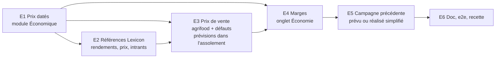

# Assolement, temps 3 (économique) — plan de réalisation

*Plan du 21/11/2026, d'après [`besoins_assolement.md`](besoins_assolement.md) §6 (FR-AS-30 à 34, décisions A11, A12, A16 à A19) et [`conception_assolement_eco.md`](conception_assolement_eco.md). Issue #115. Exécution lot par lot avec `/sc:implement`.*

## 1. Règles communes

- Une branche et une PR par lot, partie de `main` : `feat/eco-e<n>-…` ; push et PR sur accord.
- Avant chaque push : `turbo run typecheck lint test` (avec `NODE_OPTIONS=--no-experimental-webstorage`, base 5434), e2e pour les lots qui touchent l'interface.
- Migrations à la suite : 0080 (E1), 0081 (E2), 0082 (E3).
- Données des testeurs anonymisées dans le dépôt ; essais sur la base de développement.
- Chaque lot complète la section « Réalisé » ; la documentation utilisateur (`docs/economie.md`, `docs/assolement.md`) avance avec les lots.

## 2. Enchaînement

## 3. Lots

### E1 — Prix datés et module « Économique » (taille L)
- Migration 0080 : table `prices` (conception §2.1), RLS.
- Contrat `economics.ts` : `price`, `priceWrite`, `PriceKind`, sources.
- Domaine `economics/prices.ts` : `priceAt`, `convertPrice`.
- API : `GET /prices`, `POST /prices` (masse), `DELETE /prices/:id`.
- Web `/f/:ferme/economics` : onglets Intrants, Matériels (coûts BCMA affichés, prix propre ; tracteurs rattachables au barème), Main-d'œuvre (coût horaire), Services, Produits ; saisie, modification en masse (« prix à… », « + x % », date d'effet), historique d'un prix.
- Tests : prix en vigueur, conversions, ajout en masse, droits ; web (saisie, masse).

### E2 — Références Lexicon (taille M)
- Migration 0081 : `lexicon_production_yields`, `lexicon_production_prices`, `lexicon_market_prices`, `lexicon_input_prices`.
- Synchronisation : tables `master_production_yields` et `master_production_prices` du jeu `productions` ; `eu_market_prices` ; jeux adhérents `fertilizers`, `phytosanitary_prices`, `seeds` en `optional` (bundle). Vérifier avec la clé si le bundle « fourmy » les donne ; sinon le noter et ouvrir la demande.
- API `GET /prices/suggestions?kind=article` ; web : colonne « Lexicon » et « Reprendre » dans l'onglet Intrants.
- Tests : chargement (paquets de test), correspondance AMM et nom, suggestions.

### E3 — Prix de vente, agrifood et prévisions de l'assolement (taille L)
- Migration 0082 : `market_prices` (cache agrifood).
- Référentiel `economics/eu-market-codes.ts` (codes agrifood → espèce, débouché).
- Client agrifood (délai court, nouvel essai) et tâche hebdomadaire du worker ; repli Lexicon.
- Domaine `economics/defaults.ts` : rendement par défaut (médiane des récoltes de la ferme sur 3 campagnes, sinon Agreste du département), prix par défaut (ferme > agrifood > Lexicon), avec leur source.
- `GET /crop-plans/:year/eco-context` (prix, défauts, coût horaire).
- Assolement : rendement et prix prévus dans le panneau Affecter, `forecasts` recopié dans `productions.attrs` à la validation.
- Onglet Produits : prix agrifood et MATIF proposés.
- Tests : client agrifood (réponse, 500, cache), défauts sur les deux profils de ferme (historique ou Agreste), validation.

### E4 — Marges et onglet « Économie » (taille L)
- Domaine `economics/margins.ts` : produit, charges opérationnelles (`inputNeeds` × prix), mécanisation (`workload` × barème ou prix propre ou prestation), main-d'œuvre, marges brute et directe, par production, par activité, à l'hectare, pour l'assolement ; postes incomplets.
- Web : onglet « Économie » de l'assolement ; liens vers le module pour compléter.
- Tests : exemple chiffré à la main (blé, 10 ha), incomplets, mécanisation (hectare, heure, prestation).

### E5 — Comparaison avec la campagne précédente (taille M)
- Prévu N-1 si un assolement N-1 avec ITK existe ; sinon réalisé simplifié (récoltes, intrants réalisés, heures réalisées ≤ 24 h, valorisés aux prix en vigueur de N-1).
- Colonne N-1 et écart dans l'onglet Économie.
- Tests : les deux cas.

### E6 — Documentation, e2e et recette (taille S)
- `docs/economie.md`, mise à jour de `docs/assolement.md` ; points ouverts (125 fait, suites).
- e2e : prix saisis → assolement avec ITK → onglet Économie.
- Recette dans Chrome sur les deux fermes de test (base de développement).

## 4. Points de contrôle

| Après | Vérification |
|---|---|
| E1 | prix saisis, datés, modifiés en masse ; historique conservé |
| E2 | rendements et prix Lexicon chargés ; suggestions d'intrants (ou absence constatée du bundle) |
| E3 | rendement et prix prévus préremplis avec leur source ; agrifood en cache ou repli |
| E4 | marge directe du maïs de l'exploitant testeur plausible ; postes incomplets listés |
| E5 | écart avec 2026 affiché |
| E6 | e2e vert, recette |

## 5. Réalisé

### E1 — fait (21/11)
- Migration 0080 `prices` (RLS, clés exclusives par nature) ; contrat `economics.ts` (`priceWrite` avec contrôle de la clé, `priceKey`, libellés).
- Domaine `economics/prices.ts` : `priceAt`, `currentPrices`, `convertPrice` (masse, volume par la densité, semences par le PMG).
- API `GET /prices` (en vigueur à une date, `history=1`), `POST /prices` (masse, objets de la ferme vérifiés), `DELETE /prices/:id` ; coûts BCMA (`unit`, `costPerUnit`, `costPerHour`) dans les lignes du barème.
- Web : menu « Économique », 5 onglets, tableau de prix commun (saisie, cases, « Prix à », « Variation (%) », date d'effet, historique), matériels au barème marqués « barème BCMA ».
- Tests : domaine (2), API (2), web (1). Essai dans Chrome sur la ferme de l'exploitant testeur : coût horaire enregistré.
- Corrigé en essai : saisie décimale « 22,5 » effacée à la virgule ; unité « hour » non traduite ; matériel au barème affiché « à saisir ».
- Documentation : `docs/economie.md`.

### E2 — en partie fait (21/11)
- Migration 0081 : `lexicon_production_yields`, `lexicon_production_prices`, `lexicon_market_prices` (référentiel commun).
- Synchro : tables facultatives `master_production_yields` et `master_production_prices` du jeu `productions` (rechargé si la version est déjà en base mais qu'une table publiée est vide) ; jeu `eu_market_prices` s'il est publié, relevés français seulement. Base de développement : 4 942 rendements, 10 906 prix, 6 120 prix européens.
- API `GET /prices/suggestions/products` : prix du grain (producteur du département et de France, MATIF, trois places européennes), rendements Agreste du département ; repères de plus de 3 ans et places en retard de 6 mois écartés ; rien pour les productions fourragères.
- Web, onglet Produits : repères et « Reprendre » (source, date et référence gardées), rendement Agreste sous la production.
- Constats : les prix producteurs d'Agreste s'arrêtent en 2021 dans Lexicon (donc écartés) ; le MATIF va jusqu'à décembre 2025, les prix européens jusqu'à avril 2026.
- **Reste** : prix des intrants. Les jeux `fertilizers`, `phytosanitary_prices` et `seeds` répondent 403 sans clé, y compris leur structure : leur chargement attend la lecture de leur structure avec la clé d'adhérent.
- Tests : chargeur (2 nouveaux), API (1), web (1).

### E3 — fait (21/11)
- Migration 0082 : `market_prices` (cache agrifood), `market_price_fetches` (dernier appel : réussite, échec, message).
- Référentiel `certification-refs/economics/eu-market-codes.ts` : 11 codes (espèce, débouché), code par défaut par production.
- `apps/api/src/agrifood.ts` : lecture des réponses (prix « €201,50 », dates jj/mm/aaaa, France seulement), appel de 20 s, rafraîchissement hebdomadaire, nouvel essai le lendemain d'un échec, cache gardé ; tâche du worker (`FOURMY_AGRIFOOD_URL`, `off`). API toujours en panne le 21/11 (point d'entrée `SUSPENDED`) : format repris du code de Lexicon.
- Repères des produits : cache agrifood prioritaire sur la copie Lexicon, débouché courant de la production.
- Domaine `economics/defaults.ts` : `defaultYield` (médiane ferme sur 3 campagnes, sinon médiane Agreste sur 3 campagnes), `defaultPrice` (ferme, place de marché agrifood puis Lexicon, MATIF, prix producteur).
- `GET /crop-plans/:year/eco-context` : par activité, rendements de la ferme (récoltes en q/ha, `harvestYields` du plan de fumure), Agreste, repères, prix saisi, défauts ; coût horaire.
- Assolement : `forecasts` (rendement, prix, unité du prix) dans le panneau Affecter, défauts affichés avec leur source ; gardés à la réaffectation de la même activité ; différence de prévisions = mise à jour de la production (« prévisions modifiées ») ; recopiés dans `productions.attrs.forecasts` à la validation et relus à la réouverture.
- Essai sur les données de test : maïs de l'exploitant testeur 101,6 q/ha (médiane ferme 2024-2025) et 211,37 €/t ; blé du GAEC 58,5 q/ha (ferme 2026) et 196,37 €/t (La Pallice) ; avoine et triticale sans historique : médiane Agreste. Saisie de 70 q/ha dans Chrome enregistrée au brouillon.
- Limite : rendement des cultures fourragères selon la saisie des récoltes (matière brute ou sèche).
- Tests : domaine (defaults 4, diff 1), API (agrifood 3, eco-context, validation), web (panneau Affecter).

### E4 — fait (21/11)
- Contrat : `MarginFigures`, `ActivityMargin`, `MarginMissing`, `CropPlanMargins`.
- Domaine `economics/margins.ts` (`cropPlanMargins`) : produit (prévision ou défaut, conversion du prix dans l'unité du rendement), charges opérationnelles (`inputNeeds` par culture × prix de l'article converti ; « si besoin » exclu), mécanisation par passage (prix propre à l'hectare ou à l'heure, barème BCMA à l'hectare ou à l'heure, type du barème de l'étape, prestation), main-d'œuvre (heures champ + trajets × personnes × coût horaire ; rien pour une prestation), marges brute et directe, par activité, à l'hectare, total ; manques avec hectares (comptés une fois par culture) et onglet à compléter.
- Web : onglet « Économie » de l'assolement (€/ha ou total, cellules incomplètes en orange avec « * », « À compléter » avec liens vers le module).
- Essai sur l'assolement 2027 de l'exploitant testeur : maïs 2 148 €/ha de produit, main-d'œuvre 91 €/ha ; 15 manques listés (prix d'intrants, matériels sans barème, fertilisation sans matériel).
- Tests : domaine (exemple chiffré 10 ha de blé : marge directe 9 880 € ; manques ; défauts et culture sans ITK), web (onglet Économie).
- Constat de poste : limite d'observateurs de fichiers atteinte (`ENOSPC`) sur le serveur Vite de développement, modules périmés jusqu'au redémarrage (`fs.inotify.max_user_watches` à relever).

### E5 — fait en partie (21/11)
- Contrat `RealizedFacts` ; `GET /crop-plans/:year/eco-previous` (`repos/eco-previous.ts`) : cultures N-1 et rendements réalisés (`harvestYields`), interventions réalisées rattachées à la culture du jour (`fourmy_production_at`), surface travaillée, heures au prorata (périodes > 24 h écartées), matériels, intervenants, intrants (doses à l'hectare, totaux au prorata) ; fiches d'articles partagées (`articleInfos`, sorti de `itk-inputs.ts`).
- Domaine `realizedMargins` : mêmes postes et manques que le prévu, prix en vigueur le jour de chaque intervention (`toStockQuantity` pour les quantités) ; prix de vente de la ferme au 31/12, sinon défaut ; jachère sans produit attendu (prévu et réalisé).
- Web : colonnes « Marge directe N-1 » et « Écart », détail du réalisé et ses manques (accordéon) ; historique des prix chargé une fois (`/prices?history=1`).
- Données de test : exploitant testeur 2026 : 82 interventions dont 77 avec heures (95 h), aucune récolte 2026 enregistrée ; GAEC : 366 interventions sans heures (date seule), 15 cultures récoltées sur 43 : les manques le disent.
- **Écart au plan** : comparaison avec le **prévu** N-1 (assolement N-1 validé avec ITK) non faite — aucune ferme de test n'en a ; à reprendre quand un assolement validé avec ITK aura une campagne suivante.
- Tests : domaine (réalisé chiffré, sans récolte, jachère), API (route), web (colonne N-1 et écart).

