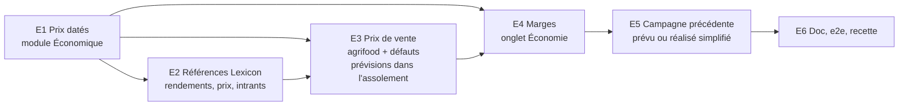

# Assolement, temps 3 (économique) — plan de réalisation

*Plan du 21/11/2026, d'après [`besoins_assolement.md`](besoins_assolement.md) §6 (FR-AS-30 à 34, décisions A11, A12, A16 à A19) et [`conception_assolement_eco.md`](conception_assolement_eco.md). Issue #115. Exécution lot par lot avec `/sc:implement`.*

## 1. Règles communes

- Une branche et une PR par lot, partie de `main` : `feat/eco-e<n>-…` ; push et PR sur accord.
- Avant chaque push : `turbo run typecheck lint test` (avec `NODE_OPTIONS=--no-experimental-webstorage`, base 5434), e2e pour les lots qui touchent l'interface.
- Migrations à la suite : 0080 (E1), 0081 (E2), 0082 (E3).
- Données des testeurs anonymisées dans le dépôt ; essais sur la base de développement.
- Chaque lot complète la section « Réalisé » ; la documentation utilisateur (`docs/economie.md`, `docs/assolement.md`) avance avec les lots.

## 2. Enchaînement

## 3. Lots

### E1 — Prix datés et module « Économique » (taille L)
- Migration 0080 : table `prices` (conception §2.1), RLS.
- Contrat `economics.ts` : `price`, `priceWrite`, `PriceKind`, sources.
- Domaine `economics/prices.ts` : `priceAt`, `convertPrice`.
- API : `GET /prices`, `POST /prices` (masse), `DELETE /prices/:id`.
- Web `/f/:ferme/economics` : onglets Intrants, Matériels (coûts BCMA affichés, prix propre ; tracteurs rattachables au barème), Main-d'œuvre (coût horaire), Services, Produits ; saisie, modification en masse (« prix à… », « + x % », date d'effet), historique d'un prix.
- Tests : prix en vigueur, conversions, ajout en masse, droits ; web (saisie, masse).

### E2 — Références Lexicon (taille M)
- Migration 0081 : `lexicon_production_yields`, `lexicon_production_prices`, `lexicon_market_prices`, `lexicon_input_prices`.
- Synchronisation : tables `master_production_yields` et `master_production_prices` du jeu `productions` ; `eu_market_prices` ; jeux adhérents `fertilizers`, `phytosanitary_prices`, `seeds` en `optional` (bundle). Vérifier avec la clé si le bundle « fourmy » les donne ; sinon le noter et ouvrir la demande.
- API `GET /prices/suggestions?kind=article` ; web : colonne « Lexicon » et « Reprendre » dans l'onglet Intrants.
- Tests : chargement (paquets de test), correspondance AMM et nom, suggestions.

### E3 — Prix de vente, agrifood et prévisions de l'assolement (taille L)
- Migration 0082 : `market_prices` (cache agrifood).
- Référentiel `economics/eu-market-codes.ts` (codes agrifood → espèce, débouché).
- Client agrifood (délai court, nouvel essai) et tâche hebdomadaire du worker ; repli Lexicon.
- Domaine `economics/defaults.ts` : rendement par défaut (médiane des récoltes de la ferme sur 3 campagnes, sinon Agreste du département), prix par défaut (ferme > agrifood > Lexicon), avec leur source.
- `GET /crop-plans/:year/eco-context` (prix, défauts, coût horaire).
- Assolement : rendement et prix prévus dans le panneau Affecter, `forecasts` recopié dans `productions.attrs` à la validation.
- Onglet Produits : prix agrifood et MATIF proposés.
- Tests : client agrifood (réponse, 500, cache), défauts sur les deux profils de ferme (historique ou Agreste), validation.

### E4 — Marges et onglet « Économie » (taille L)
- Domaine `economics/margins.ts` : produit, charges opérationnelles (`inputNeeds` × prix), mécanisation (`workload` × barème ou prix propre ou prestation), main-d'œuvre, marges brute et directe, par production, par activité, à l'hectare, pour l'assolement ; postes incomplets.
- Web : onglet « Économie » de l'assolement ; liens vers le module pour compléter.
- Tests : exemple chiffré à la main (blé, 10 ha), incomplets, mécanisation (hectare, heure, prestation).

### E5 — Comparaison avec la campagne précédente (taille M)
- Prévu N-1 si un assolement N-1 avec ITK existe ; sinon réalisé simplifié (récoltes, intrants réalisés, heures réalisées ≤ 24 h, valorisés aux prix en vigueur de N-1).
- Colonne N-1 et écart dans l'onglet Économie.
- Tests : les deux cas.

### E6 — Documentation, e2e et recette (taille S)
- `docs/economie.md`, mise à jour de `docs/assolement.md` ; points ouverts (125 fait, suites).
- e2e : prix saisis → assolement avec ITK → onglet Économie.
- Recette dans Chrome sur les deux fermes de test (base de développement).

## 4. Points de contrôle

| Après | Vérification |
|---|---|
| E1 | prix saisis, datés, modifiés en masse ; historique conservé |
| E2 | rendements et prix Lexicon chargés ; suggestions d'intrants (ou absence constatée du bundle) |
| E3 | rendement et prix prévus préremplis avec leur source ; agrifood en cache ou repli |
| E4 | marge directe du maïs de l'exploitant testeur plausible ; postes incomplets listés |
| E5 | écart avec 2026 affiché |
| E6 | e2e vert, recette |

## 5. Réalisé

*(rempli au fil des lots)*
