# Contrôles HVE et Agriculture biologique — plan de réalisation

Plan du 19/11/2026, tiré de `claudedocs/conception_controle_hve_ab.md`
(lots CT1 à CT6, ordre D11) et de `claudedocs/besoins_controle_hve_ab.md`.
Une branche et une PR par lot ; `turbo run typecheck lint test` vert,
paquets en parallèle comme en CI, avant chaque PR ; rien n'est poussé sans
accord.

## Prérequis

| # | Prérequis | Qui | Bloque |
|---|---|---|---|
| P0 | **IM6 fusionné** (assistant, retours du 19/11 : migrations 0065 et 0066). Le lot CT1 part de `main` à jour et prend la migration **0067**. | équipe | CT1 |
| P1 | **Fermes de test** : une ferme HVE et une ferme AB (en conversion et certifiée), anonymisées, avec une campagne complète (interventions, intrants, récoltes, couverts, irrigation). Proposition : reprendre le jeu pilote viticole (`fixtures/pilote-viticulture.json`) pour l'AB vigne et le jeu Geofolia anonymisé pour HVE grandes cultures, en y ajoutant les certifications. | Claude, validé par toi | tests de CT2 à CT6 |
| P2 | **Cas de référence HVE** : une grille v1.15 remplie à la main pour la ferme de test HVE (points attendus par item), pour vérifier le calcul et l'export. Toi ou un auditeur. | toi | fin de CT3, CT4, CT6 |
| P3 | **Points à confirmer** auprès d'un organisme certificateur bio : année civile ou campagne pour le 170 N ; classement du cuivre (manquement n° 328) ; note de lecture INAO « 170 kg N » et « MRV ». À défaut : valeurs par défaut de la conception (année civile, gravité « à confirmer »). | toi | non bloquant |
| P4 | **Version consolidée du règlement 2021/1165** (annexes I et II à jour) à déposer dans `docs/ab/`. | toi | CT2 (annexe II) |

## CT1 — Socle

Branche `feat/control-ct1-socle`.

1.1 **Migration 0067** (conception §4) : colonnes ajoutées à `productions`,
`articles`, `article_fertilizers`, `interventions`,
`farm_landscape_features`, `farm_settings` ; tables `hve_questionnaires`,
`seed_derogations`, `certification_runs` (RLS, droits `fourmy_app`) ;
procédure `equipment_cleaning` au catalogue. Valeur par défaut de
`productions.cycle` tirée de `lexicon_productions.life_years`.

1.2 **Paquet `@fourmy/certification-refs`** : squelette, convention d'en-tête
de source, `ab/conversion.ts`, `ab/inao-catalogue.ts` (règles → manquement,
classe, mesure), version du paquet exposée (`REFS_VERSION`).

1.3 **Domaine** `packages/domain/src/certification/` : types communs
(`ControlLevel`, `ControlFinding`, `ControlReport`, `Rule`,
`CertificationContext`), règle d'agrégation (verdict, sections), helper
« pas de faux vert ». Tests unitaires.

1.4 **Contrats** `packages/contracts/src/certification.ts` (rapport, constats,
disponibilité, réglages).

1.5 **API** :
- `repos/certification-context.ts` : chargement du contexte d'une campagne en
  6 à 8 requêtes ;
- `GET /control/availability`, `GET /control/:kind` (calcul, empreinte des
  données, enregistrement dans `certification_runs`, réutilisation si
  l'empreinte n'a pas changé) ;
- `POST /control/check` et `recordCertificationCheck` branché dans
  `recordCompliance` (feu, motif commun sur le web) ;
- `PUT /settings/certification`.

1.6 **Web** :
- menu Réglementaire conditionnel (`NavItem.when`, disponibilité selon la
  campagne de la frise) ;
- `features/certification/ControlPage` (verdict, cartes, détail, « à
  compléter ») ;
- section « Certification » de la saisie et de la fiche d'intervention ;
- `StatusLight` étendu à orange.

1.7 **Tests** : domaine (agrégation, faux vert impossible) ; API (menu
présent ou absent selon les certifications et la campagne, rapport vide mais
valide, contrôle de saisie sans certification = `NULL`) ; web (menu,
page vide).

**Fini quand** : une ferme dont une parcelle est certifiée AB voit « Contrôle
AB » sous Réglementaire pour cette campagne seulement, et la page s'ouvre
(sans règle encore) ; une ferme sans certification ne voit rien et ne paie
aucun calcul à la saisie.

## CT2 — Agriculture biologique essentielle

Branche `feat/control-ct2-ab`. Dépend de CT1, P4.

2.1 **Statut de conversion** (FR-AB-1, D8) : `conversionStatus` (C1, C2, AB ;
annuelle 24 mois, pérenne 36, semi-pérenne 24) ; remise à zéro au dernier
traitement non autorisé ; récolte suivante déclassée ; incohérence avec le
niveau saisi → orange. `GET /control/ab/parcels`. Tests sur les exemples de
US-4 et les cas du guide INAO (l. 96-99, 125).

2.2 **Phyto non autorisé** (R5) : reprise du constat `organic` du contrôle
phyto, conséquence affichée (récolte déclassée, conversion qui redémarre,
lutte obligatoire à justifier).

2.3 **Cuivre** (R21) : `ab/copper.ts` (plafond, depuis le 1/1/2022, cas
4 kg/an), table de conversion composé → cuivre métal testée sur **tous** les
produits cupriques du référentiel E-Phy ; cumul 7 ans glissants par
parcelle ; orange à 80 %, rouge au-delà ; feu de saisie (cumul + traitement).

2.4 **Fertilisants** (R14, R15, R17) : `ab/annex-ii-2021-1165.ts` ;
catégories et origine de l'effluent sur la fiche du fertilisant (web) ;
feu rouge : azote minéral, matière hors annexe II, effluent d'élevage
industriel ; `missing` si la catégorie n'est pas renseignée.

2.5 **170 N** (R16, D7) : N total des effluents par parcelle AB et par année
civile (réglable) ; orange à 80 %, rouge au-delà ; feu de saisie.

2.6 **Fiches** : production (cycle, date de plantation, mode de culture).

2.7 **Gravité INAO** (FR-AB-10) sur chaque constat.

2.8 **Tests** : domaine (bornes 12/24/36 mois, 28 kg, 170 kg, 80 %) ;
intégration (ferme AB de test : statut des parcelles, feux de saisie
cuivre, N minéral et 170 N, motif exigé sur le web) ; web (onglets Règles et
Parcelles) ; e2e (saisie d'un engrais azoté minéral sur parcelle AB → feu
rouge, motif, constat dans « Contrôle AB »).

**Fini quand** : US-4, US-5 et US-6 passent sur la ferme AB de test.

## CT3 — HVE : phyto, fertilisation, irrigation

Branche `feat/control-ct3-hve`. Dépend de CT1. Peut avancer **en parallèle
de CT2** (fichiers distincts ; seule la migration est commune, dans CT1).

**Découpage (20/11/2026)** : trois PR successives pour rester relisibles.
CT3a phyto (3.1 sauf la table des exportations d'azote, 3.2, 3.5) ; CT3b
fertilisation (table des exportations, 3.3) ; CT3c irrigation (3.4).
L'API IFT renvoie bien une signature : variante `/ift/traitement/certifie`
(identifiant et jeton signé), désormais utilisée et conservée par ligne.

3.1 **Référentiels** : `hve/grid-v1.15.ts` (items, barèmes, maxima, prorata,
4 bornes de la grille, D6) ; `hve/cmr/*.json` par
`scripts/extract-cmr.mjs` (3 versions) ; `hve/ift-references.ts` par script
(onglets Scoring_*) ; `hve/nitrogen-exports-2026.ts` (saisie semi-manuelle,
relecture ligne à ligne, test de somme de contrôle sur le nombre de lignes
par partie) ; `hve/regions.ts`, `hve/otex-herbivore.ts`.

3.2 **Phyto** : 5.1 CMR (version à la date, n° d'autorisation, semences
traitées et engrais, discordance E-Phy en orange) ; 5.2 surfaces non
traitées (biocontrôle seul = non traitée, IAE sous seuil plafonnées) ; 5.3
IFT (catégories, hors biocontrôle et semences, références, barème par
quarts, prorata, moyenne pluriannuelle) ; **vérifier que l'API IFT renvoie
une signature** et la conserver (`interventions.ift.signature`) ; 5.8
diversité variétale.

3.3 **Fertilisation** : 6.1 bilan azoté (BGA en N total réalisé, table 2026,
cultures mineures et correction, barème selon méthode et OTEX) ; 6.3 N
organique ; 6.4 OAD (PPF de Fourmy) ; 6.5 SAU non fertilisée (tournières
plafonnées à 5 %) ; 6.6 légumineuses (exclusions) ; 6.7 couverture des sols
(semaines entières, ZV et hors ZV séparées, surface limitante, > 8 semaines
en ZV).

3.4 **Irrigation** : champs mode, origine, déclencheur, matériel mobile sur
l'intervention ; « exploitation non irrigante » validée d'office ; 7.1
complétude (7 + 5 données) ; 7.6 étiage (juin-août, milieu naturel).

3.5 **Feux de saisie** : CMR1 (rouge), CMR2 (orange).

3.6 **Tests** : chaque barème aux bornes (valeurs des sources) ; CMR à la
date (produit reclassé entre deux versions) ; intégration sur la ferme HVE
de test ; comparaison avec la grille remplie à la main (P2) sur les items de
ce lot.

**Fini quand** : sur la ferme HVE de test, les points des indicateurs phyto,
fertilisation et irrigation égalent ceux de la grille de référence (P2) ;
US-2 passe.

## CT4 — HVE : biodiversité et questionnaire

Branche `feat/control-ct4-hve-biodiv`. Dépend de CT3.

4.1 **IAE** : `hve/iae.ts` (17 types, coefficients, familles) ; proposition
type PAC → type HVE ; validation et mitoyenneté (`PUT
/landscape-features/:id/hve`, onglet IAE avec carte) ; adjacence PostGIS
(tampon 1 m, ≥ 50 % de la longueur) ; socle sur terres arables (dispenses),
poids sur la surface totale, diversité ; règles de cumul.

4.2 **Items** 4.2 taille des parcelles (fusion des parcelles contiguës de même
espèce, coupure par IAE linéaire), 4.3 culture principale, 4.4 nombre
d'espèces.

4.3 **Questionnaire** (D10, FR-HVE-8) : `hve_questionnaires`, pièces via
`regulatory_documents`, formulaire par item déclaratif (4.5 à 4.8, 5.5, 5.6
en partie, 5.7, 5.9, 6.4 externes, 7.2 à 7.5, élevage pour la BGA).

4.4 **Tests** : adjacence sur géométries simples ; dispenses du socle ;
comparaison avec la grille de référence (P2) pour la biodiversité ;
questionnaire vide → `missing`, pas de point.

**Fini quand** : US-1 passe sur la ferme HVE de test (4 indicateurs, points
égaux à la grille de référence, irrigation validée d'office pour une ferme
sans irrigation).

## CT5 — Agriculture biologique : compléments

Branche `feat/control-ct5-ab`. Dépend de CT2.

5.1 **Semences** (R24, R25) : statut bio et semence traitée sur l'article ;
dérogations (`seed_derogations`, onglet Semences) ; feu rouge semence non bio
sans dérogation antérieure au semis, plant non bio.

5.2 **Mixité** (R7) : même espèce en bio et en non bio la même campagne,
critère de distinction à renseigner ; même abri → rouge.

5.3 **Matériel** (R27) : procédure `equipment_cleaning` (saisie) ; passage
d'un matériel d'une parcelle non AB à une parcelle AB sans nettoyage entre
les deux ; produits de nettoyage (`ab/cleaning-products.ts`).

5.4 **Rotation** (R11, D12) : frise par parcelle, repères N et K réglables,
règle maraîchère ; orange seulement.

5.5 **Hors-sol et serres** (R10, R13) ; **justification** des traitements
(R20, orange sans justification).

5.6 **Tests** : semis avant et après dérogation ; mixité ; séquence de
matériel avec et sans nettoyage ; rotations des exemples du guide INAO.

**Fini quand** : US-7 et US-8 passent ; toutes les règles R1 à R34 du
périmètre ont un constat (ou « non contrôlé » explicite).

## CT6 — Exports

Branche `feat/control-ct6-exports`. Dépend de CT3, CT4, CT5.

6.1 **Grille HVE v1.15** : classeur officiel embarqué ; table des cellules de
saisie (`hve/grid-v1.15-cells.ts`) ; écriture des seules cellules de saisie
(`@fourmy/isoxml` zip), `fullCalcOnLoad` ; enregistrement de l'export sur le
calcul (`certification_runs`).

6.2 **Liasse HVE** (zip) : bilan IFT (signé si possible), cahiers phyto,
fertilisation et irrigation de la période, plan parcellaire avec IAE (page
imprimable).

6.3 **Registre AB** (zip) : CSV par registre + synthèse imprimable.

6.4 **Écarts** : données modifiées depuis le dernier export → bandeau sur le
tableau de bord.

6.5 **Tests** : structure du classeur identique à l'original hors cellules de
saisie (comparaison des XML) ; recalcul headless (LibreOffice en CI) égal au
tableau de bord (US-3) ; contenu du registre AB.

**Fini quand** : US-3 passe ; la grille exportée s'ouvre dans Excel et
LibreOffice et donne les mêmes points que Fourmy.

## Ordonnancement

```mermaid
gantt
  dateFormat X
  axisFormat %s
  section Socle
  CT1 Socle                 :ct1, 0, 3
  section AB
  CT2 AB essentiel          :ct2, after ct1, 4
  CT5 AB compléments        :ct5, after ct2, 4
  section HVE
  CT3 HVE phyto-ferti-irri  :ct3, after ct1, 5
  CT4 HVE biodiversité      :ct4, after ct3, 4
  section Sorties
  CT6 Exports               :ct6, after ct4, 3
```

Durées relatives (sessions de travail), à titre indicatif. CT2 et CT3
peuvent avancer en parallèle après CT1 ; CT6 attend CT4 et CT5.

## Points de contrôle

| Après | Vérification | Avec toi |
|---|---|---|
| CT1 | menu et page sur une ferme réelle de dev (vigne en AB ?) | revue de l'écran |
| CT2 | ferme AB de test : statuts, cuivre, 170 N | revue des constats et des messages |
| CT3 | comparaison avec la grille de référence (P2) | revue des écarts |
| CT4 | IAE sur une vraie ferme (éléments TelePAC de la ferme pilote) | validation du parcours IAE |
| CT6 | export ouvert dans Excel, importable dans Certibase (essai auditeur si possible) | recette finale |

## Risques suivis

Repris de la conception §11 : changement de la grille v1.15, signature IFT
absente, bilan azoté sans élevage saisi, libellés E-Phy du cuivre,
imprécision des géométries pour l'adjacence, période du 170 N, gravité du
cuivre côté INAO, version consolidée du 2021/1165.
