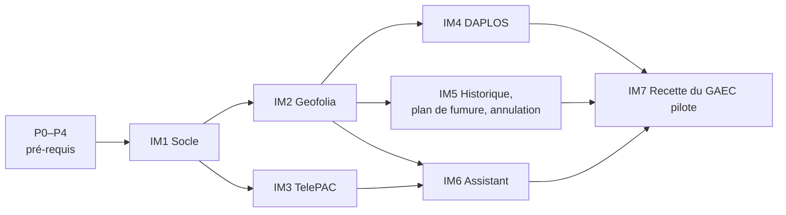

# Plan — imports DAPLOS, Geofolia, TelePAC et assistant de premier démarrage

Sources : `claudedocs/besoins_import_onboarding.md` (exigences) et
`claudedocs/conception_import_onboarding.md` (conception, §n ci-dessous).
Exécution lot par lot avec `/sc:implement IM<n>`.

## Règles

- **Une branche et une PR par lot**, depuis `main` : `feat/import-im1-socle`,
  `feat/import-im2-geofolia`… Un lot n'est fusionné que tests verts
  (`turbo run typecheck lint test`, e2e touchés) et recette du lot faite.
- **Migration** : un seul fichier par lot qui touche la base, au prochain
  numéro libre au moment du lot (0061 aujourd'hui ; les PR agrirouter
  ouvertes peuvent en prendre). Le §6 de la conception est découpé par lot
  ci-dessous.
- **Base de dev** sur le port 5434 ; tests web avec
  `NODE_OPTIONS=--no-experimental-webstorage` (Node 25).
- **Données du GAEC pilote** : jamais dans le dépôt. Les tests utilisent des jeux
  anonymisés (P3) ; les fichiers réels servent aux recettes locales
  (`ressources_fourmy/`) et sur dev.fourmy.org.
- Documentation tenue à jour à chaque lot (`docs/imports.md` créé en IM1,
  README « État du projet » en fin de lot).

## Graphe des lots

IM2 et IM3 peuvent avancer en parallèle (deux branches, aucun fichier
commun hors `packages/importers/src/index.ts` et la migration). IM4, IM5 et
IM6 peuvent aussi avancer en parallèle une fois IM2 fusionné (IM6 attend
aussi IM3).

| Lot | Taille | Base | API | Web | Dépend de |
|---|---|---|---|---|---|
| IM1 Socle | L | ✔ | ✔ | — | P0–P4 |
| IM2 Geofolia | L | ✔ | ✔ | — | IM1 |
| IM3 TelePAC | M | ✔ | ✔ | carte | IM1 |
| IM4 DAPLOS | M | — | ✔ | — | IM2 |
| IM5 Historique, plan de fumure, annulation | M | — | ✔ | ✔ | IM2 |
| IM6 Assistant | L | ✔ | ✔ | ✔ | IM2, IM3 |
| IM7 Recette du GAEC pilote | M | — | — | — | IM4, IM5, IM6 |

## Pré-requis (avant IM1)

État au 19/11/2026 : **P0 validé** (les 7 décisions du §13 tiennent) ;
**P1 en cours** chez David, en parallèle d'IM1 (le repli sans `agroedi`
couvre l'attente) ; **P2 fait** : étiquette `v2.0.0` du fork, commit
`8eaf6a623e930f2c275fa4fdc10735b0a769f33f` ; **P3 validé** (jeux anonymisés
autorisés) ; **P4 envoyé** à l'exploitant, réponse attendue avant IM7.

| # | Action | Qui | Bloque |
|---|---|---|---|
| P0 | Valider les **7 décisions de conception** (§13) : scission par doses, récolte par parcelle, historique sans stock, dates sans heure, aucune différence appliquée, fichiers 30 jours, plan de fumure en interventions planifiées | David | IM2 |
| P1 | Lexicon : créer le bundle suivi `fourmy` (`resources/flavors/fourmy.yml`, §5.8), `./lexicon publish --bundle fourmy`, puis une clé `--scope bundle:fourmy` pour le poste de dev et une pour dev.fourmy.org | David (Lexicon) | IM1 (tâche 1.6), sinon repli sans `agroedi` |
| P2 | Fork du lecteur DAPLOS : poser l'étiquette `v2.0.0` sur `fix/lecture-par-table` (Fourmy s'y fixe par commit) ; décider de l'ouverture de la PR vers OSFarm | David | IM4 |
| P3 | **Accord de l'exploitant** pour des jeux de test anonymisés dérivés de ses fichiers (comme pour Pierre) ; sinon jeux synthétiques seuls | David → exploitant | IM2 (tests) |
| P4 | Demander à l'exploitant : exports Geofolia 2024 et 2025 (historique), nature du « Mélange CINE », associés du GAEC à créer | David → exploitant | IM7 (recette complète) |

## IM1 — Socle

> ✅ Réalisé le 19/11/2026 (branche `feat/import-im1-socle`). Écarts : `unzip`
> durci en place dans `packages/isoxml/src/read.ts` (il existait pour agrirouter) ;
> procédures de repli `technical_task` et `generic_tillage` (codes d'Ekylibre
> lisibles hors catalogue) ; récolte `harvesting` ; aperçu IM1 sans
> rapprochement (`reconciliation: null`), construit dans `@fourmy/importers`
> (`buildPreview`) ; `GET /imports` lisible par tous les membres, comme
> `GET /imports/:id`.

Branche `feat/import-im1-socle`. Rien n'est encore écrit dans les données
de la ferme : ce lot sait recevoir, reconnaître, lire et analyser un fichier.

1.1 **Migration** (partie de §6.1 et §6.2) : `import_files`, extension de
`import_runs` (statuts, `file_id`, `format`, `preview`, `decisions`,
`created_by`), `import_links` ; RLS et droits `fourmy_app` sur les trois ;
`lexicon_productions.agroedi_crop_code` ; tables `lexicon_agroedi_codes`
et `lexicon_agroedi_crops` (§5.8). Test : migration rejouée sur une base
vide et sur la base de dev ; RLS (une ferme ne voit pas les fichiers d'une
autre).

1.2 **Paquet `packages/importers`** (squelette du monorepo : `package.json`,
`tsconfig`, vitest) : types du modèle canonique (§4, `ImportBundle` et
suivants), `detectFormat(name, bytes)`, erreurs typées
(`UnsupportedFormat`, `CorruptFile`, `TooLarge`).

1.3 **`unzip`** dans `packages/isoxml/src/zip.ts` (inflate `node:zlib`) avec
les limites du §10 : entrées attendues seulement, 200 Mo décompressés, ratio
≤ 100, chemins sans `..` ni absolus. Tests : archive valide, bombe de
décompression, traversée de chemin, entrée chiffrée refusée.

1.4 **Table AEE propre** `importers/src/aee.ts` (§5.3, §5.8) : codes
d'opération (table 14) → procédure et bloc ; natures d'intrant (table 5) →
nature d'article et motif ; unités (table 36 + `ZHK`) → unités Fourmy ;
effluents (table 6) ; états (11) ; catégories (26). Test : chaque procédure
cible existe dans `packages/contracts/src/procedures.ts`.

1.5 **Reprojection** Lambert 93 → WGS 84 (`proj4`) et conversion WKT /
GML 2 → GeoJSON dans `importers/src/geo.ts`. Test : un point connu de chaque
fichier du GAEC pilote à 1 m près.

1.6 **Lexicon** (`packages/lexicon`) : `FOURMY_LEXICON_API_KEY` → en-tête
`Authorization: Bearer` sur toutes les requêtes et base
`https://lexicon.osfarm.org/bundles/fourmy` par défaut quand la clé est
présente ; vérification des `sha256` du manifest ; paquet `agroedi`
facultatif dans `PACKAGES` (ignoré s'il manque à l'index) et ses
transformations ; `agroedi_crop_code` chargé depuis `master_productions`.
Tests : faux serveur avec et sans clé, paquet absent, somme fausse refusée.
Documentation : `docs/deploiement.md` (variable), `docs/activites.md`.

1.7 **Routes d'analyse** (`routes/imports.ts`, `repos/farm-imports/`) :
`POST /imports/files` (multipart, 50 Mo, sha256, format détecté, run
`analyzed`), `GET /imports`, `GET /imports/:id` étendu,
`PUT /imports/:id/decisions`, `POST /imports/:id/discard`. Pour ce lot,
l'aperçu se limite à ce que dit le lecteur (format, campagnes, comptes) :
les lecteurs arrivent en IM2 à IM4. Contrats Zod dans
`packages/contracts/src/imports.ts`. Tests d'intégration : responsable
seulement, format inconnu → 422, même fichier deux fois → même
`import_files`, abandon.

1.8 **Purge** : tâche du worker (`importFilesPurgeTick`, une fois par jour)
qui supprime les fichiers expirés et non référencés par un run `running`.

**Fini quand** : un fichier déposé est stocké, reconnu, suivi par un run
`analyzed` et abandonnable ; le worker charge `agroedi` avec la clé de dev ;
tests verts.

## IM2 — Geofolia

> ✅ Réalisé le 19/11/2026 (branche `feat/import-im2-geofolia`). Écarts :
> parcelles « secondaires » de Geofolia (interculture, dérobée) = productions
> de la parcelle principale (`landKey`) ; regroupement en interventions dans
> `@fourmy/importers` (`draftInterventions`, sans base) ; rapprochement
> `apps/api/src/repos/import-reconcile.ts`, écriture `import-apply.ts`
> (chaque intervention dans un point de reprise : une intervention refusée
> est rapportée sans annuler l'import) ; sol dans `productions.attrs` ;
> liens de parcelles d'abord, géométrie ensuite (IoU ≥ 0,8), sans nouvelle
> version d'une parcelle reliée (aucune réécriture) ; jeu `agroedi` chargé
> seulement avec une clé (le dépôt public en liste le nom, fichiers en 403).
> Ajouts décidés le 19/11/2026 : couverts d'interculture → `cover_crops` ;
> productions datées et `fourmy_production_at` (migration 0063) pour la
> culture contrôlée à une date ; alerte de saisie quand deux productions
> datées d'une parcelle se recoupent ; couvert en place contrôlé comme une
> jachère.

Branche `feat/import-im2-geofolia`. Le premier import complet de bout en
bout ; il pose toute la mécanique de rapprochement et d'écriture réutilisée
par IM3 et IM4.

2.1 **Migration** (reste de §6.2) : `interventions.origin` + `import`,
`affects_stock`, `period_precision`, `sowing` ; `productions.declared`,
`productions.attrs` (le sol y est porté, par campagne : `parcel_soils`
reste au modèle de croissance) ; origine `imported` des compositions de
fertilisants.

2.2 **Contrats et domaine** :
- `interventionOrigin` + `import` ; bloc `sowing` (technique) ;
  `periodPrecision` ;
- `validateIntervention` : destination de récolte facultative pour l'origine
  `import` (FR-EVO-5) ;
- `crewDurations` et temps de travaux : `null` en `period_precision = day`.
Tests unitaires du domaine.

2.3 **Impacts de l'existant** (§6.3), un par un avec son test :
mouvements de stock sautés si `affects_stock = false` (`completeInTx`) ;
météo journalière et exclusion du rapprochement Traccar/parcours pour
`day` ; affichage « le 01/04/2026 » sans heures (fiche, listes, registre) ;
champ `sowing.technique` dans la fiche et le formulaire ; synchro mobile :
`origin = import` envoyé comme `migration` tant que zero-mobile ne le connaît
pas (à vérifier sur la branche `fourmy-backend`).

2.4 **Lecteur `readGeofolia`** (§4.1) : zip → `Field.Json`, `Action.Json`,
`IdentificationCodes.json` ; parcelles, cultures, sols, rendements, conseils,
N-1…N-5 (dans `history`, écrits en IM5) ; produits (nature par
`CategoryEnum`/`ProductTypeEnum` : table établie sur les 120 produits du
GAEC pilote, valeur inconnue → `other` signalé) ; salariés ; actions → unités de
travail par `RecognitionId`. Tests sur le jeu anonymisé : 63 parcelles,
511 unités de travail, 120 articles.
*Réalisé : jeu anonymisé de 6 parcelles, 13 cultures, 215 couples
(`packages/importers/test/fixtures/geofolia-pilote.zip`, généré par
`scripts/anonymize-geofolia.mjs`).*

2.5 **Rapprochement** (`repos/farm-imports/reconcile.ts`, lecture seule) :
- parcelles (§5.1 : lien, IoU ≥ 0,95 même version / nouvelle version, IoU
  ≥ 0,80 sur l'existant, création) ;
- activités et productions (§5.2, résolution de culture en 4 étapes dont
  `lexicon_agroedi_crops` et `agroedi_crop_code` filtrés par saison et
  usage) ;
- articles (§5.4 : AMM → E-Phy, semences, engrais + composition, eau →
  irrigation, récoltes ; unités) ;
- personnes (§5.5) ; identité et SIRET (§5.6) ;
- interventions (§5.3 : regroupement par `ActionId`, scission par signature
  de doses, récoltes par parcelle, irrigations en mm, statut, météo) ;
- dédoublonnage par `import_links` (§5.7) ; avertissements `blocking`.
Sortie : `ImportPlan` + `ImportPreview` (§7.2). Tests unitaires de chaque
règle sur de petits bundles écrits à la main (scission, IoU, AMM inconnu,
unité inconnue, SIRET différent).

2.6 **Écriture** (`repos/farm-imports/apply.ts`, §8) :
`POST /imports/:id/apply` → 202, une transaction par fichier, ordre des huit
étapes, `planInTx` / `completeInTx` avec `ctx.origin = "import"`,
identifiants UUID v5 des interventions, `import_links` à chaque étape,
rapport (comptes, avertissements, contrôles en défaut). Un seul run actif
par ferme (règle existante). Tests d'intégration : import du jeu anonymisé,
**rejeu à l'identique sans aucune création** (US-IMP-4), échec au milieu →
rien d'écrit, entité modifiée dans Fourmy puis réimport → valeur de Fourmy
gardée et conflit au rapport.

2.7 **Recette locale** sur le vrai ZIP du GAEC pilote (base 5434) : 63 parcelles,
298,2 ha ± 0,1, 14 activités proposées, 336 interventions réalisées (après
regroupement et scission : nombre à consigner), 51 articles à AMM rapprochés,
registre phyto 2026 avec ses 62 traitements, irrigations dans le bilan
hydrique. Écarts consignés dans `docs/imports.md`.
*Constaté le 19/11/2026 : 41 parcelles (164,9 ha), 63 productions,
14 activités (13 avec leur production de référence ; « Mélange CINE » sans
le jeu AgroEDI), 133 articles, 414 interventions (aucune refusée), en 13 s
(analyse : 0,25 s) ; 18 traitements en feu rouge (produits retirés, usages
absents, nombre d'applications ; deux dépassements de dose de 1 à 3 % dus
au recalcul de la dose depuis la quantité totale).*

**Fini quand** : le ZIP du GAEC pilote s'importe par l'API, se rejoue sans
doublon, et le registre phyto, le cahier de fertilisation et le bilan
hydrique s'en nourrissent.

## IM3 — TelePAC

> ✅ Réalisé le 19/11/2026 (branche `feat/import-im3-telepac`). Écarts :
> analyseur XML d'`@fourmy/isoxml` étendu (texte des éléments, noms
> d'attributs accentués) plutôt que `fast-xml-parser` ; table des types SNA
> **déduite** d'un dossier réel (codes absents des notices TelePAC) ; type
> `woodland` (bois, V5) ajouté ; parcelle PAC sans recouvrement → parcelle
> créée même après Geofolia ; références TelePAC protégées de « Actualiser
> PAC et cadastre » ; plan 3D des haies déclarées non fait.

Branche `feat/import-im3-telepac` (en parallèle d'IM2).

3.1 **Migration** : `parcel_references.kind` + `cap_islet` ;
`farm_landscape_features` (§6.2) avec RLS.

3.2 **Notice TelePAC 2026** : établir `importers/src/telepac-sna.ts`
(`typeSna` → `kind`) d'après la notice officielle ; vérifier les hypothèses
(`V1` arbres isolés, `V4` haies…) sur les 340 SNA du GAEC pilote.

3.3 **Lecteur `readTelepac`** (§4.1) : en-tête d'encodage (ISO-8859-1),
`fast-xml-parser` sans entités, demandeur, îlots, parcelles (code culture,
surface admissible), SNA (polygone ou point, largeur), ZDH, effectifs et
aides en `notImported`. Tests : jeu anonymisé (19 îlots, 41 parcelles,
340 SNA, 16 ZDH), XML avec entité externe refusé, fichier UTF-8 accepté.

3.4 **Rapprochement et écriture** (réutilise IM2 si fusionné, sinon le
socle d'IM1 et une écriture propre aux références) : îlots et parcelles PAC
rattachés par recouvrement (§5.5) ; parcelles créées si la ferme n'en a pas
(FR-PAC-3, culture par `lexicon_cap_codes`) ; éléments du paysage ;
identité (SIRET, PACAGE, raison sociale, courriel) ; écarts de surface > 5 %.

3.5 **Carte** : couche « Éléments déclarés (PAC) » dans `ParcelMap` (haies,
arbres, mares, ZDH), légende, info-bulle (type, largeur) ; îlots PAC sur la
fiche de la parcelle. Plan 3D : hors lot (rappel en point ouvert).

3.6 **Recette locale** sur le vrai XML : identité proposée (SIRET et
PACAGE du dossier), 41 parcelles PAC rattachées, 340 SNA et
16 ZDH sur la carte, volailles mentionnées au rapport.

**Fini quand** : TelePAC seul crée une ferme utilisable (parcelles et
cultures) ; après Geofolia, il ne crée aucune parcelle et rattache les
références PAC.

## IM4 — DAPLOS

> ✅ Réalisé le 19/11/2026 (branche `feat/import-im4-daplos`). Écarts :
> DAPLOS ne relie pas cultures secondaires et principales → terre déduite
> du recouvrement des contours (63/63 comme Geofolia) ; regroupement
> DAPLOS **non identique** à celui de Geofolia (pas d'identifiant d'action :
> 289 groupes identiques sur 353, 388 interventions contre 414 sur la
> ferme réelle) ; 51 couples du DAPLOS réel sans intrant (fichier
> incomplet, vérifié ligne à ligne) ; adresse écrite au siège
> (`farm_sites`), la ferme n'ayant pas de colonne d'adresse ; aucun jeu
> public du fork dans le paquet publié.

Branche `feat/import-im4-daplos`.

4.1 Dépendance `@osfarm/agroedei-edifact-daplos-reader` par Git, fixée au
commit `v2.0.0` du fork (`github:ekylibre/agroedei-edifact-daplos-reader#…`) ;
vérifier qu'elle se résout en CI et dans l'image Docker.

4.2 **Lecteur `readDaplos`** (§4.1) : `parseDaplosFile(bytes, { dictionary })`
avec les libellés de `lexicon_agroedi_codes` ; cultures, historique, unités
de travail (sans `groupKey`), entités (`TF` : SIRET, adresse, PACAGE).
Tests : jeu anonymisé (63 cultures, 421 unités) et jeux publics du fork.

4.3 **Regroupement DAPLOS** (§5.3) : même date de début et de fin, même code
d'opération, même statut, puis scission par signature de doses. Test :
groupes identiques à ceux de Geofolia sur les 421 couples communs.

4.4 **Dédoublonnage croisé** : tests d'intégration Geofolia puis DAPLOS,
et DAPLOS puis Geofolia → mêmes comptes de parcelles et d'interventions ;
rapport « complétées » ou « déjà importées » (US-IMP-2).

4.5 **Recette locale** : les deux ordres sur les vrais fichiers ; adresse de
la ferme proposée depuis `DATF`.

**Fini quand** : US-IMP-2 passe sur les vrais fichiers dans les deux ordres.

## IM5 — Historique, plan de fumure, annulation

Branche `feat/import-im5-historique`.

5.1 **Productions déclarées** (§5.2) : écriture des N-1…N-5 (Geofolia) et
des `PH` (DAPLOS) en `declared = true`, campagnes créées au besoin ;
dédoublonnage parcelle × campagne.

5.2 **Lecture des productions déclarées** : précédent cultural de la
fertilisation, frise des rotations de la fiche parcelle, filtres des listes
de productions, exclusion de la carte d'une date passée. Tests unitaires et
d'intégration de chaque lecture.

5.3 **Plan de fumure** : les 48 actions « Plan de fumure » en interventions
planifiées (`planInTx` seul) ; PPF de Fourmy inchangé (décision 7 de P0) ;
mention « prévu dans Geofolia » sur la fiche.

5.4 **Annulation** `POST /imports/:id/revert` (§7.1) : suppression, dans
l'ordre inverse des dépendances, de ce que le run a créé et qui n'a pas été
modifié depuis ; le reste au rapport ; statut `reverted`. Tests : import puis
annulation → ferme revenue à l'état initial ; intervention modifiée après
import → conservée et signalée.

5.5 **Page Imports** (web) : liste des runs toutes sources (statut, format,
date, auteur), dépôt d'un fichier hors assistant (FR-IMP-7), aperçu,
rapport, annulation. Composants `FileImport` et `ImportPreview` écrits pour
être repris par l'assistant (IM6). e2e : dépôt → aperçu → import → rapport
→ annulation.

**Fini quand** : la fiche parcelle montre les cultures 2021–2025 du GAEC pilote,
le précédent cultural 2026 est rempli, et un import s'annule.

## IM6 — Assistant de premier démarrage

Branche `feat/import-im6-assistant`.

6.1 **Migration** : `users.farm_creation_quota`, `farm_settings.onboarding`.

6.2 **Création de ferme** (`repos/farms.ts`, `createFarm(tx, …)`) : ferme,
adhésion `owner`, `farm_settings`, campagne de l'année, personne liée au
compte, siège géocodé si adresse. Reprise Ekylibre branchée dessus si le
gain est net (sinon point ouvert).

6.3 **Routes utilisateur** (§7.3) : `GET /me/farms` + `canCreateFarm` ;
`POST /me/farms` (quota décrémenté dans la même transaction, 403 sans
quota) ; `POST /me/onboarding/identity` (lecture de l'identité d'un fichier,
rien de stocké) ; `PUT /farm/onboarding` (étape, fin). Tests d'intégration :
avec et sans quota, double envoi (une seule ferme), identité depuis chacun
des trois formats.

6.4 **CLI** : `user:create --onboarding` (quota 1) ; documentation dans
`docs/deploiement.md` (« Embarquer un nouvel agriculteur »).

6.5 **Entrée web** (§9.1) : après connexion, redirection vers `/onboarding`
si aucune ferme et `canCreateFarm` ; sinon page actuelle avec contact
administrateur ; ferme dont `onboarding.completedAt` est vide → reprise.

6.6 **Écrans** `features/onboarding/` (§9.2) : `OnboardingLayout` (frise
des 7 étapes, retour, passer), puis Ma ferme, Mes fichiers (dépôt multiple,
format reconnu, ordre TelePAC → Geofolia → DAPLOS, aide « où trouver cet
export »), Aperçu (carte et chiffres par fichier, réutilise `ImportPreview`),
Rapprochements (tables éditables : cultures → activités, articles, unités,
personnes), Paramétrage (campagne, couleurs, préférences, invitations,
liens vers les intégrations), Import (progression fichier par fichier,
rapports), Fin (liens). Tablette 768 px. Charte Lyvre.

6.7 **e2e** `apps/web/e2e/onboarding.spec.ts` : compte avec quota → les
trois jeux anonymisés → tableau de bord ; fermeture à l'étape 4 puis reprise
à l'étape 4 ; compte sans quota → message.

**Fini quand** : un compte neuf arrive au tableau de bord de sa ferme, avec
ses données, sans intervention en base.

## IM7 — Recette avec le GAEC pilote

Branche `feat/import-im7-recette` (corrections et documentation).

7.1 Déployer sur dev.fourmy.org (variables : `FOURMY_LEXICON_API_KEY` de
dev) ; synchroniser Lexicon ; vérifier le chargement d'`agroedi`.

7.2 Créer le compte de l'exploitant avec `--onboarding` ; dérouler l'assistant
avec ses trois fichiers ; contrôler les critères chiffrés du §11 des
besoins :

| Contrôle | Attendu |
|---|---|
| Parcelles, surface | 41 parcelles (164,9 ha ± 0,1), 63 productions |
| Activités | une par culture, « Mélange CINE » en couvert d'interculture |
| Interventions 2026 | 384 actions (336 réalisées, 48 planifiées) → 414 interventions, sans doublon après DAPLOS |
| Registre phyto 2026 | 62 traitements, AMM rapprochés, feux réglementaires lisibles |
| Irrigations | 77, dans le bilan hydrique |
| PAC | 19 îlots, 41 parcelles rattachées, écarts listés |
| Paysage | 340 SNA, 16 ZDH sur la carte |
| Historique | cultures N-1 à N-5 sur chaque parcelle |
| Hors périmètre | 13 200 volailles au rapport, non importées |

7.3 Session avec l'exploitant (visio ou sur place) : retours consignés dans
`claudedocs/retour_test_<date>.md`, puis plan de corrections.

7.4 Documentation : `docs/imports.md` complet (formats, correspondances,
limites), `docs/specifications-metier.md` (RG-IMP-…), README (tableau des
documents et « État du projet »), point ouvert 58 (Telepac) et 94 (eDAPLOS)
de `points_ouverts.md` mis à jour.

7.5 Remontées : PR du fork vers OSFarm (si P2 l'a décidé), défauts du
gabarit DAPLOS d'Ekylibre, corrections Lexicon listées au §14 de la
conception.

## Contrôles transverses

| Quand | Contrôle |
|---|---|
| Chaque lot | `turbo run typecheck lint test` ; migration rejouée sur base vide ; RLS des nouvelles tables |
| IM1, IM3 | Sécurité des fichiers (§10) : bombe zip, traversée, XXE, taille |
| IM2 à IM4 | Performance (NFR-1) : analyse < 30 s par fichier du GAEC pilote, import des trois < 2 min, mesurés et consignés |
| IM2, IM4 | Idempotence : rejeu = zéro création |
| IM5, IM6 | e2e web |
| IM7 | Aucune donnée du GAEC pilote dans le dépôt (`git grep` sur SIRET, PACAGE, noms) |

## Risques

| Risque | Parade |
|---|---|
| Valeurs `CategoryEnum` / `ProductTypeEnum` de Geofolia non documentées | table établie sur les 120 produits du GAEC pilote ; valeur inconnue → `other` signalé ; demande à Isagri en parallèle |
| `period_precision = day` touche des calculs dispersés (durées, météo, Traccar) | recensement en 2.3 par recherche des usages de `started_at` / `stopped_at` avant d'écrire ; un test par calcul touché |
| Bundle Lexicon ou clé pas prêts | repli sans `agroedi` prévu dès IM1 (libellés du lecteur, `agroedi_crop_code`) |
| zero-mobile ne connaît pas `origin = import` | envoi comme `migration` (2.3) jusqu'à sa mise à jour |
| Transaction longue (384 interventions et leurs contrôles) | mesure en 2.7 ; si besoin, calculs IFT et météo laissés au worker (déjà le cas) |
| Accord du GAEC pilote refusé pour les jeux anonymisés | jeux synthétiques construits sur la structure des fichiers (même nombre de cas limites) |
