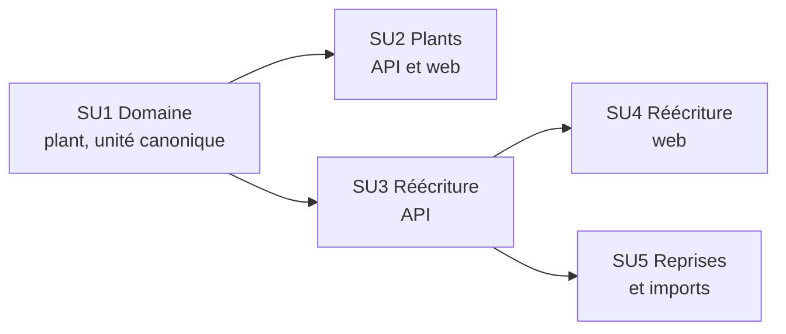

# Plan de réalisation : unités des semences reprises et plants à la pièce

*Issue [#130](https://github.com/ekylibre/fourmy/issues/130). Besoins : `claudedocs/besoins_semences_unites.md` (FR-SU-1 à 13, NF-SU-1 à 4, U1 à U3). Conception : `claudedocs/conception_semences_unites.md` (§9, découpage). Plan du 28/11/2026.*

## 1. Principes

- **Une PR par lot**, poussée puis fusionnée par l'utilisateur avant le lot suivant ; dev.fourmy.org se redéploie à chaque fusion.
- **Pas de migration de schéma.** `articles.custom` (jsonb) porte `unitRewrite` ; `article_seeds.grains_per_dose` existe.
- **Aucune quantité convertie** par la réécriture : seul le libellé change (conception §1). Chaque test de réécriture compare les stocks avant et après.
- **Pas de données de testeur dans le dépôt.** Les tests créent leurs fermes ; les essais se font sur la base de développement.
- **Suivi** : chaque lot remplit le §5 (« Réalisé ») et fait avancer `docs/semences.md`.

## 2. Enchaînement

Chemin critique : SU1 → SU3 → SU4. SU2 et SU5 peuvent avancer en parallèle dès que leur prédécesseur est fusionné.

## 3. Lots

### SU1 — Domaine (taille S)
- **`packages/domain/src/seeds/units.ts`** :
  - la dimension `{ dim: "plant" }` dans `SeedUnit` ; le code `plant` dans `SEED_UNIT_CODES` ;
  - `PLANT_WORDS` : plant, pièce, pied, motte (singulier et pluriel), unity, unité, unités. Ces trois derniers quittent `GRAIN_WORDS` (U3) ;
  - `convertSeedQuantity` et `toBase` : plant vers plant seulement ;
  - `seedConversionGap` : le motif `"dimension"` ;
  - `seedUnitChoices("plant")` → `["plant"]` ;
  - `seedEquivalents` : `plantsPerHa` et `plantsPerM2` pour un plant, grains et kg à null ;
  - `canonicalSeedUnit(unit, sheetGrainsPerDose)` (conception §4.2) : code de même grandeur, conflit de grains par dose, null si déjà canonique ou sans code de facteur 1.
- **Contrats** : `SeedListItem.unitDim` gagne `"plant"` ; le libellé de l'unité `plant` (« plants ») dans `unitLabel`.
- **Tests** (`packages/domain/test/seeds.test.ts`) :
  - le cas existant `parseSeedUnit("unity")` devient un plant ;
  - chaque variante de la base de développement → son code canonique, avec un facteur 1 vérifié ;
  - le conflit « Sac de 50 000 grains » contre une fiche à 80 000 ;
  - « 50 000 grains » sans sac : pas de proposition ;
  - le plant dans chaque fonction de conversion, refusé contre kg et grains.
- **Vérifier** les usages du domaine qui supposent trois dimensions : `quantities.ts` (`seedStockQuantity`), `itk/needs.ts`, `economics/margins.ts`, `seeds/flags.ts`, `seeds/usage.ts`. Un `switch` sur `dim` doit traiter `plant`.

### SU2 — Plants dans l'API et le web (taille M)
- **API** :
  - `POST /seeds` et le catalogue acceptent `unit: "plant"` (FR-SU-9) ;
  - `seedCrossesDimension` (`repos/interventions.ts`) : plant contre grains ou masse → `DomainError` avec le message du motif `"dimension"` (FR-SU-12) ;
  - `repos/seeds.ts` : `unitDim: "plant"`, pas de PMG retenu ni de repère pour un plant ;
  - `repos/seed-usage.ts` : l'export CSV écrit « plants ».
- **Web** :
  - `labels.ts` (`stockUnitLabel`) : « plants » ;
  - `SeedSheet.tsx` : PMG, repères Arvalis et Terres Inovia, densité en grains/m² masqués pour un plant (FR-SU-11) ;
  - `SeedLine.tsx` : plants/ha ou plants au total, et l'équivalence « 8 000 plants/ha · 0,8 plant/m² » ;
  - `AddSeedModal.tsx` : « Plants (à la pièce) » parmi les unités.
- **Tests** :
  - API (`seeds-sowing.integration.test.ts` ou un nouveau fichier) : US-3. On crée « Plants de lavande » en plants, on en reçoit 2 000, on plante 1,5 ha à 8 000 plants/ha : le stock baisse de 12 000. Une saisie en kg est refusée ; la fiche n'a pas de PMG ;
  - web (`seeds.test.tsx`) : la fiche d'une semence en plants et la saisie d'une plantation.

### SU3 — Réécriture côté API (taille M)
- **`GET /seeds/units`** (membres), conception §5.1 : les propositions avec leur stock du jour, leur usage et leurs conflits. Le calcul est dans `repos/seed-units.ts`, nouveau.
- **`POST /seeds/units`** (`requireOwner`), conception §5.2 :
  - une transaction par article ;
  - un nouveau contrôle (unité inchangée, proposition identique, facteur 1) ;
  - les mises à jour de `articles`, `stock_movements`, `intervention_parameters` (suffixe gardé), `prices`, `seed_derogations` et `article_seeds.grains_per_dose` ;
  - `custom.unitRewrite = { from, at, by }`, une ligne `audit_log` (`unit_rewritten`) et un événement `article.updated` ;
  - la vérification des stocks par lot avant et après (aujourd'hui et au 1er janvier de chaque campagne mouvementée), qui annule l'article en cas d'écart.
- **Contrats** (`packages/contracts/src/seeds.ts`) : `seedUnitRewrite`, `seedUnitRewriteWrite`, `seedUnitRewriteResult`.
- **Routes** : `GET /seeds/units` va dans `CLOSED_ROUTES` (écran interne, `external-routes.test.ts`).
- **Tests** (`seed-units.integration.test.ts`) :
  - une ferme avec une semence de chaque forme reprise, des lots, une réception, un semis à l'hectare, un prix et une dérogation AB ;
  - US-1 : stock à trois dates, registre, utilisation par campagne et détail de l'intervention, identiques avant et après ; toutes les tables réécrites ; l'historique écrit ; plus de proposition au second passage ;
  - US-2 : le conflit ignoré ;
  - un `worker` reçoit 403 ;
  - une unité changée entre la proposition et la réécriture est rendue dans `skipped`.

### SU4 — Réécriture dans le web (taille S)
- **`SeedsPage.tsx`** : un encadré « N semences ont une unité reprise d'un autre logiciel », pour l'`owner`, s'il y en a.
- **Fenêtre de réécriture** (`UnitRewriteModal.tsx`, nouveau) :
  - pour chaque semence : son nom, l'unité actuelle, l'unité proposée, le stock du jour (avant → après) et l'usage ;
  - une case par semence, cochée au départ ; les conflits à part, non cochables, avec la façon de les régler ;
  - le bouton « Réécrire N semences », puis une notification avec le nombre réécrit et les ignorées ; la liste des semences est relue.
- **Requêtes** (`queries.ts`) : `useSeedUnitRewrites`, et l'invalidation des semences, du stock et des interventions après l'envoi.
- **Tests** (`seeds.test.tsx`) : l'encadré (absent pour un `worker`), la fenêtre (décocher, conflit), le corps envoyé, la notification.

### SU5 — Reprises et imports (taille S)
- **Migrateur** (`packages/migrator-ekylibre/src/migrate.ts`), conception §6.1 :
  - l'upsert de l'article garde l'unité réécrite si Ekylibre a toujours l'unité d'origine (`custom.unitRewrite.from`) ;
  - les mouvements et les paramètres d'intervention repris prennent l'unité canonique de leur article, suffixe gardé.
- **Imports** (`repos/import-apply.ts`), conception §6.2 : une semence créée par un import reçoit directement son unité canonique, et `unitRewrite.from` garde celle du fichier.
- **Tests** :
  - migrateur (`migrate.integration.test.ts`) : une semence réécrite puis reprise de nouveau garde son unité, et ses mouvements sont dans cette unité ;
  - imports (`file-imports-geofolia.integration.test.ts` ou DAPLOS) : une semence en « Sac de 50 000 grains » est créée en `dose`, avec 50 000 grains par dose.

## 4. Points de contrôle

| Après | Vérification |
|---|---|
| SU1 | toutes les variantes de la base de développement donnent un code de facteur 1 ; suites du domaine et de l'API vertes (le changement de `unity` ne casse rien) |
| SU2 | US-3 de bout en bout ; aucun « grain » ni PMG à l'écran d'une semence en plants |
| SU3 | US-1 et US-2 : stocks, registre et utilisation identiques avant et après ; 403 pour un `worker` |
| SU4 | réécriture depuis la page Semences sur dev.fourmy.org, sur une ferme reprise d'Ekylibre |
| SU5 | une nouvelle reprise de la même ferme ne remet pas les anciennes unités |

**Recette** sur dev.fourmy.org, après SU4 et SU5 : on réécrit les unités d'une ferme reprise. On compare le stock des semences et le registre à une date passée, avant et après. On reprend la ferme de nouveau, puis on crée une semence en plants et on la plante.

## 5. Réalisé

### SU1 — fait (28/11)
- **Domaine** (`seeds/units.ts`) :
  - la dimension `{ dim: "plant" }` et le code `plant` ;
  - `PLANT_WORDS` (plant, pièce, pied, motte, au singulier et au pluriel, plus unity, unité, unités) ; ces trois derniers ont quitté `GRAIN_WORDS` ;
  - pour un plant : conversion vers un plant seulement, motif `"dimension"` dans `seedConversionGap`, `plantsPerHa` et `plantsPerM2` dans `seedEquivalents` ;
  - `canonicalSeedUnit` (code de même grandeur, facteur 1 vérifié par `convertSeedQuantity`, conflit de grains par dose).
- **Messages** du motif `"dimension"` : dans le domaine (`quantities.ts`) et dans l'API (`repos/interventions.ts`).
- **Contrats** : `unitDim` gagne `"plant"` (type et schéma de réponse) ; les libellés `plant` (« plants ») et `plant_per_hectare` (« plants/ha »).
- **Web** : `stockUnitLabel` affiche « plants », pour qu'une semence reprise en `unity` ne montre pas son code brut avant SU2.
- **Vérifié** : les autres usages des dimensions (`itk/needs.ts`, `seed-usage.ts`, `repos/seeds.ts`, `flags.ts`) passent par la conversion ou comparent les dimensions sans supposer qu'il n'y en a que trois. `margins.ts` et `usage.ts` ne lisent pas l'unité de semence.
- **Tests du domaine** (27 dans `seeds.test.ts`) : `unity` en plant ; les plants dans chaque conversion ; 8 000 plants/ha sur 1,5 ha = 12 000 plants ; les 12 variantes de la base de développement → code canonique, facteur 1 ; déjà canonique, inconnue, « 50 000 grains » sans sac ; conflit de grains par dose.
- **Non-régression** : domaine 462, contracts 9, API 497 (6 ignorés), web 292.

### SU2 — fait (28/11)
- **API** :
  - `POST /seeds` accepte « Plant » ;
  - `repos/seeds.ts` : pas de PMG retenu ni de repère pour un plant (comme pour un mélange), `plantsPerHa` dans les semis de la fiche ;
  - `seedFlags` : pas de « PMG inconnu » pour un plant ;
  - `seed-usage.ts` : l'export CSV écrit « plants » dans la colonne de l'unité ;
  - refus d'une saisie en kg ou en grains : motif `dimension`, posé en SU1.
- **Contrats** : `plantsPerHa` dans `SeedInterventionUse` et dans le schéma de réponse.
- **Web** :
  - fiche : l'unité « Plants (à la pièce) » ; les grains par dose, le poids d'un sac, le PMG, le PMG des lots et les colonnes grains/m² et kg/ha sont masqués ; une colonne plants/ha ;
  - `SeedLine` : « ≈ 8 000 plants/ha · 0,8 plant/m² » ;
  - création d'une semence en plants.
- **Tests** :
  - API (`seeds-plants.integration.test.ts`, 2) : US-3. On crée « Plants de lavande », on en reçoit 20 000, on plante 1,5 ha à 8 000 plants/ha : 12 000 plants sortent du stock. Les plants/ha apparaissent sur la fiche, une saisie en kg ou en grains/m² renvoie 422, l'export CSV dit « plants ». Une semence reprise en `unity` est un plant sans « PMG inconnu » ;
  - web (`seeds.test.tsx`, 1) : la fiche d'une semence en plants.
- **Non-régression** : domaine 462, API 499 (6 ignorés), web 293. Lint sans erreur.
- **Documentation** : `docs/semences.md`, section « Plants ».

### SU3 — fait (28/11)
- **`GET /seeds/units`** (membres, `repos/seed-units.ts`) : les semences dont l'unité reprise a un code canonique (`canonicalSeedUnit`). Pour chacune : la proposition, le nombre de grains par dose, le conflit, le stock du jour et l'usage (mouvements, interventions et prix dans l'unité reprise).
- **`POST /seeds/units`** (`requireOwner`) : une transaction par article.
  - **Nouveau contrôle** : article de type semence, pas de conflit, code identique à la proposition. Sinon `skipped` (`not_found`, `conflict`, `changed`).
  - **Réécrits** : `stock_movements` (dans l'unité reprise), `intervention_parameters` (intrants et sorties, suffixe `_per_hectare` ou `_per_square_meter` gardé), `prices`, `seed_derogations`, `article_seeds.grains_per_dose` d'une dose (s'il manquait), puis l'article (`unit`, `custom.unitRewrite = { from, at, by }`, `updated_at`).
  - **Historique** : une ligne `audit_log` (`article`, `unit_rewritten`, avec les lignes touchées).
  - **Garde-fou** : le stock de chaque lot, aujourd'hui et au 1er janvier de chaque année mouvementée, est comparé avant et après ; un écart annule l'article (`stock_mismatch`).
- **Écart avec la conception** : pas d'événement `article.updated` dans l'outbox, ce type n'existe pas. Le mobile relit l'article par son `updated_at`, comme après `PUT /articles/:id/seed`.
- **Contrats** : `seedUnitCode`, `SeedUnitRewrite`, `seedUnitRewriteWrite`, `SeedUnitRewriteResult`.
- **Routes** : `/seeds/units` dans `CLOSED_ROUTES` (écran interne).
- **Tests** (`seed-units.integration.test.ts`, 3) :
  - les propositions (dose de 50 000 grains, milliers, kg, plant ; conflit à part ; rien pour `kilogram`) ;
  - 403 pour un `worker`, et les refus `conflict`, `changed` et `not_found` ;
  - US-1 : stocks à trois dates, fiche, semis et utilisation de la campagne identiques avant et après ; toutes les tables réécrites ; l'historique ; plus rien à proposer sauf le conflit ; un nouveau semis à 1 dose/ha.
- **Non-régression** : API 502 (6 ignorés), web 293. Typecheck 40/40, lint sans erreur.

