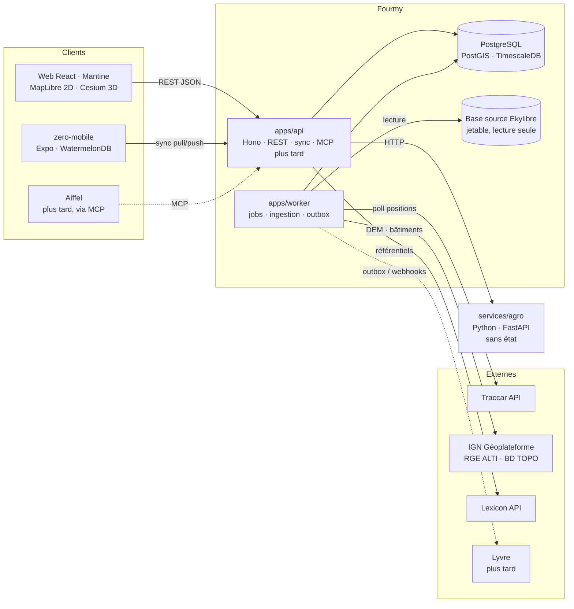
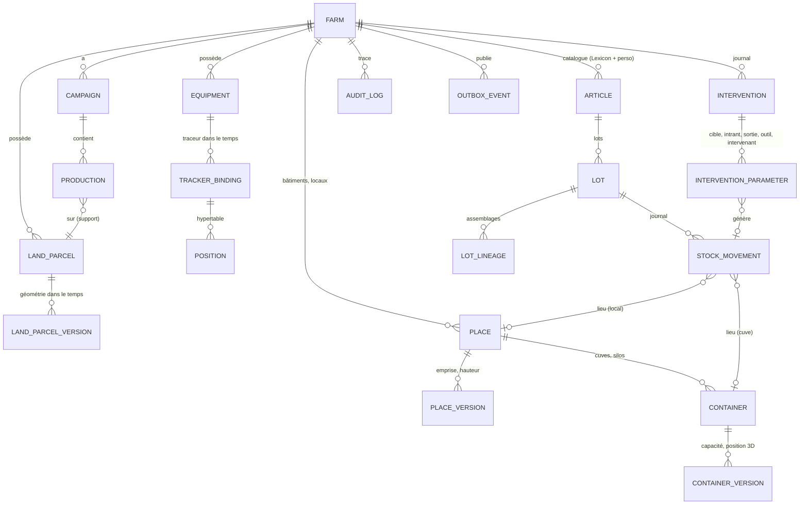
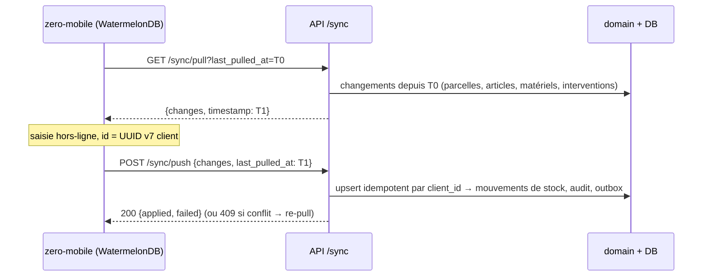
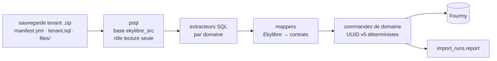
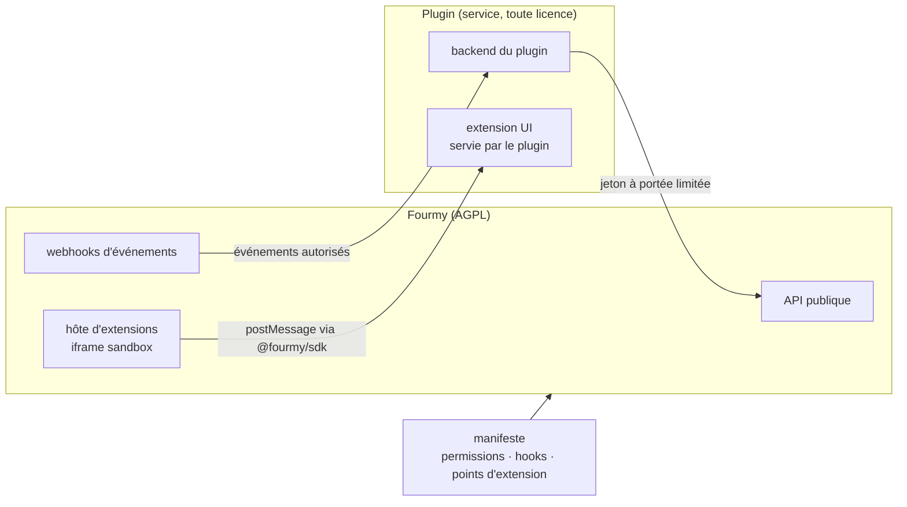

# Fourmy — Architecture v1

> Document produit par `/sc:design` le 2026-11-06, à partir de
> [`requirements.md`](requirements.md). Il fixe les choix d'architecture de la
> **première tranche (7 jours, multi-agent)** et prépare la suite (Lyvre,
> MCP, plugins) sans la construire. Étape suivante : `/sc:workflow` pour le
> plan d'implémentation par agent.

## 1. Principes directeurs

1. **Contrats d'abord.** Le modèle de domaine, le schéma SQL, l'API et les
   événements sont écrits et figés le jour 1. Les agents codent ensuite en
   parallèle contre ces contrats (NFR-DEV-2).
2. **Le temps est une dimension de première classe.** Chaque état physique a
   une période de validité ; chaque quantité est la somme d'un journal de
   mouvements. « La ferme au 15 mars » est une requête, pas une
   reconstruction (FR-TIME-1).
3. **Le cœur est petit, les intégrations sont dehors.** Traccar, la migration
   Ekylibre, puis Lyvre, Weenat, Sencrop… sont des connecteurs qui parlent au
   cœur par l'API et les événements, jamais par la base (NFR-MOD-1).
4. **Une frontière de licence nette.** Le cœur est AGPL ; tout ce dont un
   plugin a besoin pour être écrit (contrats, SDK) est sous licence permissive
   et s'utilise hors processus (FR-PLG-4).
5. **Simple d'abord.** Une seule base PostgreSQL, un seul langage côté
   serveur et web, pas de bus de messages externe en v1. Chaque brique
   écartée a un point d'entrée prévu pour plus tard.

## 2. Décisions (ADR résumées)

| # | Décision | Alternatives écartées | Raison |
|---|---|---|---|
| ADR-1 | **TypeScript** pour le cœur de Fourmy (API, worker, web), monorepo **pnpm + Turborepo**. Un **service Python** (`services/agro`, FastAPI) porte les méthodes métier qui ont leur écosystème en Python : bilans azotés, modèles agronomiques, rasters et télédétection, ML. *Confirmé le 2026-11-07.* | Rails 8 ; tout en Python comme Aiffel et Lyvre | Partage des types avec `zero-mobile` (TS) et le web ; SDK MCP officiel en TS ; CesiumJS et MapLibre natifs JS ; vivier de contributeurs pour les plugins. Le service Python est **sans état** : il reçoit des données, rend des résultats, ne touche pas la base. L'API l'appelle en HTTP ; son contrat est un OpenAPI généré depuis `packages/contracts`. Le squelette est posé dans les 7 jours, les méthodes viennent ensuite. |
| ADR-2 | API **Hono** + **Zod** + `@hono/zod-openapi`, ORM **Drizzle** | NestJS ; Prisma | Hono est léger et rapide à prendre en main par des agents ; Zod donne à la fois la validation, les types et l'OpenAPI ; Drizzle garde le SQL lisible et supporte PostGIS. |
| ADR-3 | **PostgreSQL 17 + PostGIS + TimescaleDB** (image `timescale/timescaledb-ha`, qui embarque PostGIS) | Base séparée pour les séries ; InfluxDB | Une seule base à opérer et à sauvegarder ; jointures spatiales et temporelles dans la même requête. |
| ADR-4 | Multi-ferme par colonne `farm_id` + **Row Level Security** | Un schéma par ferme (modèle Apartment d'Ekylibre) | Migrations simples, requêtes inter-fermes possibles pour le SaaS, isolation garantie par la base. |
| ADR-5 | Modèle temporel « **états versionnés + journaux** » (§4) | Event sourcing complet | Donne le voyage dans le temps sans le coût d'un event store en 7 jours. Le journal d'audit et la table *outbox* préparent un passage au bus d'événements. |
| ADR-6 | Événements via table **outbox** + `LISTEN/NOTIFY` ; NATS JetStream **plus tard** | NATS dès la v1 | Aucun consommateur externe dans les 7 jours. L'outbox garantit qu'aucun événement n'est perdu le jour où NATS ou les webhooks arrivent. |
| ADR-7 | Web **React 19 + Vite + TypeScript**, avec la même pile que Lyvre : **Mantine 9**, TanStack Query, React Router, Vitest et Playwright. Design system **Lyvre** sous forme de thème Mantine. *Confirmé le 2026-11-07.* | Vue 3 | Lyvre (`asso-seconde-nature/seconde-compta`) est en React 19 + Mantine 9 : on reprend son thème, ses polices et ses conventions. React rapproche aussi le web de `zero-mobile` (React Native) pour les hooks et la logique client. Lyvre utilise Leaflet ; Fourmy garde MapLibre (ADR-8) pour les tuiles vectorielles et les volumes de traces. |
| ADR-8 | **CesiumJS** pour le plan 3D et le rejeu temporel ; **MapLibre GL** pour la carte 2D de travail | Cesium seul ; deck.gl dès la v1 | Cesium a une horloge et une frise natives (CZML, `SampledPositionProperty`) : le rejeu des traces et l'état de la ferme suivent la même horloge. MapLibre reste léger pour la saisie et le mobile (déjà utilisé par `zero-mobile`). deck.gl s'ajoutera si les volumes de points l'exigent. **Alternative souveraine étudiée (2026-11-07)** : Giro3D d'Oslandia (framework Three.js, open source, utilisé pour le jumeau numérique de la Garonne). Écartée en v1 faute d'horloge/frise native pour le rejeu de traces datées — qui est justement la raison de choisir Cesium ; elle reste le repli si la dépendance à Cesium (ou à Cesium ion) devient gênante. |
| ADR-9 | Relief : **RGE ALTI de l'IGN** lu à la demande sur le **WMS-R de la Géoplateforme** en grille brute `image/x-bil;bits=32`, tuile par tuile (65 × 65, convention Cesium), servi par l'API à `CustomHeightmapTerrainProvider`. **Révisée le 2026-11-07 après le spike** : plus de téléchargement ni de stockage de dalles GeoTIFF. Grille validée contre le service d'altimétrie ponctuel (écart < 0,3 m). | Dalles RGE ALTI téléchargées et découpées ; tuiles *quantized-mesh* ; Cesium ion | Aucun stockage, aucune dépendance propriétaire, toujours à jour. La Géoplateforme limitant le débit (429), l'API plafonne la finesse demandée au niveau 16 (~4,7 m), interpole les tuiles plus fines dans leur ancêtre, regroupe et limite les appels, réessaie, et se replie sur un relief plat **à l'altitude de la ferme**, signalé à l'interface. |
| ADR-10 | Bâtiments : emprises Ekylibre, **hauteurs de la BD TOPO (IGN)** reprises par recouvrement d'emprise (≥ 30 %, tracé dans l'audit) ; bâtiments voisins de la BD TOPO en contexte. Cuves : **cylindres** dimensionnés depuis leur capacité (hauteur ≈ 1,6 × diamètre, plafonnée sous le toit), **placés automatiquement** en rangées dans l'emprise du bâtiment (jamais hors du bâtiment : sinon signalés), corrigibles à la souris (placement manuel prioritaire). Réalisé le 2026-11-07. | Modèles glTF dès la v1 | Ekylibre ne stocke ni hauteur ni position 3D des cuves. On génère un plan crédible automatiquement, corrigeable simplement. glTF en option ensuite. **Après la tranche** (voir §8) : génération des solides **côté serveur avec SFCGAL dans PostGIS** et diffusion en **3D Tiles** (py3dtiles). |
| ADR-11 | **Plugins hors processus** : un plugin est un service qui utilise l'API publique, reçoit les événements par webhook et déclare ses permissions dans un manifeste. Les extensions d'interface tournent dans une **iframe isolée** et dialoguent par `postMessage` via le SDK | Plugins WASM dans le processus du cœur | La frontière de processus permet les plugins **privés** sous AGPL et isole leurs données. `@fourmy/contracts` et `@fourmy/sdk` sont publiés sous **Apache-2.0**. Une clause d'exception « plugins » est ajoutée à la licence en complément. **À valider par un juriste.** Le WASM reste possible plus tard pour de petits scripts sans état. |
| ADR-12 | Migration depuis Ekylibre : l'export est la **sauvegarde de tenant** d'Ekylibre (`.zip`, voir §6.1). Son dump SQL est **restauré dans une base source jetable en lecture seule** ; le migrateur lit cette base et écrit dans Fourmy via les services de domaine | Lecture via l'API v2 d'Ekylibre | Respecte FR-MIG-4/5 (aucune connexion à l'instance en production), rejouable, complet (l'API v2 n'expose pas tout). |
| ADR-13 | Synchro mobile au **protocole de synchronisation de WatermelonDB** (`pull` par curseur, `push` des changements avec identifiants client) | API spécifique | `zero-mobile` utilise déjà WatermelonDB : l'adaptation se limite au connecteur. Les identifiants générés côté client rendent le `push` idempotent (NFR-OFF-1). |
| ADR-14 | Authentification **better-auth** : comptes locaux en auto-hébergé, **OIDC** vers le SSO commun en SaaS | Keycloak embarqué | Une seule bibliothèque pour les deux modes de distribution (FR-ACC-1/2). |
| ADR-15 | Déploiement **Docker Compose**, compatible **Dokploy** comme Aiffel | Kubernetes | Même outillage que le reste de l'écosystème ; une commande pour l'auto-hébergement (NFR-OSS-1). |

## 3. Vue d'ensemble



### Découpage du monorepo

```
fourmy/
├── apps/
│   ├── api/                  # Hono : routes REST, sync mobile, auth, terrain
│   ├── worker/               # jobs : import Ekylibre, Traccar, IGN, outbox
│   └── web/                  # React + Mantine : carte 2D, plan 3D, frise, registres
├── packages/
│   ├── contracts/            # Apache-2.0 — schémas Zod, types, événements, OpenAPI
│   ├── sdk/                  # Apache-2.0 — client API, manifeste plugin, bridge iframe
│   ├── db/                   # schéma Drizzle, migrations SQL, RLS, seeds
│   ├── domain/               # logique pure : temps, stocks, interventions, registres
│   ├── connector-traccar/    # client Traccar + mapping positions → traces
│   ├── migrator-ekylibre/    # lecture base source → commandes de domaine
│   ├── geo-ign/              # relief et bâtiments IGN
│   └── ui-lyvre/             # thème Mantine et composants React du design system Lyvre
├── services/
│   └── agro/                 # Python (FastAPI, uv) : méthodes agronomiques, sans état
├── fixtures/                 # jeux de données anonymisés de référence (NFR-DEV-4)
├── docker/                   # compose.dev.yml, compose.dokploy.yml
└── docs/                     # requirements, architecture, adr/
```

Règle de dépendance : `contracts` ← `domain` ← `db` ← `apps/*`.
`domain` n'importe ni la base ni le réseau, ce qui le rend testable en
isolation. Les connecteurs n'importent que `contracts`, `domain` et `db`.

## 4. Modèle de données

### 4.1 Trois natures de données

| Nature | Stockage | Exemple | Question « au 15 mars » |
|---|---|---|---|
| **États versionnés** | table d'identité + table `*_versions` avec `valid tstzrange` | parcelle, bâtiment, matériel, cuve | `WHERE valid @> '2026-03-15'` |
| **Journaux** | lignes immuables horodatées, corrections par contre-passation | mouvements de stock, interventions réalisées | `SUM(...) WHERE occurred_at <= '2026-03-15'` |
| **Séries temporelles** | hypertable TimescaleDB | positions GPS (puis capteurs) | `WHERE time BETWEEN ...` |

Chaque table métier porte `farm_id` (RLS) et des identifiants **UUID v7**,
générés côté client si besoin (mobile, migrateur), ce qui rend toutes les
écritures idempotentes.

### 4.2 Schéma conceptuel



### 4.3 Tables clés

| Table | Colonnes principales | Notes |
|---|---|---|
| `farms`, `users`, `memberships` | `role ∈ {owner, worker}` | better-auth gère `users` et sessions |
| `campaigns` | `year`, `starts_on`, `stops_on` | |
| `land_parcels` / `land_parcel_versions` | `name`, `shape geometry(MultiPolygon,4326)`, `area_m2`, `pac_islet`, `viti jsonb` (cépage, porte-greffe, rangs, densité, plantation), `valid tstzrange` | Contrainte d'exclusion `EXCLUDE USING gist (land_parcel_id WITH =, valid WITH &&)` : jamais deux versions qui se chevauchent |
| `productions` | `campaign_id`, `land_parcel_id`, `nature` (grande culture, vigne, prairie), `species` (référence Lexicon) | |
| `places` / `place_versions` | `kind ∈ {building, room, storage}`, `footprint geometry(Polygon)`, `height_m`, `source ∈ {ign, ekylibre, manual}` | |
| `containers` / `container_versions` | `place_id`, `kind ∈ {tank, silo, barrel}`, `capacity_l`, `shape3d jsonb` (`{x, y, z, radius, height}` en mètres dans le repère local du bâtiment), `placement ∈ {auto, manual}` | ADR-10 |
| `equipments` / `equipment_versions` | `name`, `kind`, `state` | |
| `tracker_bindings` | `equipment_id`, `source = 'traccar'`, `device_id`, `valid tstzrange` | Un traceur peut changer de matériel |
| `positions` (hypertable) | `farm_id`, `binding_id`, `time`, `point geometry(Point)`, `speed`, `heading`, `attrs jsonb` | Index `(binding_id, time)`. **RLS active ; compression reportée** : sur `timescaledb-ha` pg17, columnstore et RLS sont mutuellement exclusifs sur une hypertable — priorité à l'isolation (2026-11-07) |
| `articles` | `lexicon_ref` (nullable), `name`, `kind ∈ {phyto, fertilizer, seed, harvest, wine, other}`, `unit`, `amm` (phyto), `custom jsonb` | FR-STK-2 : base Lexicon + personnalisation |
| `lots` | `article_id`, `code`, `attrs jsonb` (millésime, cépages, appellation) | |
| `lot_lineage` | `child_lot_id`, `parent_lot_id`, `share` | Assemblages viticoles, traçabilité |
| `stock_movements` | `lot_id`, `place_id` ∨ `container_id`, `quantity numeric` (signée), `unit`, `occurred_at`, `cause ∈ {migration, intervention, purchase, sale, adjustment, transfer}`, `intervention_id` | Journal immuable ; stock = somme |
| `interventions` | `procedure` (référence au catalogue de procédures), `status ∈ {planned, done}`, `started_at`, `stopped_at`, `origin ∈ {web, mobile, migration, plugin}`, `client_id` | |
| `intervention_parameters` | `role ∈ {target, input, output, tool, doer}`, `ref_type`, `ref_id`, `quantity`, `unit`, `working_zone geometry` | Reprise simplifiée des procédures d'Ekylibre |
| `audit_log` | `actor`, `origin`, `entity`, `entity_id`, `action`, `diff jsonb`, `at` | FR-TIME-3 |
| `outbox_events` | `type`, `payload jsonb`, `occurred_at`, `published_at` | ADR-6 |
| `import_runs` | `source`, `started_at`, `report jsonb` | Rapport de migration (FR-MIG-3) |

### 4.4 Règles de domaine (dans `packages/domain`)

- **Versionner un état** : clore la version courante (`upper(valid) = t`) et
  ouvrir la nouvelle dans la même transaction.
- **Réaliser une intervention** : écrire l'intervention, ses paramètres et
  les mouvements de stock correspondants (intrants en négatif, sorties en
  positif) dans une seule transaction, plus l'audit et l'événement outbox.
- **Corriger** une intervention réalisée : contre-passer ses mouvements et en
  écrire de nouveaux. On ne modifie jamais un mouvement.
- **Registre phyto** : vue SQL sur `interventions` (status `done`) ×
  `intervention_parameters` (role `input`) × `articles` (kind `phyto`) ×
  cibles (parcelle, surface, culture). Il est calculé, jamais saisi.
- **Contenu d'une cuve à une date** : somme des mouvements par lot sur ce
  contenant jusqu'à la date, composition déduite de `lot_lineage`.

## 5. Interfaces

### 5.1 API REST (extrait, contrat complet dans `packages/contracts`)

Toutes les routes sont préfixées par `/api/v1/farms/:farmId` et acceptent
`?at=<ISO-8601>` quand elles renvoient un état.

| Méthode et route | Rôle | Exigences |
|---|---|---|
| `GET /snapshot?at=` | État consolidé de la ferme à une date : parcelles, productions, bâtiments, cuves et leur contenu, matériels | FR-TIME-1, US-3 |
| `GET /land-parcels?at=` · `POST` · `PATCH /:id` | Parcellaire versionné (le `PATCH` crée une version) | FR-PARC-1/2 |
| `GET /places?at=` · `GET /containers?at=` · `PATCH /containers/:id/placement` | Bâtiments, cuves, placement 3D | FR-VIZ-3, US-9 |
| `GET /containers/:id/contents?at=` | Volume, composition, derniers mouvements | US-9 |
| `GET /stock?at=&article=&place=` | Stocks à une date | FR-STK-1 |
| `GET /interventions?from=&to=` · `POST` · `POST /:id/complete` | Planifier, réaliser | FR-INT-1/3 |
| `GET /registers/phyto?campaign=` (+ `?format=csv\|pdf`) | Registre phytosanitaire | FR-REG-1 |
| `GET /tracks?equipment=&from=&to=&format=czml\|json` | Traces simplifiées pour le rejeu | FR-GPS-2, US-1 |
| `GET /tracks/coverage?equipment=&from=&to=` | Durée et surface par parcelle traversée | US-1 |
| `GET /terrain/heightmap/:z/:x/:y` | Grille d'altitude pour Cesium | ADR-9 |
| `GET /sync/pull?last_pulled_at=` · `POST /sync/push` | Synchro mobile | ADR-13, FR-INT-2 |
| `POST /imports/ekylibre` · `GET /imports/:id` | Lancer et suivre une migration (admin) | FR-MIG-1/3 |

Conventions : erreurs au format `application/problem+json`, pagination par
curseur, montants absents (Fourmy ne connaît pas les prix), unités
explicites sur toute quantité.

**Autorisation** (2026-11-07) : l'utilisateur doit être membre de la ferme
de l'URL (`memberships`, sinon 403). Rôle `owner` : tout ; rôle `worker` :
lecture, interventions, synchro mobile. Réservé à `owner` : parcellaire,
placement et corrections de cuves, imports. La RLS isole les fermes entre
elles ; l'appartenance décide qui entre. L'identité vient provisoirement de
l'en-tête `x-user-id` (better-auth ensuite, ADR-14).

**Interventions** : la réalisation transforme les paramètres en mouvements
de stock selon des règles pures du domaine (dose par hectare × surface
traitée à la date ; unité incohérente refusée ; lot le mieux pourvu ;
surconsommation acceptée mais signalée ; une sortie exige un lieu).

**Imports** : le client fournit un **nom** de base source
(`ekylibre_src_…`), jamais une URL ; le serveur source est fixé par la
configuration (`EKYLIBRE_SOURCES_URL`). Exécution asynchrone (202 + suivi).

### 5.2 Événements (contrat, publiés via l'outbox)

`land_parcel.versioned`, `intervention.planned`, `intervention.completed`,
`intervention.corrected`, `stock.moved`, `container.placed`,
`tracker.positions_ingested`, `import.completed`.

Format : enveloppe CloudEvents (`id`, `type`, `source`, `time`, `farmid`,
`data`). Ce sont ces événements que Lyvre, Aiffel et les plugins consommeront
après les 7 jours.

### 5.3 Synchro mobile

Implémentée le 2026-11-07. Pull : parcelles (version courante, GeoJSON,
tracé SVG, surface), articles, matériels, interventions — enregistrements
plats, instants en ms. Push : interventions seulement en v1, **tout ou rien
par intervention**, résultat par intervention (`applied` / `failed` avec
motif) adapté à l'état de synchro par intervention de zero-mobile. Conflit =
intervention modifiée sur le serveur par autre chose que le mobile depuis
son dernier pull (d'après l'audit).



Le catalogue de procédures est servi par l'API : le formulaire de
pulvérisation codé en dur dans `zero-mobile` devient un formulaire piloté par
ce catalogue (pulvérisation en premier).

## 6. Composants de la première tranche

### 6.1 Migrateur Ekylibre (`packages/migrator-ekylibre`, `apps/worker`)



- **Identifiants déterministes** : UUID v5 dérivé de `(instance, table, id)`.
  Rejouer la migration met à jour au lieu de dupliquer.
- **Ordre** : campagnes → parcellaire (`cultivable_zones`, `cap_islets`,
  `cap_land_parcels`, `activity_productions.support_shape`, données CVI pour
  la vigne) → bâtiments et cuves (`products` de variété bâtiment ou cuve,
  `initial_shape`) → matériels → articles (variants rattachés à Lexicon) →
  stocks initiaux → interventions et leurs paramètres → mouvements.
- **Format d'entrée** (vérifié le 2026-11-07 sur les trois exports) : la
  sauvegarde de tenant d'Ekylibre, `format_version: 3`. Le zip contient
  `manifest.yml` (tenant, `database_version`, version d'Ekylibre),
  `<tenant>.sql` (dump PostgreSQL **en texte**, à restaurer avec `psql`, pas
  `pg_restore`) et `files/` (pièces jointes, imports, éditions). Le dump ne
  contient qu'un schéma, nommé comme le tenant. Le migrateur lit le nom du
  schéma dans `manifest.yml`.
- **Deux versions de schéma** à gérer : Ekylibre 4.37
  (`database_version` 20250405175301) et Ekylibre 5.0 (20261010200000). Les
  extracteurs vérifient la version et signalent les colonnes absentes.
- **Exports disponibles** (hors dépôt, dans `ressources_fourmy/old_backup_ekylibre_v5`) :

  | Tenant | Ekylibre | Taille SQL | Contenu utile |
  |---|---|---|---|
  | `phaurigot` (Pierre) | 5.0 | 150 Mo | 5 activités grandes cultures, 162 parcelles, 158 cultures, 17 matériels, 7 sessions de conduite (`ride_sets`) |
  | `entredeuxterres` (Frédéric) | 4.37 | 834 Mo | vigne et vinification, 9 parcelles, **9 cuves**, 13 réceptions de vendange, 34 sessions de conduite |
  | `ferme-des-loubes` (test) | 4.37 | 8 Mo | vigne (4 activités) et grandes cultures, 111 parcelles, 1 cuve |

- **Géométries** : les bâtiments et leurs divisions ont une emprise 2D
  (`initial_shape`) dans les trois exports ; les cuves n'en ont aucune. Le
  placement automatique des cuves (ADR-10) est donc nécessaire.
- **Rapport** : volumes par entité, lignes rejetées avec leur raison, écart
  du registre phyto entre Ekylibre et Fourmy sur une campagne de référence
  (critère d'acceptation de US-5).

### 6.2 Connecteur Traccar (`packages/connector-traccar`)

- Serveur : `traccar.osfarm.org`. Lit `GET /api/devices` et
  `GET /api/positions?deviceId&from&to` avec un jeton en lecture ; identifiants
  dans des variables d'environnement, jamais dans le dépôt. Supporte aussi
  l'**authentification HTTP Basic** en repli (c'est ce qu'utilisait Ekylibre).
  Boîtiers de Pierre : id 1, 3, 5 (tracteurs), rattachés par nom aux matériels migrés.
- **Attributs agricoles** du serveur osfarm conservés dans `positions.attrs` :
  `isWorking` (en chaîne « True »/« False »), `workingWidth`, `tool`, `field`,
  `appliedArea` (compteur cumulé du jour). La couverture utilise la **largeur
  réelle de l'outil** et ne compte que les positions au travail.
  Validé le 2026-11-07 : 16,03 ha calculés contre 15,79 ha mesurés par Traccar
  sur une journée réelle (+1,5 %).
- Import de l'historique au premier lancement, puis récupération toutes les
  minutes (fenêtre glissante, déduplication sur `(binding_id, time)`).
- `GET /tracks` simplifie les traces côté serveur (Douglas-Peucker
  par fenêtre de zoom) et produit du CZML pour Cesium.

### 6.3 Plan 3D et rejeu (`apps/web`, `packages/geo-ign`)

Réalisé le 2026-11-07 : `packages/geo-ign` (tuiles, relief WMS-R, BD TOPO,
interpolation, cache), routes `/terrain/heightmap/:z/:x/:y`, `/plan3d?at=`
et `/places/ign-heights`, page « Plan 3D » (Cesium 1.146, sans Cesium ion) :
relief et photographie aérienne IGN, parcelles drapées, bâtiments
translucides (on voit les cuves), voisins BD TOPO, cuves dont le liquide
suit la frise, rejeu de la trace du jour sur l'horloge Cesium (posée sur le
relief), mode « placer les cuves ». Le détail ci-dessous était le plan
initial ; le relief suit l'ADR-9 révisée.

- **Relief** : au premier affichage d'une ferme, le worker télécharge le
  RGE ALTI de l'emprise de la ferme (+ 2 km) depuis la Géoplateforme IGN et
  le stocke en GeoTIFF ; l'API découpe des grilles à la demande pour
  `CustomHeightmapTerrainProvider`.
- **Bâtiments** : emprises et hauteurs de la BD TOPO (WFS Géoplateforme)
  rapprochées des bâtiments Ekylibre par recouvrement géométrique, puis
  extrudées.
- **Cuves** : placement automatique en grille dans l'emprise du bâtiment,
  diamètre et hauteur déduits de la capacité. Le remplissage (couleur et
  hauteur du liquide) suit l'horloge Cesium. Un mode « placer les cuves »
  permet de les déplacer à la souris (`PATCH /placement`).
- **Frise** : l'horloge Cesium pilote l'application. Changer la date
  recharge `GET /snapshot?at=` (avec cache par jour) ; les traces GPS sont
  des entités CZML animées sur la même horloge.
- **Carte 2D** (MapLibre) : vue de travail pour le parcellaire, les
  interventions et le registre ; même frise, même `snapshot`.

### 6.4 Web (`apps/web`)

Réalisé le 2026-11-07 : React 19 + Vite + Mantine 9 + TanStack Query + React
Router, mêmes versions que Lyvre ; thème et jetons CSS de Lyvre repris dans
`packages/ui-lyvre` (logotype « fourmy », jauge de cuve). La date de la frise
est portée par l'URL (`?at=`) : toutes les vues et les liens partagés
montrent la ferme au même instant. Carte : MapLibre 6 sur les fonds IGN
Géoplateforme (Plan IGN, photographie aérienne), chargée à la demande ; son
worker (module ESM) est construit par Vite et déclaré par `setWorkerUrl` —
sans cela la carte ne se charge pas une fois bundlée. Libellés de procédures
générés depuis la locale française d'Ekylibre. Tests : composants (Vitest,
MSW sur `@fourmy/mocks`, Mantine `env="test"`) et parcours Playwright en CI.

Écrans de la tranche : connexion · tableau de bord ferme · carte 2D
parcellaire · plan 3D et frise · rejeu des traces · interventions (liste,
saisie, réalisation) · stocks · cuverie · registre phyto · suivi de
migration (admin).

### 6.5 Mobile (`zero-mobile`, dépôt séparé)

- Remplacer le connecteur API v2 d'Ekylibre par `@fourmy/sdk` et le protocole
  de synchro (ADR-13).
- Remplacer le formulaire de pulvérisation codé en dur par le catalogue de
  procédures.
- Garder la carte MapLibre et le cache hors-ligne existants.

## 7. Plugins (préparé, non construit dans les 7 jours)



- **Manifeste** (`fourmy-plugin.json`) : identité, version, permissions
  (`stock:read`, `interventions:write`…), événements souscrits, points
  d'extension UI (`map.layer`, `farm.panel`, `intervention.type`).
- **Installation** : l'exploitant accepte les permissions (FR-PLG-3) ; Fourmy
  émet un jeton limité à ces permissions et à cette ferme.
- **Licence** : `@fourmy/contracts` et `@fourmy/sdk` sous Apache-2.0 ; clause
  d'exception dans la licence du cœur. **Validation juridique requise** avant
  d'annoncer les plugins privés.
- **Réécritures prévues** : Traccar (devient le premier plugin officiel après
  la tranche, son code de connecteur est déjà isolé), Weenat, Sencrop,
  viti, HVE, planning.

## 8. Après les 7 jours : points d'entrée prévus

| Sujet | Point d'entrée |
|---|---|
| **Synchro Lyvre** | Consommateur de l'outbox (`stock.moved`, `intervention.completed`) + endpoint de réception des achats et ventes de Lyvre. Fourmy reste maître des quantités. |
| **MCP / Aiffel** | Route `/mcp` (Streamable HTTP, SDK TS officiel) qui expose des outils adossés aux mêmes services de domaine et aux mêmes permissions que l'API. |
| **NATS** | Remplace `LISTEN/NOTIFY` comme transport de l'outbox, sans changer le format des événements. |
| **Capteurs** | Hypertable `measurements` sur le modèle de `positions`, standard OGC SensorThings pour l'exposition. |
| **Élevage N1** | Tables `herds` / `herd_versions` (effectifs), mouvements agrégés comme journal, pâturage = intervention ciblant une parcelle. |
| **PAC, fertilisation** | Vues et exports, comme le registre phyto. |
| **Géométrie 3D serveur** | SFCGAL dans PostGIS (`CG_*`) pour extruder les bâtiments et construire les solides de cuves ; diffusion en 3D Tiles (py3dtiles). Remplace la fabrication côté client d'ADR-10 et reste lisible par Cesium comme par Giro3D. |

## 9. Exigences non fonctionnelles : comment elles sont tenues

| Exigence | Mécanisme |
|---|---|
| NFR-UX-1 | Tokens Lyvre dans `packages/ui-lyvre`, revue UX à chaque écran sur les fermes pilotes |
| NFR-OFF-1 | Protocole WatermelonDB, UUID v7 client, `push` idempotent |
| NFR-PERF-1 | Hypertable compressée, simplification serveur par zoom, CZML ; objectif : rejeu d'une journée de 5 matériels en moins de 2 s |
| NFR-PERF-2 | Le mobile et les petits écrans utilisent MapLibre seulement ; Cesium chargé à la demande |
| NFR-SEC-1 | RLS par ferme ; plugins hors processus, jetons à portée limitée, iframe `sandbox` |
| NFR-SEC-2 | Export complet d'une ferme (JSON + GeoJSON) ; suppression en cascade par `farm_id` |
| NFR-DEV-1..4 | §10 |

## 10. Organisation multi-agent

### 10.1 Propriété des dossiers

Chaque agent travaille dans un **worktree** séparé et ne modifie que ses
dossiers. Les contrats ne changent que par une demande à l'agent intégrateur.

| Agent | Dossiers possédés | Dépend de |
|---|---|---|
| **0 — Fondations / intégrateur** | `packages/contracts`, `packages/db`, `docker/`, CI, `apps/api` (squelette, auth) | — |
| **A — Domaine** | `packages/domain`, vues SQL des registres | 0 |
| **B — Migration** | `packages/migrator-ekylibre`, jobs d'import, `fixtures/` | 0, A |
| **C — Traccar et traces** | `packages/connector-traccar`, routes `/tracks` | 0 |
| **D — API métier et synchro** | routes de `apps/api` hors squelette, `/sync` | 0, A |
| **E — Web 2D et écrans** | `apps/web` (hors `3d/`), `packages/ui-lyvre` | 0 (contrats + mocks) |
| **F — 3D, relief, cuverie** | `apps/web/src/3d/`, `packages/geo-ign`, route `/terrain` | 0 |
| **G — Mobile** | dépôt `zero-mobile` | 0 (`@fourmy/sdk`) |

### 10.2 Séquencement

```mermaid
gantt
  dateFormat  D
  axisFormat  J%d
  section Fondations
  Contrats, schéma, squelette, CI, fixtures (0)  :a0, 1, 1d
  section Parallèle
  Domaine (A)                 :a1, 2, 2d
  Migration (B)               :b1, 2, 4d
  Traccar et traces (C)       :c1, 2, 3d
  API métier et synchro (D)   :d1, 3, 3d
  Web 2D (E)                  :e1, 2, 4d
  3D, relief, cuverie (F)     :f1, 2, 4d
  Mobile (G)                  :g1, 3, 3d
  section Validation
  Intégration et recette fermes pilotes :v1, 6, 2d
```



- **Jour 1** : l'agent 0 fige les contrats et produit des **mocks** (MSW)
  et des **fixtures** anonymisées, pour que E, F et G avancent sans attendre
  l'API réelle.
- **Jours 2 à 5** : agents parallèles ; intégration continue sur `main` par
  petites PR, CI obligatoire (typecheck, lint, tests, migrations).
- **Jours 6 et 7** : migration complète des fermes de Pierre et Frédéric,
  recette des user stories US-1 à US-5 et US-9.

### 10.3 Définition de « terminé » pour chaque agent

Typecheck et lint propres · tests unitaires du module · test d'intégration
sur les fixtures · aucune modification hors des dossiers possédés · PR
relue par l'intégrateur.

## 11. Risques et parades

| Risque | Impact | Parade |
|---|---|---|
| Relief IGN : volume et format des données plus lourds que prévu | 3D en retard | **Levé par le spike du 2026-11-07** : grille WMS-R à la demande, sans stockage. **Risque avéré ensuite : limite de débit (429)** dès qu'on zoome → finesse plafonnée au niveau 16 + interpolation, regroupement, 4 appels au plus, reprises, repli à l'altitude de la ferme (0 repli constaté ensuite) |
| Bâtiments ou cuves sans géométrie dans les exports | Plan 3D vide | Rapprochement BD TOPO + placement automatique + éditeur de placement |
| Hétérogénéité des données Ekylibre (procédures anciennes, unités) | Rejets à la migration | Rapport de rejets dès le jour 3 sur les vraies exports ; mapping itératif |
| Conflits entre agents sur les contrats | Blocages, régressions | Contrats figés au jour 1, propriété stricte des dossiers, changement de contrat par l'intégrateur seul |
| Volume de positions Traccar | Rejeu lent | Simplification serveur, fenêtres temporelles bornées. Compression Timescale incompatible avec la RLS sur hypertable (pg17) : à réintroduire via isolation applicative de `positions` ou version ultérieure de Timescale |
| Licence des plugins privés | Risque juridique | Frontière hors processus + SDK Apache-2.0 + exception de licence, à faire valider avant annonce |
| Données personnelles des pilotes données aux agents | RGPD | Fixtures anonymisées (personnes, tiers, pièces jointes) produites au jour 1 ; géométries conservées ; exports bruts hors du dépôt, réservés à la recette |

## 12. Points à confirmer avant `/sc:workflow`

1. ~~Stack~~ : TypeScript, avec un service Python sans état pour les
   méthodes agronomiques (ADR-1). *Confirmé le 2026-11-07.*
2. ~~Front~~ : React + Mantine, comme Lyvre (ADR-7). *Confirmé le 2026-11-07.*
3. ~~Format des exports~~ : sauvegarde de tenant Ekylibre (§6.1). *Vérifié
   le 2026-11-07.*
4. ~~Accès Traccar~~ : réglé le 2026-11-07. Serveur `traccar.osfarm.org`,
   jeton dédié du compte de Pierre (`TRACCAR_TOKEN_PHAURIGOT` hors dépôt),
   `GET /api/devices` et `/api/positions` en 200. Trois boîtiers (tracteurs
   Claas Arion 430 et 630, Zetor 10145) avec historique de positions.
