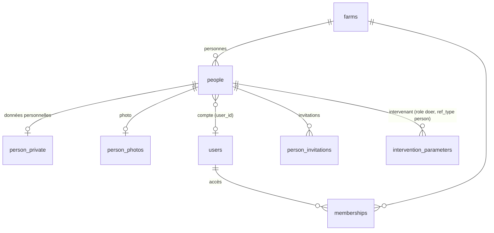
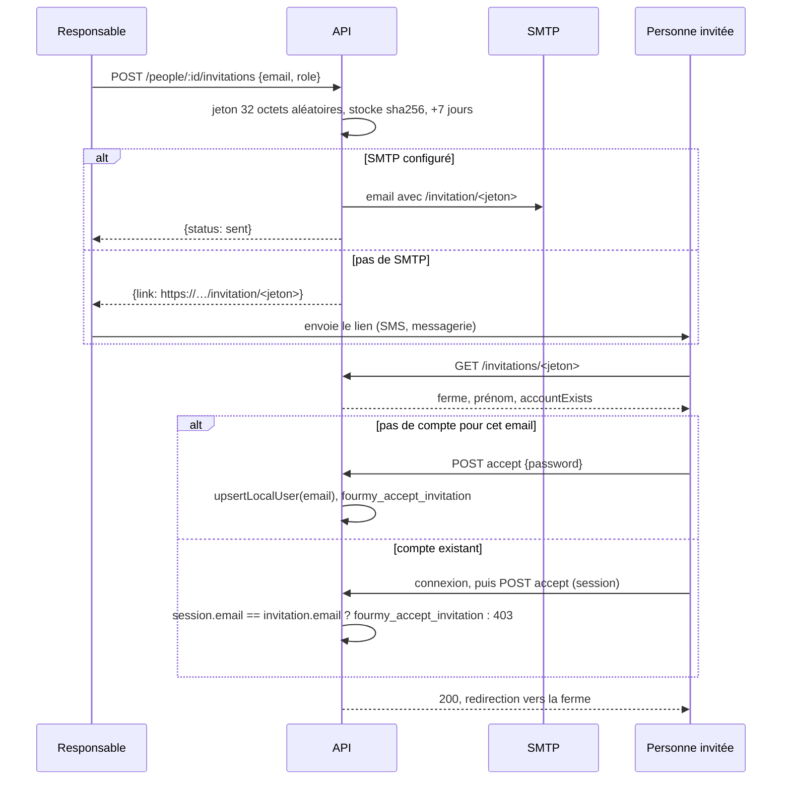

# Équipe et personnes : conception

**Statut : validée le 2026-11-12.** Les points du §11 ont été acceptés
tels quels :
- nom affiché recalculé, registres compris ;
- prénom et nom non devinés pour les fiches existantes ;
- un champ effacé dans Fourmy est complété au réimport ;
- photos Ekylibre reprises seulement si les fichiers du tenant sont
  fournis.

Besoins : [`claudedocs/besoins_equipe_personnes.md`](../claudedocs/besoins_equipe_personnes.md)
(décisions du 2026-11-12). Ce document fixe le modèle de données, les
droits, l'API, l'interface, le calcul des temps de travaux, l'import
Ekylibre et le découpage en lots.

## 1. Principes

1. **La personne est l'entité centrale.** `people` reste la table des
   personnes de la ferme. Un compte (`users`) et un accès à la ferme
   (`memberships`) s'y rattachent quand ils existent.
2. **L'accès reste porté par `memberships`.**
   - Le middleware d'authentification, la fonction `fourmy_user_farms` et
     le cloisonnement par ferme (RLS) ne changent pas de source.
   - Le lien `people.user_id` relie le profil à l'accès.
   - Invariant : **tout membre a une personne**, créée si besoin.
3. **Les données personnelles sont dans une table à part**
   (`person_private`). Une requête existante qui lit `people` (synchro,
   registres, attelages, phyto) ne peut pas les exposer par mégarde. Seules
   les routes qui vérifient le droit de les lire font la jointure.
4. **Un seul calcul des heures**, pur, dans `@fourmy/domain`. La grille, la
   fiche et la synchro mobile l'utilisent tous.
5. **L'import complète sans écraser** : une valeur déjà présente dans
   Fourmy l'emporte toujours sur celle d'Ekylibre.

## 2. Modèle de données

### 2.1 Vue d'ensemble



### 2.2 Migration `0045_people_profile.sql`

**`people`** (existante), colonnes ajoutées :

| Colonne | Type | Rôle |
|---|---|---|
| `first_name` | text ≤ 80 | prénom |
| `last_name` | text ≤ 80 | nom |
| `photo_id` | uuid → `person_photos` | photo, `ON DELETE SET NULL` |
| `certiphyto_category` | text | `decideur_entreprise`, `decideur_prestation`, `operateur`, `conseil`, `vente` |
| `certiphyto_number` | text ≤ 40 | numéro du certificat |
| `certiphyto_valid_until` | date | fin de validité |
| `external_ids` | jsonb, `{}` par défaut | `{ ekylibreEntity, ekylibreWorker, ekylibreUser }`, comme les matériels |

- **`name`** reste la colonne d'affichage, utilisée partout (registres,
  attelages, synchro). Quand le prénom ou le nom sont saisis, l'API écrit
  `name = trim(first_name || ' ' || last_name)`. Sinon, le nom saisi est
  gardé (personnes existantes).
- **`role`** (texte libre actuel) n'est plus affiché ni écrit. Il est gardé
  pour la synchro mobile v5, puis retiré au lot P5.
- **Index unique** `people (farm_id, user_id) WHERE user_id IS NOT NULL` :
  un compte, une personne par ferme.
- **Certiphyto** : il est visible de tous les membres, donc il est dans
  `people`.

**`person_private`** (nouvelle) : une ligne par personne qui en a, avec RLS
`farm_isolation`.

| Colonne | Type |
|---|---|
| `person_id` | uuid PK → `people` `ON DELETE CASCADE` |
| `farm_id` | uuid (RLS) |
| `email` | text ≤ 254 |
| `mobile` | text ≤ 30, chiffres, espaces, `+` |
| `address_line1`, `address_line2` | text ≤ 120 |
| `postal_code` | text ≤ 12 |
| `city` | text ≤ 80 |
| `country` | text, code ISO à 2 lettres, `FR` par défaut |
| `birth_date` | date |
| `contract_type` | text : `farmer`, `permanent`, `fixed_term`, `seasonal`, `apprentice`, `volunteer`, `contractor` |
| `contract_started_on`, `contract_ended_on` | date ; contrôle : début ≤ fin |
| `updated_at` | timestamptz |

**`person_photos`** (nouvelle), sur le modèle de `equipment_assets` :

| Colonne | Type |
|---|---|
| `id` | uuid PK |
| `farm_id` | uuid (RLS) |
| `media_type` | `image/png` ou `image/jpeg` |
| `bytes` | bytea |
| `size` | integer ≤ 2 Mo |
| `sha256` | text, aussi l'ETag |
| `created_at` | timestamptz |

**`person_invitations`** (nouvelle), avec RLS `farm_isolation` :

| Colonne | Type | Rôle |
|---|---|---|
| `id` | uuid PK | |
| `farm_id`, `person_id` | uuid | |
| `email` | text | adresse invitée (celle de la fiche par défaut) |
| `role` | text : `owner`, `worker`, `reader` | rôle donné à l'acceptation |
| `token_hash` | text unique | SHA-256 du jeton ; le jeton lui-même n'est jamais stocké |
| `expires_at` | timestamptz | création + 7 jours |
| `created_by` | uuid → `users` | |
| `accepted_at`, `revoked_at` | timestamptz | |
| `sent_by_email` | boolean | faux : lien copié par le responsable |

- Une seule invitation ouverte par personne : index unique partiel
  `WHERE accepted_at IS NULL AND revoked_at IS NULL`. Une nouvelle
  invitation révoque la précédente.

**`memberships.role`** : la contrainte devient
`role IN ('owner', 'worker', 'reader')`.

**Fonctions `SECURITY DEFINER`** (même motif que `fourmy_user_farms`, et
`EXECUTE` à `fourmy_app` seulement), pour l'acceptation qui a lieu hors
contexte de ferme :

- `fourmy_invitation(p_token_hash text)` : ferme (id, nom), prénom de la
  personne, email, rôle, état (ouverte, expirée, acceptée, révoquée) ;
- `fourmy_accept_invitation(p_token_hash text, p_user uuid)`, dans une
  seule transaction :
  - vérifie l'invitation ouverte et non expirée ;
  - crée le `membership` (ou met à jour son rôle) ;
  - relie `people.user_id` ;
  - marque l'invitation acceptée.

### 2.3 Reprise des données existantes (même migration)

1. **Comptes sans personne.** Pour chaque `membership` sans personne liée
   sur sa ferme, une personne est créée : `name` = `users.name`, sinon la
   partie de l'email avant `@` ; `user_id` = le compte. C'est le cas de la
   ferme de Pierre.
2. **Doublons.** Si deux personnes d'une ferme pointent le même compte (pas
   d'index jusqu'ici), la plus ancienne garde le lien. Le doublon est signalé
   au journal de migration, sans données personnelles.
3. **Prénom et nom.** Rien n'est découpé automatiquement : on ne devine pas
   le prénom dans « Pierre Haurigot ». La fiche propose de les saisir.

## 3. Droits

### 3.1 Rôles

| | Responsable (`owner`) | Salarié (`worker`) | Lecture seule (`reader`) |
|---|---|---|---|
| Lire la ferme, les registres, les exports | oui | oui | oui |
| Saisir (interventions, stocks…) | oui | oui | **non** |
| Grille et fiches de l'équipe (nom, photo, rôle, Certiphyto, heures) | oui | oui | oui |
| Données personnelles d'un autre | **oui** | non | non |
| Ses propres données personnelles | lire et modifier | lire ; modifier contact et photo | lire ; modifier contact et photo |
| Contrat, Certiphyto, date de naissance, identité | modifier | lire (les siens) | lire (les siens) |
| Inviter, changer un rôle, retirer un accès | oui | non | non |

### 3.2 Mise en œuvre

- **`reader`** : un garde central, dans le middleware de ferme
  (`context.ts`), refuse en 403 toute méthode autre que `GET` et `HEAD`.
  - Exceptions explicites : les routes du compte lui-même, à savoir
    `PATCH /people/:id` sur sa propre personne (contact) et
    `PUT|DELETE /people/:id/photo` sur la sienne.
  - Les exports de registres sont des `GET` : ils restent permis.
  - Les 25 routes d'écriture ouvertes aux salariés aujourd'hui n'ont donc
    pas à être annotées une par une.
- **Données personnelles** : un helper `canSeePrivate(c, person)` renvoie
  vrai si le rôle est `owner` ou si `person.user_id` est le compte
  connecté.
  - La route ne fait la jointure avec `person_private` que si c'est vrai.
  - Sinon, le champ `private` est **absent** de la réponse : ni `null` ni
    vide, pour ne rien laisser deviner.
- **`Role`** (TypeScript) devient `"owner" | "worker" | "reader"`. Le web
  masque les boutons de saisie pour `reader` grâce à un hook `useCanWrite()`.
  Ce n'est qu'un confort : l'API reste la garde.

## 4. API

Toutes les routes sont sous `/api/v1/farms/:farm`, sauf mention contraire.
Les contrats sont dans `packages/contracts/src/people.ts`, nouveau
fichier ; `Person` et `personWrite` y sont déplacés.

### 4.1 Lecture

| Route | Réponse |
|---|---|
| `GET /people?at=AAAA-MM-JJ&active=&account=&role=&q=` | `{ items: PersonCard[] }` pour la grille |
| `GET /people/:id?at=` | `PersonSheet` |
| `GET /people/:id/photo` | image, `ETag` = sha256, cache privé ; 404 sans photo |
| `GET /people/:id/work?at=` | `PersonWork` : totaux, mois, activités, procédures |
| `GET /people/:id/interventions?from=&to=&cursor=` | `{ items: PersonIntervention[], nextCursor }` |

```ts
// Carte de la grille (tous les membres).
PersonCard = {
  id; name; firstName; lastName; active;
  photo: { hash } | null;
  account: { status: "none" | "invited" | "active"; role: "owner" | "worker" | "reader" | null };
  certiphyto: { status: "none" | "valid" | "expiring" | "expired"; validUntil: date | null };
  monthHours: number;                 // mois de `at`
  lastIntervention: { id; date; procedure } | null;  // réalisée, au plus tard `at`
}
// Fiche : la carte, plus le Certiphyto détaillé, et `private` si permis.
PersonSheet = PersonCard & {
  certiphyto: { category; number; validUntil; status };
  external: { ekylibre: boolean };
  private?: {                          // absent si non permis (§3.2)
    email; mobile; address: { line1; line2; postalCode; city; country };
    birthDate; contract: { type; startedOn; endedOn };
    invitation: { status; email; expiresAt; sentByEmail } | null;  // responsable seulement
  };
}
PersonWork = {
  at; periods: { week: Bucket; month: Bucket; campaign: Bucket & { campaignId; label }; last12: Bucket };
  byMonth: { month: "AAAA-MM"; hours }[];   // 12 derniers mois
  byActivity: { activityId | null; name; hours }[];   // sur la campagne
  byProcedure: { procedure; hours }[];              // sur la campagne
}
Bucket = { from; to; hours }
PersonIntervention = { id; date; procedure; hours; parcels: string[]; equipments: string[] }
```

- **Statut du Certiphyto** à la date `at` :
  - `expired` si `validUntil < at` ;
  - `expiring` si `validUntil` tombe moins de 90 jours après `at` ;
  - `valid` sinon ;
  - `none` sans date.

### 4.2 Écriture

| Route | Qui | Corps |
|---|---|---|
| `POST /people` | responsable | `{ firstName, lastName, name?, active?, certiphyto?, private? }`, 201 |
| `PATCH /people/:id` | responsable : tout ; soi-même : `private.email`, `private.mobile`, `private.address` | champs partiels |
| `PUT /people/:id/photo` | responsable, ou soi-même | octets PNG ou JPEG (`content-type`), 2 Mo au plus |
| `DELETE /people/:id/photo` | idem | |
| `DELETE /people/:id` | responsable | 204 si aucun historique ; sinon anonymisation (§4.4), 200 |
| `POST /people/:id/invitations` | responsable | `{ email?, role }` → `{ status, link?, sentByEmail, expiresAt }` |
| `DELETE /people/:id/invitations` | responsable | révoque l'invitation ouverte |
| `PATCH /people/:id/account` | responsable | `{ role }` ; refusé s'il ne reste aucun responsable |
| `DELETE /people/:id/account` | responsable | retire l'accès (`membership`) ; garde la personne et `user_id` à null |

- **Photo** : le navigateur la recadre et la réduit (canvas, 256 × 256,
  JPEG à 0,85), comme le logo raster des matériels. L'API vérifie la
  signature des octets (PNG ou JPEG), la taille, et calcule le sha256.
- **Lien d'invitation** : il n'est renvoyé que si aucun email n'a été
  envoyé (pas de SMTP, ou envoi en échec). Il n'est jamais journalisé.
- **Routes `/members` existantes** :
  - `GET /members` est conservée, en lecture ;
  - `POST /members` (compte existant) crée ou relie aussi la personne ;
  - les autres routes renvoient vers les nouvelles ;
  - elles sont à retirer au lot P5, après la page Équipe.

### 4.3 Invitations, hors ferme

| Route | Session | Rôle |
|---|---|---|
| `GET /api/v1/invitations/:token` | non | `{ farmName, firstName, email, role, status, accountExists }` |
| `POST /api/v1/invitations/:token/accept` | facultative | crée le compte ou relie celui de la session |



- **Création de compte à l'acceptation.** Elle est permise même avec
  `FOURMY_ALLOW_SIGNUP` désactivé : c'est l'invitation qui l'autorise, et
  la création passe par `upsertLocalUser`, pas par l'inscription publique
  de better-auth.
- **Mot de passe** : 10 caractères au moins, comme ailleurs.
- **Email de l'invitation** : texte simple, sans données personnelles
  autres que le prénom et le nom de la ferme. Le lien pointe vers
  `PUBLIC_URL/invitation/<jeton>`.

### 4.4 Effacement

- **Sans historique** (aucun paramètre d'intervention, membre d'attelage
  type ni accès) : `DELETE` supprime la personne. La photo et les données
  personnelles partent en cascade.
- **Avec historique** : anonymisation dans une transaction.
  - `name` devient « Personne anonymisée n » ; prénom, nom, Certiphyto et
    `external_ids` sont effacés.
  - `person_private` et la photo sont supprimés, les invitations révoquées,
    l'accès retiré.
  - `active` passe à faux.
  - Les interventions et les heures restent : les registres
    réglementaires gardent un intervenant, anonymisé.
  - Une ligne d'audit est écrite, sans les valeurs effacées.

## 5. Temps de travaux

### 5.1 Fonction du domaine

Dans `packages/domain/src/work-time.ts` :

```ts
type WorkEntry = { interventionId: string; from: number; to: number }; // une plage d'une intervention
type Attributed = { interventionId: string; seconds: number };

/** Union des plages (heures réellement travaillées) et part de chaque intervention. */
export function workTime(entries: WorkEntry[]): { totalS: number; byIntervention: Attributed[] };
/** Même calcul, découpé par tranches [from, to[ (jours, mois). */
export function workTimeBuckets(entries: WorkEntry[], buckets: { key: string; from: number; to: number }[]): Record<string, number>;
```

- **Balayage** des bornes triées. Sur chaque segment élémentaire où `k`
  plages sont ouvertes, la durée compte une fois dans le total, et `1/k`
  de la durée est attribuée à chacune des `k` interventions.
- **Propriété** : la somme des parts est égale au total. La répartition
  par activité et par procédure retombe donc sur le total (critère 6).

### 5.2 Entrées (SQL)

Une requête par appel lit les périodes d'une ou plusieurs personnes,
bornées à la fenêtre demandée :

```sql
SELECT me.ref_id AS person_id, i.id AS intervention_id, i.procedure, w.started_at, w.stopped_at
FROM intervention_parameters me
JOIN interventions i ON i.id = me.intervention_id AND i.status = 'done'
JOIN intervention_periods w ON w.intervention_id = i.id
 AND (i.staffing = 'free' OR w.crew_id = me.crew_id)
WHERE me.role = 'doer' AND me.ref_type = 'person' AND me.ref_id = ANY($people)
  AND w.stopped_at > $from AND w.started_at < $to
```

- C'est la même règle d'attelage que pour les outils attelés
  (`hitches`).
- Les plages sont coupées aux bornes de la fenêtre avant le calcul.
- **Index à vérifier au lot P2** :
  `intervention_parameters (ref_type, ref_id) WHERE role = 'doer'`.

### 5.3 Répartition par activité

Aucune règle n'existe encore dans Fourmy : elle est définie ici.

1. **Cibles** : les parcelles cibles de l'intervention (paramètres
   `target`, `land_parcel`).
2. **Poids** : l'aire de la zone travaillée (`working_zone`) si elle
   existe, sinon l'aire de la parcelle à la date de l'intervention.
3. **Activité** : celle de la production de la parcelle dans la campagne
   qui contient la date de début de l'intervention (`productions` +
   `campaigns`).
4. **Part** : la part de l'intervention (§5.1) est répartie au prorata des
   poids. Les parcelles sans production, et les interventions sans
   parcelle, vont dans « Sans activité ».

Pour la répartition par procédure, toute la part de l'intervention va à
sa procédure.

### 5.4 Fenêtres

À partir de la date `at` (frise) :

| Fenêtre | Bornes |
|---|---|
| Semaine | du lundi au dimanche contenant `at` |
| Mois | le mois civil de `at` |
| Campagne | la ligne `campaigns` de la ferme qui contient `at`, sinon l'année civile |
| 12 derniers mois | les 12 mois civils jusqu'au mois de `at` inclus |

- Les bornes sont calculées en heure de Paris, comme le reste de
  l'interface. Les plages sont stockées en UTC.
- **Grille** : un seul appel lit le mois de toutes les personnes affichées.
  Le calcul se fait en TypeScript ; il reste léger pour 50 personnes et un
  mois.

## 6. Interface web

### 6.1 Routes

- `/f/:farm/team` : la grille.
- `/f/:farm/team/:personId?tab=general|work` : la fiche. Elle remplace la
  page actuelle (`TeamPage.tsx`).
- `/invitation/:token` : page publique, hors gabarit de ferme.
  - Elle montre la ferme et le prénom.
  - Sans compte : formulaire « choisir un mot de passe ».
  - Avec un compte : « se connecter pour accepter ».

### 6.2 Composants

Dans `apps/web/src/features/team/` :

| Fichier | Rôle |
|---|---|
| `TeamPage.tsx` | grille `SimpleGrid` (`cols={{ base: 1, sm: 2, md: 3, xl: 4 }}`), filtres, recherche, « Ajouter une personne » |
| `PersonCard.tsx` | le pavé : avatar, nom, rôle, heures du mois, dernière intervention, badges ; carte cliquable (lien, clavier) |
| `PersonAvatar.tsx` | photo, ou initiales sur une couleur tirée de l'id (palette du thème) |
| `PersonSheetPage.tsx` | en-tête et onglets, sur le modèle de `EquipmentSheetPage` |
| `PersonGeneralTab.tsx` | identité, coordonnées, contrat, Certiphyto, compte |
| `PersonWorkTab.tsx` | quatre totaux, barres par mois, répartitions, liste paginée |
| `PersonForm.tsx` | création et modification (champs selon les droits) |
| `PhotoPicker.tsx` | choix, recadrage carré et réduction (canvas) |
| `InvitePanel.tsx` | inviter, renvoyer, copier le lien, révoquer, rôle, retirer l'accès |
| `../auth/InvitationPage.tsx` | acceptation |

- Les barres par mois suivent la skill `dataviz` : une seule série et des
  libellés de mois.
- Les intervenants proposés dans les formulaires (interventions, attelages)
  restent la liste `GET /people` des personnes actives, inchangée côté
  données.

## 7. Import Ekylibre

### 7.1 Extraction (`extract.ts`)

- **`people(s)`** : les entités liées à un intervenant ou à un
  utilisateur :
  - `products.type = 'Worker'` → `person_id` ;
  - `users.person_id`.
- **Champs repris** :
  - identité : `first_name`, `last_name`, `full_name`, `born_at` ;
  - photo : `picture_file_name` ;
  - identifiants Ekylibre : du worker (`products.id`), de l'utilisateur
    (`users.id`), et `users.email`.
- **`addresses(s)`** : `entity_addresses` non supprimées, des canaux
  `email`, `mobile` et `mail`, avec `by_default` et `updated_at`.
  - Le canal `phone` (fixe) n'est pas repris : le besoin parle du
    portable.
- **`contracts(s)`** : `worker_contracts`. On reprend `started_at`,
  `stopped_at` et `nature`, et ni le salaire ni la durée mensuelle (hors
  besoin, et sensibles).

### 7.2 Correspondance

| Ekylibre | Fourmy |
|---|---|
| entité d'un Worker ou d'un utilisateur | une personne. Identifiant : `id("products", worker.id)` s'il y a un Worker, comme aujourd'hui (les interventions déjà importées restent reliées) ; sinon `id("entities", entity.id)` |
| `first_name`, `last_name` | `first_name`, `last_name` ; `name` recalculé |
| `born_at` | `person_private.birth_date` |
| adresse `email` | `person_private.email` ; sinon `users.email` |
| adresse `mobile` | `person_private.mobile` |
| adresse `mail` | lignes 1 à 6 : la dernière ligne non vide contient « code postal + ville » (format Ekylibre) et donne `postal_code` et `city` ; les lignes précédentes, hors nom, donnent `address_line1` et `line2` ; `mail_country` donne `country` |
| `worker_contracts` (le plus récent) | `contract_*`. `nature` : `permanent_worker` → `permanent`, `temporary_worker` → `fixed_term`, `seasonal`, … ; sinon vide |
| `picture_file_name` | photo, si `EKYLIBRE_FILES_DIR` pointe sur les fichiers du tenant ; sinon ignorée et comptée |
| utilisateur Ekylibre | **aucun compte, aucun accès** ; `administrator` noté dans le rapport |

**Choix d'une adresse par canal** : celle qui a `by_default`, sinon la plus
récente (`updated_at`).

### 7.3 Écriture

- Chaque champ est écrit en `coalesce(valeur Fourmy, valeur Ekylibre)`,
  pour `people` comme pour `person_private`.
  - Un champ effacé volontairement dans Fourmy est donc complété au
    réimport suivant. La limite est acceptée et documentée.
- `external_ids` est fusionné (`||`).
- **Rapport** (`counts`), sans aucune valeur :
  - `people` (créées), `people_completed` ;
  - `people_email`, `people_mobile`, `people_address`, `people_birth_date`,
    `people_contract` ;
  - `people_photo`, `people_photo_missing` ;
  - `ekylibre_admins`.
- **Fixtures** (`export-fixture.ts`) : prénoms, noms et coordonnées
  remplacés par des valeurs fictives déterministes ; pas de date de
  naissance.

## 8. Synchro mobile

- La collection `people` garde ses champs actuels, sans coordonnées. Elle
  ajoute :
  - `first_name`, `last_name` ;
  - `photo_hash`, pour aller chercher la photo par
    `GET /people/:id/photo` ;
  - `certiphyto_status`.
- ~~Nouveau bucket `me`~~ — **remplacé au lot P5** par la route
  `GET /people/me` (WatermelonDB prend chaque clé de `changes` pour une
  table locale : une clé `me` ferait échouer le pull). Elle renvoie, au seul
  compte connecté :
  - sa fiche, `private` compris ;
  - son `PersonWork` à la date du pull (semaine, mois, campagne).
- Côté zero-mobile (dépôt séparé, branche `fourmy-backend`) : un écran
  « Ma fiche », à part de ce lot.

## 9. Lots

| Lot | Contenu | Critères (besoins §5) |
|---|---|---|
| **P1 Modèle et grille** | migration 0045 et reprise ; rôle `reader` et garde central ; contrats `people.ts` ; `GET /people` (cartes), `GET /people/:id`, `POST`, `PATCH`, photo ; grille, fiche Général, formulaire ; e2e grille → fiche | 1, 2, 4, 5, 7 |
| **P2 Temps de travaux** | `work-time.ts` et tests (chevauchements, prorata) ; `/work`, `/interventions` ; onglet Temps ; heures et dernière intervention sur les cartes | 6 |
| **P3 Invitations** | table, fonctions SQL, routes, email ou lien, page `/invitation/:token`, effacement et anonymisation | 3 |
| **P4 Import Ekylibre** | extraction, correspondance, rapport, fixtures anonymisées ; test sur les fixtures et sur la source Entre-deux-Terres | 8 |
| **P5 Mobile et nettoyage** | bucket `me`, champs `people` ; retrait des routes `/members` et de `people.role` ; mise à jour de docs/interventions.md §7.1 | 9, 10 |

Les lots P1, P2 et P3 sont utilisables l'un après l'autre. P4 peut avancer
en parallèle de P2 et P3.

## 10. Tests

- **Domaine** (`work-time.test.ts`) :
  - plages disjointes, chevauchantes, incluses, identiques ;
  - somme des parts = total ;
  - découpage par mois à cheval sur deux mois ;
  - changement d'heure d'octobre.
- **API** :
  - droits : un salarié et un lecteur ne reçoivent pas `private`, y compris
    sur `GET /people/:id` ; un lecteur reçoit 403 sur toute écriture, sauf
    sur sa propre fiche ;
  - reprise des comptes sans personne ;
  - photo : type, taille, ETag ;
  - invitation : envoi par email (transport simulé) ou lien, expiration,
    réutilisation refusée, email différent refusé, compte créé, historique
    gardé ;
  - anonymisation ;
  - heures sur des interventions de test.
- **Migrateur** :
  - fixture avec intervenant, utilisateur, et entité commune aux deux ;
  - adresses multiples ;
  - réimport sans doublon et sans écrasement.
- **Web** :
  - grille : pavés, filtres, carte cliquable au clavier ;
  - fiche : bloc Coordonnées absent pour un salarié ;
  - formulaire selon les droits ;
  - page d'invitation.
- **e2e** : création → intervention réalisée → heures sur la fiche ;
  invitation par lien → compte → même personne.

## 11. Points d'attention

- **`name` reste la clé d'affichage** : les registres réglementaires
  (phyto, fertilisation) l'impriment. Recalculer `name` depuis le prénom
  et le nom change donc les registres déjà émis. C'est voulu : c'est la
  même personne.
- **Index unique `people (farm_id, user_id)`** : la migration doit
  résoudre les doublons avant de le créer (§2.3).
- **better-auth** : un compte créé à l'acceptation n'a pas d'email
  vérifié. On met `email_verified = true`, puisque le lien reçu fait foi.
- **Courriels** : le bouton « Inviter » reste disponible sans SMTP (mode
  lien). L'interface dit clairement quel mode s'applique.

## 12. Réalisation

### Lot P1 (2026-11-12)

- **Base** : migration `0045_people_profile.sql`.
  - Profil, Certiphyto et `external_ids` sur `people`.
  - Tables `person_private` et `person_photos`, avec RLS.
  - Rôle `reader`.
  - Un compte, une personne par ferme : index unique, doublons résolus.
  - Personnes créées pour les comptes qui n'en avaient pas.
- **Tout membre a une personne**, garanti aussi à la lecture
  (`ensureMemberPeople`) : comptes de tests, `seed-dev`, fermes importées.
  `POST /members` crée la personne, ou relie celle de la fiche
  (`personId`).
- **API** :
  - `apps/api/src/repos/people.ts` et `routes/people.ts` : grille, fiche,
    création, modification selon les droits, photo, rôle et retrait de
    l'accès ;
  - garde « lecture seule » central dans `context.ts` ;
  - l'ancien format `POST /people` (`name`, `role`, `userId`) reste
    accepté.
- **Contrats** : `packages/contracts/src/people.ts`.
- **Web** :
  - `features/team/` : grille de pavés, fiche (Identité, Coordonnées,
    Certiphyto, Compte Fourmy), formulaire selon les droits, photo
    recadrée dans le navigateur ;
  - route `/team/:personId`.
- **Tests** :
  - `apps/api/test/people.integration.test.ts` : droits sur les données
    personnelles, lecture seule, photo, compte ;
  - `apps/web/test/team.test.tsx`.
- **En attente** :
  - masquage des boutons de saisie pour un lecteur dans le reste de
    l'application (`useCanWrite`, prêt). L'API refuse déjà ces écritures.

### Lot P2 (2026-11-12)

- **Domaine** : `packages/domain/src/work-time.ts`.
  - `workTime` : union des plages, part de chaque intervention.
  - Fenêtres en heure de Paris : semaine, mois, 12 mois, campagne.
  - Tests dans `test/work-time.test.ts` : chevauchements, mois à cheval,
    passage à l'heure d'hiver.
- **API** : `apps/api/src/repos/people-work.ts`.
  - `GET /people/:id/work?at=` : totaux, mois, activités, procédures.
  - `GET /people/:id/interventions?from=&to=&cursor=&limit=` : la liste
    paginée.
  - Les pavés reçoivent les heures du mois et la dernière intervention
    réalisée.
  - Visibles de tous les membres.
- **Web** : onglet « Temps de travaux » de la fiche (`PersonWorkTab.tsx`).
  - Quatre totaux.
  - Barres par mois, avec leurs valeurs aussi en texte.
  - Répartitions par activité et par type de travail.
  - Liste des interventions (mois, campagne ou 12 mois), avec un lien vers
    chacune.
- **Vérifié** sur la ferme de Pierre : 148,9 h sur la campagne 2026, dont
  128 h en avril. Le broyage du 05/10 compte pour 1,4 h.
- **Tests** :
  - `apps/api/test/people-work.integration.test.ts` : chevauchement
    partagé, prorata par activité, sommes égales au total, pavés,
    pagination ;
  - `apps/web/test/team.test.tsx`.

### Lot P3 (2026-11-12)

- **Base** : migration `0046_person_invitations.sql`.
  - Table `person_invitations`, avec RLS : seul le SHA-256 du jeton est
    stocké, et une seule invitation ouverte par personne.
  - Fonctions `fourmy_invitation` et `fourmy_accept_invitation` (`SECURITY
    DEFINER`, exécutées en `fourmy_app`).
- **API** : `repos/invitations.ts`, `routes/invitations.ts`.
  - `POST` et `DELETE /people/:id/invitations` (responsable). Email si SMTP,
    sinon le lien est renvoyé une seule fois. Un envoi en échec renvoie
    aussi le lien.
  - Routes publiques `GET /api/v1/invitations/:token` et
    `POST …/accept`.
  - Création de compte stricte (`createLocalUserIfAbsent`) : un lien
    d'invitation ne remplace jamais le mot de passe d'un compte existant.
    Ce compte doit se connecter et avoir le même email.
  - `DELETE /people/:id` : suppression sans historique, anonymisation
    sinon. Le dernier responsable reste.
  - Pavés et fiche : état « Invitée » ; invitation en cours visible du
    responsable.
- **Web** :
  - panneau « Compte Fourmy » : inviter, renvoyer, copier le lien,
    annuler, changer le rôle, retirer l'accès ;
  - bouton « Supprimer » avec explication ;
  - page publique `/invitation/:token` ;
  - retour après connexion (`/login?next=`, chemin interne seulement).
- **Tests** :
  - `apps/api/test/invitations.integration.test.ts` : lien, email
    (transport simulé), acceptation, usage unique, compte existant et autre
    email refusés, révocation, expiration, effacement ;
  - `apps/web/test/team.test.tsx`.

### Lot P4 (2026-11-12)

- **Extraction** : `people`, `personAddresses`, `personContracts`
  (`packages/migrator-ekylibre/src/extract.ts`), en lecture seule.
- **Correspondance** (`src/people.ts`, fonctions pures) :
  - adresse postale : ligne 1 = nom ; dernière ligne au format
    « Commune, CP » ou « CP Commune » ;
  - pour chaque canal, l'adresse par défaut, sinon la plus récente ;
  - email du compte utilisateur à défaut ;
  - portable illisible ignoré ;
  - contrat le plus récent, nature traduite ;
  - photo lue dans les fichiers du tenant (`EKYLIBRE_FILES_DIR` ou
    l'option `filesDir`, chemins Paperclip).
- **Écriture** (`src/migrate.ts`) :
  - une personne par Worker, avec le même identifiant qu'avant, ou par
    utilisateur sans Worker ;
  - tous les champs en `coalesce(Fourmy, Ekylibre)` ;
  - `external_ids` fusionnés.
- **Rapport** : `people`, `people_completed`, `people_email`,
  `people_mobile`, `people_address`, `people_birth_date`,
  `people_contract`, `people_photo`, `people_photo_missing`,
  `ekylibre_admins`. Il ne contient aucune valeur.
- **Fixtures** : prénom, nom, photo, Certiphyto et liens Ekylibre retirés
  à l'export ; `person_private` n'est pas exporté.
- **Vérifié** le 2026-11-12 sur Entre-deux-Terres, dans une base jetable :
  - 14 personnes (9 intervenants, 7 utilisateurs) ;
  - 8 emails, 1 portable, 2 adresses, 1 date de naissance ;
  - un email modifié dans Fourmy est gardé au réimport ;
  - les 138 intervenants des interventions restent rattachés à des
    personnes.
- **Tests** : `packages/migrator-ekylibre/test/people.test.ts`.
- **Utilisateurs Ekylibre** : chacun devient une personne **sans
  compte**. S'il est déjà membre de la ferme sous le même email (par
  exemple le responsable qui a importé la ferme), c'est sa personne qui est
  complétée, sans doublon. Un utilisateur qui est aussi intervenant garde
  la fiche de l'intervenant (son historique) : s'il a aussi un compte
  Fourmy, invitez cette fiche pour relier les deux.

### Lot P5 (2026-11-12)

- **Synchro mobile** : la collection `people` porte `first_name`,
  `last_name`, `photo_hash` et `certiphyto_status`, sans aucune
  coordonnée. `role` reste dans le format, toujours `null`, pour le schéma
  mobile v5.
- **`GET /people/me?at=`** : la fiche du compte connecté (coordonnées
  comprises) et ses heures (`{ sheet, work }`), pour l'écran « Ma fiche »
  de zero-mobile.
- **Nettoyage** :
  - migration `0047_people_drop_role.sql` : le rôle libre des personnes
    est supprimé ;
  - routes `POST|PATCH|DELETE /members` retirées : les accès se gèrent sur
    la fiche (invitation, rôle, retrait) ;
  - `GET /members` reste, pour les destinataires des alertes d'entretien ;
  - la décision §7.1 de `interventions.md` est revue (lot P4).
- **Tests** :
  - synchro : aucune coordonnée, nouveaux champs ;
  - `/people/me` ;
  - autorisations réécrites sur les invitations et les routes de compte.
- **Reste, hors de ce dépôt** : l'écran « Ma fiche » de zero-mobile
  (branche `fourmy-backend`), qui lit `GET /people/me` et affiche les
  nouveaux champs de `people`.
