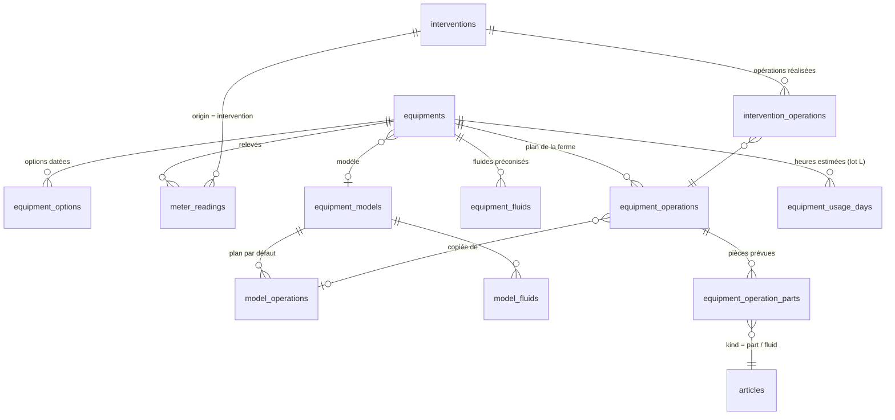
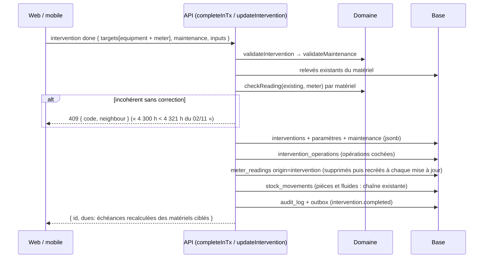

# Matériels et entretien — design

> Produit par `/sc:design` le 2026-11-08, à partir des exigences
> [`materiels-entretien.md`](materiels-entretien.md) (FR-MAT-4 à 73, NFR-MAT,
> arbitrages des §6 et §8).
> Il est découpé en lots **I → J → K → L**, dans l'ordre validé.
> Phase suivante : `/sc:implement` lot par lot.

## 1. Principes

1. **Les échéances sont calculées, jamais stockées.**
   - Une fonction pure du domaine (`@fourmy/domain`) les calcule à partir :
     - du plan ;
     - des réalisations (interventions `done`) ;
     - des relevés.
   - Le résultat est identique sur l'API, le web et le mobile, et peut
     être rejoué à n'importe quelle date (NFR-MAT-5, FR-TIME-1).
   - Annuler ou corriger une intervention suffit à tout recalculer
     (US-MAT-9).
2. **Les heures d'usage forment une échelle continue.** Les relevés bruts
   restent tels que saisis. Un **remplacement de compteur** ouvre un
   nouveau segment.
   - Le domaine convertit les relevés en heures d'usage cumulées.
   - Les échéances comparent des heures d'usage, jamais des valeurs brutes
     de compteur.
3. **Les relevés réels priment.** Origines `manual`, `intervention` et
   `reference`.
   - Les heures estimées (Traccar, lot L) sont des **durées de
     fonctionnement par jour**, pas des valeurs de compteur.
   - Elles ne servent qu'après le dernier relevé réel et sont recalées
     dessus.
   - Couper l'intégration ne supprime rien (FR-MAT-14).
4. **Le plan appartient à la ferme.** Appliquer un modèle **copie** ses
   opérations sur le matériel.
   - Le modèle n'est jamais modifié par la ferme (FR-MAT-22).
   - Chaque copie garde le lien vers l'opération du modèle, pour comparer
     plus tard.
5. **L'intervention reste l'unique journal** (FR-MAT-30).
   - La forme `maintenance` reçoit un bloc `maintenance` (nature, problème,
     atelier, opérations réalisées) et des relevés par matériel.
   - Pièces et fluides sont des intrants ordinaires, avec la sortie de stock
     déjà en place.
6. **Les conventions déjà en place s'appliquent.**
   - Tables `farm_id` sous RLS (`withFarm`), identifiant client et
     idempotence.
   - Audit (`audit_log`), outbox, code en anglais, textes en français.

## 2. Modèle de données



### 2.1 Lot I — migration `0017_equipments.sql`

**`equipments`** : colonnes ajoutées (rien n'est retiré, `kind` garde la
nature Ekylibre).

| Colonne | Type | Rôle |
|---|---|---|
| `brand`, `model` | text | marque, modèle (« CLAAS », « ARION 430 ») |
| `serial_number` | text | n° de série |
| `manufacturer_type` | text | type constructeur (« A21 »), type mine |
| `year` | int | année |
| `model_id` | uuid → `equipment_models` (lot J) | modèle catalogue, facultatif |
| `meter_unit` | text NULL, CHECK `'hours'` | `NULL` = pas de compteur (FR-MAT-72) |
| `commissioned_at` | timestamptz | mise en service (départ des échéances sans réalisation) |
| `aggregates` | jsonb | `[{ organ, designation, serial }]` (moteur, boîte, ponts…) |
| `technical` | jsonb | fiche technique sourcée, format `fiche_technique.json` (FR-MAT-5, NFR-MAT-3) |
| `external_ids` | jsonb | `{ traccar?, karnott?, manufacturer? }` (NFR-MAT-6) |

Valeur par défaut de `meter_unit` :
- `'hours'` pour `tractor` et `self_propelled_equipment` ;
- `NULL` pour les autres natures.

La migration remplit les matériels existants selon cette règle.

**`equipment_options`** : options montées, datées (FR-MAT-4).

```
id, farm_id, equipment_id → equipments ON DELETE CASCADE,
code text            -- 'front_linkage', 'front_pto'… (anglais)
label text, valid tstzrange, source jsonb
EXCLUDE (equipment_id WITH =, code WITH =, valid WITH &&)
```

**`meter_readings`** : relevés (FR-MAT-10 à 12).

```
id uuid PK, farm_id, equipment_id → equipments ON DELETE CASCADE,
read_at timestamptz NOT NULL,
value numeric NOT NULL CHECK (value >= 0),        -- valeur affichée au compteur
origin text CHECK IN ('manual','intervention','reference','traccar'),
correction text NULL CHECK IN ('fix','replacement'),
correction_reason text,                          -- obligatoire si correction
intervention_id uuid NULL → interventions ON DELETE CASCADE,
client_id text, author text, note text, created_at,
UNIQUE (farm_id, client_id),                     -- synchro mobile idempotente
CHECK ((correction IS NULL) = (correction_reason IS NULL)),
CHECK ((origin = 'intervention') = (intervention_id IS NOT NULL))
INDEX (equipment_id, read_at)
```

- `reference` sert à amorcer un matériel : compteur connu à une date, sans
  intervention.
- `fix` corrige une saisie fausse : les relevés suivants se comparent à
  lui.
- `replacement` signale un compteur neuf : la valeur repart, et l'échelle
  d'usage continue (§3.1).
- `traccar` est réservé à un vrai compteur remonté par le boîtier, plus
  tard. Les estimations vont dans `equipment_usage_days` (lot L).

`articles.kind` : la contrainte s'étend à `'part'` et `'fluid'` dès le lot I,
pour que les pièces importées existent avant le plan.
- Les références constructeur vont dans `articles.custom` :
  `{ reference, referenceNorm, family, catalog: { group, plate, item } }`.

### 2.2 Lot J — migration `0018_maintenance_plans.sql`

**Catalogue des modèles** : tables globales, sans `farm_id`, lues par tous,
écrites par l'import. Elles suivent le modèle des tables `lexicon_*`.

```
equipment_models (id uuid, slug text UNIQUE 'claas-arion-430', brand, model,
                  manufacturer_type, serial_from, serial_to, sources jsonb,
                  imported_at)
model_operations (id, model_id, code 'OP01', manual_number, label,
                  kind CHECK IN ('inspection','cleaning','greasing','replacement',
                                 'oil_change','adjustment','bleeding'),
                  every_hours numeric, every_months int,
                  first_hours numeric, first_months int,   -- visites initiales
                  performer CHECK IN ('member','workshop'),
                  organ text, requires_option text, absent_options text[],
                  condition text, source jsonb NOT NULL,   -- { id, page } NFR-MAT-3
                  parts jsonb, fluids jsonb, position int)
model_fluids (id, model_id, organ, fluid, standard, viscosity,
              capacity_l numrange, drain_capacity_l numeric, source jsonb)
```

**Plan de la ferme** : tables sous RLS.

```
equipment_operations (id, farm_id, equipment_id → CASCADE,
                      model_operation_id NULL → model_operations,
                      code, label, kind, every_hours, every_months,
                      first_hours, first_months, performer, organ,
                      requires_option, condition, source jsonb,
                      baseline_at timestamptz, baseline_hours numeric,  -- « dernière fois connue »
                      archived_at timestamptz, position int)
equipment_operation_parts (id, farm_id, operation_id → CASCADE,
                           article_id → articles, quantity numeric, unit text)
equipment_fluids (id, farm_id, equipment_id → CASCADE, organ, fluid,
                  standard, viscosity, capacity_l numrange,
                  drain_capacity_l numeric, article_id NULL → articles,
                  source jsonb)
```

- **Périodicité** : `every_hours` et/ou `every_months`. La première
  atteinte des deux s'applique (pas de km, arbitrage 5).
- **`first_*`** : visite initiale, comptée une seule fois depuis la mise en
  service (FR-MAT-21).
- **Opération ponctuelle** : pas de périodicité, seulement `first_*` ou une
  échéance fixe (`baseline_*`).
- **`baseline_*`** : amorce une échéance sans intervention (« dernière
  vidange à 4 200 h en mars »). Une réalisation plus récente l'emporte
  toujours.
- **Applicabilité** : on la calcule, on ne la stocke pas.
  - L'opération est applicable si `requires_option` est nul ou si l'option
    est montée à la date.
  - Les options absentes d'usine (`absent_options` du modèle) arrivent
    `archived_at` à l'import, marquées « non applicable » (US-MAT-6).
- **Réglage « bientôt »** : `farm_settings (farm_id PK, maintenance jsonb)`
  avec `{ soonHours: 50, soonMonths: 1 }` par défaut. C'est une table
  générique de réglages de ferme, qui servira à d'autres réglages.

### 2.3 Lot K — migration `0019_maintenance_interventions.sql`

```
ALTER TABLE interventions ADD maintenance jsonb;
  -- { nature: 'preventive'|'corrective', problem?, workshop?: { name, reference? } }

intervention_operations (id, intervention_id → interventions CASCADE,
                         equipment_id → equipments,
                         operation_id → equipment_operations,
                         result text CHECK IN ('done','ok','anomaly'),
                         note text,
                         UNIQUE (intervention_id, operation_id))
  -- RLS par l'intervention (même politique que intervention_parameters)
```

Les autres données passent par les structures existantes :
- **Relevé de chaque matériel ciblé** : `meter_readings` avec l'origine
  `intervention`.
- **Intrant rattaché à un matériel** : `intervention_parameters.attrs`
  reçoit `{ equipmentId }`.
- **Relevé de fin de chantier** sur un outil (FR-MAT-60) : un
  `meter_readings`, lui aussi d'origine `intervention`.

### 2.4 Lot L — migration `0020_equipment_usage.sql`

```
equipment_usage_days (farm_id, equipment_id → CASCADE, day date,
                      hours numeric CHECK (hours BETWEEN 0 AND 24),
                      source text CHECK IN ('traccar'),   -- 'interventions' plus tard (FR-MAT-61)
                      computed_at, PRIMARY KEY (equipment_id, source, day))
maintenance_alerts (farm_id, operation_id → CASCADE, status text, due_key text,
                    notified_at, PRIMARY KEY (operation_id, status, due_key))
ALTER farm_settings.maintenance + { notify: [userId] }
```

- `due_key` identifie l'échéance (`h:4500` ou `d:2027-03`). Une même
  échéance n'est notifiée qu'une fois par état.

## 3. Domaine (`packages/domain/src/maintenance/`)

Ce sont des fonctions pures, testées seules, partagées entre l'API, le web
et `zero-mobile`.

### 3.1 Heures d'usage

```ts
type Reading = { id; readAt; value; origin; correction?: "fix" | "replacement" };
type UsageDay = { day: string; hours: number };

/** Contrôle d'un nouveau relevé (FR-MAT-12). */
checkReading(existing: Reading[], next: Reading):
  | { ok: true }
  | { ok: false; code: "below_previous" | "above_next" | "reason_required"; neighbour: Reading }

/** Échelle continue : relevés réels → [{ at, usage }] (heures d'usage cumulées). */
usageSeries(readings: Reading[]): UsagePoint[]
  // usage(r0) = r0.value ; à chaque 'replacement', l'échelle continue :
  // usage(r) = usage(précédent) + (r.value si replacement, sinon r.value - précédent.value).

/** Heures d'usage à une date. */
usageAt(series, usageDays: UsageDay[], at):
  { usage: number; kind: "read" | "interpolated" | "estimated" | "unknown"; since?: Reading }
  // Entre deux relevés réels : interpolation linéaire.
  // Après le dernier relevé réel : + somme des heures estimées depuis (lot L).
  // Avant le premier : inconnu.

/** Écart signalé quand un relevé réel contredit l'estimation (FR-MAT-14). */
estimateGap(series, usageDays, reading): { estimated: number; gap: number; flagged: boolean }
  // signalé si |écart| > max(10 h, 10 % des heures estimées depuis le relevé précédent)
```

- Un relevé saisi après coup doit rester **entre ses voisins**, sur
  l'échelle des relevés réels.
- `fix` remplace la valeur d'un voisin faux, sans le supprimer. `fix` et
  `replacement` exigent un motif.

### 3.2 Échéances

```ts
type PlanOperation = { id; everyHours?; everyMonths?; firstHours?; firstMonths?;
                       baselineAt?; baselineHours?; requiresOption?; archivedAt? };
type Completion = { operationId; at; usage: number | null };  // d'une intervention done

computeDue(op, ctx: { completions; series; usageDays; options; commissionedAt;
                      at; soonHours; soonMonths }): Due

type Due = {
  operationId;
  status: "ok" | "soon" | "overdue" | "unknown" | "not_applicable";
  last?: { at; usage: number | null; source: "intervention" | "baseline" | "commissioning" };
  nextUsage?: number; nextDate?: string;       // la première atteinte des deux décide
  remainingHours?: number; remainingDays?: number;
  usageNow?: number; usageKind;                // « 4 321 h (lu le 02/11) »
  reason?: string;                             // « sans relevé : échéance par la date seule »
};
```

Ordre de recherche de la dernière réalisation, à la date `at` :
1. la dernière réalisation (`done`, avant `at`) ;
2. sinon, `baseline` ;
3. sinon, la mise en service (pour `first_*`, puis la périodicité).

Si rien n'est connu, l'état est `unknown`, affiché « à renseigner ».

- **Réalisation sans relevé** : on prend les heures interpolées, sinon on
  repart par la date seule, avec un motif affiché (FR-MAT-50).
- **Visite initiale** : due à `first_hours` depuis la mise en service, tant
  qu'aucune réalisation n'existe. Ensuite, la périodicité normale
  s'applique.
- **Tri par urgence** (FR-MAT-24) : `overdue` d'abord, puis `soon`, puis
  `ok`. À état égal, on compare le reste normalisé
  `min(remainingHours / everyHours, remainingDays / (everyMonths × 30))`.

### 3.3 Intervention d'entretien

```ts
deriveNature(operations): "preventive" | "corrective"   // ≥ 1 opération 'done'|'ok' → preventive
validateMaintenance(body, equipments): string[]
  // corrective ⇒ problem requis ; chaque opération vise un matériel ciblé ;
  // relevé seulement si le matériel a un compteur ; intrant.equipmentId ∈ cibles.
prefillMaintenance(plan, dues, operationIds, equipment): Partial<InterventionWrite>
  // opérations cochées ; intrants = pièces prévues (quantité) + fluide de l'organe
  // (drain_capacity_l, sinon borne haute de capacity_l) ; matériel ciblé.
```

`validateIntervention` (déjà en place) appelle `validateMaintenance` quand
la forme est `maintenance`.

### 3.4 Pièces à commander (lot L)

```ts
partsForecast(plan, dues, parts, horizon: { hours?; months? }, stock):
  [{ articleId; reference; designation; needed; inStock; toOrder; operations: [...] }]
```

- Une opération entre dans la commande si son prochain terme tombe dans
  l'horizon.
- La consommation est projetée sur la moyenne de la dernière année d'usage
  (série d'heures).
- Si l'opération revient plusieurs fois dans l'horizon, la quantité est
  multipliée d'autant.

## 4. Contrats (`@fourmy/contracts`)

Nouveau fichier `entities/equipment.ts`, et extensions des contrats
d'intervention :

```ts
equipment              // + brand, model, serialNumber, year, meterUnit, commissionedAt,
                       //   aggregates, options[], externalIds, modelId
equipmentSummary       // liste : + lastReading, due: { overdue, soon }
equipmentSheet         // fiche : + technical, plan[], fluids[], dues[], readings (récents)
meterReading, meterReadingWrite { readAt, value, correction?, correctionReason?, note?, clientId? }
planOperation, planOperationWrite, planPart, fluid
due                    // §3.2
maintenanceBlock { nature, problem?, workshop?: { name, reference? },
                   operations: [{ equipmentId, operationId, result, note? }] }

// Interventions (extensions, toutes facultatives : rien ne casse)
interventionTarget.meter?  { value, correction?, correctionReason? }   // kind = equipment
interventionTool.meter?    { value }                                   // fin de chantier
interventionInput.equipmentId?
interventionBody.maintenance?  maintenanceBlock

articleKind += "part" | "fluid"
procedure `equipment_maintenance` : inputKinds += part, fluid
syncCollection += "meter_readings", "equipment_operations", "equipment_fluids"
```

## 5. API

Toutes les routes sont sous `/api/v1/farms/:farmId`. **W** = membre
`worker` ou `owner` ; **O** = `owner` seul (NFR-MAT-4).

| Lot | Route | Droits | Rôle |
|---|---|---|---|
| I | `GET /equipments?state=&kind=` | W | liste, dernier relevé, badge d'échéances (vide avant J) |
| I | `POST /equipments` · `PUT /equipments/:id` | O | identité, compteur, options, agrégats |
| I | `GET /equipments/:id/sheet?at=` | W | fiche complète à une date |
| I | `GET /equipments/:id/readings?from=&to=` | W | relevés, avec l'échelle d'usage |
| I | `POST /equipments/:id/readings` | W | relevé ; `clientId` idempotent ; 409 + voisin si incohérent |
| I | `DELETE /meter-readings/:id` | O | relevé `manual` ou `reference` seulement ; audité |
| J | `GET /equipment-models?q=` | W | catalogue |
| J | `POST /equipments/:id/plan/apply-model` | O | copie le plan et les fluides du modèle |
| J | `GET/POST /equipments/:id/plan` · `PUT/DELETE /plan-operations/:id` | W lit · O écrit | plan de la ferme, pièces prévues |
| J | `GET /maintenance/due?at=&status=` | W | tableau de bord, trié par urgence |
| J | `POST /imports/equipment-bundle` (zip) | O | import de la base Arion (§7) |
| K | `GET /equipments/:id/prefill?operations=a,b` | W | brouillon d'intervention (`prefillMaintenance`) |
| K | interventions existantes | W | acceptent `maintenance`, `meter`, `equipmentId` |
| L | `GET /maintenance/parts?hours=&months=` | W | pièces à commander |
| L | `PUT /settings/maintenance` | O | seuils « bientôt », membres notifiés |

**Synchro mobile** : `pull` ajoute les relevés, le plan et les fluides.
`push` accepte les relevés en plus des interventions.
- L'idempotence se fait par `clientId`.
- Un relevé incohérent est rejeté avec le même code que l'API. Le mobile
  propose alors une correction motivée.

## 6. Écriture d'une intervention d'entretien (lot K)



- **`planned`** : on écrit le bloc `maintenance` et les opérations, sans
  relevé. Rien n'avance tant que l'intervention n'est pas `done`.
- **Annulation ou suppression** : le relevé de l'intervention est supprimé
  (CASCADE ou suppression explicite si `cancelled`). Les opérations ne
  comptent plus, puisque seules les réalisations `done` sont lues.
- **Interventions migrées** (FR-MAT-59) : `maintenance IS NULL` est lu
  comme `corrective`, sans opération. La liste propose un filtre « matériel
  à préciser » pour celles qui n'ont pas de cible.

## 7. Import de la base Arion (FR-MAT-8, lot J)

**Décision proposée sur la question §7.2 des exigences** : les modèles par
défaut sont un **catalogue en base**, alimenté par l'import, et **pas des
fichiers dans le dépôt**.
- Les notices et les extractions PartsDoc sont des documents du
  constructeur : leurs droits de diffusion sont incertains, alors que le
  dépôt est public.
- Le paquet `@fourmy/equipment-import` contient l'analyseur, qui est pur et
  testé sur des données fictives.
- La donnée réelle reste dans `ressources_fourmy`.

Ce qui part où :

| Fichier | Ce qui est importé | Où |
|---|---|---|
| `machine.json` | marque, modèle, type, gamme | `equipment_models` |
| `machine.json` | n° de série, agrégats, options, options absentes d'usine | `equipments` et `equipment_options` de la ferme |
| `sources.json` | liste des documents (titre, validité par n° de série) | `equipment_models.sources` |
| `fiche_technique.json` | fiche technique, telle quelle (valeurs sourcées) | `equipments.technical` |
| `entretien/plan_entretien.json` | plan d'entretien | `model_operations`, puis copie dans `equipment_operations` |
| `entretien/fluides.csv` | fluides préconisés | `model_fluids`, puis `equipment_fluids` |
| `pieces/pieces_entretien.csv` | pièces | articles de la ferme `kind = 'part'` (dédoublonnés par `reference_norm`), puis `equipment_operation_parts` par opération |

- `toutes_pieces.csv` et les exports PartsDoc bruts ne sont **pas
  importés** en v1.
- Les visuels et les PDF attendent le lot fichiers (FR-MAT-6 et 7, avec les
  photos).
- **Rattachement** : à un matériel existant, choisi à l'écran (l'ARION 430
  migrée d'Ekylibre), sinon création.
- **Rejouable** : un second import du même dossier met à jour sans
  dupliquer. Les clés sont le n° de série, le code d'opération et la
  référence de pièce.
- **Rapport d'import** : `import_runs`, comme le migrateur.

Il liste les opérations sans source et l'avertissement de validité de la
notice (« machine A2108967 antérieure au début de validité »).

Le type de l'opération est traduit en anglais :

| Plan Arion | Fourmy |
|---|---|
| `controle` | `inspection` |
| `nettoyage` | `cleaning` |
| `graissage` | `greasing` |
| `remplacement` | `replacement` |
| `vidange` | `oil_change` |
| `reglage` | `adjustment` |
| `purge` | `bleeding` |

L'exécutant est traduit aussi : `utilisateur` devient `member`,
`atelier_agree` devient `workshop`.

## 8. Écrans web

Toutes les routes sont en anglais, sous `/f/:farmId`. Le menu principal
gagne l'entrée « Matériels » (FR-MAT-73).

| Lot | Route | Contenu |
|---|---|---|
| I | `equipments` | Tableau : nom, nature, marque/modèle, état, dernier relevé, badges d'échéances. Filtres nature et état. Bouton « Relevé » en ligne (modale de saisie rapide). |
| I | `equipments/:id?tab=` | Fiche en onglets, comme la fiche parcelle : **Général** (identité, agrégats, options datées, ids externes), **Technique** (valeurs sourcées, alternatives repliées), **Relevés** (courbe d'usage, liste, origine, corrections), **Historique** (interventions d'entretien et de champ, `?at=`). Onglets J : **Entretien**, **Pièces**. |
| J | onglet Entretien | Échéances triées par urgence (pastille, « dans 38 h ou le 12/01 », source « notice p. 342 »). Actions **Réaliser** et **Planifier**. Plan modifiable (O), avec « non applicable » replié et l'amorce « dernière fois connue ». |
| J | `maintenance` | Tableau de bord de la ferme : tout ce qui est en retard ou à venir, par matériel. Une carte sur le tableau de bord existant renvoie vers cette page. |
| J | `imports` | Section « Base matériel » : dépôt d'un zip, choix du matériel de rattachement, rapport. |
| K | `interventions/new?procedure=equipment_maintenance&equipment=…&operations=…&status=planned` | Formulaire de saisie pré-rempli (FR-MAT-55). |
| L | `maintenance/parts` | Horizon en heures ou en mois, références groupées, stock, à commander. Export CSV. |

### 8.1 Formulaire d'intervention, forme `maintenance` (lot K)

La colonne de gauche reprend la grille en deux colonnes du lot B.

1. **Matériel(s) entretenu(s)**. Une carte par matériel :
   - relevé du compteur, si le matériel a un compteur, avec le rappel
     « dernier : 4 321 h le 02/11 » et la correction motivée en cas d'écart
     refusé ;
   - liste des opérations du plan : celles qui sont en retard ou bientôt
     dues viennent d'abord, les autres sont dans « Autres opérations » ;
   - pour un contrôle, le résultat (RAS ou anomalie) et une note.
2. **Nature** : préventif ou curatif.
   - Elle est déduite des opérations cochées, et modifiable.
   - En curatif, le champ « Problème constaté » est obligatoire.
3. **Pièces et fluides** : la liste d'intrants existante, filtrée sur
   `part` et `fluid`.
   - Chaque ligne a un sélecteur « pour : [matériel] » quand plusieurs
     matériels sont ciblés.
   - Le pré-remplissage se met à jour quand on coche une opération. Une
     ligne modifiée à la main n'est plus touchée.
4. **Intervenants** : membres, et un champ **Atelier externe** (nom, n° de
   bon).
   - Le bloc « Matériels utilisés » est masqué pour cette forme.
5. **Périodes** et **notes** : inchangées.

**Colonne de droite**, `MaintenancePanel` (FR-MAT-56), pour le matériel
choisi :
- dernier relevé ;
- échéances en retard et à venir, chacune avec « + ajouter » qui la coche ;
- pièces prévues, avec le stock à la date ;
- fluides de l'organe.

### 8.2 Fiche d'intervention d'entretien (FR-MAT-57)

- **Bandeau** : matériel, nature, relevé, atelier.
- **Tableau des opérations réalisées** : source, résultat et **prochaine
  échéance** (calculée avec cette intervention).
- **Pièces et fluides** consommés.
- **Anomalie** : bouton **« Planifier une réparation »**. Il ouvre
  `interventions/new?…&nature=corrective&problem=…` (US-MAT-8).

### 8.3 Interventions de champ (FR-MAT-60, S)

- Dans « Matériels utilisés », un matériel à compteur affiche le champ
  facultatif « Heures en fin de chantier ».
- Ce champ crée un relevé `intervention` au moment de `stoppedAt`.

## 9. Lot L — Traccar et notifications

### 9.1 Heures estimées (FR-MAT-13 ; réponse à la question §7.1 : **un relevé par jour d'activité**)

1. Le worker ajoute la tâche `usage`, qui tourne après la synchro Traccar.
2. Pour chaque rattachement actif d'un matériel à compteur, il prend les
   jours qui ont des positions nouvelles.
3. La durée de fonctionnement d'un jour est la somme des écarts entre
   positions consécutives quand le matériel est **en mouvement**
   (vitesse > 1 km/h) ou **au travail** (`attrs.working`).
   - Chaque écart est plafonné à 5 min.
   - Les boîtiers du pilote ne remontent pas le contact.
4. Le résultat est écrit dans `equipment_usage_days` (upsert, idempotent).

À l'écran, ces jours apparaissent comme des relevés `traccar` **estimés** :
« ≈ 4 337 h ». Une valeur affichée vaut dernier relevé réel + somme des
jours depuis. Rien n'est réécrit quand un relevé manuel arrive : le recalage
découle du calcul.

- **Écart** : `estimateGap` est calculé à chaque relevé réel. S'il est
  signalé, il s'affiche sur la fiche et sur le relevé (FR-MAT-14).
- **Désactivation** : le worker arrête de calculer, et les jours déjà
  écrits restent.
- **Vrai compteur plus tard** : quand le boîtier remonte `hours`, on écrit
  des `meter_readings` d'origine `traccar` (non estimés), et le calcul
  ci-dessus ne s'applique plus.

### 9.2 Notifications (FR-MAT-25)

1. Une tâche quotidienne du worker calcule `computeDue` pour chaque ferme.
2. Toute opération qui vient de passer à `soon` ou `overdue` et n'est pas
   encore dans `maintenance_alerts` déclenche un e-mail aux membres choisis.
   - Un seul e-mail récapitulatif par ferme et par jour, envoyé par le SMTP
     déjà configuré (`nodemailer`).
3. Une alerte reste visible sur le tableau de bord tant que l'échéance est
   dépassée.

## 10. Lots, contenu et tests

| Lot | Contenu | Migration | Tests clés |
|---|---|---|---|
| **I** | fiche, compteur, options, relevés, liste et fiche web, natures `part`/`fluid`, synchro des relevés | 0017 | domaine : `checkReading`, `usageSeries` (correction, remplacement). API : relevé idempotent, 409 avec le voisin, droits worker/owner. Web : saisie rapide, onglets. e2e : relevé depuis la liste. |
| **J** | catalogue, plan de la ferme, `computeDue`, tableau de bord, onglet Entretien, import Arion | 0018 | domaine : `computeDue` (heures ou mois au premier terme, visite initiale, baseline, interpolation, option absente, rejeu à une date). Import : dossier fictif rejoué deux fois sans doublon. API : échéances triées. |
| **K** | intervention d'entretien (bloc, relevé par cible, opérations, intrants rattachés), panneau de droite, pré-remplissage, fiche, relevé de fin de chantier | 0019 | domaine : `deriveNature`, `validateMaintenance`, `prefillMaintenance`. API : `done` remet à zéro, `planned` non, annulation et suppression recalculent (US-MAT-9), sortie de stock des pièces. e2e : vidange de bout en bout (US-MAT-3). |
| **L** | heures Traccar estimées, écart signalé, pièces à commander, notifications, réglages | 0020 | domaine : durée de fonctionnement d'un jour, `estimateGap`, `partsForecast`. Worker : idempotence, désactivation sans perte. Notification unique par échéance. |

## 11. Risques et points ouverts

- **Modèle de mesure** : le domaine travaille sur l'échelle d'usage.
  L'écran doit montrer la **valeur du compteur**, sinon un relevé après
  remplacement du compteur paraîtra faux. La conversion se fait dans
  l'affichage (`usage → valeur au compteur courant`).
- **Notice non valide pour le n° de série** (ARION 430 A2108967) : le plan
  est importé avec l'avertissement. Il faudra le valider une fois en
  pilote.
- **Mobile** : `zero-mobile` est un dépôt à part. Les contrats et le
  domaine sont prêts dès le lot I. Les écrans mobiles se font de leur côté.
- **Droits de la base Arion** : à confirmer avant toute diffusion du
  catalogue au-delà de la ferme pilote (§7).
