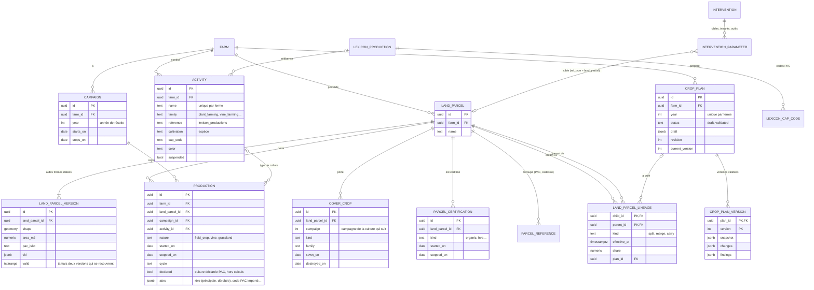
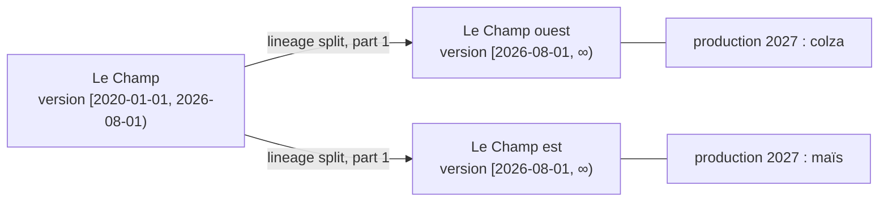

# Modèle des parcelles, activités et productions

Comment Fourmy représente le parcellaire, les cultures et l'assolement :
modèle conceptuel, tables et liens entre elles (au sens `belongs_to`,
`has_many` d'un ORM), règles qui les tiennent ensemble. Schéma relevé dans
la base au 20/11/2026 (migrations jusqu'à 0074).

Voir aussi : `docs/parcelles.md` (écrans du parcellaire), `docs/activites.md`
(activités et productions datées), `docs/assolement.md` (assolement),
`docs/architecture.md`.

## 1. Les notions en une phrase

| Notion | Table | Ce que c'est |
|---|---|---|
| Ferme | `farms` | L'exploitation ; tout le reste lui appartient (isolation par RLS sur `farm_id`). |
| Parcelle | `land_parcels` | Identité stable d'un morceau de terre : un nom, rien d'autre. |
| Version de parcelle | `land_parcel_versions` | La forme et la surface d'une parcelle pendant une période (`valid`). Une parcelle change de forme en ouvrant une nouvelle version. |
| Filiation | `land_parcel_lineage` | D'où vient une parcelle née d'une découpe, d'une fusion ou d'une reconduction. |
| Campagne | `campaigns` | Une année de récolte : un blé semé en octobre 2026 appartient à la campagne 2027. |
| Activité | `activities` | Une culture ou un atelier de la ferme (« Maïs », « Vignes AOP »), rattaché à une production de référence Lexicon. Elle dure d'une campagne à l'autre. |
| Production | `productions` | La culture d'une parcelle pendant une campagne : **parcelle × campagne × activité**, éventuellement datée (semis → récolte). C'est elle que les interventions, les contrôles et les registres retrouvent. |
| Assolement | `crop_plans`, `crop_plan_versions` | Le plan des productions d'une campagne : brouillon, puis versions validées. |
| Couvert d'interculture | `cover_crops` | Couvert semé entre deux cultures, rattaché à la parcelle et à la campagne de la culture qui suit. |
| Certification | `parcel_certifications` | AB, HVE… d'une parcelle pendant une période. |

## 2. Modèle conceptuel de données

## 3. Les liens, table par table

Notation à la manière d'un ORM (Rails, Active Record) : `belongs_to` porte la
clé étrangère, `has_many` en est l'autre bout. « Supprimé avec » indique la
règle de la clé (`ON DELETE`).

### `land_parcels` (parcelle)

| Lien | Vers | Clé | Supprimé avec |
|---|---|---|---|
| `belongs_to :farm` | `farms` | `farm_id` | la ferme |
| `has_many :versions` | `land_parcel_versions` | `land_parcel_id` | la parcelle |
| `has_many :productions` | `productions` | `land_parcel_id` | la parcelle |
| `has_many :cover_crops` | `cover_crops` | `land_parcel_id` | la parcelle |
| `has_many :certifications` | `parcel_certifications` | `land_parcel_id` | la parcelle |
| `has_many :references` | `parcel_references` | `land_parcel_id` | la parcelle |
| `has_one :nitrate_zone` | `parcel_nitrate_zones` | `land_parcel_id` | la parcelle |
| `has_many :fertilization_plans` | `fertilization_plans` | `land_parcel_id` | la parcelle |
| `has_many :parents, through: :lineage` | `land_parcels` via `land_parcel_lineage.child_id` | | |
| `has_many :children, through: :lineage` | `land_parcels` via `land_parcel_lineage.parent_id` | | |
| cible d'interventions (lien polymorphe) | `intervention_parameters` (`role = 'target'`, `ref_type = 'land_parcel'`, `ref_id`) | sans clé étrangère | |

La « parcelle à une date » est `land_parcels` jointe à la version dont
`valid` contient cette date (`v.valid @> date`, `parcelsAt` dans
`apps/api/src/repos/parcels.ts`).

### `land_parcel_versions` (forme datée)

| Lien | Vers | Clé | Supprimé avec |
|---|---|---|---|
| `belongs_to :land_parcel` | `land_parcels` | `land_parcel_id` | la parcelle |

Contrainte d'exclusion `EXCLUDE USING gist (land_parcel_id WITH =, valid WITH &&)` :
deux versions d'une même parcelle ne se recouvrent jamais dans le temps.
Une version ouverte a `upper(valid) = NULL`.

### `land_parcel_lineage` (filiation)

| Lien | Vers | Clé | Supprimé avec |
|---|---|---|---|
| `belongs_to :child` | `land_parcels` | `child_id` | l'enfant |
| `belongs_to :parent` | `land_parcels` | `parent_id` | le parent |
| `belongs_to :crop_plan, optional` | `crop_plans` | `plan_id` | mis à NULL |

`kind` : `split` (découpe : chaque morceau a un parent, part 1), `merge`
(fusion : la parcelle fusionnée a plusieurs parents, chacun avec sa part de
surface), `carry` (reconduction d'une parcelle de l'an passé, part 1).
`effective_at` = fin de la version du parent = début de celle de l'enfant.

### `campaigns` (campagne)

| Lien | Vers | Clé | Supprimé avec |
|---|---|---|---|
| `belongs_to :farm` | `farms` | `farm_id` | la ferme |
| `has_many :productions` | `productions` | `campaign_id` | la campagne |

`year` est l'année de récolte ; `starts_on` et `stops_on` valent par défaut le
1er janvier et le 31 décembre. Les campagnes se créent à la demande
(activités, imports, fiche parcelle, validation d'un assolement).

### `activities` (activité)

| Lien | Vers | Clé | Supprimé avec |
|---|---|---|---|
| `belongs_to :farm` | `farms` | `farm_id` | la ferme |
| `has_many :productions` | `productions` | `activity_id` | mis à NULL (suppression refusée par l'API tant qu'elle a des productions) |
| `belongs_to :reference, optional` (logique) | `lexicon_productions.reference_name` | `reference` | sans clé étrangère |
| `belongs_to :phyto_crop, optional` | `ref_phyto_crops` | `crop_code` | |

La famille (`family`) décide si l'activité porte des parcelles : végétal et
pépinière → productions `field_crop`, vigne → `vine`, élevage → `grassland` ;
transformation, administration, maintenance, services → aucune parcelle.
Le code PAC vient de `cap_code` s'il est saisi, sinon de la production de
référence (`lexicon_cap_codes`).

### `productions` (production)

| Lien | Vers | Clé | Supprimé avec |
|---|---|---|---|
| `belongs_to :land_parcel` | `land_parcels` | `land_parcel_id` | la parcelle |
| `belongs_to :campaign` | `campaigns` | `campaign_id` | la campagne |
| `belongs_to :activity, optional` | `activities` | `activity_id` | mis à NULL |
| `belongs_to :farm` | `farms` | `farm_id` | la ferme |
| `has_many :fertilization_plans` | `fertilization_plans` | `production_id` | mis à NULL |

Pas d'unicité sur (parcelle, campagne) : une parcelle peut porter plusieurs
productions la même campagne (culture principale puis dérobée, cultures
successives). Le rôle est dans `attrs.cropPlan.role` (`main`, `secondary`),
sinon déduit de `attrs.secondary` des imports.

### `crop_plans`, `crop_plan_versions` (assolement)

| Lien | Vers | Clé | Supprimé avec |
|---|---|---|---|
| `crop_plans belongs_to :farm` | `farms` | `farm_id` | la ferme |
| `crop_plans has_many :versions` | `crop_plan_versions` | `plan_id` | l'assolement |
| `crop_plans has_many :lineage` | `land_parcel_lineage` | `plan_id` | mis à NULL |

Un assolement par ferme et par année (`UNIQUE (farm_id, year)`). Il n'a pas
de clé vers les productions : le brouillon (`draft`, JSON) désigne les
parcelles par clé (`p:<id>` existante, `n:<id>` à créer) et les productions
reprises par `productionId` ; la validation crée ou modifie les productions
réelles, puis fige une version.

### `cover_crops` (couvert d'interculture)

| Lien | Vers | Clé | Supprimé avec |
|---|---|---|---|
| `belongs_to :land_parcel` | `land_parcels` | `land_parcel_id` | la parcelle |
| `belongs_to :farm` | `farms` | `farm_id` | la ferme |

Pas de clé vers `campaigns` : `campaign` est l'**année** de la culture qui
suit le couvert (un couvert semé à l'automne 2026 après un blé 2026, avant
un maïs 2027, a `campaign = 2027`). Un couvert par parcelle et par campagne
(`UNIQUE (land_parcel_id, campaign)`).

### `parcel_certifications`, `parcel_references`, `parcel_nitrate_zones`

Chacune `belongs_to :land_parcel` (supprimée avec la parcelle) et
`belongs_to :farm`. Les certifications ont une période (`started_on`,
`stopped_on`) ; les références sont les îlots PAC et parcelles cadastrales
recoupés ; la zone nitrates est calculée pour la parcelle.

## 4. Retrouver la culture d'une parcelle à une date

Les interventions ne pointent pas une production : elles ciblent une
parcelle (`intervention_parameters`, `ref_type = 'land_parcel'`). La
production concernée se déduit par la fonction SQL
`fourmy_production_at(parcelle, jour)`, dans cet ordre :

1. la production **datée** en place ce jour-là (`started_on` ≤ jour ≤ `stopped_on`) ;
2. sinon une production **non datée** de la campagne qui contient le jour ;
3. à égalité, celle qui a une activité, puis la plus récente.

Les productions `declared = true` (déclarations PAC importées) n'entrent pas
dans ce calcul. Contrôle phyto, IFT, registre, cahier de fertilisation et
contrôles HVE et AB passent tous par cette fonction.

## 5. Exemples

### Une parcelle découpée

La campagne 2026 garde « Le Champ » et sa production ; à partir du
01/08/2026, les deux morceaux existent et portent les productions 2027.
L'historique des morceaux remonte à celui de « Le Champ » par la filiation.

### Une ferme reprise d'Ekylibre

Ekylibre crée une parcelle par culture et par campagne : « Braquet Maïs
2025 » (version 2024-12-31 → 2025-12-30), puis « Braquet Maïs 2026 »
(2025-12-31 → 2026-12-30), chacune avec une seule production. Pour 2027,
l'assolement reprend « Braquet Maïs 2026 », qui s'arrête en décembre, sous
le nom « Braquet » ; la validation crée la parcelle « Braquet », valide à
partir du 30/12/2026, filiation `carry`. Les années précédentes sont
retrouvées par **recoupement géographique** : la parcelle de la ferme qui
recouvre au moins la moitié de « Braquet » l'année voulue.

## 6. Points d'attention

- **Campagnes** : pas de contrainte d'unicité sur (ferme, année) en base ;
  le code lit la première campagne de l'année (`LIMIT 1`). À sécuriser par
  une contrainte `UNIQUE (farm_id, year)` après vérification des données.
- **Lien intervention → parcelle** : polymorphe (`ref_type`, `ref_id`), sans
  clé étrangère ; supprimer une parcelle ne supprime pas ses cibles
  d'intervention.
- **Activité → référence Lexicon** : lien logique (`reference`), sans clé
  étrangère, car le référentiel est rechargé en bloc.
- **Surface** : `area_m2` est calculée par PostGIS (géodésique) à
  l'enregistrement d'une version ; l'écran calcule la même valeur au dessin
  (`@fourmy/carto`, GeographicLib).
