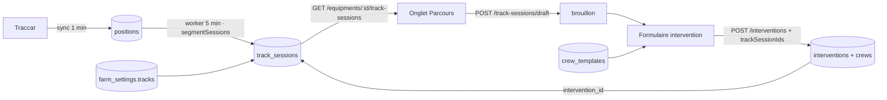

# Fourmy — Parcours GPS et attelages (design)

> Produit par `/sc:design` le 2026-11-09, à partir des exigences
> [`parcours-attelages.md`](parcours-attelages.md) (FR-GPS-10 à 25,
> FR-ATT-1 à 12). Prochaine étape : `/sc:workflow` (plan de lots), puis
> `/sc:implement`.

## 1. Principes

1. **Rétrocompatibilité par construction.** Un attelage regroupe des lignes
   qui existent déjà : `intervention_parameters` (rôles `tool`, `doer`) et
   `intervention_periods`, auxquelles s'ajoute une colonne `crew_id`. Une
   requête qui lit aujourd'hui « les matériels de l'intervention » reste
   juste sans modification. Seules celles qui ont besoin de savoir **qui
   travaillait avec quoi et quand** lisent `crew_id`.
2. **Parcours matérialisés.** Les sessions sont calculées par le worker et
   stockées dans `track_sessions`. C'est nécessaire pour trois raisons :
   - un parcours rattaché doit garder une identité stable (FR-GPS-15) ;
   - un changement de réglage ne recalcule que les parcours libres
     (FR-GPS-16) ;
   - la liste doit s'afficher en moins de 2 s sur 90 jours.
3. **Fonctions pures dans `@fourmy/domain`** : découpage, brouillon
   d'intervention, règles d'attelage, applicateurs. Le SQL ne fait que la
   géométrie (parcelles, couverture), avec PostGIS, comme `trackCoverage`
   aujourd'hui.
4. **Un brouillon n'est jamais enregistré.** `POST /track-sessions/draft`
   renvoie un corps d'intervention. Le formulaire existant l'affiche, et le
   rattachement se fait à l'enregistrement, dans la même transaction.



## 2. Modèle de données (migration `0022_tracks_crews.sql`)

### 2.1 Attelages d'une intervention

```sql
ALTER TABLE interventions
  ADD COLUMN staffing text NOT NULL DEFAULT 'free' CHECK (staffing IN ('free', 'crews'));

CREATE TABLE intervention_crews (
  id               uuid PRIMARY KEY,
  intervention_id  uuid NOT NULL REFERENCES interventions(id) ON DELETE CASCADE,
  rank             int  NOT NULL,              -- ordre d'affichage
  label            text,                       -- « Attelage 1 » par défaut, côté web
  template_id      uuid REFERENCES crew_templates(id) ON DELETE SET NULL,
  UNIQUE (intervention_id, rank)
);
ALTER TABLE intervention_parameters ADD COLUMN crew_id uuid REFERENCES intervention_crews(id) ON DELETE CASCADE;
ALTER TABLE intervention_periods    ADD COLUMN crew_id uuid REFERENCES intervention_crews(id) ON DELETE CASCADE;
CREATE INDEX intervention_parameters_crew_ix ON intervention_parameters (crew_id) WHERE crew_id IS NOT NULL;
CREATE INDEX intervention_periods_crew_ix    ON intervention_periods (crew_id)    WHERE crew_id IS NOT NULL;
-- RLS de intervention_crews : via l'intervention (comme intervention_periods).
```

**Invariants**, vérifiés par le domaine et par un trigger de garde :

| `staffing` | `tool` / `doer` | `intervention_periods` |
|---|---|---|
| `free` | `crew_id IS NULL` | `crew_id IS NULL`, sans chevauchement (règle actuelle) |
| `crews` | `crew_id NOT NULL` | `crew_id NOT NULL` ; sans chevauchement **dans un attelage** ; chevauchement permis **entre** attelages |

Les cibles, intrants et sorties n'ont jamais de `crew_id`.
`interventions.started_at` et `stopped_at` restent le minimum et le maximum
de toutes les périodes.

### 2.2 Attelages types (FR-ATT-6)

```sql
CREATE TABLE crew_templates (
  id          uuid PRIMARY KEY,
  farm_id     uuid NOT NULL REFERENCES farms(id) ON DELETE CASCADE,
  name        text NOT NULL,
  active      boolean NOT NULL DEFAULT true,
  created_at  timestamptz NOT NULL DEFAULT now(),
  updated_at  timestamptz NOT NULL DEFAULT now(),
  UNIQUE (farm_id, name)
);
CREATE TABLE crew_template_members (
  template_id   uuid NOT NULL REFERENCES crew_templates(id) ON DELETE CASCADE,
  equipment_id  uuid REFERENCES equipments(id) ON DELETE CASCADE,
  person_id     uuid REFERENCES people(id) ON DELETE CASCADE,
  CHECK ((equipment_id IS NULL) <> (person_id IS NULL))
);
-- RLS farm_isolation (crew_templates) ; membres via le modèle.
```

Une intervention garde `template_id` à titre d'information seulement. Elle
copie la composition du modèle, donc modifier le modèle ne change pas le
passé.

### 2.3 Parcours

```sql
CREATE TABLE track_sessions (
  id                 uuid PRIMARY KEY,           -- uuidv5(binding_id, started_at, kind)
  farm_id            uuid NOT NULL REFERENCES farms(id) ON DELETE CASCADE,
  equipment_id       uuid NOT NULL REFERENCES equipments(id) ON DELETE CASCADE,  -- matériel suivi
  binding_id         uuid NOT NULL REFERENCES tracker_bindings(id) ON DELETE CASCADE,
  kind               text NOT NULL CHECK (kind IN ('work', 'transit')),
  started_at         timestamptz NOT NULL,
  stopped_at         timestamptz NOT NULL CHECK (stopped_at > started_at),
  position_count     int  NOT NULL,
  distance_m         numeric NOT NULL,
  covered_area_m2    numeric,                    -- travail seulement
  coverage           geometry(MultiPolygon, 4326),  -- bandes de largeur d'outil (simplifiées à 0,5 m)
  parcels            jsonb NOT NULL DEFAULT '[]',   -- [{ landParcelId, name, areaM2, share }] à la date
  tool_hint          text,                       -- attribut Traccar `tool` dominant
  tool_equipment_id  uuid REFERENCES equipments(id) ON DELETE SET NULL,  -- outil résolu
  intervention_id    uuid REFERENCES interventions(id) ON DELETE SET NULL,
  crew_id            uuid REFERENCES intervention_crews(id) ON DELETE SET NULL,
  linked_extent      tstzrange,                  -- étendue figée au rattachement
  drift              jsonb,                      -- FR-GPS-15 : { startedAt, stoppedAt } recalculés si différents
  settings_hash      text NOT NULL,              -- réglages utilisés
  computed_at        timestamptz NOT NULL DEFAULT now(),
  EXCLUDE USING gist (binding_id WITH =, tstzrange(started_at, stopped_at) WITH &&)
);
CREATE INDEX track_sessions_list_ix ON track_sessions (equipment_id, started_at DESC);
CREATE INDEX track_sessions_tool_ix ON track_sessions (tool_equipment_id, started_at DESC) WHERE tool_equipment_id IS NOT NULL;
CREATE INDEX track_sessions_intervention_ix ON track_sessions (intervention_id) WHERE intervention_id IS NOT NULL;
-- RLS farm_isolation.
```

- **Libre** : `intervention_id IS NULL`. Le worker peut supprimer et
  recréer la ligne.
- **Rattaché** : figé. Le worker ne la supprime jamais et n'en modifie
  que `drift`.

### 2.4 Réglages (FR-GPS-16)

```sql
ALTER TABLE farm_settings ADD COLUMN tracks jsonb NOT NULL DEFAULT
  '{"stopMin": 15, "minDurationMin": 3, "minDistanceM": 200, "movingKmh": 2,
    "parcelMinShare": 0.05, "parcelMinAreaM2": 500}';
```

`settings_hash` = sha256 du JSON trié. Si la ferme change ses réglages, le
worker voit des lignes **libres** dont le hash diffère et les recalcule.

### 2.5 Registre phyto (FR-ATT-12)

La vue `phyto_register` gagne une colonne `applicators text[]`, calculée
par la fonction SQL `fourmy_input_applicators(intervention_id, input_param_id)`
(`STABLE`, `security_invoker`). Elle applique la règle du §4.4.

## 3. Contrats (`@fourmy/contracts`)

```ts
// entities/interventions.ts
export const staffing = z.enum(["free", "crews"]);
export const interventionCrew = z.object({
  id: uuid.optional(),                 // stable entre deux modifications
  label: z.string().trim().max(80).optional(),
  templateId: uuid.optional(),
  tools: z.array(interventionTool).min(1),     // ≥ 1 matériel
  doers: z.array(interventionDoer).default([]), // 0..n (FR-ATT-1)
  periods: z.array(workPeriod).min(1),
});
// interventionBody : + staffing (défaut "free"), + crews (défaut []),
//                    + trackSessionIds: z.array(uuid).max(50).optional()
// Mode "crews" : tools, doers et periods de premier niveau doivent être vides.

// Lecture (Intervention) : on renvoie aussi, pour les anciens clients,
//   tools / doers  = réunion des attelages,
//   periods        = réunion fusionnée des périodes des attelages,
//   crews          = détail ; workDurationS (somme), spanS (chantier).

// tracks.ts
export const trackSession = z.object({
  id: uuid, equipmentId: uuid, kind: z.enum(["work", "transit"]),
  startedAt: isoDateTime, stoppedAt: isoDateTime, durationS: z.number(),
  distanceM: z.number(), coveredAreaM2: z.number().nullable(),
  parcels: z.array(z.object({ landParcelId: uuid, name: z.string(), areaM2: z.number(), share: z.number() })),
  toolHint: z.string().nullable(), tool: ref.nullable(),          // outil résolu
  tracker: ref.nullable(),        // onglet d'un outil : le matériel tracteur
  intervention: z.object({ id: uuid, procedure: z.string(), status: interventionStatus }).nullable(),
  drift: z.object({ startedAt: isoDateTime, stoppedAt: isoDateTime }).nullable(),
});
export const trackSettings = z.object({
  stopMin: z.number().int().min(2).max(180), minDurationMin: z.number().min(0).max(120),
  minDistanceM: z.number().min(0).max(10_000), movingKmh: z.number().min(0.5).max(15),
  parcelMinShare: z.number().min(0).max(1), parcelMinAreaM2: z.number().min(0),
});
export const trackDraftRequest = z.object({ sessionIds: z.array(uuid).min(1).max(50) });
export const trackDraft = z.object({
  body: interventionCompleteWrite,   // staffing "crews", trackSessionIds remplis
  procedureSuggestions: z.array(z.string()),
  hints: z.array(z.string()),        // « outil déduit de l'habitude », « aucun conducteur connu »…
});
export const crewTemplate = z.object({ id: uuid, name: z.string(), active: z.boolean(),
  equipmentIds: z.array(uuid), personIds: z.array(uuid) });
```

Synchro mobile (`sync.ts`), FR-ATT-8 :
- `syncInterventionPushed` accepte `staffing` et `crews`, facultatifs :
  sans eux, le mode est `free`.
- `body_json` du pull contient `staffing`, `crews` et la forme aplatie.
- Un **update** sans `staffing` d'une intervention en mode `crews` est
  rejeté dans `failed`, avec « Intervention à attelages : à modifier sur le
  web ou avec une version récente », plutôt qu'aplati en silence.

## 4. Domaine (`@fourmy/domain`, fonctions pures testées)

### 4.1 `segmentSessions(positions, settings) → SessionSpan[]` (`tracks.ts`)

Entrée : positions triées `{ time, speedKmh, working, tool, distanceToNextM }`.

1. **État** de chaque position :
   - `work` si `working === true` ;
   - sinon `move` si la vitesse dépasse `movingKmh`, ou si elle est absente
     et que la distance au point suivant implique ce seuil ;
   - sinon `idle`.
2. **Coupure** : un écart de temps de plus de `stopMin`, ou une suite de
   positions `idle` de plus de `stopMin`, ferme la session en cours.
3. **Entre deux coupures**, on découpe en suites de même nature :
   - un passage `move` de moins de `stopMin` entre deux suites `work` est
     **absorbé** dans le travail (demi-tours en bout de champ, outil
     relevé) ;
   - les autres suites `move` deviennent des déplacements (`transit`).
4. **Filtre** : on écarte les sessions de moins de `minDurationMin` ou de
   `minDistanceM`.
5. **Outil** : `tool_hint` = la valeur de `tool` la plus fréquente dans la
   session.
6. Le résultat donne, pour chaque session, ses bornes de temps et ses
   indices de positions. Il est **déterministe** (testé sur des traces
   réelles anonymisées).

`operatingHoursByDay` (lot L) garde ses propres règles. Elle ne dépend pas
des sessions.

### 4.2 `crewRules(body) → string[]` (`intervention-rules.ts`)

- `staffing = crews` : au moins 1 attelage ; chacun a ≥ 1 matériel et ≥ 1
  période ; ses périodes sont ordonnées et ne se chevauchent pas ; les
  `tools`, `doers` et `periods` de premier niveau sont vides.
- Un matériel ou une personne présent dans deux attelages dont les
  périodes se chevauchent → erreur (FR-ATT-3).
- `flattenCrews(crews)` donne les `tools`, `doers` et `periods` aplatis
  (réunion, périodes fusionnées). C'est ce qu'utilisent les règles
  existantes (formes, doses, météo) : elles ne changent pas.
- `toCrews(free)` et `toFree(crews)` servent au changement de mode
  (FR-ATT-4) ; `toFree` signale la perte d'information.
- Avertissement, sans blocage, entre interventions différentes : vérifié
  dans le repo, car il faut lire les autres interventions.

### 4.3 `draftFromSessions(sessions, ctx) → TrackDraft` (`tracks.ts`)

`ctx` contient l'outil résolu, l'outil habituel, le conducteur habituel,
les surfaces des parcelles et les réglages. Le brouillon est construit
ainsi :
- **attelage** : `tools` = [matériel suivi, outil] ; `doers` = [conducteur
  habituel] ou vide ;
- **périodes** : une par session, fusionnées si l'écart est inférieur à
  `stopMin` ;
- **cibles** : les parcelles des sessions de travail, avec
  `share ≥ parcelMinShare` **ou** `areaM2 ≥ parcelMinAreaM2` ;
  `workedAreaM2` = somme des surfaces couvertes ; `workingZone` = union des
  couvertures (calculée par l'API, en SQL) ;
- un brouillon de **déplacements seuls** a des cibles vides et l'indice
  « procédure de transport à choisir ».

### 4.4 `applicatorsOf(intervention, inputParamId)` (FR-ATT-12)

Écrite en TypeScript pour les tests, et répliquée en SQL dans
`fourmy_input_applicators`. Le cas est testé des deux côtés.
1. Mode `free` : tous les intervenants.
2. Mode `crews` : l'attelage qui contient `input.attrs.equipmentId` (le
   matériel qui applique, déjà saisi).
3. Sinon, l'attelage qui contient un matériel de nature pulvérisateur
   (`sprayer`, `self_propelled_sprayer`, ou modèle d'avatar `*sprayer*`).
4. Sinon, s'il n'y a qu'un attelage : celui-là.
5. Sinon : tous les intervenants, avec l'indicateur « applicateur
   ambigu ».

Un attelage sans intervenant donne « non renseigné ». Le contrôle
réglementaire le signale (feu orange) sans bloquer.

## 5. API

| Route | Droits | Rôle |
|---|---|---|
| `GET /equipments/:id/track-sessions?from&to&kind&parcel&state&cursor` | membre | FR-GPS-12/13/17 ; un outil reçoit les sessions des tracteurs où il était attelé |
| `GET /track-sessions/:id` | membre | détail : trace simplifiée (GeoJSON), couverture, parcelles |
| `POST /track-sessions/draft` `{ sessionIds }` | owner, worker | brouillon ; 409 si une session est rattachée ou si elles appartiennent à plusieurs matériels (FR-GPS-25 hors v1) |
| `POST /interventions/:id/track-sessions` `{ sessionIds, crewId? }` | owner, worker | FR-GPS-24 : ajoute une période à l'attelage du matériel et les parcelles manquantes |
| `GET /settings/tracks` · `PUT /settings/tracks` | membre · owner | FR-GPS-16 ; le PUT marque les sessions libres à recalculer |
| `POST /track-sessions/recompute` | owner | recalcul immédiat, sur la fenêtre des 90 derniers jours |
| `GET/POST /crew-templates` · `PUT/DELETE /crew-templates/:id` | membre · owner | FR-ATT-6 |
| `POST /interventions`, `PUT …/complete`, `PUT …/:id` | inchangés | corps + `staffing`, `crews`, `trackSessionIds` |

**Rattachement**, dans la transaction d'écriture de l'intervention :

```sql
UPDATE track_sessions SET intervention_id = :iid, crew_id = :crew,
       linked_extent = tstzrange(started_at, stopped_at)
WHERE id = ANY(:ids) AND (intervention_id IS NULL OR intervention_id = :iid)
RETURNING id;   -- moins de lignes que d'ids → 409 « parcours déjà rattaché »
```

`crew_id` = l'attelage qui contient le matériel de la session. **Annuler**
(`status → cancelled`) ou **supprimer** une intervention remet
`intervention_id`, `crew_id`, `linked_extent` et `drift` à NULL. La
suppression le fait déjà par `ON DELETE SET NULL` ; l'annulation le fait
explicitement dans le repo.

**Écriture** (`writeBody`) : en mode `crews`, on insère `intervention_crews`
(id client conservé, sinon uuid), puis les `tool`, `doer` et périodes avec
leur `crew_id`. Le reste ne change pas. Validation : `crewRules`, puis les
règles existantes sur `flattenCrews(body)`.

**Lecture** : un repo `crewsOf(interventionIds)` alimente la fiche, la
liste, le calendrier, la synchro et l'historique (FR-ATT-11). L'audit
existant compare les corps avant et après ; il voit donc les attelages.

## 6. Worker

Une nouvelle tâche `trackSessionsTick`, toutes les 5 minutes, après la
synchro Traccar, sur les fermes de `fourmy_traccar_farms()`. Pour chaque
`tracker_binding` :
1. **Fenêtre** : du `stopped_at` de la dernière session moins `stopMin` × 2
   (positions tardives) jusqu'à maintenant. Toute la fenêtre si les
   réglages ont changé (`settings_hash`). La première fois, tout
   l'historique.
2. Lire les positions de la fenêtre et **retirer** celles qui tombent dans
   `linked_extent` d'une session rattachée (on n'y touche plus).
3. `segmentSessions`, puis une requête SQL par session (parcelles à la
   date, couverture et surface couverte, distance). Cette requête reprend
   les CTE de `trackCoverage`, paramétrées par les bornes de la session.
4. Dans une transaction : supprimer les sessions **libres** de la fenêtre,
   insérer les nouvelles.
5. **Dérive** (FR-GPS-15) : pour chaque session rattachée qui touche la
   fenêtre, recalculer ses bornes sur toutes les positions, celles de sa
   plage figée comprises. Si elles diffèrent de plus d'une minute, écrire
   `drift`, sinon le remettre à NULL.
6. **Outil résolu** :
   - `tool_hint` est rapproché de `external_ids.traccarTool`, puis du nom
     normalisé (`matchDevices`) ;
   - sinon, l'outil attelé déclaré dans une intervention sur la plage
     (repo `hitches`, désormais au courant des attelages) ;
   - sinon NULL.

`hitches()` (rejeu 3D) lit d'abord les attelages : outils du **même
attelage** que le tracteur, sur les périodes de cet attelage. Pour les
interventions en mode libre, il garde la déduction actuelle.

## 7. Migrateur Ekylibre (FR-ATT-10)

Une nouvelle extraction, `participations(s)`, lit les
`intervention_participations` avec leurs `intervention_working_periods`
(par `intervention_participation_id`), et indique si elles existent.

Règles, par intervention :
1. **Participations présentes** : un attelage par matériel motorisé, avec :
   - les outils dont les périodes de participation recouvrent les siennes ;
   - les personnes dont les périodes recouvrent les siennes ;
   - les périodes du matériel motorisé.
   Ce qui n'a pas été rattaché va dans le premier attelage.
2. **Sinon**, s'il y a au plus un matériel motorisé **ou** au plus un
   intervenant : **un seul attelage** avec tous les `tool` et `doer`, et
   les périodes de l'intervention.
3. **Sinon** : mode `free`, avec `counts.crews_ambiguous` au rapport et un
   avertissement par intervention.

Les identifiants sont déterministes : `id("intervention_crews",
"<intervention>:<rank>")`. On ne réécrit pas une intervention dont l'audit
contient une action `corrected`, comme pour les parcelles et les cuves.

Volumes attendus, d'après le contrôle du 2026-11-09 :
- Pierre : environ 586 interventions avec attelage par la règle 2, 5 par la
  règle 1 ;
- Frédéric : au plus 14 cas à examiner. Une partie relève de la règle 2
  (un seul tracteur).

## 8. Web

- **Fiche matériel, onglet `?tab=tracks`** (`TrackSessionsTab`) :
  - visible si `GET /equipments/:id/track-sessions?limit=1` renvoie au
    moins une session ;
  - filtres : période, type, parcelle, état ;
  - tableau avec cases à cocher : date, heures, durée, type (badge),
    parcelles (puces avec surface), hectares, outil, état (lien vers
    l'intervention) ; un badge « trace modifiée » si `drift` ;
  - mini-carte (composant carte existant) : trace et couverture de la
    sélection, et parcelles ;
  - actions : **Créer l'intervention**, qui ouvre `…/interventions/new`
    avec le brouillon (`navigate(state)`) ; **Ajouter à une intervention**,
    qui ouvre une fenêtre listant les interventions du même jour ;
  - sur un outil, une colonne « Tracteur ».
- **Formulaire d'intervention** :
  - un sélecteur « Attelages | Libre » au-dessus des moyens ;
  - en mode attelages, une carte par attelage : attelage type (sélection),
    matériels, intervenants, périodes (éditeur de périodes actuel) ;
    ajouter, dupliquer, supprimer un attelage ;
  - « Enregistrer comme attelage type » (owner) ;
  - une synthèse « chantier 8 h-12 h · temps de travail 5 h » ;
  - changer de mode passe par `toCrews` ou `toFree` (confirmation pour
    `toFree`) ;
  - les parcours d'origine s'affichent en bandeau : « 2 parcours GPS
    seront rattachés ».
- **Fiche d'intervention** : un bloc par attelage (moyens, périodes,
  durées), la liste des parcours rattachés, et la trace GPS de chaque
  matériel sur les périodes **de son attelage**.
- **Calendrier** : une barre par attelage et par période, à la couleur de
  l'intervention.
- **Réglages de la ferme** : une section « Parcours GPS » avec les 6
  réglages et « Recalculer ».
- **Matériels › Attelages types** : liste, création et modification
  (owner).

## 9. Impacts sur l'existant

| Consommateur | Changement |
|---|---|
| Règles d'intervention, doses, météo, IFT | aucun : ils lisent `flattenCrews` ou les tables, inchangées pour eux |
| `hitches()` / rejeu 3D | attelage déclaré d'abord (§6) |
| Trace GPS de la fiche d'intervention | périodes de l'attelage du matériel |
| Calendrier, recherche | attelages et périodes par attelage |
| Registre phyto (vue, JSON, CSV) | + `applicators` (§2.5, §4.4) |
| Relevé de fin de chantier (`interventionTool.meter`) | inchangé : il est porté par le `tool` dans son attelage |
| Synchro mobile | §3 ; zero-mobile doit suivre (branche `fourmy-backend`) |
| Audit et historique | inchangé : il compare les corps, attelages compris |
| Fixtures anonymisées | régénérées après le lot migrateur |

## 10. Risques

| Risque | Parade |
|---|---|
| Positions tardives qui coupent une session rattachée en deux | plage figée exclue du recalcul ; dérive signalée, jamais appliquée seule |
| Volume : 90 jours × 3 tracteurs × 1 position / 5 s, soit environ 4,7 M positions | calcul incrémental par fenêtre ; index `(binding_id, time)` existant ; couverture simplifiée stockée |
| Boîtier sans `isWorking` (Frédéric, Samsys) | état déduit de la vitesse (`movingKmh`) ; tout en `transit` est acceptable, la conversion reste possible |
| Ancien client mobile qui aplatit les attelages | update refusé (`failed`), jamais aplati en silence |
| Attelage déduit à tort par le migrateur | règle 3 conservatrice (mode libre si ambigu) ; corrections préservées |
| Applicateur ambigu (plusieurs attelages, pas de pulvérisateur identifiable) | indicateur au registre et au contrôle ; on peut le préciser avec `equipmentId` sur l'intrant |

## 11. Lots proposés (à détailler avec `/sc:workflow`)

| Lot | Contenu | Dépend de |
|---|---|---|
| **N — Attelages** | 0022 (crews, staffing), contrats, `crewRules` et `flattenCrews`, écriture et lecture, formulaire et fiche, calendrier, `hitches()` | — |
| **O — Parcours** | 0022 (`track_sessions`, réglages), `segmentSessions`, worker, `GET …/track-sessions`, onglet (tracteur et outil), réglages | — |
| **P — Conversion** | `draftFromSessions`, `POST /track-sessions/draft`, rattachement et libération, ajout à une intervention, dérive | N, O |
| **Q — Attelages types** | tables, API, sélection dans le formulaire | N |
| **R — Réglementaire et reprise** | `applicators` (vue, exports, contrôle), migrateur (participations, règles 1 à 3), fixtures, contrat mobile | N |

N et O sont indépendants et peuvent avancer en parallèle. La recette sur
les traces de Pierre suppose que le jeton Traccar voie ses boîtiers (voir
les exigences, §7 point 8).
