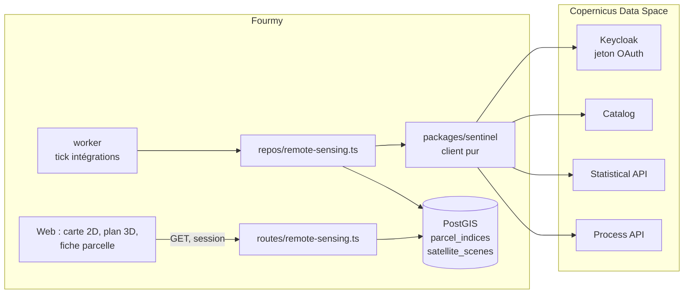
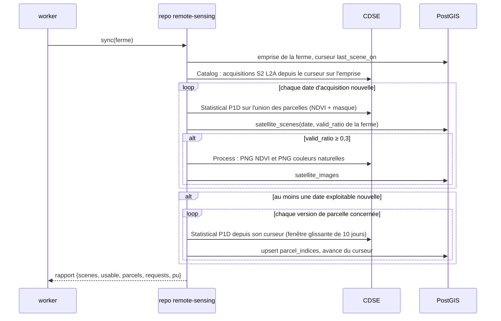

# Télédétection par parcelle : conception (lot S)

*2026-11-10. Statut : **validé** le 2026-11-10 (décisions en §13).*

**Exigences couvertes** (voir `claudedocs/etude_jumeau_3d.md` §6) :
- **FR-TWIN-1** : état observé de chaque parcelle à la date de la frise ;
- **FR-TWIN-2** : série temporelle et comparaison avec les années précédentes ;
- **FR-TWIN-5** : couches satellite drapées sur la carte 2D et le plan 3D.

**Exigences non fonctionnelles** : NFR-TWIN-1 (traçabilité), NFR-TWIN-2 (aucun
secret dans le navigateur), NFR-TWIN-5 (fournisseur remplaçable).

**Source** : Copernicus Data Space (CDSE), Sentinel Hub Statistical et Process
API, avec **un compte par exploitant**. Le test du 2026-11-10 sur la ferme de
Pierre en donne les chiffres de référence (`claudedocs/etude_copernicus.md` §11).

## 1. Choix structurants

| # | Choix | Écarté | Pourquoi |
|---|---|---|---|
| D1 | **Intégration `copernicus`**, thème nouveau « Télédétection ». Réglage `clientId` (texte) et secret `clientSecret` (chiffré) | Variables d'environnement globales | Un compte par exploitant (décision du 2026-11-10) ; reprend tel quel le cadre des intégrations (formulaire décrit dans les contrats, test, synchro par le worker, secret chiffré jamais renvoyé) |
| D2 | **Client TypeScript `packages/sentinel`**, pur, comme `packages/weather` | Service Python `services/agro` | Le lot ne fait **aucun calcul raster local** : la Statistical API rend du JSON, la Process API rend un PNG déjà colorié et découpé. Le service Python n'est pas encore déployé ; l'ajouter maintenant coûterait un conteneur de plus pour de simples appels HTTP. Il reste prévu pour le LAI et les modèles de culture (lot ultérieur). **→ ADR-11, §9** |
| D3 | **Stockage en base** des statistiques par **version de parcelle** et par date d'acquisition, et des images PNG en `bytea` | Recalcul à la demande ; COG et TiTiler | La frise et la fiche parcelle lisent en base : réponse immédiate et quota prévisible. Une date passée est immuable. Les versions de parcelle suivent les campagnes, donc la série suit la géométrie de l'époque. Le `bytea` existe déjà (avatars, photos) |
| D4 | **Synchro déclenchée par les acquisitions** : le Catalog signale une acquisition, un test sur l'ensemble de la ferme la juge exploitable ou non, et les statistiques par parcelle ne partent que dans le premier cas | Synchro quotidienne ou hebdomadaire de toutes les parcelles | Le facteur limitant est le nombre de requêtes (10 000 par mois), pas les PU (§6) |
| D5 | **Images en EPSG:4326**, emprise des parcelles, transparentes hors parcelles et sous les nuages | WMTS Sentinel Hub en direct | Le WMTS expose l'identifiant d'instance et ruine le quota de requêtes. Une image unique s'affiche dans Cesium (`SingleTileImageryProvider` + `rectangle`) comme dans MapLibre (source `image`) |
| D6 | **Valeurs, pas couleurs** : le survol et la fiche lisent les statistiques ; le PNG n'est qu'un rendu | Lire les valeurs dans l'image | Séparer la mesure de son rendu (piège relevé dans les dépôts NDVI) |

## 2. Vue d'ensemble



Le navigateur ne parle **jamais** à CDSE.

## 3. Synchronisation

### 3.1 Déroulé d'une synchro (adaptateur `copernicus.sync`)



- **Fréquence** : toutes les **6 heures**, en ajoutant une clause `copernicus`
  à `fourmy_due_integrations`. Une acquisition L2A est publiée quelques heures
  à environ 24 h après le passage.
- **Fenêtre glissante** : chaque synchro reprend les **10 derniers jours**
  (republications tardives, retraitements) ; l'upsert rend l'opération
  idempotente.
- **Une requête par version de parcelle couvre toutes les dates** depuis son
  curseur. Les parcelles ne sont donc interrogées qu'au rythme des dates
  exploitables, pas des passages.

### 3.2 Première activation : historique
- **Par défaut**, l'historique part du **1er janvier de l'année précédente**
  (deux campagnes, la comparaison inter-annuelle est possible tout de suite).
- On interroge chaque version de parcelle sur l'intersection de sa période de
  validité (`valid`) et de la fenêtre d'historique.
- Coût mesuré : environ 0,04 PU par date et par parcelle. Pour 200 parcelles
  sur 23 mois, environ 200 × 230 × 0,04 ≈ **1 850 PU**, à étaler pour rester
  sous 300 PU/min (le client limite à environ 200 PU/min).
- **Historique plus profond** (depuis 2017) : action manuelle « Charger
  l'historique depuis… » sur la page de l'intégration, avec une estimation du
  coût affichée avant de lancer.

### 3.3 Garde-fous
- **Budget mensuel de requêtes**, réglage facultatif de l'intégration, 3 000
  par défaut. Il est compté dans `remote_sensing_usage(farm_id, month,
  requests, pu)`, alimenté par l'en-tête `x-processingunits-spent`.
- **Au-delà du budget** : la synchro s'arrête, l'intégration passe en
  « budget atteint » (affiché), et elle reprend le mois suivant.
- **Erreurs** : 429 → attente et réessai (3 fois) ; 401 → un nouveau jeton,
  puis une erreur lisible (« identifiants refusés ») ; 5xx → le tour suivant.
  On reprend le mécanisme `last_error` des intégrations.
- **Jamais de valeur inventée** : en cas d'échec, rien n'est écrit. L'interface
  montre l'âge de la dernière donnée.

## 4. Données (migration `0029_remote_sensing.sql`)

```sql
-- Acquisitions vues sur l'emprise de la ferme
CREATE TABLE satellite_scenes (
  farm_id       uuid NOT NULL REFERENCES farms(id) ON DELETE CASCADE,
  acquired_on   date NOT NULL,
  source        text NOT NULL DEFAULT 'sentinel-2-l2a',
  valid_ratio   numeric NOT NULL,          -- part des pixels des parcelles sans nuage
  fetched_at    timestamptz NOT NULL DEFAULT now(),
  PRIMARY KEY (farm_id, source, acquired_on)
);

-- Images rendues (seulement pour les acquisitions exploitables)
CREATE TABLE satellite_images (
  farm_id       uuid NOT NULL REFERENCES farms(id) ON DELETE CASCADE,
  acquired_on   date NOT NULL,
  kind          text NOT NULL CHECK (kind IN ('ndvi', 'rgb')),
  bbox          box2d NOT NULL,             -- EPSG:4326, ouest/sud/est/nord
  width         int NOT NULL, height int NOT NULL,
  png           bytea NOT NULL,
  etag          text NOT NULL,              -- sha256 du PNG
  PRIMARY KEY (farm_id, acquired_on, kind)
);

-- Statistiques par version de parcelle, par date et par indice
CREATE TABLE parcel_indices (
  farm_id                 uuid NOT NULL REFERENCES farms(id) ON DELETE CASCADE,
  land_parcel_version_id  uuid NOT NULL REFERENCES land_parcel_versions(id) ON DELETE CASCADE,
  acquired_on             date NOT NULL,
  index                   text NOT NULL CHECK (index IN ('ndvi', 'ndre', 'ndmi')),
  mean numeric, std numeric, p10 numeric, p50 numeric, p90 numeric,
  valid_px                int NOT NULL,     -- pixels valides (sampleCount − noDataCount)
  parcel_px               int NOT NULL,     -- surface après retrait de 10 m / 100 m²
  source                  text NOT NULL DEFAULT 'cdse-sh-statistical',
  method                  text NOT NULL,    -- version de l'evalscript, ex. 's2-idx-v1'
  fetched_at              timestamptz NOT NULL DEFAULT now(),
  PRIMARY KEY (land_parcel_version_id, acquired_on, index)
);
CREATE INDEX parcel_indices_farm_on ON parcel_indices (farm_id, acquired_on);

-- Où en est chaque version de parcelle
CREATE TABLE parcel_index_cursors (
  land_parcel_version_id  uuid PRIMARY KEY REFERENCES land_parcel_versions(id) ON DELETE CASCADE,
  farm_id                 uuid NOT NULL REFERENCES farms(id) ON DELETE CASCADE,
  fetched_until           date NOT NULL,
  geometry_hash           text NOT NULL     -- si la géométrie change, on repart de zéro
);

CREATE TABLE remote_sensing_usage (
  farm_id uuid NOT NULL REFERENCES farms(id) ON DELETE CASCADE,
  month   date NOT NULL,                    -- 1er du mois
  requests int NOT NULL DEFAULT 0,
  pu      numeric NOT NULL DEFAULT 0,
  PRIMARY KEY (farm_id, month)
);
-- + RLS farm_isolation et GRANT fourmy_app sur les 5 tables (comme 0028)
-- + 'copernicus' dans integrations_provider_check
-- + clause copernicus (toutes les 6 h) dans fourmy_due_integrations
```

**Règles portées par les données** :
- **Exploitable** : `valid_px / parcel_px ≥ 0,8`. On le calcule à la lecture
  et on ne le stocke pas : le seuil reste un réglage.
- **Parcelle trop petite** : `parcel_px < 30`. L'interface affiche « trop
  petite pour Sentinel-2 » au lieu d'une valeur.
- **Les lignes non exploitables sont conservées** (avec `valid_px`) : elles
  montrent qu'il y a eu un passage, nuageux.
- **Volume** : 200 parcelles × 3 indices × environ 120 dates ≈ 72 000 lignes
  par an et par ferme. Pas besoin d'hypertable.
- **Calcul géométrique côté PostGIS** : le retrait de 10 m (`ST_Buffer`) et la
  projection en UTM (zone tirée de la longitude du centroïde, 30, 31 ou 32
  pour la France métropolitaine, `EPSG:326zz`). `geometry_hash` est le
  `md5(ST_AsBinary(shape))` de la version.

## 5. Client `packages/sentinel`

Package pur : `fetch` injectable, aucune dépendance au reste de Fourmy, testé
sans réseau.

```ts
export interface SentinelCredentials { clientId: string; clientSecret: string }
export interface SentinelClientOptions { fetch?: typeof fetch; baseUrl?: string; tokenUrl?: string; puPerMinute?: number }

export class SentinelClient {
  constructor(creds: SentinelCredentials, opts?: SentinelClientOptions);
  /** Jeton mis en cache jusqu'à exp − 60 s ; un 401 force un renouvellement unique. */
  token(): Promise<string>;
  /** Dates d'acquisition S2 L2A sur une emprise (Catalog), triées. */
  acquisitions(bbox: Bbox4326, from: string, to: string): Promise<{ date: string; cloudCover: number }[]>;
  /** Statistiques P1D d'une géométrie projetée (UTM), NDVI, NDRE et NDMI avec masque SCL. */
  parcelStats(geom: ProjectedGeometry, from: string, to: string): Promise<{ rows: IndexStatRow[]; pu: number }>;
  /** PNG RGBA de l'emprise des parcelles pour une date : NDVI colorié ou couleurs naturelles. */
  render(geom: GeoJsonMultiPolygon4326, date: string, kind: "ndvi" | "rgb", size: { width: number; height: number }): Promise<{ png: Uint8Array; pu: number }>;
}

export interface IndexStatRow {
  date: string; index: "ndvi" | "ndre" | "ndmi";
  mean: number | null; std: number | null; p10: number | null; p50: number | null; p90: number | null;
  sampleCount: number; noDataCount: number;
}
export const EVALSCRIPT_VERSION = "s2-idx-v1";
```

**Evalscripts** : versionnés dans le package (`evalscripts/s2-idx-v1.js`, etc.).
- **Statistiques** : bandes B04, B05, B08, B8A, B11, SCL et `dataMask` ;
  sorties FLOAT32 ; masque SCL qui exclut les classes 0, 1, 3, 8, 9, 10 et 11.
  C'est celui du test sur la ferme de Pierre.
- **NDVI** : palette séquentielle fixe de 9 paliers, rouge vers vert, sur le
  domaine [0 ; 0,9]. Alpha à 0 hors parcelles et sous le masque, alpha à 0,85
  ailleurs. Légende identique en 2D, en 3D et sur la fiche.
- **Couleurs naturelles** : B04, B03, B02 avec gain de 2,5, même masque.

Changer d'evalscript change `method` : les anciennes lignes restent lisibles
et un recalcul peut être demandé.

## 6. Budget (calculé sur les mesures du 2026-11-10)

| Poste | Requêtes par mois | PU par mois |
|---|---|---|
| Catalog toutes les 6 h | 120 | 0 |
| Test ferme par acquisition nouvelle (environ 12 par mois) | 12 | environ 0,5 |
| Images de 2 sortes par acquisition exploitable (environ 6 par mois) | 12 | environ 8 |
| Statistiques : environ 6 synchros utiles par mois × N parcelles ; chaque requête couvre la fenêtre de 10 jours, soit environ 4 dates × 0,04 PU | 6 × N | 6 × N × 0,15 |
| **Pierre (N = 11)** | **environ 210** | **environ 20** |
| **200 parcelles** | **environ 1 350** | **environ 190** |

Quota du compte gratuit : 10 000 requêtes et 10 000 PU par mois. Le budget de
3 000 requêtes par défaut laisse de la marge pour l'historique et pour les
lots suivants (Sentinel-1, LAI).

## 7. API

Sous `/api/v1/farms/:farmId`, avec session et RLS, comme le reste.

| Route | Rôle | Réponse |
|---|---|---|
| `GET /remote-sensing/status` | État de l'intégration pour l'interface : active, dernière acquisition, budget du mois | `{ enabled, lastSceneOn, usage: { requests, pu, budget } }` |
| `GET /remote-sensing/scenes?from&to` | Acquisitions de la période (pour la frise) | `[{ date, validRatio, images: ('ndvi'\|'rgb')[] }]` |
| `GET /remote-sensing/scenes/:date/:kind.png` | Image d'une date | PNG ; `ETag` = sha256 ; `Cache-Control: private, max-age=31536000, immutable` |
| `GET /remote-sensing/parcels?at=&index=ndvi` | Dernière valeur exploitable de chaque parcelle à la date `at` (fenêtre de 20 jours) | `[{ parcelId, versionId, date, ageDays, mean, p10, p50, p90, validRatio, status: 'ok'\|'stale'\|'none'\|'too_small' }]`, plus `scene: { date, bbox }` = la dernière image exploitable ≤ `at` |
| `GET /parcels/:parcelId/indices?index=ndvi&from&to` | Série d'une parcelle à travers ses versions | `{ points: [{ date, mean, p10, p90, usable }], smoothed: [{ date, value }], reference: [{ doy, median, years }] }` |
| `POST /integrations/:id/history` | Historique profond (§3.2) | `{ from, estimate: { requests, pu } }` ; avec `confirm: true`, lancement en tâche de fond |

Contrats zod dans `packages/contracts/src/remote-sensing.ts`. La
**mention légale** « Contient des données Copernicus Sentinel modifiées
[années] » est renvoyée dans les réponses et affichée par l'interface.

## 8. Interface

### 8.1 Fiche parcelle : onglet « Végétation » (FR-TWIN-1 et 2)

- **Courbe NDVI** de la campagne de la frise :
  - points bruts exploitables (les dates nuageuses en gris clair) ;
  - bande p10–p90 (hétérogénéité) ;
  - **courbe lissée** ;
  - **courbe de référence** : la médiane des années précédentes au même jour de
    l'année, puis la seule année précédente tant qu'il y a moins de trois ans
    d'historique.
- **Choix d'indice** NDVI, NDRE ou NDMI (aide d'une ligne sur chacun) : *plus
  tard*. Ce lot n'affiche que le NDVI (décision 2).
- **Interventions de la parcelle** en repères verticaux sur la courbe (semis,
  fertilisation, récolte). Le lecteur voit lui-même l'écart entre ce qui est
  observé et ce qui est saisi, comme le cas de la récolte non saisie chez
  Pierre.
- **États** : « pas encore de donnée », « trop petite pour Sentinel-2 »,
  « intégration Copernicus non configurée » (lien vers les Intégrations).
- **Lissage** : Whittaker (λ réglable, pondéré 0 pour les dates non
  exploitables) dans `packages/domain`, en TS pur et testé. Il est calculé par
  l'API et non dans le navigateur, pour que le mobile en profite plus tard.
- **Graphique** : **`@mantine/charts`**, épinglé sur la version de
  `@mantine/core` (9.7.3), avec **recharts 3.x** en dépendance. On utilise
  `CompositeChart` : une aire pour la bande p10–p90, des lignes pour la courbe
  lissée et la référence, des points pour les dates brutes, et des
  `ReferenceLine` pour les interventions. Le graphique est chargé à la demande
  avec l'onglet, pour ne pas alourdir le premier écran.

### 8.2 Carte 2D et plan 3D (FR-TWIN-1 et 5)

- **Sélecteur de couche « Satellite »** : Aucun / NDVI / Couleurs naturelles.
  Il est partagé entre la carte et le plan 3D et mémorisé dans l'URL comme
  `at`.
- **À la date de la frise**, on affiche la dernière image exploitable
  antérieure ou égale, avec un badge « Sentinel-2 du 26/06 (il y a 3 j) ».
  Au-delà de 20 jours, le badge passe en « ancienne ».
- **MapLibre** : source `image` (4 coins tirés de `bbox`) posée sous les
  contours des parcelles.
- **Cesium** : `SingleTileImageryProvider({ url, rectangle })` ajouté au-dessus
  de l'orthophoto IGN, donc drapé sur le relief. Un changement de date
  remplace la couche, et les images déjà vues restent en cache navigateur
  (immuables).
- **Survol d'une parcelle** : NDVI moyen, p10–p90, date et part valide, lus
  dans `/remote-sensing/parcels`, jamais dans l'image.
- **Coloration des parcelles par indice** (sans image) : un mode
  « Parcelles : NDVI » colore chaque polygone par sa moyenne. C'est utile pour
  le mobile et les petites parcelles, et cela ne coûte rien de plus.

### 8.3 Intégrations
- Nouveau thème « Télédétection » et carte « Copernicus — images Sentinel ».
- **Champs** : identifiant client, secret client, budget mensuel (facultatif).
  L'aide renvoie au tableau de bord CDSE et précise : « Ne pas cocher SPA ».
- **Le test** obtient un jeton puis compte les acquisitions des 30 derniers
  jours sur l'emprise. Exemple de message : « 9 acquisitions, dont 4
  exploitables ».
- **Le rapport de synchro** affiche les acquisitions, les parcelles mises à
  jour, ainsi que les requêtes et PU consommées.

## 9. ADR-11 proposé (à ajouter à `docs/architecture.md`)

> **ADR-11** — Télédétection, premier lot : **client TypeScript**
> (`packages/sentinel`) appelé par le worker, **sans le service Python**. Les
> statistiques et le rendu sont faits par Sentinel Hub (CDSE), et Fourmy
> stocke les résultats par version de parcelle. *Écarté* : le service Python
> (`services/agro`), rasterio et TiTiler, prématurés tant qu'aucun raster
> n'est traité localement. *Révision prévue* : le LAI (processeur
> biophysique), les modèles de culture et le traitement STAC/COG d'un
> fournisseur de secours (Earth Search) passeront par `services/agro`, qui
> recevra des géométries et rendra des séries ou des COG, sans état
> (conforme à l'ADR-1).

## 10. Sécurité et conformité
- **Secret** : chiffré par le mécanisme existant des intégrations. Le jeton
  OAuth n'existe qu'en mémoire du worker, et le navigateur ne reçoit que des
  PNG et des nombres.
- **Isolation** : RLS `farm_isolation` sur les 5 tables. Les PNG ne sont servis
  qu'aux membres de la ferme.
- **Attribution** : la mention Copernicus est affichée sur les couches, la
  fiche et les exports.
- **Données personnelles** : seule la géométrie des parcelles part chez CDSE,
  sur le compte de l'exploitant lui-même.

## 11. Tests

| Niveau | Contenu |
|---|---|
| `packages/sentinel` | Construction des requêtes (géométrie UTM, evalscript, intervalle P1D) ; analyse des réponses (sampleCount et noDataCount) ; cache et renouvellement du jeton ; 429 et 401. Le `fetch` est simulé avec des réponses **synthétiques**, pas les données de Pierre |
| `packages/domain` | Whittaker (série régulière, trous, bords) ; règles « exploitable » et « trop petite » ; référence multi-annuelle par jour de l'année ; choix de la zone UTM |
| API (intégration, base réelle) | Upsert idempotent ; fenêtre glissante ; curseur remis à zéro quand la géométrie change ; budget atteint ; `parcels?at=` (ok, ancienne, aucune, trop petite) ; RLS entre fermes |
| Contre CDSE réel | Un test désactivé par défaut (`FOURMY_CDSE_E2E=1`) sur la ferme pilote, pour la veille sur les changements d'API |
| Web | Onglet Végétation (états vides et erreurs) ; sélecteur de couche ; e2e Playwright sur la carte avec des scènes de démonstration |

**Démonstration sans compte** : les fixtures `packages/mocks` reçoivent des
séries synthétiques et un PNG pour les fermes pilotes. L'interface se
développe et se teste sans CDSE.

## 12. Découpage proposé

1. Contrats, migration 0029 et fixtures de démonstration.
2. `packages/sentinel` (client, evalscripts, tests).
3. `packages/domain` : lissage de Whittaker, règles, référence.
4. API : repo `remote-sensing`, adaptateur `copernicus`, routes, ajout au
   worker.
5. Web : onglet Végétation de la fiche parcelle.
6. Web : couche Satellite sur la carte 2D et le plan 3D, coloration des
   parcelles.
7. Recette sur la ferme de Pierre (compte réel), puis documentation
   (`docs/teledetection.md`, ADR-11, mise à jour de requirements FR-TWIN).

## 13. Décisions (2026-11-10)
1. **Historique** : depuis le **1er janvier de l'année précédente** à
   l'activation. Un historique plus profond se demande à part, avec son coût
   estimé affiché avant lancement (§3.2).
2. **Indices** : NDVI, NDRE et NDMI sont **stockés dès le départ**. L'interface
   n'affiche **que le NDVI** dans ce lot ; le sélecteur d'indice de §8.1
   arrive plus tard.
3. **Graphique** : **`@mantine/charts`**, avec recharts (§8.1).
4. **Récolte non saisie** :
   - ce lot ne montre que les **repères d'interventions** sur la courbe ;
   - l'alerte « intervention probablement manquante » (détection d'une chute
     du NDVI sans récolte saisie, confirmée par le NDMI ou Sentinel-1) fait
     l'objet du **lot suivant**.
